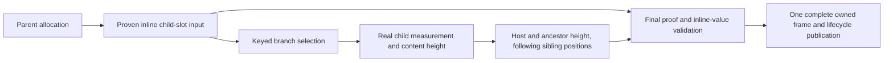

# Inline construction with content-derived block size

Updated 2026-11-16 on `codex/rendering-performance-research`. This extends
[atomic keyed builders](RETAINED_CONSTRAINT_BUILDERS.md). The full RFC remains
active; this is an additional dependency-checked layout contract, not full
Flutter LayoutBuilder/RenderBox or a performance qualification.

## API and layout behavior

`LogicalEdit::inline_constraint_builder(host, build)` runs within
`LogicalUi::edit_frame` or the later
[`edit_local_frame`](RETAINED_ATOMIC_LOCAL_EDITS.md). Its public `InlineConstraintBuilderInput` exposes only
the child slot's horizontal `min`, `max`, `available` and `percentage_basis`.
It exposes no height or block-axis available space. Branch construction can
therefore change the child's height, the host's auto height, ancestor Column
height and following sibling positions without invalidating a height dependency
that was never read. `constraint_builder` retains its full two-axis input and
continues to require Size containment.

```rust,ignore
let page = LayoutStyle::column()
    .size(LayoutDimension::Percent(1.0), LayoutDimension::Auto);
let host_style = LayoutStyle::constraint_box(ConstraintFit::Tight, ConstraintFit::Loose)
    .container_type(LayoutContainerType::InlineSize)
    .padding(LayoutEdges::all(LayoutLength::Px(5.0)));
// page -> host -> selected branch; following siblings remain normal Flex items.
let (commit, frame) = ui.edit_frame(constraints, viewport, |_| Ok(()), |(), edit| {
    edit.inline_constraint_builder(host, |input, edit| {
        let branch = edit.reconcile_keys(component, &[u64::from(input.max >= 600.0)])?[0];
        let output = edit.renders(branch)?;
        if let Some(node) = output.first() { return Ok(*node); }
        edit.append_layout(branch, host, LayoutStyle::column(), 0)
    })
})?;
```

The host must be a ConstraintBox. A Size-contained box may use this projection
under its existing contract. An InlineSize-contained box requires the shared
inline dependency proof below. Plain Normal boxes remain unsupported. The
host's child slot still uses the real parent protocol: Tight inline bounds are
an exact assignment; Loose supplies a maximum, and the child may be narrower.
The selected width is a percentage basis; a maximum alone is not a used size.
ContainerQuery continues to read actual content width, not this input record.
Paint clip and viewport are independent.

## Shared dependency proof

Builder planning and responsive container queries now use one internal
`layout_dependencies` proof. Construction checks current draft styles;
responsive registration/evaluation checks current styles, source values and
every registered breakpoint alternative. Ancestor results are memoized within
a proof; there is no persistent proof cache.

The proof supports:

- In-flow Column/ColumnReverse NoWrap links with a numeric/percentage/Stretch
  width, or auto width stretched without horizontal auto margins. The root
  must have a numeric/percentage/Stretch width.
- A parent ConstraintBox with **Tight inline fit** assigns its content width
  to the child. Recursion proves that parent's width is independent of content
  height. This supports nested inline builders and a fluid query host inside
  a box edge. Loose edges do not establish that independence.
- An exact `width == min-width == max-width` finite border-box size with
  numeric horizontal padding/border can terminate the proof under ordinary
  CSS Flex. Grow/shrink cannot alter that locked width, so Row/wrap/aspect
  ancestors above it are allowed. Numeric insets keep the content width
  independent of an unproven ancestor's percentage basis. A hard constraint
  parent can override authored min/max, so this termination is not used there.

Unproven Row/wrap feedback, aspect ratios on a visited node, out-of-flow nodes,
intrinsic width limits, loose parent box edges and unsupported layout modes
reject with `UnsafeConstraintBuilder` (or `UnsafeContainerQuery`). These are
conservative restrictions, not a claim that every rejected scene is cyclic.
An exact fixed node may bypass unsafe ancestors; a fluid node cannot.

Before publication, each observation rechecks **both** its dependency proof
and its observed inline values. Changing a parent from NoWrap to Wrap fails
even if the final numeric width happens to match. Later inline input changes
reject the entire frame plan; block-size changes alone are allowed. No
fixed-point iteration or callback inside intrinsic layout is introduced.



## ADR: expose the dependency actually consumed

**Status:** implemented for the stated proof domain.

**Context:** requiring full Size containment prevents common content-height
documents. Exposing full constraints while ignoring changing height on final
validation would permit structure to depend on an unvalidated value. Running
callbacks during repeated intrinsic probes would entangle keyed lifecycle and
layout measurement.

**Decision:** expose a separate inline-only value type and track inline
observations explicitly. Keep full-input observations strict. Reuse and extend
the existing inline query proof, with final revalidation against the candidate.
This permits useful content-height layout while keeping its dependency direction
explicit and testable. The public type does not assume a rendering backend.

**Alternatives:** forcing every host to a fixed height loses document layout;
returning full inputs but comparing only width gives a false atomicity contract;
retrying arbitrary structural feedback until stable has no deterministic bound.
General custom parent policies still need their own protocol rather than relaxing
these checks silently.

**Costs:** no new Taffy or GPU data format, no Style/Display size increase and
no new per-layout-node records. Planning still makes the full candidate and
per-builder preview copies described by the previous stage, plus style clones
and ancestor proof work. Previews are now explicitly dropped before callbacks,
so nested builders do not retain one complete preview per nesting level. There
is no timing or lower-memory measurement claim. Final FramePacket layout counters
still exclude builder preview work. Automatic scheduling/indexing remains open.

## Evidence and limits

[Evidence](performance/2026-11-16-inline-constraint-builders/README.md) covers
conditional narrow/wide content heights, nested wrapping Flex, following sibling
positions and hit testing, cleanup/old-frame behavior, loose assignments, fixed
width under Row/wrap/aspect, unsafe percentage inset/hard-parent feedback,
source/branch/effect rollback and final proof invalidation. CPU pixels match
independently constructed forced-full trees.

A real bundled Noto paragraph is shaped, rasterized, wrapped and painted at
50/90/140/50 widths. Host/root auto height and footer position follow its real
line count. Complete CPU glyph pixels match a fresh full tree; old frames retain
their pixels after UI/font-owner destruction. An explicit NVIDIA/Vulkan test
compares every GPU pixel against a fresh full reference through repeated branch
retirement and resize, with explicit red content and green footer checks.

Subsequent stages add [pure custom parent measurement/placement](RETAINED_CUSTOM_PARENT_LAYOUT.md)
and [atomic local edit output](RETAINED_ATOMIC_LOCAL_EDITS.md).
[Explicit responsive stages](RETAINED_STRUCTURAL_RESPONSIVE.md) combine existing
ContainerQuery rules and keyed inline builders in that atomic edit. Still open:
general content-sized/full-axis builders, automatic dependency scheduling,
complete RenderBox, incremental planning, broad Flex/
percentage/cyclic/baseline and device-rounding conformance. The actual GPU test
uses GTX 1650 Ti; newer desktop GPU/effect workloads, sustained 60/120Hz, visible
presentation, input-to-visible tails and CPU smoothness remain unqualified.

[Scope-owned responsive declarations](RETAINED_SCOPED_RESPONSIVE_RULES.md) add
draft registration/update/removal and rule retirement with keyed scopes.

[Independent custom-parent width phases](RETAINED_PARENT_INLINE_ALLOCATION.md)
now allow this proof to cross enforced width-only allocation edges. The parent's
own inline independence is still proven; atomic input observations additionally
retain custom snapshot and layout-ordered child identities. Arbitrary custom
parents remain unproven, and this is not a full-axis/general builder scheduler.
