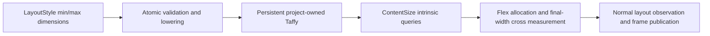

# Intrinsic minimum and maximum layout sizes

Updated 2026-11-16 on `codex/rendering-performance-research`. This extends
[preferred intrinsic sizing](RETAINED_FLEX_SIZING_QUERIES.md) and
[size containment](RETAINED_SIZE_CONTAINMENT.md). The full RFC remains open.

Same-day follow-up: [normal unbounded layout](RETAINED_UNBOUNDED_LAYOUT.md)
now implements Unbounded and independent finite paint viewports. Validation
numbers and the open list below describe this earlier intrinsic-limit stage;
the authoritative current status is in the linked progress table.

## Public contract and migration

`LayoutStyle.min_size` and `max_size` now use `LayoutSize<LayoutDimension>`,
matching preferred sizes. Both axes accept `Px`, `Percent`, `Auto`,
`MinContent`, `MaxContent`, `FitContent`, `FitContentPx`,
`FitContentPercent` and `Stretch`. `Content` remains flex-basis-only and is
rejected in every preferred/minimum/maximum size field. Functions and numeric
values must be finite and nonnegative. Validation runs before transaction
publication, including values overwritten by later writes in the same batch.

```rust
use gpui_box::retained::{LayoutDimension as D, LayoutStyle};

let style = LayoutStyle::row()
    .size(D::Px(100.0), D::Auto)
    .min_size(D::MinContent, D::Auto)
    .max_size(D::FitContentPx(240.0), D::Auto);
```

The builders accept `impl Into<LayoutDimension>` per argument. Existing
`.min_size(LayoutLength::Px(10.0), LayoutLength::Auto)` calls continue to work.
Direct field assignment and struct literals are a source migration: replace
`LayoutLength` with `LayoutDimension`, or convert the individual value using
`.into()`. This is also a fork API change to Taffy's `Style` and `CoreStyle`
min/max fields/methods; it is not upstream Taffy 0.15 API compatibility.
`Auto` in maximum size continues to mean no authored cap in this API.

## Algorithm and ownership decision

Status: implemented in the research branch. The project-owned Taffy fork
remains the persistent algorithm kernel. The framework owns the public types,
validation, transactions, query proofs and published results.

The alternative of precomputing pixel constraints in the adapter was rejected:
it would be stale after Flex allocation, paragraph wrapping, parent changes or
owned resource measurement, and would duplicate the layout truth. Replacing
Taffy wholesale would add a much larger Flex correctness burden without
evidence that a new algorithm is needed for this contract.



`compute/common/intrinsic_limits.rs` shares keyword resolution among root,
Flex, legacy Grid/Block and out-of-flow layout. Content queries clear the
queried axis's known size and ignore that node's own preferred/min/max styles;
descendant constraints still participate. This prevents self-recursion and
applying the maximum before finding the minimum. Numeric-only limits do not
add content measure calls. Returned intrinsic sizes are border-box values,
so callers do not add ContentBox padding twice. Minimum wins when it exceeds
maximum. Ratio-transferred limits preserve separately authored numeric limits.

Flex resolves main-axis limits before shrink/grow. After main allocation it
resolves intrinsic cross limits against the final main size: a paragraph's
minimum height uses the actual wrap width rather than its earlier preferred
width. The same ordinary layout publication updates geometry, baseline and
draw positions. Hidden restore, child style changes and isolated measure-only
queries use existing dirty/cache and snapshot ownership rules.

Leaf intrinsic probing requires the measure callback to run more than once.
The low-level `compute_leaf_layout` callback is now `FnMut` instead of `FnOnce`.
GPUI's mutable context and the vendored measurement example reborrow per call.
Implementations must measure the supplied constraints consistently rather than
consume one-shot state. The public owned `MeasureSnapshot` contract does not
gain arbitrary UI callbacks.

Content-derived auto height remains indefinite for descendant percentages,
including equal intrinsic min/max. This is distinct from selecting a used
height for wrapping. A fixed authored height can still establish a percentage
basis. The browser limitations below qualify that latter combination.

The InlineSize column-chain query proof now rejects intrinsic width min/max
on ancestors. Those constraints can feed descendant content back into the
host's width. Existing fixed-inline and Size-boundary contracts remain; this
change does not extend responsive support to an unproven feedback graph.

## Validation and limits

Final Windows / Rust 1.98.1 results: retained **198 passed**; combined
retained-text/retained-wgpu **231 passed**; standalone Taffy default **181
passed** and project feature set **175 passed**; combined-feature library
Clippy with `-D warnings` passed. Hello **12 passed, 1 hardware test ignored**;
vendored examples, Flex-only and all-feature library checks passed. Main test
commands used offline dependencies. The optional all-feature check first needed
an online dependency fetch (`cssparser` was absent from the local cache).
Retained-only still reports the existing unused transport fields, and native
dependency builds can print Windows linker informational warnings.

Tests cover root/nested Row/Column, shrink/cross stretch, min-over-max,
preferred keywords, ratio transfer and explicit opposite-axis limits,
padding/box-sizing/containment, fixed/function/percent/Stretch limits, measured
leaves and baseline, hidden restoration and changed content, normal full versus
selective geometry publication, retained old frames, idle layout reuse,
measure-only isolation and transaction rejection. Vendor tests additionally
exercise actual Grid/Block hosts and their item algorithms, numeric caps during
intrinsic probes and out-of-flow content. These are focused regressions, not
complete Grid/Block conformance.

A platform-backed hello test shapes the bundled Noto paragraph and compares
its intrinsic minimum height at final Flex widths 50/90/140 with the actual
paragraph layout at those widths. This text test is native-only; the browser
fixture uses fixed div children, not the same font/content.

The [evidence directory](performance/2026-11-16-intrinsic-limits/README.md)
contains commands and an independent Chromium 145.0.7632.6 reference:
**47/47** geometry assertions pass. It also records **two explicit browser
differences**, excluded from the pass count, for authored height 5px combined
with intrinsic height limits and a 50%-height descendant. Framework content
queries ignore the queried node's preferred height; Chromium's intrinsic
percentage handling differs. The framework currently yields host/child heights
30/15, while Chromium yields 5/2.5 (minimum only) and 2.5/2.5 (equal min/max).
Complete CSS percentage/intrinsic dependency semantics are **not** implemented.
The browser does not support `max-width:fit-content(50px)`; numeric and percent
functions have native regressions only.

Intrinsic queries cost layout/measurement work. Mode changes can evict Taffy
cache entries, and the shared resolver can run at parent and child stages.
No O(1) claim or measured performance improvement follows from this API work.
No GPU pixels, visible presentation, sustained 60/120Hz, full-chain tail latency
or CPU rendering smoothness qualification was added here.

Open: broad Flex/intrinsic/baseline consistency, cyclic and percentage sizing,
Grid/Block cross-axis final-width coverage, last-baseline/vertical writing,
device rounding, public Grid/calc, Unbounded, contain-intrinsic-size fallback,
general Row/wrap/aspect query proofs, constraint builders/structural adaptation,
public local responsive output and atomic multi-stage failure recovery. The
remaining rendering/presentation/effects/performance RFC acceptance also stays
open in the [authoritative progress table](RETAINED_IMPLEMENTATION_PROGRESS.md).
