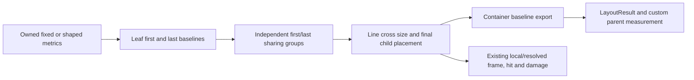

# First and last horizontal baseline sets

Status: experimental framework contract, 2026-11-17. Extends the public Flex
alignment stage and the existing pure measurement/parent-layout protocol. The
full RFC and broad Flex conformance are still open.

## Public contract

```rust,ignore
LayoutStyle::row().align_items(LayoutAlignItems::LastBaseline);
LayoutStyle::row().align_self(LayoutAlignSelf::LastBaseline);
MeasureSnapshot::FixedBaselines(BaselineMeasureSnapshot {
    width: 30.0,
    height: 24.0,
    first_baseline: Some(6.0),
    last_baseline: Some(18.0),
});
```

`Baseline` remains first-baseline alignment; `LastBaseline` is a separate
baseline-sharing group, not a Safe/Unsafe position. Overflow modifiers on either
baseline keyword reject at LayoutStyle validation, including atomic source and
style transactions. Auto cross-axis margins remove an item from both sharing
groups. Horizontal row/row-reverse containers use actual baseline metrics;
columns align along the horizontal inline axis, perpendicular to the horizontal
baseline-sharing alignment direction, and use the corresponding start/end fallback. Vertical
writing/baselines are not implemented by this stage.

`LayoutResult::baseline` remains the first horizontal baseline, with a new
`last_baseline` field. Both offsets are from the queried border-box top, in
logical coordinates before presentation projection. A container's exported set
can represent a shared alignment baseline, not necessarily the first/last line
of a single descendant. Hidden subtrees and layout containment suppress both;
a leaf with no metrics exposes None. Flex synthesizes missing descendant metrics
from the border-box bottom when a baseline is needed. Scroll containers clamp
the baseline used by alignment to their border box.

`BaselineMeasureSnapshot` supplies two independent optional content-box offsets.
Each present value must be finite, nonnegative and within intrinsic content
height. The existing `CustomMeasureSnapshot { baseline, .. }` keeps its struct
literal syntax and denotes a single line: its one metric is now supplied for
both first and last sets. Images continue to supply neither. Padding and border
are added once by the leaf adapter. Baselines outside the final used box due to
hard sizing or overflowing content remain meaningful and are not clamped except
where scroll-container alignment requires it.

Real `ParagraphLayout` now includes `last_baseline`: actual wrapped height minus
one line-height plus the final hard line's font baseline. Wrapping is queried at
the same final content width used by glyph extraction, not the first shaping
width or original intrinsic height. Existing hard-newline/uniform-font/LTR text
restrictions and the four-width owned memo cache remain. This does not add rich
text, bidi, text selection, vertical writing or baseline snapping. The existing
scrollbar/content-box measurement-versus-paint contract has not been redesigned.

Custom `ParentLayoutChildren::measure` returns both border-box offsets through
`ChildLayoutResult`. `ParentLayoutOutput` accepts both content-box offsets; the
adapter forwards them and the owned kernel validates and adds host inset once.
An author must explicitly return the intended last set; None does not silently
copy the first set. ConstraintBox already transports both, and Block now forwards
its last eligible in-flow child's last baseline plus placement/group alignment.
The legacy raw Grid algorithm does not implement last-baseline sharing or export;
its keyword handling falls back to End. Public LayoutStyle still exposes Flex
and ConstraintBox only. Do not infer Grid conformance from this change.

**Source migration:** LayoutResult, ChildLayoutResult, ParentLayoutOutput and
ParagraphLayout gain a public field. ParentLayoutOutput struct literals must
add `last_baseline` (None preserves their former first-only contract). Existing
CustomMeasureSnapshot struct literals remain compatible. The new MeasureSnapshot
and alignment variants require exhaustive match updates. None of these types is
a stable cross-language/binary ABI.

## Owned-kernel behavior



Each sharing group computes its own greatest ascent plus greatest descent.
The line is large enough for each group and nonparticipants; a single participant
still needs its metric to anchor the group to the appropriate edge. First groups
anchor at cross-start, last groups at cross-end, with wrap-reverse exchanging
physical edges. Negative margins and overflowing metrics must not be accidentally
floored to zero in the group maxima.

Final child placement keeps separate first and last values in container
coordinates. Container export selects visual startmost/endmost lines, a sharing
group anchored toward the respective edge (falling back to the other group), or
the corresponding endpoint item when no group participates. Direction, reverse
and wrap-reverse determine selection. Sharing metrics are distinct from the
child's own first/last intrinsic baselines.

Independent browser probes exposed an existing general cross-axis auto-margin
bug: under negative remaining space, auto top/both margins could become negative
and move content past logical start. The kernel now keeps overflow on logical
end; zeroes an auto logical-start margin and adjusts its opposite used margin.
This implements the normal Flex rule, without scene or browser conditions.
Expanded RTL column probes also exposed an existing baseline fallback bug hidden
when every item fills its line: inline direction must reverse the fallback even
in wrapping columns. The fallback now follows the same direction rule for wrapped
and unwrapped columns.

## Publication, validation and lifetime

Both sets already fit Taffy's LayoutOutput/Layout/cache representation. Framework
LayoutResult now reads them; normal unrounded-layout comparisons observe
last-only changes and propagate through cached ancestors. A baseline-only metric
change with unchanged geometry preserves paint pages/commands. When alignment
changes origins, existing local/resolved output, hit testing and damage publish
those changes. No alternate geometry is introduced.

Typed measure sources use ordinary equality/coalescing and atomic layout/frame
publication. Invalid fixed metrics and custom parent outputs preserve previous
published sources/results/stats/frame. Owned frames retain their glyph/primitive
resources after UI, shaping and raster owners drop. No new frame queue or renderer
resource record is needed.

## ADR: carry both sets through the normal layout protocol

Decision: add LastBaseline as an item/self alignment keyword; carry two optional
metrics in result/parent protocols, while preserving the original single-metric
leaf constructor. Use the owned kernel's existing Baselines pair instead of a
paint translation workaround.

Alternatives: using the bottom edge or first baseline as last baseline breaks
multiline text and nested containers. Post-layout translation fails to size lines
and makes parent baseline queries disagree with paint/hit. Replacing all existing
single-metric struct literals would add avoidable migration; the new explicit
measurement variant allows both contracts.

Costs: public result/parent structs gain another optional float and MeasureSnapshot
may have a larger maximum variant. Actual layout depends on compiler/target.
Each transient FlexItem gains one f32; group scans are bounded linear passes over
line children. Baseline participants, including singleton groups, need real
layout metrics; paragraphs also perform a final-width memo lookup, potentially
wrapping on a miss, on the existing four-entry cache. There is no new alignment
heap collection, persistent tree field or GPU instance/FramePacket format. Existing
candidate/preview/source rollback costs remain. No timing, memory reduction,
continuous-frame or tail-latency improvement is claimed.

## Evidence and remaining work

See [reproducible validation](performance/2026-11-17-last-baseline/README.md).
The independent 1,440-case Chromium marker matrix covers first/last/mixed/single groups,
auto top/bottom/both/left/right/horizontal margins, all four directions, RTL/LTR, all three wrap modes,
auto/positive/overflow height, and decorated/negative-margin boxes. A separate
outer Flex probe measures both exported container baseline sets. Fixed synthetic
metrics are read from browser markers, not the kernel under test. Real bundled
Noto paragraphs separately check actual wrapping/glyph pixels and owner lifetimes.

Still open: align-content baseline distribution; vertical writing and orthogonal
baseline synthesis, broad scroll/OOF/Grid/Block/rich-text baseline semantics;
broader Flex intrinsic/percentage/cyclic/device-precision conformance; full
RenderBox, mixed ordinary-Flex content-builder dependency proofs, automatic
builder/query/environment scheduling and incremental preview/rollback; general
resource/primitive/effect/native lifecycle and performance/global budgets. Modern
desktop GPU effects, CPU continuous complete-frame delivery, sustained 60/120Hz
and display-visible input tails retain their separate acceptance gates.

References: [Flex baselines](https://www.w3.org/TR/css-flexbox-1/#flex-baselines),
[baseline self-alignment](https://www.w3.org/TR/css-align-3/#baseline-align-self),
[baseline sharing groups](https://www.w3.org/TR/css-align-3/#baseline-sharing-group),
[cross auto margins](https://www.w3.org/TR/css-flexbox-1/#algo-cross-margins).
