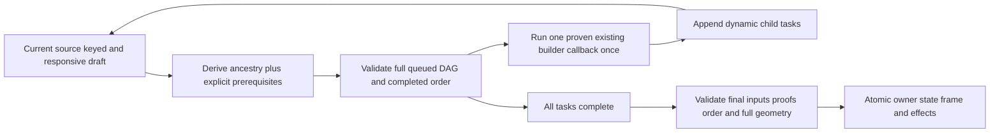

# Once-only layout construction plans

Status: experimental Rust framework contract, 2026-11-18. The complete RFC remains
active. This adds transaction-scoped scheduling to the existing four builder
protocols; it is not a complete persistent component scheduler or general layout
feedback solver. Common nested Flex content is the first acceptance target.

Follow-up: [source-driven Content tasks](RETAINED_CONTENT_PRODUCERS.md) adds
Content kind/input without dimensions to the same planner and persistent
producer protocol. It allows ordinary data-driven structure to participate in
automatic natural sizing; the four dimension-reading protocols below keep their
existing proofs. Exhaustive matches on the two Rust enums must handle Content.

Follow-up: [inferred measurement prerequisites](RETAINED_INFERRED_MEASUREMENT_TASKS.md)
adds proven content-dependent sibling subtree edges for full Allocation tasks,
including dynamic descendants, shared edge limits and final executed-order
validation. The ancestry/explicit-only description below is the original stage.

The later [scope-owned producer stage](RETAINED_LAYOUT_PRODUCERS.md) adds a
separate owned reusable callback contract, automatic future transaction/frame
entry and tracked-source content-callback reuse. It targets this same planner;
the ephemeral borrowed plan API below remains explicitly requested and once-only.

## Public API and semantics

`logical::{LayoutBuildPlan, LayoutBuildQueue, LayoutBuildTaskId, LayoutBuildKind,
LayoutBuildInput, LayoutBuildLimits, LayoutBuildStats}` and
`LogicalEdit::build_layout_plan` let a frontend declare construction tasks before
choosing their execution order. A task has a caller-assigned ID, a live draft
render host, one existing builder kind, optional explicit prerequisite IDs and
an owner-local once-only callback. No Taffy/Window/GPU object crosses the public
boundary. Closures can borrow transaction-local frontend data; they are neither
stored globally nor required to be Send or 'static.

Builder kinds map directly to existing constraint_builder, allocation_builder,
inline_constraint_builder and inline_allocation_builder. Full/Inline inputs keep
their existing known/definite/available/bounds/percentage-basis semantics and
dependency proofs. Scheduling does not relax containment or ordinary Flex/Grid
independence requirements. Unsupported content feedback still rejects before a
builder callback, rather than replaying it until dimensions happen to agree.

The planner derives dependencies from **current render ancestry**, regardless
of task registration order or numeric task IDs. Every ancestor-host task precedes
its descendant-host tasks. Unrelated ready tasks use ascending task ID order for
determinism. Explicit `after` declares sibling/source prerequisites that ancestry
cannot infer. Forward references are allowed within the complete queued graph;
unknown IDs, duplicate IDs/hosts and self-dependencies reject. Exactly one task
per host avoids ambiguous competing structural writers; compose work within it.

```rust,ignore
let mut plan = LayoutBuildPlan::new();
plan.add(LayoutBuildTaskId(1), inner, LayoutBuildKind::InlineAllocation, &[],
    |input, edit, queue| { build_inner(input, edit, queue) })?;
plan.add(LayoutBuildTaskId(90), outer, LayoutBuildKind::InlineAllocation, &[],
    |input, edit, queue| { build_outer(input, edit, queue) })?;
// If outer is an ancestor of inner, task90 runs first despite registration/ID.
let stats = edit.build_layout_plan(plan)?;
```

Before each task the planner settles the captured scope-owned responsive rules,
previews the current source/topology draft and validates the **entire queued**
task graph, including cycles. It then invokes exactly one existing builder,
which obtains its proven layout input, records the normal final observation and
runs its callback once. No construction code runs during graph sorting or Taffy
intrinsic measure calls. All queued tasks must finish before the plan returns.

Callbacks receive an append-only `LayoutBuildQueue`. A parent may create a keyed
child host and enqueue its task in the same transaction; the next graph sees its
actual ancestry and new policies. Pending/completed tasks cannot be removed or
replaced by taking the executing plan. Task IDs remain reserved after completion.
New ancestors/prerequisites cannot retroactively precede completed callbacks.
Changing ancestry so a completed later task becomes an earlier task's ancestor
also rejects. Reentrant build_layout_plan calls reject; enqueue children instead.

## Atomicity and lifecycle

Use inside edit_frame/edit_local_frame or an edit with a captured frame session.
The plan does not create another publication boundary. Existing reactive sources,
keyed scopes/state, bindings, effects, resource ownership, final layout and frame
install together. Effects/cleanup run only after normal successful owner adoption.
Failed reservations retain existing generation-consumption rules.

Any plan scheduling/execution error poisons the outer LogicalEdit. Catching the
error and returning Ok cannot publish earlier successful tasks. A failed add
marks that plan invalid even if a callback catches its Result. User side effects
outside draft APIs, panic and shared memo warming remain outside rollback, just
as for existing builders; callbacks must respect the same side-effect contract.

After execution only callback-free host ranks/prerequisites remain for final
validation. Final source/keyed ordering and layout must preserve both actual
builder inputs/proofs and the executed ancestor/prerequisite order. A later
equal-width reparent cannot silently reverse the construction dependency.
Discarded/removed task hosts reject rather than erasing their observations.

`LayoutBuildStats` reports tasks_executed, planning_previews, peak_pending and
peak_dependency_edges for this plan. Previews are graph-preparation copies;
the count excludes builder measurement previews, repeated responsive passes and
final layout/extraction. It is not a total layout-work or allocation counter.
Default limits are 1,024 tasks and 16,384 deduplicated explicit+ancestry edges per
current graph, including completed tasks. They are structural bounds, not hard
time/byte deadlines. InvalidLayoutBuildPlan, CyclicLayoutBuildPlan and
LayoutBuildPlanLimit are explicit errors. Source schema3 is unchanged.



## ADR and costs

Decision: make once-only construction order explicit data, infer ancestor edges
from current draft topology and retain normal builder proof/publication machinery.
Use append-only dynamic tasks for newly created descendants. This provides an
API boundary that future macros/planners can target without replaying FnOnce.

Alternatives: forcing callers to manually sort every nested builder is brittle
for generated/dynamic content. Retrying callbacks to a numeric fixed point changes
lifecycle/side-effect semantics and can diverge. Executing builders inside layout
measurement can run them repeatedly during intrinsic probes. Guessing arbitrary
closure read/write dependencies is unsound; sibling prerequisites stay explicit
and final normal observations remain authoritative. Automatic rerun subscriptions
require a separate owned reusable-producer/source contract, not this ephemeral
callback list.

Costs: one boxed callback per task, BTreeMap/BTreeSet storage and graph sorting,
current-source preview per iteration plus each builder's own private measurement
preview. The current planner re-derives the graph and performs a complete
deterministic topological check after every task, even if only paint changed.
Worst-case repeated graph scanning and whole-tree preview copies are substantial;
this is capability work with no timing/memory/FPS improvement claim. Final
observations retain host IDs/ranks/explicit edges for the transaction. Limits do
not bound arbitrary callback CPU work. No new persistent UiTree/Taffy/GPU/frame
record, extra renderer layer or scene-specific split-layout algorithm is added.

## Evidence and open scope

See [tests and reproduction](performance/2026-11-18-layout-build-plan/README.md).
Nested Flex geometry and all CPU/GPU pixels compare with ordinary forced-full
trees. Actual Noto wrapping/baselines and owner-retired packets use that same
layout protocol. Equal-key repeated edits retain existing state/handles; ordinary
unchanged frames retain their existing P0/layout caches. Re-executing an inline
allocation task still opts into final input tracking and runs checked layout.
The [output-identity follow-up](performance/2026-11-18-local-revalidation/README.md)
retains the exact local snapshot after that work when the source revision,
pixel-snap policy and certified paint/property storage remain unchanged. The
equal-width GPU fixture can then skip its duplicate submit. This does not skip
requested callbacks, previews, layout or final dependency/geometry validation.

This schedules one requested transaction, not future signal/environment events.
Cross-task reactive/source-write dependency discovery, persistent registration/
invalidation, read/write indexing, skipped unchanged callbacks, separate output
domains, generalized intrinsic/full-axis feedback, automatic component lifecycle
and full RenderBox remain open. Wider Flex/Grid conformance, native independent
presentation, common-interaction p99, modern desktop effects, CPU continuous
complete frames and sustained 60/120 Hz retain their separate acceptance gates.
