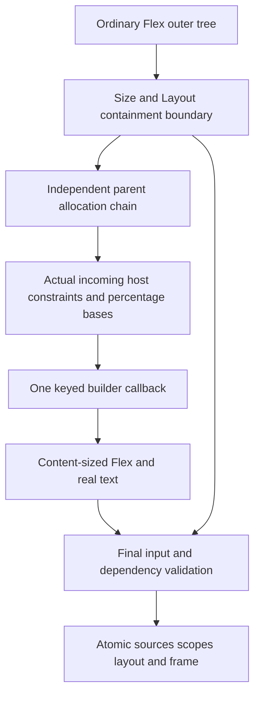

# Mixed Flex and independent allocation builders

Status: experimental public framework contract, 2026-11-17. Extends
[independent parent intervals](RETAINED_PARENT_ALLOCATION_BUILDERS.md), without
declaring complete RenderBox or general Flex/content construction achieved.

`allocation_builder` no longer requires every ancestor to be a custom parent.
A full Size+Layout containment boundary can isolate content construction from
ordinary Flex outside it, while independent parent algorithms inside the
boundary pass loose/tight inputs to content-sized hosts. Size-contained
ConstraintBox parents can likewise supply their real outgoing child slot.
All geometry still comes from the owned Taffy algorithms.

## Inputs: known size is distinct from constraints

`ConstraintBuilderInput` now preserves:

```rust,ignore
pub known_size: LayoutSize<Option<f32>>,
pub known_size_is_definite: LayoutSize<bool>,
pub constraints: LayoutConstraints,
pub percentage_basis: LayoutSize<Option<f32>>,
```

The first pair is the parent-selected border-box dimensions and their
percentage definiteness, taken from the real final LayoutInput. A Flex parent
can supply known used size while hard SizeBounds remain unbounded. A known
block size derived from content may remain indefinite for percentage children.
Neither a finite soft available space nor a loose maximum is the child's used
size. For example, a loose width140 slot can contain intrinsic width120 output.

Both allocation_builder and full constraint_builder return these fields.
InlineConstraintBuilderInput retains its separate inline-only contract.
Existing code reading the other fields is unchanged; external complete struct
literals/exhaustive patterns for ConstraintBuilderInput must add the fields.
This remains an experimental source API, not a stable cross-language ABI.

## Structural proof and actual layout



The proof walks from host toward root:

1. A `ParentAllocationLayout` edge enforces the same input before every
   measurement and final placement, preserving the existing independence chain.
2. An ordinary Size+Layout-contained ConstraintBox edge passes its recorded
   outgoing slot. This can be loose in either axis; the child's actual size
   can come from constructed content. The parent derives its own size from
   empty content and external inputs.
3. At a full Size+Layout-contained node below an ordinary Flex parent, both
   intrinsic size contributions, baseline and propagated scrollable overflow
   stop depending on constructed descendants. This is an isolation cut.
   Higher ancestors may be ordinary Flex/ConstraintBox nodes, including
   reverse/wrap/aspect/intrinsic sizing. Their layout still runs normally.
4. A contained external root can itself consume its real incoming root input.
   Below an isolation cut, preferred/min/max intrinsic resolution rejects as
   before; it can run before an independent assignment and observe descendants.
5. InlineSize alone does not establish two-axis independence. An arbitrary
   measured parent below a cut is rejected. Above a cut this first implementation
   also rejects custom parent callbacks, whose unrestricted explicit placement
   inputs are not proven independent by ordinary CSS containment. Out-of-flow,
   hidden, Grid and Block ancestry remain outside this builder proof.

The builder can change its host's descendants. It cannot change ancestor
styles, algorithm snapshots, ancestry or layout-ordered child lists after
observing them. Records include the complete chain above the cut, so removing
containment or substituting an equal-number algorithm still rejects rather
than depending on an accidental numeric match. Final publication checks the
complete recorded known/definite/space/bounds/base input as well as the proof.
Callbacks execute once, never inside Taffy intrinsic probes and never replayed
to convergence. Automatic responsive sessions use the existing pre-builder
checkpoint and final observation contract.

Full Size containment is an explicit author choice, not inserted by this API.
It prevents content-sized outer boundary behavior: a contained auto-size box
may legitimately remain zero even when its children have visible overflow.
The host *inside* the boundary may derive either actual dimension from content.
Applications needing a content-sized ordinary Flex boundary without a cut
still require additional dependency contracts; this stage does not fake one.

## Kernel records, cache and lifecycle

The project-owned TaffyTree stores incoming PerformLayout inputs only for full
size-contained nodes. Writes happen after the unified layout entry, including
its own cache hits. Intrinsic/ComputeSize probes cannot overwrite a final
observation; cached ancestors preserve it. Hidden layout clears it recursively;
containment removal, node removal/generation reuse and tree clear retire it.
Private clones preserve their own records. As with prior layout outputs, dirty
trees may expose older observations; framework builders always layout previews.
Raw Taffy errors may follow internal writes, whereas framework candidates reject
without publishing partial state.

Ordinary CSS final cache keys can hide soft available space behind known size,
and subtree cache hits can skip these observable inputs. Invocation-wide exact
measurement/final guards therefore also activate for trees containing full
size-contained boundaries, using the existing sparse complete-input caches.
An index exists before first layout and follows style/create/remove/clear,
including hidden boundaries. This prevents cached ancestors from erasing a
change to a builder-observable input. It is deliberately conservative.

## ADR: containment as a dependency cut

**Status:** implemented.

**Context:** the prior allocator-only ancestry proof prevented ordinary Flex
application shells from hosting independently constructed content. Exposing
final width/height alone would lose known-size definiteness and accept feedback.

**Decision:** reuse enforced parent intervals and actual incoming layout records;
admit ordinary ancestry only across explicit full size/layout containment.
Preserve every input category rather than converting known dimensions to hard
bounds or turning finite maxima into percentage bases. Retain complete final
proof/input validation in the existing atomic publication boundary.

**Alternatives:** duplicating Flex allocation in the builder layer creates a
second geometry truth. An unchecked independence flag or numeric before/after
equality cannot prove freedom from content feedback. Always adding containment
silently changes auto-size behavior. Automatic repeated user callbacks would
change their lifecycle and side-effect contract. A more general phase/dependency
scheduler remains follow-up work.

**Costs:** two added public input fields enlarge builder observations. Two sparse
Taffy maps hold full contained inputs and node membership; creation/style/removal
maintain them. PerformLayout checks and records containment inputs. Trees with
full containment now use the existing complete-input cache mode, retaining more
metadata and possibly doing more layout than ordinary lossy CSS cache keys.
Private candidates clone these maps; proof capture clones styles/algorithm
handles and ordered ancestor child lists. No GPU record, FramePacket format,
per-node NodeData payload or alternate Flex algorithm is added. No timing,
allocation reduction or smoothness improvement is claimed.

## Evidence and remaining scope

See [validation](performance/2026-11-17-mixed-allocation-builders/README.md).
CPU pixels use fresh ordinary full-layout trees without custom parent callbacks;
actual text wrapping and explicit GPU readback validate rendered output. Cache,
hidden/restoration, intrinsic probes, clone/remove/reuse/clear and exact input
guards are checked in the owned kernel.

Still open: ordinary content-dependent Flex edges without an isolation cut,
child-style custom allocation dependencies, general cross-builder/query schedule,
complete RenderBox, Grid/Block/OOF builder proofs, incremental proof/planning/
rollback, global budgets, broad Flex/intrinsic/percentage/cyclic/baseline/writing-
mode/precision coverage and general primitive/resource/effect/native lifecycle.
Modern desktop GPU effects, CPU smooth complete-frame delivery, sustained60/120Hz
and display-visible input tails retain separate unmet acceptance gates.
