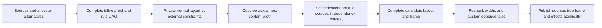

# Content-width queries on ordinary uncontained layout hosts

Status: experimental framework capability implemented, 2026-11-17. The complete
RFC goal remains active. Extends [ordinary inline builders](RETAINED_INLINE_ALLOCATION_BUILDERS.md),
[responsive stages](RETAINED_STRUCTURAL_RESPONSIVE.md) and
[automatic sessions](RETAINED_AUTOMATIC_RESPONSIVE.md).
No frame-time, memory-saving or sustained-frame improvement is claimed.

Follow-up: [content-independent Row allocation](RETAINED_ROW_INLINE_ALLOCATION.md)
extends the shared chain through proven Row/RowReverse/wrap inputs and adds
ordered sibling/effective-style observations plus sibling-producer DAG edges.
The original Column-only restrictions below do not describe those newly proved
cases. General content-dependent/ratio/intrinsic Row feedback remains open.

## Public behavior

Existing `LayoutQuery::ContainerInline(host)`, standalone
`LayoutResponsiveBindings::bind_container` and scope-owned `responsive_rule`
now accept ordinary, uncontained content-sized hosts when a complete independent
inline chain can be proven. Applications no longer need an artificial fixed
width or InlineSize/Size containment boundary for this class of responsive
Column layouts. There is no new public enum, callback, trait method or struct
field in this stage.

The query reads the host's **actual used content width**, after border, padding
and explicit scrollbar allocation. It remains distinct from an incoming
border-box assignment, a parent's maximum width and the environment/paint
viewport. Descendant selection can change content height, ancestor height and
following sibling placement. Layout still uses the normal shared kernel.

```rust,ignore
let host = ui.append_render_layout(scope, root, LayoutStyle::column(), 0)?;
let target = ui.append_render_layout(scope, host, base.clone(), 0)?;
let source = ui.state(scope, 0, || base.clone())?;
let styles = LayoutBreakpointStyles::new(base, vec![(600.0, wide)])?;
bindings.bind_container(&mut ui, source, target, host, styles)?;
```

The target must still be a strict render descendant and the rule must own its
exact source/style writer. Computed sources cannot also be responsive producers.
Computed layout sinks, ancestor dependencies, sibling custom-slot order and
all authored/current alternatives remain part of validation. Existing fixed
content-width and explicit containment query contracts retain their behavior.
The legacy raw `ResponsiveBindings` subset is not expanded.

## Prove inline independence before selecting descendants

The new path reuses the complete incoming-inline proof from ordinary builders:
Column/ColumnReverse NoWrap ancestors, stretched or authored inline sizes,
Tight-width ConstraintBox edges and enforced independent ParentInlineLayout
phases. The proof must reach the external root and consider every reachable
authored ancestor alternative. Ordinary Row/wrap/aspect feedback, out-of-flow
chains, intrinsic width limits, nonstretched auto shrink-wrap and unproved custom
parents remain rejected. This is conservative support, not a claim that all
other layouts are inherently impossible.

An ordinary host also needs a **live external inline anchor**: numeric root
width, finite normal inline opportunity or hard-tight root width. A previous
shrink-wrapped result cannot supply this proof. Percentage/stretch roots under
Unbounded/MinContent/MaxContent without that anchor fail before rule selection.
The same root-anchor helper now serves ordinary builders and queries; its
semantics do not depend on the paint viewport or host environment.

The dependency graph distinguishes descendant content from host/ancestor input.
Changing an ordinary host's descendant styles cannot change its independently
assigned width, but a rule that writes the host/ancestor remains a producer for
that query. Nested consumers run after those producers even if registered
first. A source with a computed sink back into its own host rejects as a cycle,
even if that sink currently happens to return the same width. Custom allocator
snapshot and ordered-child identities are observations, not just numeric outputs.

## Atomic standalone and keyed publication

Scope-owned and explicit keyed edits reuse their existing final rule/proof,
source selection, writer, observed width and custom dependency checks. Automatic
sessions apply the same path before builders and final output; subsequent
ordinary source transactions settle the rules and publish a complete local frame.
There is no replay of user construction callbacks or iterative convergence.

Standalone responsive publication now also records every observed host width
and custom snapshot/order dependencies in its private draft. After producing
the final candidate frame it checks all observations again, **before installing
the candidate or publishing source/effect changes**. Earlier stage values cannot
be silently replaced by a different final width. Equal numeric widths do not
authorize a different custom allocation algorithm. Unchanged queries still use
cached layout, with zero layout work on idle output.

Invalid anchors, unsafe authored alternatives, computed self-feedback or final
observation mismatch preserve live sources, stats, geometry and published output.
Earlier independent transactions, callback external effects, panic and shared
memo warming retain their existing boundaries. Structural scheduling remains
explicit; this does not introduce a general builder/query task solver.



## ADR, costs and limits

Decision: extend the existing query contract through the enforced shared
dependency proof, rather than add an ordinary-container API with subtly different
width semantics. Keep used-content observation separate from incoming allocation.
Do not use containment as a universal substitute for proving dependency direction.

Alternatives: forcing containment changes intrinsic contributions, baseline and
containing-block semantics. Substituting viewport/parent maximum ignores nested
allocation and padding/gutters. Repeatedly resolving until thresholds stabilize
can oscillate and couples frontend lifetimes to layout. Trusting a client flag
does not enforce independence. None was adopted.

Costs: uncontained query validation walks the complete ancestor chain and clones
reachable style alternatives. Standalone drafts now allocate an observation
vector and clone custom snapshot handles/ordered child lists, then perform final
width/dependency checks even for previously supported hosts. Existing full
private tree copies, staged layout, source savepoints and graph scans remain.
No new persistent node/style/GPU/cache/frame field, Taffy algorithm, lease or
fixed-point solver is introduced. No timing, memory or complexity gain follows
from eliminating an application wrapper/containment requirement.

See [evidence and reproduction](performance/2026-11-17-ordinary-container-queries/README.md).
Finite full/local CPU references, real Noto glyphs and explicit GPU submissions
validate the protocol. Browser CSS container queries require their own containment
semantics, so these ordinary framework queries are not presented as new CSS
browser-conformance cases.

General Row/wrap/aspect feedback proofs, automatic cross-builder/query scheduling,
full RenderBox, incremental candidates/rollback/proof indexes and global budgets
remain open, together with broad Flex/Grid/Block intrinsic/percentage/cyclic/
writing-mode conformance. Primitive/effect/native lifecycle and modern desktop
heavy-effects GPU, CPU continuous complete frames, sustained60/120Hz and
display-visible input tails retain separate acceptance gates.
