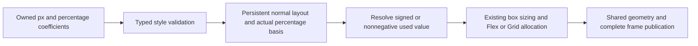

# Owned mixed lengths in the layout contract

Status: experimental linear mixed-length capability implemented, 2026-11-17.
Full RFC goal remains active. No frame-time or sustained-FPS gain is claimed.

## Public values and resolution

`LayoutLength::calc(px, percent)` and `LayoutDimension::calc(px, percent)` store
the two finite coefficients of `px + percent * basis`. Percentages are fractions.
`LayoutDimension::fit_content_calc` adds the mixed fit-content limit. Grid min/max
tracks have matching Calc variants, with `GridTrack::calc` and
`GridTrack::fit_content_calc` helpers. All values are owned and copied with style.

```rust,ignore
let card = LayoutStyle::column()
    .size(LayoutDimension::calc(-12.0, 0.5), LayoutDimension::Auto)
    .padding(LayoutEdges::all(LayoutLength::calc(2.0, 0.01)));
// width = 50% - 12 logical pixels, padding = 1% + 2 logical pixels.
```

Resolution uses each property's existing percentage basis. Padding/margin on
both physical axes use containing inline width; percentage height/gap/basis
still require their supported definite axis. Missing basis leaves the whole
expression unresolved, including a zero percentage coefficient. Callers wanting
an unconditional pixel value use Px. The runtime does not discard percentage
provenance after a particular evaluation or substitute a previous layout width.

Finite negative coefficients are legal. Nonnegative used domains (dimensions,
padding/border/gap, Grid track sizes and fit limits) floor the resolved result
at zero; margin/inset retain signed values. Existing box sizing, padding floors,
intrinsic/minmax/clamp, hard parent bounds and containment apply afterwards.
Overflowing/nonfinite final geometry retains existing fallible publication
checks. This API represents affine arithmetic, not a CSS parser, arbitrary
expression tree, min/max/clamp expression, viewport/font unit or trigonometry.

## Kernel ownership and shared paths

The vendored Taffy `affine` feature adds owned coefficient tags to CompactLength,
the Dimension/Length wrappers, Grid track wrappers and expanded inspection enums.
Shared optional resolution and sizing-keyword helpers evaluate these values.
No pointer resolver, global expression registry, interning, leaked allocation,
per-node expression table or external lifetime is required. Existing external
pointer `calc` remains a separate low-level facility with its prior resolver
contract; framework code does not use it for this API.

Typed style transactions retain P0/source rollback and persistent layout cache
invalidation. Coefficient edits compare by value. Custom parent item-style views
preserve unresolved Calc/FitContentCalc fields; content/paragraph box sizing,
ConstraintBox and Grid use the same kernel arithmetic. Resolved/local frames,
CPU raster and GPU consumption keep their existing common geometry contract.

The complete ordinary-Flex inline allocation proof now accepts mixed Row
bases/minima/maxima under the same definite-chain/live-root-anchor requirement
as percentages. Calc preferred widths compose with Column allocation. Missing
anchors, intrinsic/ratio/content feedback and unsupported custom/box percentage
chains remain rejected; no callback replay or iterative solver is introduced.



## ADR: explicit memory tradeoff

Decision: owned inline coefficients, gated by a Taffy feature and enabled by the
framework. Fixed two-coefficient values match the framework's owned snapshot
model. Opaque raw pointers require ownership machinery across candidate clones,
custom queries and retired frames. Tree-local integer handles would also need
stable import/identity/retirement rules; a global intern table would introduce
unbounded lifetime and shared state. Those alternatives are not free savings.

**Measured64-bit static layout cost:** enabled Taffy length/Dimension8→16bytes,
Grid TrackSizingFunction16→32bytes; Style<String>576→776 and Style<Arc<str>>544→744.
These are `size_of` results checked by vendor tests, not heap/peak/RSS profiling.
Every enabled style pays the additional200bytes, including styles without Calc;
the retained framework stores multiple style/candidate copies. Cargo unifies
features, so GPUI using this same patched Taffy in the workspace also sees the
larger types. No frame/cache/GPU fields are added, but kernel style size and clone
bandwidth are real costs. The feature-disabled standalone kernel retains8-byte
lengths and original style sizes. Feature selection is not an application-level
runtime performance policy. Future compact storage needs an owned lifetime design
and measurements before replacing this representation.

Serde keeps existing scalar-u64 encoding for ordinary values and uses a pair
for owned mixed values; round-trip tests preserve coefficients and domain checks.
Pointer expressions remain unserializable. This is the vendored Rust format,
not a promised cross-language ABI or portable style IR.

## Evidence and open scope

Independent Chromium reference contains336cases across Row/reverse/Column,
Grid/minmax/fit-content/auto-fit and absolute placement, LTR/RTL, two box models,
three widths, negative resolved sizes and two content heights. All match within
0.1logical px without exclusions. Maximum actual deviation is0.08px from nested
percentage rounding; raw case output/metadata are retained. Initial fixture
errors (root containing width and positioned ancestor) and tolerance history
are recorded in [evidence](performance/2026-11-17-owned-calc/README.md).

Normal typed coefficient updates/P0/rollback, unanchored rejection, Row builders
with registered content queries, FitContent preferred/max and ConstraintBox
numeric controls, custom style round-trip, actual Noto wraps/baselines and CPU/GPU
full-reference pixels cover finite integration. Broad cyclic/intrinsic sizing,
general calc functions/units, full RenderBox/automatic scheduling, indexed
candidates/cache budgets, visible presentation/input tails, modern desktop heavy
effects and sustained GPU/CPU smoothness remain open.
