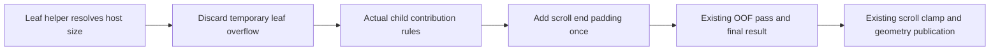

# Actual overflow for owned layout containers

Status: implemented correctness fix, 2026-11-17. Applies to custom ParentLayout
hosts and ConstraintBox in the vendored owned layout kernel. Full RenderBox and
RFC acceptance remain open.

## Problem and decision

Both owned container protocols use the common leaf algorithm to resolve host
box sizing. Its returned scrollable overflow describes measured leaf content.
That desired size is not an additional child or paint source for a container.
Keeping it and unioning the real child bounds created phantom content extent.
In the prior baseline fixture, a custom80px host with2px padding and a50px child
reported right78 while ordinary Flex reported right52, despite equal geometry.

Final container layout now discards that temporary leaf overflow and accumulates
only actual child border boxes and eligible descendant overflow. It reuses the
same shared contribution function as Flex/Block/Grid: logical scroll origin,
RTL, child Visible/Clip/Hidden/Scroll, layout/paint containment, and unreachable
negative-region exclusion for scroll containers. A scroll container adds its
physical inline-end and bottom padding once after child accumulation. Empty or
hidden-only hosts retain only that end-padding contribution, never their assigned
content size. Border and scrollbar gutters do not become additional content.

The host's size selection, child constraints, parent data, pure metric phase,
placement and OOF containing-block area are unchanged. ComputeSize overflow is
still temporary and is not promoted to a public final result. Full final layout
and cached final results expose actual overflow. The shared OOF pass continues
to add eligible real OOF descendants after in-flow accumulation.

ParentMeasure/ParentLayout baselines are now **finite signed content offsets**,
not confined to the host's content height. Overflowing final text or a negative
child placement can legitimately put a baseline outside a fixed container.
Final dry/full agreement remains exact, and adding the host inset must still
produce a finite exported baseline. Fixed leaf intrinsic metrics retain their
separate nonnegative/intrinsic-height validation. No new public fields are needed.

## API and lifecycle consequences

No public API fields, ABI, snapshot/cache format or per-node storage are added.
The parent baseline value domain is broadened as described above. Existing
`LayoutResult::scrollable_overflow` and scroll clamp consume corrected geometry.
When child content shrinks, the existing layout-output observer sees the changed
maximum scroll amount and marks affected descendants for property publication,
including descendants whose own local layout was a cache hit. Authored scroll
offset remains unchanged; the effective offset clamps to the new extent.

Painting clip/scroll properties remain explicitly authored by the host framework;
layout overflow does not automatically create a paint clip. This preserves the
documented separation of layout and visual properties.

**Alternative rejected:** retaining the desired content size as an overflow
minimum invents content not represented by child output. Expanding public
ParentLayoutOutput with a second overflow answer would create a conflicting
geometry truth for this case. Reimplementing overflow propagation independently
would duplicate existing clipping/containment/direction rules.

**Costs:** replaces an existing union seed with zero and adds constant end-padding
arithmetic. No extra traversal/allocation, GPU or CPU raster path. This fixes
scroll geometry, not measured frame time; no timing/p99 improvement is claimed.

## Validation and limits

See [commands and results](performance/2026-11-17-owned-container-overflow/README.md).
384 finite controls compare owned custom/ConstraintBox final child geometry,
overflow and scroll maxima against independently authored ordinary Flex of the
same assigned geometry. ConstraintBox's finite loose cap remains intentional;
the ordinary reference uses that actual fixed child size. Additional explicit
checks cover empty, hidden/restored/removed, wholly unreachable and partly
reachable negative placements, final cache reuse and baseline fixture full
LayoutResult equality.

Normal resolved/local frames, numeric scroll reclamping, hits, all CPU pixels,
real wrapping Noto glyphs, old-owner-drop output and explicit offscreen GPU
submission cover the integration path. These are internal same-kernel controls,
not new independent browser conformance or complete arbitrary custom-parent
equivalence. Custom placement can intentionally differ from Flex.

Full RenderBox/intrinsic protocol, arbitrary style-dependent allocation,
uncontained Flex feedback builders, general scheduler, incremental candidates/
proof/rollback and global budgets, broad CSS/writing-mode/device precision and
primitive/effect/native lifecycle remain open. Modern desktop GPU effects,
smooth CPU continuous complete-frame delivery, sustained60/120Hz and visible
input tails still require their separate acceptance evidence.
