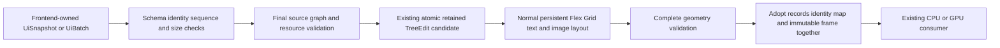

# Owned UI snapshots and atomic batches

Status: experimental Rust input model,2026-11-18. The complete RFC remains active.
This implements a first source-level input boundary from
[the runtime architecture](UI_RUNTIME_ARCHITECTURE.md), distinct from LocalFrame
and FramePacket output. The initial schema1 was experimental Rust data;
[typed style composition](RETAINED_TYPED_STYLE_COMPOSITION.md) advances the
model to schema2; [adopted-frame input routing](RETAINED_UI_INPUT_ROUTING.md) now
advances it to schema3, explicitly rejecting schemas1/2. No revision is a
frozen wire format or foreign ABI. Original stage checks below describe the
input-stage baseline; the linked style stage records current verification.

Schema3 adds UiNode.interaction and UiOperation::Interaction, plus owned
UiPublication.input geometry/policy for pointer/focus routing. Create(UiNode)
becomes Create(Box<UiNode>), Layout.value becomes Box<LayoutStyle>; migrate
constructors accordingly. The input-routing contract specifies host adoption,
delayed handler validation, supported keys/pointer semantics and open scope.

## Public inputs and owner adapter

`retained::ui_ir` supplies `UiSnapshot`, `UiBatch`, `UiNode`, `UiNodeId`,
`UiProperties`, `UiContent`, `UiResourceId`, `UiResources` and `UiDocument`.
Nodes describe framework LayoutStyle, ordered child IDs, common visual properties
and Box/Fixed/Image/Text content. Layout includes the current owned Flex/Grid/
Calc/ConstraintBox subset. Messages contain no Taffy Style, NodeId, Window, GPU
object, raw pointer or custom callback. Message types are Send+Sync and an actual
worker-created snapshot is accepted on another owner thread in tests. UiDocument
itself stays owner-local and does not make the existing kernel transferable.

Schema2 adds ordered immutable StyleRefs and StyleState to each UiNode, explicit
style_environment to UiSnapshot, and Styles/StyleState/StyleEnvironment operations.
UiDocument retains authored source separately from resolved layout/properties;
node()/snapshot() return authored rules, resolved_node() returns effective values.
It resolves with final state/environment, validates topology and effective payloads and
diffs previous effective output before ordinary atomic publication. Snapshot
recovery recomputes styles. Environment defaults to zero logical viewport and
unknown optional capabilities; it is not inferred from host constraints or paint
viewport. The style contract documents supported conditions and overrides.

Resource references use immutable IDs in one host-owned table. Image resources
are decoded RGBA8; text resources are already prepared glyph/paragraph snapshots.
The table is pinned by receiver identity and rejects reusing an ID for another
value/kind. A document cannot silently switch resource-table instances, including
after an ID is no longer referenced by live nodes. New IDs replace resources.
The table currently retains all bindings for its lifetime; it has no byte budget,
eviction/unregister or portable resource-import ABI. Resource handles/bytes remain
out of messages. No arbitrary callback runs during message interpretation.

`UiDocument::from_snapshot` validates a complete source graph, builds a persistent
tree and publishes a complete LocalFrame. `apply` validates and stages a batch
through the existing TreeEdit/candidate boundary, including layout and geometry
validation, before installing source records, external/internal identity maps,
sequence and frame. It emits only changed layout/content/properties to ordinary
transactions. Same-value source writes suppress visual work; ordinary P0–P5 and
resource routing remain authoritative. There is no separate layout/render solver.

## Identity, sequence and recovery

Runtime and epoch are nonzero host-assigned identifiers. An external node is
`slot + generation`; generation0 rejects. Active slots are unique. Successful
creation advances its generation watermark even if created then removed in the
same accepted batch. A failed whole batch does not consume external IDs: those
IDs were assigned by its producer, and no receipt/frame/handle is published.
Internal TreeEdit reservations retain their separate monotonic rules.

Every ordinary accepted batch requires exact base_revision and next_sequence,
increments source revision by1 and advances sequence by1. Revision and sequence
overflow reject. A source revision advances even for a net visual no-op; the
retained frame revision can stay unchanged. These domains are deliberately
separate. The most recent exactly equal batch can be replayed idempotently:
return the same current immutable frame/identity map without rerunning operations
or applying new host constraints/capabilities. Same sequence with different
contents is ReplayConflict. Older/missing-base messages return ResyncRequired;
this bounded implementation is not an unlimited deduplication ledger.

Snapshots carry all live nodes plus generation tombstones, source revision and
next sequence. `recover` atomically rebuilds from a newer complete snapshot of
the same runtime/epoch. Both revision and sequence must advance; known generation
watermarks cannot disappear/regress and retired generations cannot reappear as
live identities. A new epoch is a new explicitly created owner. Recovery creates
new internal IDs/frame tree; old publications retain their own geometry, resources
and immutable mapping. Resource identities remain pinned to the same host table.
Snapshot export contains source records/tombstones, not the resource table or
the last accepted replay record; after restore an old duplicate needs resync.

`UiPublication` distinguishes Applied/Replayed and carries source identity,
next sequence, ordinary Commit and LocalFrame. Its hit_test maps that exact
published frame back to external IDs, including after owner drop, node reuse or
recovery. The live document also has layout_result and current hit_test. This
stage proves CPU-applied/published state only; it does not report submitted,
gpu_completed or displayed without those later events.

## Final state and operation semantics

- Create adds a declaration; writes to a new node require its Create earlier in
  the operation list. Child lists may reference a later Create. Node-record order
  in a snapshot is independent of tree/preorder. Same-slot replace requires a
  prior accepted removal, then a strictly greater generation in a later batch.
- Layout, Properties, Content, Children, Styles, StyleState and StyleEnvironment
  replace their typed field/group;
  repeated valid writes take the final value. Each numeric/resource-metric
  declaration must be valid even if overwritten or removed later, matching the
  ordinary transaction contract and ensuring accepted replay values are reflexive
  (NaN cannot hide in a retained replay payload). Structural identities and input
  work caps are also checked while processing, not bypassed by cancellation.
- RemoveSubtree evaluates against the final draft child graph. A surviving child
  must be moved out of the retiring host's final list; merely adding it elsewhere
  while leaving that edge does not rescue it. Overlapping removals coalesce;
  surviving lists drop retired children. No dangling, duplicated, multi-parent,
  cyclic, unreachable or removed-root final graph is accepted.
- Every node is root-reachable exactly once. Non-Box content is leaf-only.
  Fixed metrics are finite/nonnegative with valid first/last baselines. Content
  transitions clear old image/text measurement owners in the same transaction;
  invalid image/text/fixed combinations do not leak transient measurements.
- UiLimits caps nodes, operations, depth, children, shadows, authored Grid track
  entries, styles/expanded atoms/cases and remembered generation slots. It bounds
  receiver-owned structural work, not total bytes/wall time. Repeat expansion retains kernel limits;
  producer message allocations, registry bytes, clone memory, last replay payload,
  layout caches and old publications require separate budgets.

## ADR and costs

Decision: add owned input records and one single-writer adapter using current
atomic candidate/layout/publication machinery. Keep original public LayoutStyle
and render outputs in their existing domains. Do not promote Taffy Style or
FramePacket into UI input IR, and do not expose mutable document internals.

Alternatives: directly sending retained patches exposes engine IDs and callbacks;
serializing render packets loses UI layout/structural semantics. A new persistent
source arena and incremental topology proof could avoid full graph work but needs
its own journal/rollback invariants. A closure-based builder scheduler cannot
reorder/replay existing FnOnce callbacks without a new contract. This boundary
enables a future declarative planner; it does not claim that planner exists.

Follow-up [incremental style planning](RETAINED_INCREMENTAL_STYLE_PLANNING.md)
shares immutable authored/effective records and cached composition plans, and
reevaluates touched/read-input consumers. The map directories still clone;
structural batches validate the complete source topology, while attribute batches
reuse accepted edges and validate changed payloads. Style resolution validates
selected output without repeating the same graph proof. Candidate clone and
complete geometry validation occur per accepted batch.
Changed child lists remain sparse, while topology validation and source scans
can still be full-tree. External hit maps are immutable complete maps per
publication. One latest batch payload is retained for equality/replay; resource
registry bindings are unbounded until table retirement. Snapshot recovery fully
rebuilds. No O(1), throughput, peak-memory or sustained frame-rate claim is made.

This is deliberately an initial primitive input boundary, not complete semantic
UI IR. Missing: logical component ownership, bindings, complete event/semantics/
IME/focus scopes, token/theme/inheritance cascade, portable text shaping/font schema,
resource/device epochs, canonical encoding/decoding, foreign ABI, collection
deltas, dynamic control-flow regions and automatic builder/query scheduling.
The existing LogicalUi remains a separate owner for scopes/signals; mixing both
writers on one UiDocument is not offered. Store/Command/provider/macros and
independent native presentation remain active-goal work.

## Verification

See [evidence and commands](performance/2026-11-18-owned-ui-input/README.md).
Tests cover transfer, routes/no-op, replay/conflict, exact baselines, topology and
generation recovery, bounded inputs, resource transitions and rollback. Mixed
CPU/GPU output compares with direct ordinary complete trees, and real Noto text
uses the same normal Grid/paragraph/image paths. Software Exact still rejects
decorative shadows; hardware comparison includes shadows while its extra CPU
control explicitly omits them. Finite output correctness does not establish
native display, modern desktop heavy effects, sustained60/120Hz, CPU continuous
complete frames or full input-to-presentation latency.
