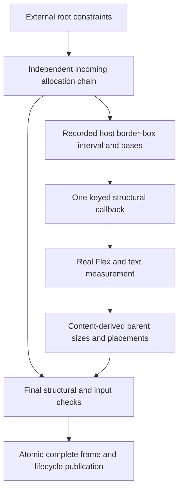

# Independent parent intervals and content-sized construction

Follow-up 2026-11-17: [independent item styles](RETAINED_ALLOCATION_STYLES.md)
extends allocate_children with unresolved style reads, still without measurement.
Builder observations retain all effective sibling styles as well as metadata,
including image-derived replaced/aspect inputs and nested allocator ancestors.

Follow-up 2026-11-17: [parent data](RETAINED_PARENT_DATA.md) adds the optional
`allocate_children(input, &dyn ParentAllocationChildren)` entry with immutable
typed metadata. Its default calls the existing count-only allocate method.
The original count-only subset described below remains valid; metadata-aware
builder observations additionally retain all allocator child-data identities.

Status: experimental framework contract, 2026-11-17. This extends
[independent inline allocation](RETAINED_PARENT_INLINE_ALLOCATION.md). The full
RFC, general RenderBox, automatic scheduling and performance acceptance remain
open. This stage adds capability and correctness; no speedup is claimed.

2026-11-17 follow-up: [mixed Flex allocation builders](RETAINED_MIXED_ALLOCATION_BUILDERS.md)
extend the ancestry proof across explicit full Size+Layout containment cuts and
Size-contained ConstraintBox slots. ConstraintBuilderInput now also preserves
real incoming known dimensions and their percentage definiteness. The strict
allocator-only domain described below is the earlier subset; ordinary feedback
edges without a proven cut and complete RenderBox remain open.

## Public protocol

```rust,ignore
impl ParentAllocationLayout for MyAllocation {
    fn allocate(
        &self,
        input: ParentAllocationInput,
        children: usize,
    ) -> Result<Vec<ChildLayoutInput>, Error> { /* pure allocation */ }
}
let snapshot = ParentLayoutSnapshot::new(measured_parent)
    .with_allocation_layout(MyAllocation);
edit.allocation_builder(host, |input, edit| {
    // Reconcile keyed descendants using input.constraints and percentage_basis.
    // The host may derive both used width and height from those descendants.
    Ok(())
})?;
```

The allocator observes **incoming border-box** known dimensions, their independent
definiteness flags, soft available space, hard min/max intervals and percentage
bases. It receives child count, without child styles or measure capability. It
does not receive the host's measured content dimensions. Return one complete
ChildLayoutInput per child in layout order, including hidden children. Loose
intervals, tight intervals, Unbounded, MinContent and MaxContent remain distinct.
Bounds override authored child sizing; available space alone is not a hard max,
used size or percentage basis. Hidden layout stays zero.

This is intentionally different from ParentLayoutInput: common host sizing,
padding/border/gutter resolution, selected inline-size remeasurement and final
known content height have not happened. An algorithm needing inset policy must
own the relevant immutable configuration and derive its slots explicitly. The
framework does not automatically turn border constraints into content constraints
or infer a percentage basis from a finite interval. Normal measured-parent host
sizing/baseline/overflow/placement still runs afterward.

The vendored kernel invokes allocation once per uncached custom-layout invocation,
before host measurement. The same assignments are enforced in every real child
measurement and final placement for that invocation, across internal size probes
and the final host plan. ParentLayoutChildren::allocation(index) exposes the
enforced input. The measured parent's requested child input cannot override it.
Intrinsic queries can invoke allocation with different incoming constraints;
there is no structural callback inside these repeated queries.

with_allocation_layout and with_inline_layout replace each other; overlapping
phases have no implicit precedence. Snapshot equality includes measured algorithm
and selected phase Arc identities. Cloning preserves identity; replacement is a
change even if sample numbers equal. Purity depends on owned immutable data and
declared inputs. Rust &self does not prohibit interior mutable application state.

## Structural builder and dependency boundary

allocation_builder is distinct from constraint_builder: it reads the **host's
incoming border-box assignment**, not the ConstraintBox output slot for that
host's own child. Its ConstraintBuilderInput reports hard intervals, soft modes
and percentage bases. It reports no host used size. ContainerQuery still reads
used content width under its separate proof; a loose max is not query width.

Run within edit_frame or edit_local_frame. Size/InlineSize containment is not
required: the host and ancestors may derive both content dimensions from the
chosen descendants. Nested allocation builders read earlier draft edits. Their
callbacks run once and are not retried until convergence. Sources, keyed scope
lifetimes, effects, layout and the complete frame publish atomically.

The initial proof domain is deliberately strict:

- Every parent edge from host to root installs ParentAllocationLayout.
- Visited nodes are visible in-flow Flex hosts; preferred/min/max intrinsic
  style keywords reject, as their pre-entry resolution can measure descendants.
- The root's incoming constraints originate outside the tree. Ordinary Flex,
  ConstraintBox or arbitrary measured edges do not establish full-axis
  independence here. The prior contained and inline builder APIs remain useful.
- Observation captures each visited style and algorithm snapshot, ancestry and
  each ancestor's layout-ordered child list. The host's own child list can change
  because allocation_builder constructs its descendants. Ancestor lists and
  snapshots must be established before observation; late equal-number algorithm
  replacement, insertion, removal or reorder rejects.
- Final publication rechecks both these structural dependencies and the recorded
  numerical input. Capturing the whole style/snapshot is conservative. A final
  value match alone does not prove lack of structural feedback.



Malformed slot count, bounds, available space or percentage basis rejects through
InvalidParentLayout. Errors before final publication preserve the previous
source/layout/frame. Direct non-frame transactions remain independently committed.
External callback side effects, panic and shared resource memo warming are not
rolled back. Existing frames own resolved geometry/resources independently.

## Cache and lifetime

Sparse Arc-backed final slot arrays live in the owned Taffy candidate. Only
successful local PerformLayout records replace them; ComputeSize/intrinsic probes
cannot overwrite final observations. Cache hits preserve the prior record.
Hidden subtrees, delegate replacement/removal, node deletion/generation reuse and
tree clear retire records. As with existing Taffy layout output, reading a dirty
tree can observe the previous layout; framework builders compute previews first.
Raw Taffy errors can follow internal writes; framework custom layout uses a
private candidate, so failure cannot publish partial records.

The ordinary final CSS cache key combines known size with available space; with
a known dimension it can omit observable soft space. The new independent phase
can distinguish those inputs. Whenever a custom layout is present, the existing
final result is therefore gated by a sparse **complete LayoutInput** record.
This applies to ordinary ancestors too, because they may hide a custom descendant.
ComputeSize keeps the previous bounded complete-input/output cache. Exact final
guards follow cache clear, dirty ancestor propagation, deletion and tree clear;
ordinary invocations allocate no guards. A mismatch recomputes, without replacing
the public layout semantics or growing every NodeData's cache payload.

## ADR: allocate from incoming constraints before measuring content

**Decision:** add an independent full-input phase to the owned Taffy parent
kernel; enforce assignments at measurement and final placement; expose them to a
separate builder with a structural proof rooted in external constraints.

**Alternatives:** using final ParentLayoutInput height feeds measured content
back into construction. A trusted independent=true flag cannot enforce a
dependency. Reusing the previous tight-width phase for two axes would conflate
incoming intervals with selected/measured host dimensions. A general automatic
dependency solver remains larger work; unrestricted callbacks inside measurement
would entangle keyed lifetime with repeated intrinsic probes.

**Costs:** another optional Arc fat pointer per snapshot, slot vectors and checks
O(direct children) per uncached custom invocation, an Arc slot array per completed
independent host, sparse tree-map headers and clone traversal. Exact final guards
store one LayoutInput per visited final-layout node when custom algorithms exist;
stricter hits may recompute more often. Builder observations clone styles/handles
and copy/sort ancestor child lists. Existing full candidate/per-builder preview,
source savepoint, proof and rollback costs remain. No GPU format changes, no
lower-allocation/tail-latency claim and no new timing result.

## Evidence and remaining scope

See [validation record](performance/2026-11-17-parent-allocation-builders/README.md).
Ordinary Flex CPU controls, real bundled Noto glyphs and explicit WGPU pixels
validate actual output through resizes and keyed retirement. They do not establish
continuous delivery, modern-GPU effects or display-visible latency.

Still open: mixed ordinary-Flex/full-axis dependency proofs, child-style-dependent
independent allocation, automatic cross-builder/query scheduling and environment
subscriptions, full RenderBox and broad intrinsic/percentage/cyclic/baseline/Flex
conformance, incremental candidate/proof dispatch/rollback, global cache budgets
and timing. Full resource/effect/native lifecycle, modern desktop GPU effects,
CPU smooth complete-frame delivery, sustained 60/120Hz and display-visible input
tails retain their separate acceptance gates.
