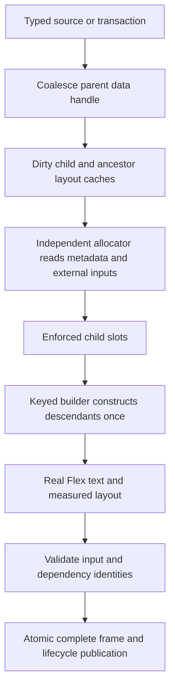

# Immutable child metadata for owned parent layouts

Follow-up: [independent item-style allocation](RETAINED_ALLOCATION_STYLES.md)
adds read-only styles alongside metadata and captures all effective sibling
styles for structural observations. No child measurement is exposed.

Follow-up: [item-style reads](RETAINED_CHILD_STYLE.md) now serve measured parent
policies. The original stage below restricted independent allocators to metadata;
the allocation-style follow-up above supersedes that style restriction while
preserving the prohibition on content measurement.

Follow-up: [pure parent metrics](RETAINED_DRY_PARENT_MEASURE.md) reads the same
authored child metadata and enforced assignments without a placement list;
final layout still validates exact metric agreement. General RenderBox remains open.

Status: experimental framework contract, 2026-11-17. Extends
[independent allocations](RETAINED_PARENT_ALLOCATION_BUILDERS.md) and
[mixed Flex composition](RETAINED_MIXED_ALLOCATION_BUILDERS.md). Complete
RenderBox, general content-feedback builders and full RFC acceptance stay open.

## Public contract

`ParentData::new(value)` owns a `Send + Sync + 'static` typed value. `get::<T>()`
returns a borrowed value only for the exact type. Clones preserve identity;
construct a new handle when inputs change. Equal numeric values in distinct
handles are changes, as with owned layout algorithms. Immutable ownership is a
contract: Rust permits interior mutation, which violates purity and is not
tracked by caches or proofs. No backend, Window, App or Taffy type is public.

Write through `Transaction::parent_data(node, Option<ParentData>)` or bind a
signal to `Property::parent_data(node)`. UiTree, ReactiveUi and LogicalUi provide
read-only `parent_data(node)` access. Every node may carry metadata, including
leaves and custom hosts. Ordinary Flex ignores it. It is not inherited; a
custom algorithm reads only its direct children's data, in actual layout order,
including hidden children. Reparenting moves metadata with the node rather than
with a numerical slot. New keyed children can declare it in their creation edit.

`ParentLayoutChildren::parent_data(index)` makes data available to measured
algorithms without requiring an independent phase. The optional independent
phase can override:

```rust,ignore
impl ParentAllocationLayout for MyAllocation {
    fn allocate_children(
        &self,
        input: ParentAllocationInput,
        children: &dyn ParentAllocationChildren,
    ) -> Result<Vec<ChildLayoutInput>, Error> {
        let data = children.parent_data(0)?.ok_or(Error::InvalidParentLayout)?;
        let role = data.get::<MyRole>().ok_or(Error::InvalidParentLayout)?;
        // Derive all child inputs from incoming constraints, order and owned
        // metadata. No child measurements or used host dimensions are exposed.
        todo!()
    }
}
```

This is a generic extension point, not a new built-in weighted allocator. The
weight/fraction algorithms in tests are client examples. `allocate_children`
defaults to the prior `allocate(input, child_count)` API, so existing framework
implementations keep compiling. A metadata-aware implementation may override
only `allocate_children`; the count-only default errors. At least one entry
must be implemented. The inline-only allocator remains count-only, preserving
its narrower inline independence proof.

The vendored low-level `CustomLayout::allocate` now takes a read-only child
metadata view instead of a count. Raw kernel implementors need this source
migration; framework ParentAllocationLayout count-only implementations do not.
As before, the kernel enforces independent inputs during every real child
measurement and final placement. Metadata cannot authorize content measurement
inside independent allocation or weaken the existing ancestry/containment proof.

## Updates, cache and publication



Final same-handle writes coalesce before layout, including an intermediate
different handle restored to the original. A changed handle selects Relayout
and invalidates the child and all dependent ancestors through the existing
ordinary/exact cache invalidation. This currently also relayouts ordinary Flex
that ignores metadata; selective dependency invalidation is not implemented.
Data writes do not change paint order, authored style or primitive resources.

Allocation-builder observations capture metadata identity for **every direct
child of every allocator ancestor** in addition to style/algorithm/order proof.
Changing a sibling's metadata after consuming a slot rejects final publication,
even if the replacement's numeric result matches. The host's descendant data
may change because it cannot affect its own incoming slot. New source/computed
metadata sinks join responsive layout-target discovery in ordinary and atomic
edit planners, preserving container-query ordering and feedback rejection.

Missing or wrong data types are handled by the application algorithm. Its error
maps to InvalidParentLayout. `edit_frame` / `edit_local_frame` preserve prior
source values, scopes, geometry and frame on failure. An ordinary previously
committed transaction remains committed, as with other layout inputs; arbitrary
panics/external effects and shared resource warming are not rolled back.

The owned kernel stores metadata in a sparse map separate from NodeData. Hidden
layout retains authored metadata, unlike final allocation observations. Clone
shares immutable handles; reparent preserves them, deletion/generation reuse and
clear release entries. Published render packets never carry parent data; old
frames remain consumable after metadata owners retire.

## ADR: parent data is a separate input domain

**Status:** implemented.

**Context:** a child-count-only allocator cannot express parent-defined child
roles without baking them into positional algorithm snapshots. Allowing child
measurement in the independent phase would reintroduce structural feedback.

**Decision:** add owned typed child metadata, a read-only allocation view and a
measured-parent read API. Carry changes through normal typed transactions and
kernel cache invalidation; extend final structural proof and responsive target
discovery. Keep ordinary Flex style and allocation algorithms unchanged.

**Alternatives:** exposing all child styles increases the dependency domain and
permits intrinsic/percentage policy coupling without proving independence.
Encoding every child's role in the parent snapshot makes reparenting/keyed
lifetime indirect. A fixed list of weights/spans/roles would be another preset
rather than an extensible public parent protocol. Untracked arbitrary user data
would break caching and atomic builder observation.

**Costs:** one optional Arc-backed wrapper in each framework Node/Pending and
one sparse kernel map; parent-data values allocate once, reads clone an Arc
handle and downcast, private tree copies clone map handles. Changed data uses
the conservative measurement invalidation path, resetting more caches than
strictly necessary. Builder proofs retain direct-child metadata handles and
still scan/copy full ancestor lists. Opaque data has no byte budget or stable
cross-language serialization ABI. No GPU instance/FramePacket format change,
layout speedup, lower latency or sustained-frame improvement is claimed.

## Evidence and remaining scope

See [validation](performance/2026-11-17-parent-data/README.md). Client weighted
allocation matches an independent ordinary Flex full-layout tree, including
wrapped content, full CPU bytes, hits, local/resolved frames and old ownership.
Actual bundled Noto paragraphs validate typed metadata updates, selected keyed
branches, wrapping and footer height against ordinary full Flex pixels. Explicit
GPU submissions compare local output to full ordinary Flex references.

This completes the authored metadata leg of custom parent layout, not arbitrary
child-style dependency allocation, general uncontained ordinary Flex feedback,
full RenderBox, intrinsic/dry-layout protocol, automatic cross-builder scheduling,
incremental proof/rollback, cache budgets or broad Flex conformance. Modern
desktop heavy effects, smooth continuous CPU complete frames, sustained 60/120Hz
and display-visible input tails remain separate unmet acceptance gates.
