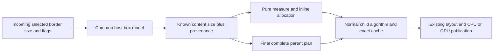

# Selected-size provenance in owned parent callbacks

Status: implemented experimental public layout contract, 2026-11-17. Extends
[selected child assignments](RETAINED_CHILD_ASSIGNMENTS.md) and
[custom parent layout](RETAINED_CUSTOM_PARENT_LAYOUT.md). The complete RFC goal
remains active. This stage establishes no performance or sustained-frame gain.

## The missing contract

ChildLayoutInput and the incoming independent allocation phase already carry
selected dimensions plus per-axis percentage definiteness. The measured parent
callback previously received only numerical content dimensions, soft space and
percentage bases. During final custom layout the kernel also unconditionally
supplied the used width as a percentage basis. ConstraintBox made the same
assumption. An explicitly indefinite incoming selected width therefore became
definite merely by crossing an owned parent edge.

The regression assigns84x64 border-box units with padding2 on every side and
false definite flags. A50%-wide natural10px child must retain10px width, but
the old final parent phase resolved40px. This is different from ordinary
automatic inline sizing, which selects a width and establishes its existing
inline basis. A value being numerically known must not erase that provenance.

## Public and kernel input domains

`ParentLayoutInput` adds `known_size_is_definite: LayoutSize<bool>`. It describes
the accompanying selected **content-box** dimensions. `ParentMeasure` and
`ParentLayout` see the same domain at the same input; final plans still preserve
every known dimension exactly. A final content-derived height is known but
remains indefinite. In a preliminary callback, absent dimensions normalize to
true flags with no meaning until a dimension is present.

`ParentInlineInput` adds `known_width_is_definite: bool`, projected from the same
inline domain. The independent inline phase still cannot inspect height, measure
children or inspect child styles. It may use the new inline provenance in its
pure allocation algorithm. Its ChildInlineAllocation continues assigning a
tight child width with its existing true selected-size definiteness; the
separate incoming percentage basis remains independently chosen by that phase.

The project-owned Taffy `CustomLayoutInput` carries the matching per-axis field.
The framework adapter forwards it for both pure metrics and complete layout,
including inline allocation before either callback. Complete independent
ParentAllocationInput continues using the original incoming border-box domain;
it is not replaced by measured content inputs.

This is a source API expansion: complete struct literals and exhaustive patterns
of ParentLayoutInput, ParentInlineInput and CustomLayoutInput need the new
field. Existing callback implementations that only read their named fields need
no changes. These Rust APIs do not establish a stable binary or cross-language
ABI. Style, FramePacket, GPU records and persistent node/cache formats do not
gain fields.

## One owned layout path

Both custom parents and ConstraintBox normalize flags on absent incoming
dimensions before resolving numeric authored dimensions. Incoming selected
indefinite dimensions retain their flags. Tight hard host intervals establish
definite dimensions independently. Existing normal unknown-width selection still
does one selected-width remeasurement, establishing its inline basis; no
fixed-point loop is added.

Final custom percentage bases now include only established axes. The final
callback receives both actual known content dimensions and their provenance,
even though its soft space is the actual finite inner size. Finite soft space
does not implicitly change those flags. An automatic content-derived height is
still passed as a known final dimension with false definiteness and no block
percentage basis.

ConstraintBox uses the same established inline basis for its final child's
percentage styles and for published child padding/border metadata. Previously
its final metadata also resolved padding against the numerical width even when
measurement had no corresponding percentage basis. The child's own Tight/Loose
assignment semantics remain separate: Tight may assign a definite child extent
even when the host's incoming extent was indefinite.

## ADR: preserve provenance instead of inferring it from finite geometry

**Decision:** extend the existing pure callback input types and repair final
basis selection in the shared owned-parent kernel. Keep numerical size,
definiteness, hard interval, soft opportunity and incoming percentage basis as
separate domains. Reuse existing exact cache keys, normal source routing and
atomic frame publication.

**Alternatives:** converting all selected extents to tight intervals changes
child percentage behavior. Inferring definiteness from finite available space
or a final float recreates the defect. Removing the selected size would violate
the parent's actual allocation. Giving clients a second post-layout percentage
algorithm would duplicate box sizing and create inconsistent overflow/metadata.
None implements the requested general parent protocol.

**Costs:** two bools in full callback inputs and one bool in inline inputs may
change temporary struct padding and copying. Scalar normalization and optional
basis checks are added, without another measurement pass, callback, snapshot
lease or persistent allocation. Existing private tree clones/exact cache maps,
lineage checks and repeated sizing callbacks retain their costs. Overall memory,
wall time and input tails have not been profiled; no saving or speedup is claimed.

## Verification, failure and remaining scope

See [evidence and reproduction](performance/2026-11-17-parent-definiteness/README.md).
Tests include callback observations, exact size and baseline queries, both
axes independently, pure policy failures, normal typed source transactions,
resolved/local frames, complete CPU/GPU numeric controls and actual Noto glyphs.
Dry queries publish no live geometry. Same-value transaction restoration remains
P0. A policy rejecting newly observed indefinite input causes atomic frame edits
to restore source, geometry, stats and prior frame; preceding ordinary committed
transactions, panic/external effects and shared memo warming retain existing
limits. Old frames remain consumable after UI/content owners retire.

These are finite framework protocol checks. There is no browser analogue for
arbitrary custom callbacks and no new independent CSS conformance claim.
Full RenderBox, general content-feedback builders and builder/query scheduling,
incremental private candidates/proofs/global budgets, broad Flex/Grid/Block
cyclic/aspect/intrinsic and writing-mode semantics, primitive/effect/native
lifecycles and modern desktop visible heavy-effect/CPU smoothness/60/120Hz/tail
acceptance remain open.
