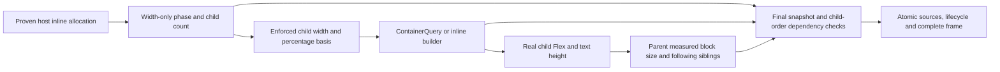

# Independent inline allocation for custom parents

Status: implemented experimental framework contract, 2026-11-17. Full RenderBox,
automatic builder/query scheduling and full RFC acceptance remain open.

## Public protocol

The general `ParentLayout` can observe both axes and measure arbitrary direct
children. A Boolean claim that it is width-independent would not establish the
dependency needed by a ContainerQuery or structural builder. This stage adds a
separate phase whose inputs and enforced output carry that dependency explicitly:

```rust
trait ParentInlineLayout: Debug + Send + Sync + 'static {
    fn allocate(
        &self,
        input: ParentInlineInput,
        children: usize,
    ) -> Result<Vec<ChildInlineAllocation>, Error>;
}

let snapshot = ParentLayoutSnapshot::new(measured_parent)
    .with_inline_layout(width_allocator);
```

`ParentInlineInput` exposes only `known_width`, inline `available` space and
inline `percentage_basis`. It has no height, child styles, measure capability,
Taffy types or UI/backend owner. Owned immutable configuration and child count
are legitimate dependencies. Each `ChildInlineAllocation` contains a finite
nonnegative **tight border-box width** and a separately established optional
inline percentage basis. Return one slot per direct child in layout order,
including hidden children. Layout `order` can change which identity occupies
each slot. Intrinsic/Unbounded modes still require a finite width; returning an
error is allowed. No universal intrinsic allocation is inferred by the framework.

The adapter runs allocation before each general parent callback, validates its
complete slot list, and applies those slots to **every child measurement and
final placement**. A measured parent's requested child width, inline bounds,
available space and inline percentage basis cannot bypass the slot. Block
constraints/bases and origins remain the general parent's responsibility. The
parent can call `children.inline_allocation(index)` to inspect the effective
slot. With no phase, that method returns None and the old measurement/placement
contract is unchanged. Invalid indices reject; hidden results retain zero size.

The host's ordinary box model still selects its own outer dimensions. A phase
does not make a content-sized parent width independent automatically. The common
kernel still validates preservation of known content dimensions. Parent baselines,
block content size, overflow, padding/gutters and real child Flex/text layout use
the same owned kernel as before. This is a general tight-width allocation phase,
not a new built-in Stack/Grid algorithm and not a full interval/full-axis protocol.

Snapshot equality includes both measured algorithm and width phase Arc identity.
Cloning retains identity; adding/replacing the phase creates a changed snapshot
even if its sample output is numerically equal. Pure repeatability remains a
contract: interior mutable application state, invocation counts and external
side effects can violate it, just as for existing ParentLayout. Rust `&self`
does not itself prove purity. Errors map through InvalidParentLayout.

## Query and builder integration



The shared inline dependency proof now crosses a custom-parent edge only through
its installed independent phase, and recursively proves the parent's own width.
Hard slot width supersedes the child's authored min/max/ratio width coupling;
the slot's independent percentage basis resolves percentage insets. Ordinary
Column/Tight-box/fixed-width boundaries keep their existing proof. Arbitrary
custom edges and unproven ancestor cross-axis feedback still reject. An ordinary
fixed CSS boundary below a custom ancestor may stop the proof when that boundary
truly insulates allocation; an exact CSS width directly below an arbitrary hard
custom edge cannot do so. Containment alone is not an arbitrary-allocator proof.

LayoutResponsiveBindings uses this proof for current styles, synchronized source
values and all breakpoint alternatives. Its existing computed-sink DAG checks
still include ParentLayout sinks. Sibling style sinks under custom parents are
treated as query dependencies because `order` can select a different slot.
This is conservative; general per-field dependency indexing is not introduced.

Atomic `LogicalEdit::responsive` / `responsive_registered` and
`inline_constraint_builder` additionally capture ancestor custom snapshot
identities and complete layout-ordered child lists when input is observed. Final
publication rechecks those dependencies alongside the existing width/proof and
writer checks. A later replacement, sibling insertion/reorder/removal or changed
ancestry rejects even if numeric width happens to remain equal. Build prerequisite
custom child lists before observation; choose keyed descendants inside the assigned
slot afterward. Callbacks are not retried until accidental convergence.

Standalone resolved/local responsive output has no structural callback; each
style stage revalidates the current preview/dependency stages. A query source
with a computed sink replacing its own custom ancestor is rejected as feedback
before registration, even if its initial value would be harmless. Ordinary edits
may replace a phase before a later query call; that call uses the new contract.

Pure allocation failure, invalid count/width/basis, final dependency or geometry
failure preserves the original sources/lifecycle/layout/published frame when
using the atomic frame APIs. Non-frame transactions remain independently committed.
External side effects, panic and shared resource cache warming retain existing
rollback limitations. Old frames own already resolved data and outlive algorithms.

## ADR: enforce an independent phase instead of trusting a capability flag

**Decision:** make width allocation a separate object with width-only inputs and
enforce every output in the adapter. Use the existing Taffy hard-bound protocol;
no vendor algorithm or GPU format change is needed. Extend shared query/builder
proofs and record structural dependencies at observation time.

**Alternatives:** an unchecked `width_independent=true` could be contradicted by
child measurements; numeric equality across one preview/final result misses
structural feedback. Disallowing every custom ancestor prevents useful custom
parents from composing with responsive content. Running lifecycle callbacks
inside repeated intrinsic probes would mix persistent structure with measurement.
Full automatic scheduling still needs a broader stable builder/dependency model.

**Costs:** ParentLayoutSnapshot now carries an additional optional Arc fat
pointer, also present in cloned/staged snapshot values. Each phase invokes a pure
callback, allocates/validates O(direct children) slots, and overrides child inputs.
Existing exact caches still operate on final transformed inputs. Atomic inline
observations retain ancestor snapshot handles and clone/sort custom child lists;
final checks repeat that traversal. Capturing all custom ancestors is conservative
even beyond a fixed proof boundary. Query dependency checks walk custom ancestry
per target/host. Existing complete candidate/per-stage preview costs remain.
There is no frame-time, allocation reduction or p99 improvement claim.

The subsequent [incoming allocation stage](RETAINED_PARENT_ALLOCATION_BUILDERS.md)
adds a separate full-axis loose/tight interval phase from incoming border-box
inputs and content-sized builders along independently allocated chains. It does
not broaden this inline phase's proof or make loose maximums into query widths.

## Evidence and remaining scope

See [validation record](performance/2026-11-16-parent-inline-allocation/README.md).
Real ordinary/full/CPU and explicitly run WGPU controls validate responsive
height changes through custom width allocation. Bundled Noto output exercises
width allocation → ContainerQuery padding → keyed inline text → footer geometry,
with independent full Flex glyph pixels and retained old frames.

Still open beyond the subsequent incoming-allocation subset: general mixed-edge
full-axis/child-style dependency proofs, general content-sized structural builders, automatic
cross-builder/query scheduling and environment subscriptions, complete RenderBox,
incremental planning/proof dispatch/rollback and cache byte budgets. Broad Flex,
intrinsic, percentage/cyclic/baseline conformance and optional pixel-projection
incrementality remain open. Full resource/effect/native lifecycle and modern GPU
heavy effects, CPU continuous complete-frame delivery, sustained 60/120Hz and
display-visible input tails retain their separate acceptance gates.
