# Definite percentage Row allocation

Status: experimental framework capability implemented, 2026-11-17. Extends
[content-independent Row allocation](RETAINED_ROW_INLINE_ALLOCATION.md). The
complete RFC goal remains active. No timing or sustained-frame gain is claimed.

## Public behavior

Ordinary `inline_allocation_builder` and uncontained `ContainerInline` queries
now support percentage Row inputs when the complete ordinary Flex ancestry
proves a definite inline allocation from a live external root anchor. This
includes Row/RowReverse, NoWrap/Wrap/WrapReverse, nested Rows and stretched or
numerically sized columns. Existing public types and methods are unchanged.

```rust,ignore
let sidebar = LayoutStyle::column()
    .flex_basis(LayoutDimension::Percent(0.25))
    .flex_grow(0.0)
    .min_size(LayoutDimension::Percent(0.1), LayoutDimension::Auto)
    .max_size(LayoutDimension::Percent(0.9), LayoutDimension::Auto);
// Ordinary Row at a definite width; all direct in-flow siblings must qualify.
// inline_allocation_builder observes its final incoming border-box allocation.
// ContainerInline observes its actual content width after insets/gutters.
```

For every direct visible in-flow item and reachable authored branch, the shared
proof accepts finite nonnegative Px or Percent basis, Auto basis with Px or
Percent preferred width, explicit Px or Percent main minimum and Auto/Px/Percent
main maximum. Preferred intrinsic keywords and effective aspect ratios still
reject. Percentage margins/padding continue to use normal width resolution.
The ordinary Flex algorithm handles line membership, min/max and grow/shrink;
this adds no alternative allocation solver, callback replay or iteration.

## Why independent width and definite width are separate

A finite selected width can be content-derived or explicitly marked indefinite
by a parent protocol. An unresolved percentage basis then becomes content-based;
an unresolved percentage minimum can expose the automatic content minimum. Such
inputs cannot safely determine width before descendant construction.

The new private proof is conditional on the existing live external-root check:
authored numeric root width, normal Definite inline space, or hard-tight root
width. Unresolved percent/stretch roots in Unbounded/MinContent/MaxContent input
reject before a builder callback or query selection. Paint viewport/environment
dimensions and previously published geometry cannot supply the anchor.

Within ordinary Flex, a definite Row main size makes each post-flexing main size
definite. A Column passes definiteness through numeric preferred widths or the
supported stretch case without cross auto margins. Independence is checked
separately by the existing complete-chain proof, including all Row sibling
bases/minima/maxima and all ancestor alternatives. Definite alone is insufficient.

This conditional permission is used only by complete incoming proofs whose
callers check the external anchor. The older used-width proof remains
unconditional and does not gain percentage assumptions. Custom/ConstraintBox
protocols conservatively stop the new definiteness proof; an independent custom
phase is not automatically a percentage-definiteness guarantee. Their existing
numeric Row and direct independent-slot capabilities remain as documented.

```mermaid
flowchart LR
    A[Live external root anchor] --> B[Definite ordinary Flex inline chain]
    B --> C[Resolved percentage Row bases and limits]
    C --> D[Content-independent normal Flex allocation]
    D --> E[Builder or query selects descendants]
    E --> F[Dependent heights and complete layout]
    F --> G[Final input styles order and source validation]
    G --> H[Atomic complete frame publication]
```



## Publication and dependencies

Existing ordered sibling/effective-style observations and responsive DAG edges
cover the newly accepted percentages. A sibling producer executes before the
consumer even if registered later. Computed query output feeding a sibling
allocation input rejects as a cycle. A late inactive preferred-width change
still invalidates observation even if actual width remains equal. Sources,
keyed outputs, geometry, stats and frame revisions retain the atomic boundary.
Scope-owned rules automatically resettle on ordinary source transactions after
the environment/constraints/paint input has been captured.

## ADR and cost

Decision: extend dependency proof with a separate conservative definiteness
predicate. Keep normal Flex semantics, engine-independent API and full recovery.
Always rejecting percentages unnecessarily prevents common sidebar/flexible
content layouts. Assuming any finite measured width is definite risks content
feedback. Inferring custom-protocol definiteness from current output alone loses
the explicit selected-size provenance already exposed by the public API.

The proof is lazy: numeric-only Row inputs do not trigger the new ancestor walk.
For percentage inputs it scans ancestor styles/reachable alternatives with a
per-invocation memo, once per Row item-proof invocation. Multiple Row ancestors,
hosts and query plans can repeat that work. Existing sibling/style observations,
private full-tree candidates, previews and final validation retain their costs.
No persistent node/style/GPU/cache/frame field or new Taffy pass is added. No
payload, peak-memory or wall-time improvement has been measured.

Content/automatic/intrinsic bases/minima, aspect feedback, Column wrapping,
general custom/box-protocol percentage proofs, broad cyclic percentage sizing,
full-axis construction feedback, automatic cross-builder/query scheduling,
complete RenderBox, incremental planning/indexes and global budgets remain open.
Modern desktop GPU heavy effects, sustained CPU complete-frame smoothness,
visible presentation/input tails and sustained60/120Hz remain separate acceptance.

See [tests and reproduction](performance/2026-11-17-percentage-inline-allocation/README.md).
