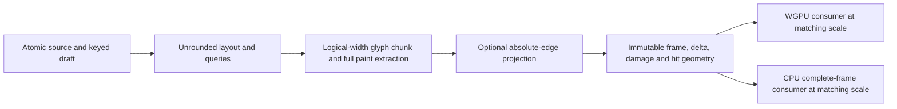

# Optional device-pixel presentation projection

Status: implemented experimental output contract, 2026-11-16. The full rendering
RFC remains active. This stage adds no new Taffy algorithm or timing claim.

## Public contract

```rust
use gpui_box::retained::PixelSnap;

// Existing explicit owner API. Future output changes; no logical relayout.
tree.set_pixel_snap(PixelSnap::DevicePixels { scale: 1.5 })?;

// Or join sources, keyed lifetime/layout work and frame publication atomically.
ui.edit_local_frame(constraints, paint_viewport, sources, |value, edit| {
    edit.pixel_snap(PixelSnap::DevicePixels { scale: 1.5 })?;
    // responsive_registered / constraint builders / ordinary properties
    Ok(value)
})?;
```

`PixelSnap::None` is the default and preserves fractional rendering. `scale`
means physical pixels per logical unit, including host zoom; it must be finite,
positive and have a finite f32 inverse. UiTree/LogicalUi report the current
policy; FramePacket/LocalFrame expose the exact policy owned by that snapshot.

With DevicePixels, publication projects **absolute border, content and effective
clip edges** to the nearest device grid, with half ties away from zero. Width
comes from rounded endpoints, not independently rounded local widths. Shared
absolute Flex endpoints therefore remain shared instead of accumulating local
rounding error. The finite paint viewport participates in root clipping.
Independent authored gaps/overlaps remain; this is not a gap-repair algorithm.

Logical layout stays unrounded: Taffy used sizes, LayoutResult, intrinsic
queries, first baseline, ContainerQuery thresholds and ConstraintBuilder input
are unchanged. Glyph chunks are selected at the **logical used content width**
before projection. Changing policy alone does not reshape/rewrap text, run
layout or rerecord unchanged display commands. The text origin moves, while
internal glyph geometry remains governed by the existing integer-origin
grayscale contract. A projected content rectangle can differ from its logical
wrap width. This does not implement baseline snapping, a text reflow option,
font-scale subscription or new font rasterization policy.

Radii, border thicknesses and effect lengths stay logical and are scaled by the
consumer as before. Image resources keep their identity; no decoding or texture
resampling policy is added. For fractional-motion animation, callers may keep
None to avoid device-step motion. Snapping is explicitly opt-in.

## Publication and consumers



Projection bakes visual translation and scroll into parent-local output
placement. It retains the hierarchy, clears output transform/scroll maps and
rebuilds effective clip identities, while retaining group effect chains. The
mutable owner's authored properties remain available for subsequent edits and
for restoring None. Equal inherited clips reuse their ancestor; a stricter clip
records the effective intersection with the ancestor property reference.

Absolute values are computed with f64 rounding, then represented as f32. Local
coordinates and clip intersections are canonicalized through the same f32
operation order used by consumers. Arbitrary device grids and deep accumulated
coordinates are not exactly representable in f32; this contract does not promise
bit-exact integer physical endpoints at every magnitude/depth. Nonfinite or
overflowing composed/physical geometry is rejected, including own-clip overflow
otherwise hidden by an inherited intersection. Extremely large geometry remains
subject to backend validation limits.

Projection runs **before** comparing published geometry and calculating damage,
so damage/hits use the same output as painting. A policy-only edit advances one
UI revision and requests output; a mixed edit advances only once. An equal
policy is a no-op. `TreeEdit::pixel_snap` and `LogicalEdit::pixel_snap` validate
before staging. The frame-producing logical edit APIs retain their complete
candidate boundary: source/style/lifetime/policy/final-frame errors preserve the
previous published state. Direct set_pixel_snap or an edit without frame output
does not promise later frame generation cannot fail. User callback side effects,
panic and shared memo-cache warming retain their existing rollback limits.
The projected root viewport stays distinct from the root's own effective clip.
Damage compares projected viewport to projected viewport, so a fractional window
or a smaller authored root clip does not turn every later color update into full
damage. Root own clips retain ordinary clip-property identity.

Snapped frames can only be consumed at their captured scale. SoftwareJob and
both WGPU submit entry points reject mismatch before allocating/mutating their
consumer path; a valid retry remains possible. Hosts changing DPI/zoom must
publish a new matching-policy frame and replace scale-specific glyph resources
when necessary. Old frames keep their old policy and resources until retired.
This adds a private FramePacket field: external struct literals are no longer
supported; packets are produced by the retained owner and cloned as snapshots.
This experimental packet is not a stable external or cross-language ABI.

## ADR: preserve logical layout, project presentation explicitly

**Status:** implemented; broad rounding/conformance acceptance remains open.

**Context:** enabling Taffy rounding would change measured layout outputs while
glyph extraction still needs the original wrapping width. Rounding local widths
independently can create accumulated seams. Implicit backend-specific rounding
would give painting and hit testing different geometry and obscure scale changes.

**Decision:** leave layout and query inputs logical, and add one owned optional
post-extraction presentation projection, shared by CPU/WGPU/hit snapshots. Capture
scale privately, reject mismatched consumers, and join the existing atomic edit
boundary. Keep None as the fractional baseline.

**Alternatives:** rounded Taffy output would need a second authoritative logical
width/baseline representation and an explicit text reflow contract. Backend-only
rounding cannot update the owner's hit/damage snapshot consistently. Rounding
all lengths would alter border/effect/text semantics beyond this requirement.

**Costs:** one policy field per UiTree and FramePacket (also owned by local frame
templates), one optional staged value per TreeEdit, and O(depth) projection stack.
Every dirty snapped frame currently forces full paint extraction and an O(N)
projection/rebuilt clip/effect map; layout/display-command/glyph caches still
reuse valid entries. In particular a snapped P1 color edit can no longer use the
sparse producer path. Dirty local frames fall back to complete publication;
idle frames still reuse their snapshot. Baking placement also loses ancestor
transform/scroll sharing in GPU output. Existing backend deltas/allocations may
reuse equal final values, but no incremental snapping dependency index is added.
The full atomic candidate and preview costs remain. This stage makes no claim
of faster frames, lower allocation, smoother CPU delivery or reduced tail latency.

## Verification and remaining work

See [validation evidence](performance/2026-11-16-pixel-snapping/README.md).
CPU/local/full references cover fractional Flex partitioning, query/builder
inputs, nested translation/scroll/clips, group effects, images, OOF, hide/show,
reparenting, scale/toggle, atomic failure and old snapshots. A real bundled Noto
threshold proves the original wrap chunk survives policy changes; independently
translated ordinary text is the CPU/WGPU pixel oracle. Integer geometry provides
a separate simple CPU/GPU edge oracle.

Still open: indexed incremental projection preserving sparse producer/ancestor
updates, host automatic DPI/zoom integration, broad fractional-coordinate/deep
precision/decoration conformance, last/vertical-baseline policy, full affine and
complex clips. Broader Flex/intrinsic/percentage/cyclic conformance, automatic
builder/query scheduling, complete RenderBox and the full RFC resource/native
and performance acceptance remain open. GPU completion is not visible display;
modern desktop heavy effects, CPU smooth complete frames, sustained 60/120Hz and
input-to-visible tails are not qualified by these tests.
