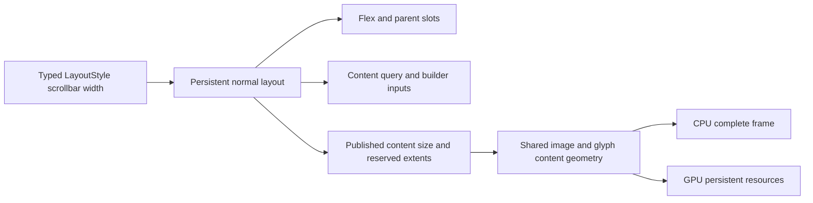

# Explicit scrollbar allocation across layout and rendering

Status: experimental public contract implemented, 2026-11-17. The complete RFC
goal remains active. Extends the [public layout contract](RETAINED_RESPONSIVE_CONTRACT.md),
[owned content](RETAINED_CONTENT_MEASURE.md) and
[ordinary inline builders](RETAINED_INLINE_ALLOCATION_BUILDERS.md).
No frame-time, tail-latency or sustained-frame gain is claimed.

## Public API and semantics

`LayoutStyle.scrollbar_width: f32` and `.scrollbar_width(value)` express a finite
nonnegative logical thickness. Default0 keeps overlay allocation. The kernel
reserves width when vertical overflow is Scroll, height when horizontal overflow
is Scroll, and neither for Visible/Clip/Hidden. Vertical space sits on inline-end:
right in LTR, left in RTL. Horizontal space sits at the bottom in the supported
horizontal writing mode. One thickness applies to both scrollbars.

```rust
# use gpui_box::retained::*;
let style = LayoutStyle::column()
    .size(LayoutDimension::Px(400.0), LayoutDimension::Px(300.0))
    .overflow(LayoutOverflow::Visible, LayoutOverflow::Scroll)
    .scrollbar_width(12.0);
```

This is explicit space allocation. It does not paint scrollbars, subscribe to OS
metrics, add Overflow::Auto, predict overflow, implement CSS scrollbar-gutter
stable/both-edges or silently enable visual clipping. Paint/clip/scroll properties
retain their existing separate ownership. Hosts select the thickness from their
actual presentation policy. Automatic scrollbar appearance needs a separate
dependency/convergence design because changing width can change paragraph wraps
and create overflow on the other axis.

`LayoutResult.scrollbar_size: [f32; 2]` exposes actual reserved physical extents:
horizontal space for a vertical bar, vertical space for a horizontal bar.
`content_size` now subtracts border, padding **and these reservations**, floored
at0, matching actual child/paragraph opportunity and container queries. This
corrects public results for existing raw Taffy styles with nonzero gutters too.
Complete LayoutStyle/LayoutResult literals and exhaustive patterns need the new
fields. Default-based callers remain source-compatible. No stable ABI is claimed.

## One content box through the normal pipeline

The public style lowers to the existing project-owned Taffy scrollbar field.
Flex allocation, line wrapping, percentage bases, ConstraintBox slot deflation,
custom-parent content inputs and pure content callbacks already use that kernel
box model. Existing ChildLayoutStyle also carries the same width and independent
allocator observations already include it. No second Flex algorithm, adaptive
solver or renderer-specific sizing rule was added.

The newly public input exposed inconsistencies after layout:

- Paragraph first/last baseline queries used border-minus-padding width without
  removing a vertical reservation, potentially measuring different wraps from
  actual layout. The common measure adapter now subtracts it.
- Glyph chunk selection and image/glyph content destinations used that same
  oversized width. Shared full/selective extraction now publishes the actual
  deflated width/height; RTL leaf content additionally moves past the left gutter.
- A gutter-only change can preserve border-box size/padding/border while changing
  content geometry. Layout publication now observes scrollbar_size changes.
  Direction changes explicitly dirty own content geometry because LTR/RTL can
  move content while all scalar Layout fields remain equal.

The existing four content offsets retain their internal representation: the
horizontal padding offset now includes any left reservation. CPU image/glyph
paint, local resolution, GPU image/glyph placement, property-only transforms,
validation and device-pixel projection consume those same values. GPU primitive
formats and FramePacket schema do not grow. Box fills/hit bounds still use the
border box. The leaf kernel also removes its right-only gutter TODO and follows
direction, consistent with Flex/Grid/ConstraintBox/custom parents; its leaf size
arithmetic uses inset sums, so this edit alone is not a measured positional fix.



## ADR and costs

Decision: expose the kernel's explicit reservation through the framework's own
style/result types and reconcile all later content consumers with actual layout.
Keep automatic appearance, visual chrome and platform subscriptions separate.

Alternatives: accepting only raw Taffy styles leaks the backend into ordinary UI
code; padding-only application wrappers cannot express the original scrollbar
layout/overflow semantics; adding the field without fixing publication lets
paragraph metrics and rendered wraps disagree. Automatic detection now would
need a new dependency protocol and possible second-axis feedback. None replaces
the explicit contract in this stage.

Costs: one f32 in public LayoutStyle and two in LayoutResult, validation and a
few scalar arithmetic/dirty checks. Actual ABI padding/peak memory were not
profiled. Existing internal Style/Layout already stored these values, and no
persistent per-node/GPU/cache field or new Arc/map/lease is introduced. Changes
to this style input relayout; paragraph/glyph width changes can populate existing
bounded wrap/chunk caches. Direction-only style edits now refresh own content
geometry even when no scalar layout field changes. Ordinary same-value/final
restoration remains P0. No timing or memory-saving claim follows.

Invalid negative/NaN/infinite widths fail the existing typed style validation
before publication. Source, logical draft, stats, geometry and old frames retain
the normal atomic failure boundary. Restored final values do not request layout.
Existing private candidates/previews/cache budgets remain separate costs.

## Verification and remaining scope

See [actual evidence and commands](performance/2026-11-17-scrollbar-gutters/README.md).
Independent Chromium geometry covers four Flex directions, three wrap modes,
LTR/RTL,0/6/12px bars, vertical/both axes and BorderBox/ContentBox. Numeric
padding controls verify complete image and real Noto glyph pixels independently
of scrollbar interpretation. Other tests exercise custom parents, boxes, normal
typed sources, P0/error rollback, query threshold changes, nested builders,
scroll reclamping and old frames.

Automatic overflow/scrollbar prediction, classic/overlay OS policy integration,
per-axis thickness/side policies, native chrome/hit/IME/accessibility, broad
writing-mode and CSS cross-axis overflow normalization remain open. Full
RenderBox, general builder/query dependency scheduling, incremental planning and
global budgets are not closed. Modern desktop heavy-effects GPU, CPU continuous
complete-frame smoothness, sustained60/120Hz and display-visible input tails
still require independent acceptance.
