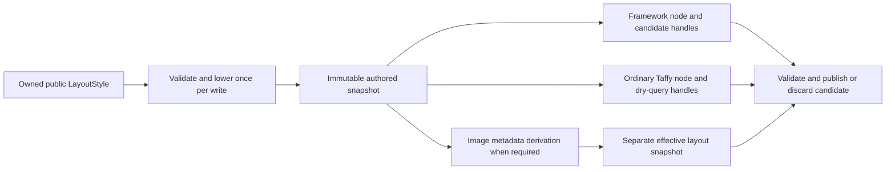

# Immutable layout style snapshots

The complete RFC goal remains active. This stage removes duplicate style
payloads from normal retained/Taffy storage and private layout candidates. It
does not replace Flex/Grid algorithms or make candidate construction incremental.
See [comparative evidence](performance/2026-11-17-shared-layout-styles/README.md).

## Ownership and replacement

Framework render nodes and vendored Taffy nodes now hold `Arc<Style>`. A normal
node shares one immutable lowered style between both trees. Framework candidates,
Taffy dry-query clones and builder dependency observations retain that snapshot
instead of copying its complete inline fields and Grid track vectors. Creating
different nodes still creates different snapshots; this is not global interning.

Public framework `LayoutStyle`, transactions, `UiTree::style() -> &Style` and
the existing owned Taffy constructors/setter keep their contracts. The fork adds
`new_leaf_shared(Arc<Style>)` and `set_style_shared(node, Arc<Style>)` to join the
ownership boundary without copying. Context/parent owned constructors also store
immutable snapshots internally. No mutable style reference is exposed. Replacing
a style swaps the handle and invalidates the same caches/capability indexes as
before. Taffy setters still invalidate equal values; framework P0 filters them
before reaching Taffy.

Image sizing can derive replaced-element classification and an aspect ratio
from decoded metadata. The authored snapshot remains unchanged; layout receives
a separate effective snapshot only when these fields differ. Removing image
measurement rejoins the authored snapshot. Explicit ratios and inline-size
containment retain their existing semantics. Ordinary fixed/content/paragraph
measure updates reuse authored styles rather than cloning them.

Final dependency checks still compare **values**, including tracks, siblings,
derived image metadata and child order. Sharing is an ownership optimization,
not permission to skip validation or equate different styles by their address.
Responsive alternatives are still lowered/validated for the current plan;
their vectors, proof scans and equality work have not been eliminated.

## ADR: share immutable values at the tree boundary

Context: enabling owned affine lengths made `Style<String>`776bytes on64-bit.
The framework and kernel each stored it inline and cloned it during atomic
edits, queries and fallible layout. Grid styles additionally deep-cloned tracks.
These costs are unrelated to the semantic complexity of a small UI update.

Decision: share immutable lowered snapshots and replace them on writes. Preserve
all rollback, generation, measurement and dirty-index boundaries. Do not add a
parallel layout solver, scene-specific size shortcuts or an intern registry.

Alternatives: leaving the two payloads inline preserves allocation locality but
duplicates values and bandwidth. Interning equal styles across unrelated nodes
needs bounded ownership/eviction and structural keys. Replacing whole candidates
with persistent slot/cache/topology structures could remove more work but is a
separate change to mutation and failure semantics. Sharing does not prove that
larger change unnecessary.

Costs: each distinct snapshot has a heap allocation and reference counters;
access adds indirection, and clone/drop updates atomic counts. Retained image
metadata can require a second effective style. New owned style writes still
lower/validate/allocate; staged property preparation still copies changed style
values before publication. There is no allocation-free write claim. Long-lived
old candidates keep old snapshots alive until their last handle drops.

`Arc` describes ownership only. Upstream compact lengths include raw-pointer
representation, so Taffy Style remains neither Send nor Sync, even in a build
without pointer expressions. This stage adds no unsafe Send/Sync assertion and
does not make UiTree transferable. A small documented construction helper
locally allows Clippy's `arc_with_non_send_sync`, matching the fork API. Immutable
render packets and framework-owned public layout values retain their separate
thread/ownership contracts; a transferable layout-worker representation remains
separate design work. Switching to Rc would also impose its thread restriction
on any future safe kernel representation.

The low-level tree's existing pointer-calc lifetime/resolver contract is not
repaired by an Arc around Style. Framework-owned affine values remain inline
coefficients and do not use that pointer path.

## Verification and remaining scope

Targeted regressions check shared identity across both trees, independent Grid
replacement, unchanged descendant sharing, value-equal new-style P0, lifetime
after owner retirement, authored/effective image separation and rejection after
candidate layout without altering published hit geometry. Kernel tests cover
context/parent constructors, old clone geometry, weak-handle retirement,
equal-style dirty behavior and containment/visibility indexes. Complete suites
continue to check typed/keyed Flex/Grid, paragraph/image, dependency rejection,
source rollback, old CPU packets and explicit real GPU pixels.

Timing measures actual candidate clone/drop, isolated subtree/root measurement,
atomic edit with layout validation and tree creation/measurement. It is not a
native presentation, GPU raster or sustained frame-rate experiment. The affine
Style itself remains776bytes. Node `size_of` reduction moves the shared payload
to the heap; it must not be presented as total/peak/RSS savings. No allocator,
resident-memory, energy or isolated live-layout throughput profiling is claimed.

Remaining whole-tree slot/child/cache clones, full observations and proof scans,
changed-style lowering, sparse payloads/budgets and incremental planning remain
open. Broad Flex/Grid conformance, full-axis/content-feedback builder protocols,
automatic cross-builder/query scheduling, complete RenderBox, independent native
presentation, modern desktop heavy effects, CPU sustained complete-frame
smoothness and input tail latency remain part of the active larger goal.
