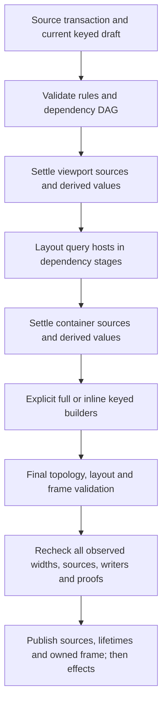

# Responsive stages inside atomic keyed construction

Date: 2026-11-16. Implemented public subset; full RFC acceptance remains open.

`LogicalEdit::responsive(&LayoutResponsiveBindings, &LayoutEnvironment)` now
settles existing viewport and container rules inside `LogicalUi::edit_frame`
or `edit_local_frame`. Subsequent source reads, bindings and full/inline
constraint builders observe those settled values and the current structural
draft. Final source, keyed lifetime, layout and frame publication share the
existing atomic boundary. Plain `edit` rejects this API because it has no final
layout environment with which to validate the observations.

This closes explicit composition of registered ContainerQuery rules and keyed
construction. It does not add automatic builder scheduling, draft rule
registration, a general feedback solver or full-axis content-sized builders.

## Public usage and ordering

The rules and their exact style bindings must already exist on the owner.
Inside an edit, construct/reparent prerequisite nodes before the responsive
read; evaluate the rules before building children that depend on the result.
The following fragment assumes an existing rule set and an InlineSize-contained
single-child constraint box named `boundary`:

```rust
let (commit, frame) = ui.edit_local_frame(
    constraints,
    paint_viewport,
    |sources| {
        sources.set(model, next_model)?;
        Ok(())
    },
    |(), edit| {
        let work = edit.responsive(&rules, &environment)?;
        edit.inline_constraint_builder(boundary, |input, edit| {
            let wide = input.max >= 100.0;
            let branch = edit.reconcile_keys(parent_scope, &[u64::from(wide)])?[0];
            let output = match edit.renders(branch)?.first() {
                Some(node) => *node,
                None => edit.append_layout(
                    branch,
                    boundary,
                    LayoutStyle::column().size(
                        LayoutDimension::Percent(1.0),
                        LayoutDimension::Px(if wide { 40.0 } else { 20.0 }),
                    ),
                    0xff0000ff,
                )?,
            };
            Ok((work, output))
        })
    },
)?;
```

`LayoutEnvironment.layout_viewport` selects viewport breakpoints; its direction
selects logical styles. The surrounding edit's `LayoutConstraints` remain the
layout input, and `paint_viewport` remains the finite output clip. These three
inputs can differ. ContainerQuery continues to read the host's actual content
width; an inline builder reads its parent's child-slot constraints. Neither is
substituted for the other.

The same ordering applies to `constraint_builder` for Size-contained two-axis
inputs and to `edit_frame` for resolved output. User builder closures execute
once at the explicit call site; the runtime does not replay them to seek a
fixed point. Arbitrary external side effects therefore remain outside rollback.

## Settlement and final validation



The private responsive preview includes pending property/topology changes and
filters output of retired logical scopes. Viewport rules settle first; container
rules then run in the existing proven dependency stages, including nested and
sibling allocation dependencies. A stage can trigger a private layout before
reading actual content widths. Every preview is released before the next is
built; it is not retained across user builders.

Derived settlement includes live and draft-created computations in rank order.
New derived-to-derived edges, bindings and effects see the final selected
values. Reverse edges become ordinary live dependencies on publication and work
in later source transactions. Equal derived results stop propagation. A source
restored to its original value emits no transient live sink or effect update.
New effects still receive their normal initial final-state observation.

At the end of the render closure, each responsive observation freezes the final
reachable layout sinks and verifies exact registered writer ownership. After
final layout/extraction, publication verifies:

- Registered sources still equal the styles selected by that responsive call.
- Binding ID, source, target and Style field retain their registered ownership;
  replacing a writer with an equivalent new binding still fails.
- The final dependency proof and ordered query stages still hold, including new
  computed layout sinks added after the responsive call.
- Each registered target's final lowered style agrees with its selected source.
- Each queried host's final actual content width equals the observed width.

Retiring an unrelated derived sink is allowed; deleting a registered target or
its query host is rejected. A later ancestor/topology change can invalidate the
proof even if the numeric width stays equal. All responsive calls retain their
observations: a later call cannot erase assumptions made by an earlier builder.
Contradictory observations reject instead of publishing stale construction.

The existing conservative CSS proofs still apply. Arbitrary custom parent
allocators have no declared query-dependency contract, so querying through them
is rejected. General Row/wrap/aspect feedback is still unsupported. There is no
numeric convergence loop.

## Failure boundary and counters

An uncaught error preserves the published source values, logical scopes,
bindings/effects, layout and old full/local frame. Reserved provisional IDs
remain invalid and cannot later identify unrelated objects. Each responsive
call also has a source/counter savepoint: if a later container stage or computed
evaluation fails and the user catches the error, values from an earlier
viewport stage do not leak into the rest of the edit. Earlier caller edits are
preserved. Panic, arbitrary callback side effects and shared font/resource memo
cache warming are not covered by this guarantee.

`ResponsiveEditStats` describes only this call's private responsive layout work:

- `rules_examined`: registered rules considered, not DAG or source visits.
- `changed_styles`: registered sources differing from values at call entry.
- `layout_runs` and `layout_stats`: private query layout passes only.

It excludes builder previews and final frame production. The returned
FramePacket/LocalFrame keeps its existing final-publication counters. These
counters must not be added together to claim complete transaction timing.

## ADR: explicit responsive stages before automatic scheduling

**Status:** implemented for existing rule sets.

**Context:** standalone responsive style evaluation followed by a separate
structural edit could publish intermediate source/effect state or build using
an obsolete width. It also could not inspect new derived sinks in the same
keyed draft. Layout and structural choice must use one validated candidate.

**Decision:** share the existing prepared source map and keyed publication
boundary. Adapt the existing query proof/DAG to the current draft, settle
derived sources after each stage, and validate frozen observations at final
publication. Keep the sequencing explicit until general builder dependencies
and registration/retirement semantics have a public contract.

**Alternatives:** separate commits expose partial state on failure; using window
width for local constraints gives wrong geometry; replaying user closures until
sizes stabilize has ambiguous effects, identities and failure behavior; a new
automatic scheduler would require dependency APIs not yet defined. Existing
standalone responsive entry points remain available with their prior contract.

**Costs:** the surrounding edit still clones the full retained/layout candidate.
This stage adds a full preview initially and after each source-selection stage;
each preview starts from the current edit rather than reusing the last preview's
computed layouts. Final publication can repeat layout. Source savepoints clone
the prepared BTreeMap of reference-counted values; settlement scans and sorts
live/draft computed sources. Query target/DAG/proof checks scan bindings and
ancestors, and rules/styles are cloned into observations for final validation.
No indexed scheduler, persistent proof cache or incremental rollback is added.
No new per-Taffy-node field or GPU format is required. This capability may add
CPU work and memory; no frame-time, p99 or sustained-rate improvement is claimed.

## Evidence and remaining scope

See [frozen validation](performance/2026-11-16-structural-responsive/README.md).
CPU full references, real Noto shaping/rasterization and explicit hardware
readback cover viewport → ContainerQuery → keyed inline construction, content
height, footer geometry/hit testing, repeated retirement and old snapshots.

The subsequent [scope-owned rule lifecycle](RETAINED_SCOPED_RESPONSIVE_RULES.md)
adds draft registration/update/removal and retirement with keyed scopes.
Still open: automatic cross-builder/query scheduling; general full-axis content-sized structural
construction and complete RenderBox; custom-policy dependency declarations;
incremental planning/rollback and indexed dispatch; broad Flex/percentage/cyclic/
baseline/device-rounding conformance; modern desktop GPU effects, CPU smooth
complete-frame delivery, sustained 60/120Hz and input-to-visible tail latency.
The [implementation table](RETAINED_IMPLEMENTATION_PROGRESS.md) retains the
remaining full RFC acceptance items.
