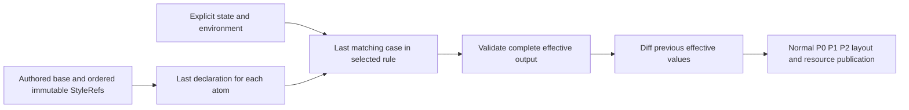

# Typed style composition and pure conditions

2026-11-19 follow-up: [typed tokens and owned expressions](RETAINED_TOKENS.md)
adds StyleValue::Expression/StyleRule::expression and explicit token-aware plan
evaluation. UI schema7 carries per-node complete token snapshots and updates;
literal rule composition/order remains the contract below. Stable serialization,
parts/ThemePatch and render-domain budgeted preparation remain open.

Status: experimental Rust Style IR,2026-11-18. Full RFC goal remains active.
This implements the ordered composition core from
[runtime architecture section6](UI_RUNTIME_ARCHITECTURE.md), joined to the
[owned primitive UI input](RETAINED_OWNED_UI_INPUT.md). It is not a CSS parser,
StyleX compatibility layer, complete theme system or stable foreign ABI.

Follow-up: [incremental style planning](RETAINED_INCREMENTAL_STYLE_PLANNING.md)
adds reusable StylePlan/StyleDependencies, immutable shared UI records and
selected-rule environment indices. The all-node planning costs below describe
this initial composition stage; global validation/candidate work still remains.

Later [input routing](RETAINED_UI_INPUT_ROUTING.md) adds an explicit adopted-frame
router that can generate ordinary hovered/pressed/focus-visible StyleState
operations. It does not install native event hooks or turn style disabled into
semantic disabled; UiInteraction is the independent authority. Source schema3
supersedes the schema2 integration described for this initial stage below.

## Typed definitions and deterministic resolution

`retained::style` provides immutable `StyleRef`, typed `StyleDeclaration`,
`StyleRule<T>`, `StyleValue<T>`, `StyleCondition`, `StyleState`, `StyleResolution`
and `StyleWinner`. Declarations cover all current public LayoutStyle fields and
common UiProperties: fill, translation, clip, scroll, group opacity, decoration
and shadow list. A generated typed atom definition keeps property key, assignment
and validation together. No `Any` value, string property path or callback is used.
Text resource/color, image/measure content and intrinsic font metrics remain
UiContent/resource inputs, not accidentally mapped to the box's fill color.

1. Padding/Margin/Border/Inset/Size/MinSize/MaxSize/Gap shorthands expand to atomic
   physical properties before validation. Duplicate atomic properties within one
   definition reject, including shorthand+longhand. Use separate StyleRefs for
   deliberate overrides.
2. Walk the composed list in order; each property's last declaration wins as a
   **complete rule**, including default and all conditional cases. A later
   declaration does not silently merge earlier hover/pressed branches.
3. For that selected rule, start with default and take the last matching case.
   Conditions are flat conjunctions; multiple cases supply ordered alternatives.
4. `Initial` restores the framework default for that property. An undeclared
   property keeps the authored base. Removing an overlay list restores authored base
   values; no previous resolution is used as the next base.
5. Validate the complete selected layout/visual output and emit ordinary typed
   retained changes. Cross-property combinations can fail, e.g.Grid plus a
   Flex-axis gap. Failure cannot install only some properties.

```rust,ignore
use gpui_box::retained::{style::*, *};
let base = StyleRef::new("base", vec![
    StyleDeclaration::Padding(StyleRule::value(LayoutEdges::all(LayoutLength::Px(12.0)))),
    StyleDeclaration::Color(StyleRule::value(0xff0000ff).when(
        StyleCondition { hovered: Some(true), ..Default::default() },
        0x0000ffff,
    )),
])?;
let external = StyleRef::new("caller", vec![
    StyleDeclaration::PaddingLeft(StyleRule::value(LayoutLength::Px(20.0))),
    StyleDeclaration::Color(StyleRule::value(0x00ff00ff)),
])?;
// [base, external] gives left20, other padding12 and green in every state.
```

StyleRef clones share owned normalized declarations. A newly constructed equal
definition compares by value; it need not have the same Arc address. Names are
diagnostic labels and participate in source equality. `declarations()` exposes
read-only expanded atoms. Standalone `resolve` returns winners by property with
style index, expanded declaration index, case index/default and Initial flag.
It explains the selected source without persisting renderer-specific identities.

Atoms follow the existing public field model. `MainCrossGap` remains a separate
optional Flex-axis helper that takes precedence over physical ColumnGap/RowGap
in LayoutStyle. Setting a later physical gap does not implicitly clear that
helper; compose MainCrossGap::Initial explicitly when switching to physical
gaps. Decoration and Overflow likewise remain typed field groups, not invented
CSS longhands. This stage does not claim a complete CSS property cascade.

## Conditions and input domains

StyleState supplies hovered, pressed, focus_visible, disabled and selected bools.
These are **style inputs**; disabled does not disable handlers or establish
accessibility semantics. The host/frontend must provide authoritative state.
No pointer/focus event subscription is installed and UI-stall-independent hover
evaluation is not claimed.

StyleCondition additionally supports optional min_width inclusive/max_width
exclusive, direction, reduced_motion, touch and pointer capability. Width reads
the explicit LayoutEnvironment.layout_viewport, never layout parent max-width
or the paint viewport. All present constraints must match. Unknown optional
capabilities match neither true nor false requirements. Bounds must be finite,
nonnegative and ordered; an empty interval rejects. Environment metadata does
not implicitly scale layout/font sizes or change node direction. Only declared
rules change output. Device/application/text scales remain validated metadata.

No container condition is added here: existing query proofs and source ownership
must be composed explicitly in a later planner. There is no user predicate,
fixed-point iteration or callback replay. Logical theme inheritance, color-scheme/
contrast preferences, tokens, Inherit, bindings and animations remain separate.
Unsupported operations have no misleading placeholder enum variant.

Every default/case value and condition is validated at immutable definition
construction, including branches not selected now. NaNs, invalid padding/opacity,
alignment modifiers and Grid grammar reject. Atom values are checked in a
default output context; selected complete combinations receive final validation.
Inherited base fields also validate in the full result. No invalid overwritten
branch is permitted to hide inside a replayable StyleRef.

## Owned UI schema2 integration

`UiNode` adds ordered styles and style_state; `UiSnapshot` adds an explicit
style_environment. `UiOperation::Styles`, StyleState and StyleEnvironment join
ordinary atomic batches. Snapshot constructor defaults to an environment with
zero logical viewport and unknown capabilities; it is not inferred from the
constraints/paint viewport. Set it deliberately when environment rules matter.
**UI_SCHEMA_VERSION advances1→2** for these added source fields/operations;
schema1 rejects explicitly. This is a Rust source-model revision, not a promise
of portable binary layout or serde encoding.

UiDocument retains authored records separately from resolved layout/properties.
`node` and `snapshot` expose authored state; `resolved_node` exposes current
effective values. The adapter clears overlay references in its resolved copies
to avoid applying them twice. On any input batch it resolves the graph with the
final environment/state, validates source/effective graphs and stages only value
differences against prior effective nodes. Styles/State/Environment/source
revision/frame are adopted together after layout and geometry validation.

Color-only conditional changes use existing P1 when supported, opacity uses P2,
and size/display/gaps use real layout. Changing a covered state whose output
stays equal advances source revision but keeps frame revision and no request.
Recovery exports authored rules/state/environment and recomputes effective
values. Exact equal batch replay and generation/tombstone ownership continue.



## ADR and costs

Decision: implement composition as pure owned data before macros, global style
tables or theme inheritance. Keep whole-rule override order explicit and reuse
normal public layout/property validation. This avoids allocating per-condition
closures or binding hidden imperative setters behind the source protocol.

Alternatives: merging condition branches from earlier definitions contradicts
the specified caller override behavior. Copying resolved output back into base
prevents removing a style or returning from hover correctly. Passing raw engine
styles loses the backend-independent boundary. A CSS cascade/parser introduces
selectors/specificity/inheritance outside this defined native model.

Original-stage costs: normalization clones shorthand rules into atoms; StyleRef creation scans
and validates all values. Each resolution builds a property-winner map and copies
the base; that UiDocument stage resolves **all live nodes per batch** and retains
both authored and effective records. Same-frame suppression does not mean no
planning work. Limits cover definition name bytes/declarations/cases/value Grid
entries/shadows and document per-node style/atom/case counts plus possible
track/shadow value sizes. They do not form byte/time budgets; standalone resolve
accepts caller-owned style lists without a document-wide budget. The follow-up
caches composition and indexes input dependencies, while threshold dispatch and
compact atom storage remain open. No timing/memory/FPS gain is claimed here.

## Verification and remaining scope

See [evidence](performance/2026-11-18-style-composition/README.md). Tests cover
whole-rule replacement, shorthand order/duplicate rejection, reset, condition
boundaries/unknown values, invalid unused branches/final combinations, source
rollback, P0/P1/P2, Flex/Grid/Calc, schema rejection, replay/recovery and old
frames. Real Noto wrapping/baselines and complete CPU/GPU pixels compare with
direct ordinary full trees and manually selected numeric styles.

Tokens/theme logical inheritance/parts, text/font style inputs, semantic disabled,
bindings/handlers/focus, macros, portable schema/ABI and automatic container/
builder scheduling remain open. Native independent presentation, modern desktop
heavy effects, CPU continuous complete-frame smoothness, sustained60/120Hz and
full input tails remain separate requirements of the active goal.
