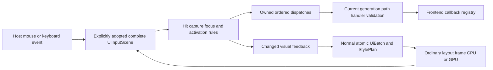

# Adopted-frame pointer, focus and activation routing

Status: experimental Rust contract,2026-11-18. Full RFC remains active. Extends
[owned UI source input](RETAINED_OWNED_UI_INPUT.md) and
[typed style feedback](RETAINED_TYPED_STYLE_COMPOSITION.md). The common desktop
interaction contract is backend-independent; this is not complete event/IME/
accessibility support or native input-to-presentation qualification.

The later [wheel scrolling stage](RETAINED_WHEEL_SCROLLING.md) adds default
logical-pixel wheel deltas and ancestor chaining through current exact-base UI
batches while retaining adopted target geometry. Source schema now4 adds a
narrow Scroll operation; the earlier schema3 migration below is historical.

The [focus-reveal follow-up](RETAINED_FOCUS_REVEAL.md) advances schema4→5 with
post-layout ScrollIntoView. Tab/explicit Focus emit focus_reveals; use
plan_input_scroll to combine these with style feedback. Pointer focus does not
scroll. Host adoption remains the geometry boundary.

## Source policy and immutable input scene

`retained::input` supplies UiInteraction, UiHandlerId, UiFocusPolicy, UiInputScene,
UiInputSceneId, UiInputEvidence, UiInputRouter, UiInput, UiInputEffects and typed
dispatch/feedback records. UiNode gains interaction; UiOperation::Interaction
replaces the complete policy. Handler IDs are nonzero frontend-owned registry
identities. Do not rebind an ID to another callback within one runtime/epoch;
closures/registries stay outside messages and the router never invokes them.

The public source model advances schema2→3 and explicitly rejects both older
schemas. Create now holds Box<UiNode> and Layout holds Box<LayoutStyle>, reducing
the large variant payload of ordinary state/interaction batches at the expense
of an allocation for those larger operations. Existing callers must migrate
their constructors/exhaustive matches. No portable encoding or foreign ABI is
frozen. No backend/kernel layout/instance format changes are required.

UiPublication.input owns the exact LocalFrame, external/internal identity map,
interaction policy/parent map and declaration-order Tab list for that publication.
The graph derives enabled/visible flags through ancestors; Display::None removes
a subtree from input. An unchanged policy/topology/visibility graph is shared
across publications. Style state is not the authority for enabled behavior:
UiInteraction.disabled controls routing, while style disabled/selected remain
caller-owned presentation inputs.

Pointer targeting defaults to true independently of fill or opacity; transparent
boxes can intentionally intercept input. pointer_target=false passes through its
own box while preserving eligible descendants. Disabled subtrees still occlude
what is behind them but do not dispatch normal pointer events, focus, capture or
activate. This avoids accidental click-through on a disabled front control.
LocalFrame.hit_test_filtered uses the same immutable geometry, clip, scroll and
paint ordering as ordinary hit_test; the filter never prunes children. Existing
geometric UiPublication.hit_test remains unchanged; policy-aware code uses input.

## Host adoption and evidence

The host calls router.adopt(publication.input, evidence) when it installs the
corresponding **complete** image/scene for input. Latest UiDocument output is not
automatically adopted. Evidence is Published, ImageInstalled or PresentAttempted;
these are caller-supplied descriptions, not independently verified display events.
There is deliberately no Displayed variant pretending native presentation proof.
CPU and GPU hosts use the same scene, in logical coordinates; the host converts
physical/window coordinates and must keep the installation/adoption boundary
consistent. Transform/clip/scroll resolve from that scene, not the current tree.

Scene identity includes runtime, epoch, source revision, internal tree and frame
revision. Old source revision rejects. Different runtime/epoch requires reset.
Equal source revision must have the same scene identity. Recovery creates another
tree: captures/key presses/focus retire rather than attach to rebuilt internal
objects, even if external IDs survive. Policy/path/eligibility changes cancel a
pending pointer gesture. Adoption recomputes hover at the last pointer position
so stationary-pointer feedback follows newly installed geometry.
Recovery cancellation emits press/focus clears with the new scene identity for
surviving external IDs, so retained authored feedback cannot remain stuck. Old
feedback that arrives after recovery is rejected by its old tree identity.

## Common desktop behavior

One primary mouse pointer and one focus are supported:

- Move performs policy-aware hit testing. Enter/Leave are emitted for changed
  ancestors; PointerMove/Down/Up bubble target-first along captured render ancestry.
  Effects are an ordered dispatch list; capture phase/stop-propagation are not
  implemented, and the host must not describe this as a full DOM event system.
- Down focuses the nearest focusable ancestor, hides keyboard focus indication
  and captures the exact hit target. The activation owner is the nearest control
  with an activation handler, otherwise nearest focusable ancestor or hit target.
- Captured move/up stays routed to the original target. Pressed feedback is active
  while inside its owner; leaving removes it, returning restores it. Release
  activates only within that same owner, and not over a nested distinct control.
  A release without a press does not activate. Duplicate down cancels the old
  gesture. PointerLeave clears hover but retains capture for an eventual up;
  Cancel/window blur explicitly retire it.
- Tab/Shift-Tab use declaration preorder, independent of Flex/Grid layout order,
  skip disabled/hidden nodes and wrap within this router's scope. No OS focus
  transfer or modal trap is inferred. Programmatic focus is separate from Tab
  eligibility; focus changes emit target-only Focus/Blur.
- Unmodified Enter activates on first key down; Space shows pressed on down and
  activates on release. Repeat does not reactivate. Focus change, Cancel, window
  blur, disable/unmount/policy invalidation retire pending activation. Keyboard
  shortcuts, IME and modifier interpretation remain host/frontend responsibilities.

Activation dispatch stops at the first activation handler; nested controls do not
both activate. This is a generic activation-control contract, not a claim that
all native button/link/platform key conventions are identical. No user callback
runs during hit traversal or graph preparation.

## Visual feedback and delayed dispatch

Router effects include changed hovered/pressed/focus-visible values. The helper
effects.style_operations(document) converts them into ordinary StyleState input
operations, preserving caller disabled/selected and discarding wrong runtime,
epoch, recovered tree or retired nodes. Current disabled/hidden eligibility clears
feedback rather than restoring a stale pressed state. Apply them in a normal
atomic UiBatch, then install/adopt that publication at the host boundary. The
router owns those three visual fields while used; do not simultaneously drive
them from another writer. Effects must be processed in order; no cross-event
sequence acknowledgement, compositor animation or independent UI-stall execution
is claimed in this stage.

Each dispatch carries scene/evidence, target/current-target generation, handler
identity, target-first ancestry and optional scene-local pointer position. Before
invoking a delayed handler, UiDocument.accepts_dispatch verifies runtime/epoch/tree,
nonfuture revision, live eligibility, unchanged complete ancestry and handler ID.
An old visible click can still be valid after a geometry-only move, but cannot
silently hit a newer node or a reparented route. This is current validity checking,
not a security/authentication boundary for untrusted input records.

Cancellation/Blur/Leave generated while retiring a scene reference its old
registry and path for cleanup. The host should process lifecycle cleanup while
that registry is alive; accepts_dispatch on the new disabled/retired tree may
reject it for ordinary current business dispatch. Unmount cleanup must not depend
on invoking callbacks after their registry has already been destroyed.

## ADR and costs

Decision: keep interaction policy as owned UI source, bind it to immutable
publication geometry and have a single local router emit data rather than
executing closures. Continue normal batch/style/geometry publication for feedback.
This defines usable common behavior without exposing Window or renderer handles.

Alternatives: using live tree hit_test targets not-yet-installed geometry.
Embedding callbacks into transferable records ties them to one language/thread.
Dispatching purely from rendered color cannot express disabled/focus/capture.
Automatically adopting on CPU publication misrepresents CPU/GPU host installation.
A universal DOM/native/gesture event system would add unsupported semantics here.

Costs: policy fields enlarge UiNode; input graph stores O(N) parent/policy/flags
and Tab IDs and is rebuilt after relevant topology/display/policy changes.
The adapter currently scans effective records to detect those changes. Each
publication retains geometry/mapping/graph; old scenes extend resource lifetimes.
Local hit testing remains a linear geometry walk with a context vector; input
filtering does not magically add a BVH. Routing allocates ancestor paths and
dispatch/feedback arrays; bubble dispatches share one owned path per event kind.
Feedback still pays normal UiDocument candidates/validation and is not a low
latency renderer-side overlay. No timing, peak memory or FPS gain is claimed.

## Verification and remaining work

See [evidence](performance/2026-11-18-ui-input-routing/README.md). Core cases cover
capture/drag-out/nested controls, focus/key activation, disabled/pass-through,
clip/scroll/motion, delayed reparent/handler/identity invalidation, recovery,
atomic errors and feedback vs direct full CPU/GPU pixels. A GPUI test forwards
actual dispatched mouse events into the public router and paints normal canvas
output. This does not qualify a native visible sustained interaction benchmark.

Open: event ordering acknowledgements, OS capture/focus integration, keyboard
navigation scopes, right/middle/multiple pointer/touch/pen, drag thresholds,
double-click, scroll latching/inertia/overscroll, gestures, text editing/IME, full semantics/
accessibility, arbitrary affine presentation hit transforms, native independent
presentation and input p99. Automatic builder/query scheduling/full RenderBox,
themes/parts, CPU smoothness, modern desktop effects and full RFC remain active.
