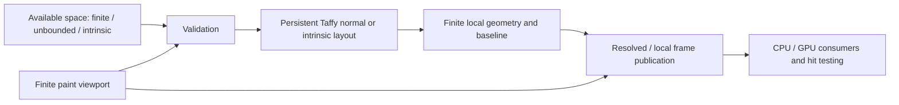

# Normal unbounded layout and an independent paint viewport

Follow-up (2026-11-16): [atomic responsive evaluation](RETAINED_ATOMIC_RESPONSIVE.md)
adds public resolved/local responsive methods with these independent inputs,
private query previews and final-only publication. It supersedes the missing
public-local-responsive and multi-stage-recovery items below for the framework
resolver. Ordinary UiTree methods keep their existing error semantics.
The later [parent-constraint stage](RETAINED_PARENT_CONSTRAINTS.md) adds hard
min/max/tight/loose root and isolated-subtree host intervals. Nested constraint
builders and structural adaptation remain open.

Updated 2026-11-16 on `codex/rendering-performance-research`. This extends
[intrinsic limits](RETAINED_INTRINSIC_LIMITS.md). The complete RFC remains open.

## Public contract

`LayoutAvailableSpace::Unbounded` now runs normal layout with no finite upper
bound. It is neither `MaxContent` nor `MinContent`, does not establish a
percentage basis and is not a floating-point infinity accepted through
`Definite`. Finite numeric layout inputs and viewport sizes remain nonnegative;
NaN and infinity are rejected before changing the frame environment.

`UiTree`, `ReactiveUi` and `LogicalUi` expose the same two entry points:

```rust
use gpui_box::retained::{LayoutAvailableSpace as A, LayoutConstraints, LayoutStyle, UiTree};

let mut ui = UiTree::new_layout(LayoutStyle::column(), 0)?;
let space = LayoutConstraints::new(A::Definite(800.0), A::Unbounded);
let frame = ui.frame_in_viewport(space, [800.0, 600.0])?;
let local = ui.local_frame_in_viewport(space, [800.0, 600.0])?;
Ok::<(), gpui_box::retained::Error>(())
```

The viewport is a finite logical paint/hit-test clip, independent of layout
available space. It is not a physical GPU allocation request, nor a new scroll
container. The layout may grow beyond that clip. A scrolling panel still needs
a bounded scroll host around its unbounded content; making the content itself
the scroll host does not automatically create a bounded visible extent.

Existing `frame([w,h])` and `local_frame([w,h])` use identical finite layout
and paint sizes. `frame_with_constraints` still derives a viewport from two
Definite axes; use the new API for intrinsic/unbounded axes. Explicit
MinContent/MaxContent inputs can also publish with a separate finite clip.
`measure_with_constraints` and `measure_node_with_constraints` continue to run
on an owned tree clone without changing published geometry or revision.

These are available-space inputs, not Flutter `BoxConstraints` min/max bounds.
ConstraintBuilder, general min/max parent constraints and structural adaptation
remain unimplemented. Reading an actual content width through the existing
container-query system does not supply those missing APIs.

## Decision: retain a tagged mode through the algorithm

Status: implemented in the research branch. The project-owned Taffy fork adds
`AvailableSpace::Unbounded`; the public framework contract owns its meaning.
Using `Definite(f32::INFINITY)` would establish an invalid percentage basis and
allow infinity into geometry. Mapping it to `MaxContent` would invoke the
intrinsic Flex contribution algorithm and can change the result. Neither is a
correct representation of normal unbounded layout.



In an unbounded Flex main axis, the container starts from the longest line's
sum of hypothetical outer sizes, gaps and content-box insets. The hypothetical
sizes already include used minimum/maximum constraints and margins. This skips
the intrinsic content-flex-fraction algorithm. For example, a child with
preferred main size 80, basis 20, minimum 0 and grow 1 produces a normal
unbounded main size of 20, while the MaxContent query yields 80. Both Row and
Column are covered. Grow does not fill infinity; an authored finite minimum
can create finite free space for normal Flex distribution.

Unbounded wrap uses one line until an actual main-axis maximum/known size
provides a wrap bound. Minimum wins over a smaller maximum. An actual cross
maximum can bound child measurement. Arithmetic preserves the tag through
subtraction/addition/minimum-only constraints; a real maximum can produce a
finite Definite bound. Text treats the unbounded inline axis as no wrap limit.
Explicit intrinsic style keywords and size containment still select their own
sizing semantics; Unbounded does not override them.

Legacy Grid uses normal indefinite track expansion, including finite `fr`
sizes derived from content, while intrinsic-only limited-min-content rules
remain intrinsic-only. Block and float integration handles the new input. This
is focused compatibility coverage for the kernel, not a public Grid contract.

Taffy's mixed cache key has a distinct quiet-NaN bit payload for the Unbounded
tag, separate from finite known/available dimensions and intrinsic infinity
tags. No NaN is passed as geometry. A known dimension supersedes available
space in that axis only. Tests distinguish run modes, requested axes, intrinsic
queries and the remaining unknown axis. The enum adds a variant in both
vendored Taffy and GPUI: downstream exhaustive matches must be updated. GPUI
scaling/conversion and its list adapters preserve the variant; this is a fork
API change rather than upstream source compatibility. CSS parsing deliberately
does not invent an `unbounded` keyword.

## Publication and containing blocks

The tree tracks layout constraints separately from its paint viewport. An input
change advances the frame environment once. Changed layout constraints require
layout; a viewport-only change requires full clip extraction but zero layout
runs. A corrected paint fast-path guard prevents reuse of the old clip during
that change. Local publication prepares the same environment and carries the
same constraints into its complete fallback. Old packets retain their original
geometry, clip and material ownership.

Damage compares the new viewport with published output, rather than the
already-prepared working environment. Empty/hidden output conservatively
requests full damage; zero-size clipping and hidden restoration are covered.
Invalid constraints or viewport are rejected before environment mutation.
This does not add atomic recovery for every later layout/publication failure.

Out-of-flow layout deliberately uses layout available space for the initial
containing block. In an indefinite axis the existing kernel falls back to the
root padding box. The paint viewport is never substituted. Absolute and
compatibility-only Fixed tests verify 50% sizing against that fallback and then
against changed definite layout input, even with a different paint viewport.
The public position enum still has Static/Relative/Absolute only. Complete CSS
fixed attachment, scroll and transform containing-block semantics remain open.

## Validation and costs

Windows / Rust 1.98.1 results and exact commands are in the
[evidence directory](performance/2026-11-16-unbounded-layout/README.md).
Framework regressions cover normal/intrinsic distinction, mixed finite/unbounded
axes, percent basis, bounds/wrap/growth, margins/gaps/nested allocation,
containment, OOF, hidden/zero-size restoration, full/selective agreement,
local publication, transactions/equal writes and old snapshots. A CPU raster
test asserts both a red pixel inside and a transparent pixel outside the finite
clip, with matching hit testing. A real bundled Noto paragraph test verifies
unbounded width, finite wrapping, restored baseline and viewport-only reuse.

The independent Chromium 156 block-axis reference passes 14 geometry assertions
for finite inline width and auto-height Column Flex. It does not establish
browser equivalence for an independently unbounded inline axis. Earlier
percentage/intrinsic-height differences remain documented in
[intrinsic limits](RETAINED_INTRINSIC_LIMITS.md).

Separating the inputs removes layout from viewport-only edits, as verified by
layout-run counters. Such edits still extract the complete scene to update the
clip. There is no timing benchmark, O(1), new GPU pixel or visible-presentation
claim here. Sustained 60/120Hz, full-chain tail latency, modern desktop GPU
effects and CPU smoothness qualification remain open. The tree gains two
available-space values plus Option bookkeeping; no measured memory improvement
is claimed. Intrinsic probes and owned measurement clones retain their costs.

Next framework work includes parent constraint builders/structural adaptation,
public local responsive output and atomic multi-stage failure recovery, general
query dependency proofs, broader Flex/percentage/baseline conformance,
last-baseline/vertical writing and device rounding. See the
[authoritative progress table](RETAINED_IMPLEMENTATION_PROGRESS.md) for the
remaining rendering, resource and presentation acceptance.
