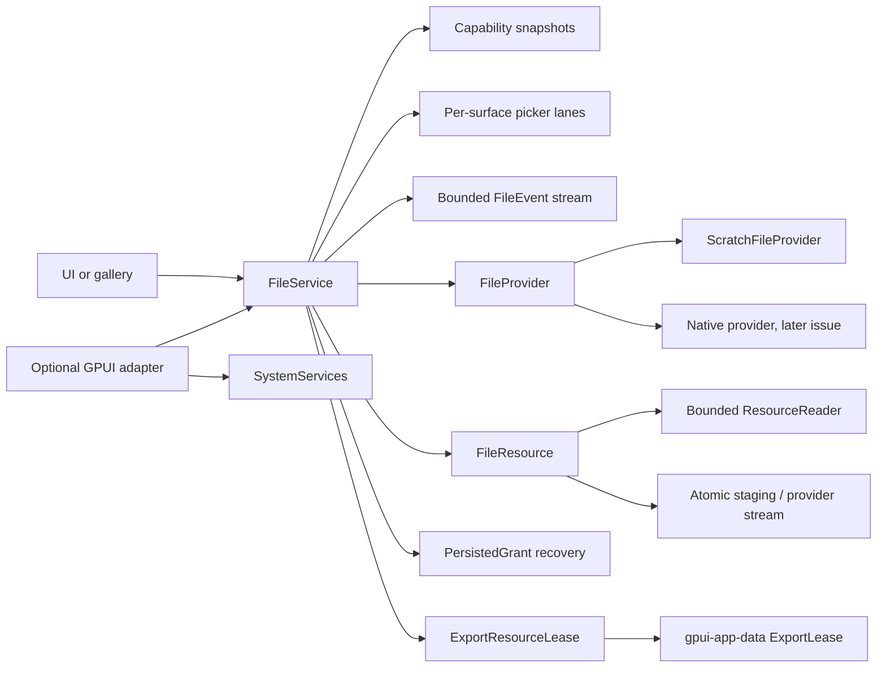

# Authorized file resources

This document describes `crates/gpui-files`, the resource-scoped file workflow
for [#23](https://github.com/jihuayu/gpui-box/issues/23). It builds on the
`gpui-system` contracts from [#19](https://github.com/jihuayu/gpui-box/issues/19)
and the private export leases in `gpui-app-data`. It installs no native provider:
Windows, macOS, Linux, Android and iOS are represented by capability manifests
only. Native pickers, security-scoped bookmarks, SAF `content://` transports and
share-sheet handoff remain provider issues (#25 and platform qualification).

## Scope and ownership

`gpui-files` owns:

- Opaque authorized resources and public-safe metadata.
- `open_file`, `open_files`, `pick_directory` and `save_file` picker flows,
  including per-surface serialization and host-lifetime checks.
- Bounded streaming reads and safe save/export policies.
- Durable grant probing, opaque token persistence and recovery outcomes.
- Consumer export leases pinned through `gpui_app_data::ExportLease`.

Picker grants are **not** `PermissionKind` values and never become durable
app-wide storage permission state. A file picked through a system picker reports
`PermissionState::NotRequired` for that resource operation; this means the system
picker itself is the authorization gesture, not that the application received
broad filesystem access. The permission domain from [#20](https://github.com/jihuayu/gpui-box/issues/20)
remains separate.

`gpui-box` exposes the crate through opt-in features:

```toml
gpui-box = { features = ["files"] }
gpui-box = { features = ["files-gpui"] }
```

The first imports `gpui_box::files`; the second also compiles the optional GPUI
adapter. Neither feature selects a desktop or Android backend.

## Architecture



`FileService` is `Rc`-backed and UI-local. It can be registered as a concrete
typed service with `SystemServices::register`, replaced explicitly with
`override_provider`, and installed in a GPUI `App` with
`gpui_adapter::install_file_service`. Clones share the provider, picker lanes,
subscribers and revision sequence.

`FileProvider` exposes four typed interactive operations plus grant restoration:

- `open_file(OpenFileOptions, FilePickerRequest, PickerCompletion<FileResource>)`
- `open_files(OpenFilesOptions, ..., PickerCompletion<Vec<FileResource>>)`
- `pick_directory(PickDirectoryOptions, ..., PickerCompletion<FileResource>)`
- `save_file(SaveFileOptions, ..., PickerCompletion<FileResource>)`
- `restore_grant(&PersistedGrant)`

A provider must return `Err` only when no dialog was presented. It retains the
completion and calls it from the platform callback, or completes inline when the
platform resolves synchronously. Exactly one completion is accepted.

## Opaque resource model

`FileResource` is a cloneable handle. Native paths, SAF URIs and Apple
security-scoped URLs/bookmarks remain inside its provider backend. Public
`ResourceMetadata` contains only:

| Field | Meaning |
| --- | --- |
| `id` | Process-local opaque `ResourceId`. |
| `display_name` | Sanitized base name, never a path. |
| `extension` | Sanitized lowercase extension, if any. |
| `mime_hint` | Coarse static hint, never a trusted type assertion. |
| `size` | Known byte size, if available. |
| `kind` | `File` or `Directory`. |
| `access` | `ReadOnly` or `ReadWrite`. |
| `write_atomicity` | `AtomicRename` or `NonAtomicTruncate`. |
| `durable_grant` | `Unsupported`, `SecurityScopedBookmark` or `PersistableUriGrant`. |
| `revision` | Public-safe change fingerprint, not an integrity proof. |

`Debug` for `FileResource`, `PersistedGrant`, `ExportResourceLease`, metadata,
errors and diagnostics deliberately omits native locations. `SystemError`
messages are static and contain no path, URI, bookmark, account identifier or
native exception payload. `DiagnosticEvent` has only request identity, phase and
an optional error code.

`release()` is idempotent and revokes reads, writes, streaming, grant persistence
and open readers on every clone immediately. A subsequent operation returns
`ErrorCode::PermissionDenied`. Dropping the final active clone also revokes
access. A provider backend receives a non-blocking `revoke` hook for native
security-scope or stream teardown; the final reader/export handle triggers it if
no `FileResource` clone remains. A `ResourceReader` retains the opaque state for
its own lifetime, so an in-progress read cannot outlive explicit release
unnoticed.

## Picker operations and host lifetime

Interactive calls require an `OperationContext` with a current `UiContext`:

1. `require_ui` rejects worker-thread calls, disposed owners and stale
   generations before any provider dialog is shown.
2. Cancellation observed before the provider call returns
   `Completion::Cancelled`, not an error.
3. The service serializes dialogs **per `SurfaceId`**. A concurrent prompt on the
   same surface returns `ErrorCode::Busy` with
   `RetryAdvice::AfterConditionsChange`. Different surfaces have independent
   lanes.
4. A lane is released on completion, dismissal, provider failure, cancellation,
   owner disposal, generation advance, or provider setup error.
5. A user dismissal is `PickerOutcome::Cancelled`, an ordinary typed result.
   Cooperative cancellation remains an outer `Completion::Cancelled`.
6. Late, duplicate, cancelled or generation-stale callbacks are rejected and
   cannot complete a newer request.

## Streaming I/O

Blocking and streaming operations require a background `OperationContext`
(`context.ui.is_none()`), matching `gpui-app-data`. A UI-attached context returns
`ErrorCode::InvalidInput` before any native I/O. Cancellation and deadlines are
checked before opening, before and after each chunk, before commit, and between
source chunks.

- `open_reader` returns a cancellation-aware `ResourceReader`. It also
  implements `std::io::Read` for adapters, applying release, context and
  cancellation checks on each call.
- `read_chunk` reads at most a validated chunk size; the default is 64 KiB and
  the maximum is 1 MiB.
- `read_chunks` invokes a callback per chunk and never materializes the full file
  in this crate.
- `copy_to_writer` streams to a caller writer.
- `save_from_reader` streams a blocking reader into the destination.
- `write_chunks` splits oversized caller chunks at the 64 KiB bound.

No operation intentionally copies a multi-megabyte file on the UI thread.

## Safe save, conflict and atomicity semantics

`WriteOptions` combines a `ConflictPolicy` and an `AtomicityPolicy`:

| Policy | Meaning |
| --- | --- |
| `ConflictPolicy::CreateNew` | Fail if any destination entry exists. |
| `ConflictPolicy::Overwrite` | Replace unconditionally. |
| `ConflictPolicy::ReplaceIfUnchanged { expected_revision }` | Replace only if the current fingerprint matches. |
| `AtomicityPolicy::BestEffort` | Permit a provider non-atomic stream. |
| `AtomicityPolicy::RequireAtomic` | Reject a provider without atomic rename before writing. |

A successful write returns `WriteReceipt { atomicity, bytes_written, new_revision }`.
`WriteAtomicity::AtomicRename` means a same-directory staging file was committed;
`WriteAtomicity::NonAtomicTruncate` means content may have been truncated in
place.

Directory-backed files use a same-directory `tempfile`, write and sync chunks,
re-check conflict/cancellation/deadline immediately before commit, then rename
(or atomically reserve a new name for `CreateNew`). Any error or cancellation
before commit drops the staging file and leaves the original target intact.
`RequireAtomic` is therefore always satisfied for this backend.

Provider-backed streams (simulated Android SAF or a cloud provider in the
deterministic harness) cannot guarantee rename atomicity. `RequireAtomic`
returns `ErrorCode::Unsupported` **before** writing. `BestEffort` truncates the
provider stream in place, enforces `AccessMode::ReadWrite` and the conflict
policy, and reports `NonAtomicTruncate`. A mid-stream disconnect, quota failure
or cancellation can leave the provider content partial; the receipt is never
returned as if the write were atomic. Mid-stream provider failures map to a
static `SystemError` with `RetryAdvice::AfterConditionsChange`.

`ReplaceIfUnchanged` on a directory-backed target is re-checked immediately
before rename, so a concurrent edit produces `ErrorCode::ResourceExpired`
instead of silently overwriting the newer content. `CreateNew` reports
`ErrorCode::InvalidInput` with `RetryAdvice::ModifyRequest` when the name exists.
Read-only grants reject writes with `ErrorCode::PermissionDenied` before touching
the destination.

## Durable grants and recovery

`persist_grant` probes `DurableGrantSupport` on the resource. Unsupported
resources return `ErrorCode::Unsupported`; supported resources return a bounded
opaque `PersistedGrant` (at most 16 KiB). Its serialized bytes are provider-private
and its `Debug` reports only the length.

`restore_grant` and `restore_grant_bytes` run on a background context and return
`GrantRestoreOutcome`:

| Outcome | Application action |
| --- | --- |
| `Restored { resource, refreshed_grant }` | Continue with fresh metadata and token. |
| `Revoked` | Treat access as revoked and re-prompt. |
| `MissingOrMoved` | The resource disappeared or moved; re-prompt. |
| `InvalidOrCorrupt` | Do not trust the token; re-prompt. |

Malformed, empty and oversized tokens are `InvalidOrCorrupt`, not panics. A
restore never presents UI and never promotes a resource grant into app-wide
permission state.

## Consumer export leases

`ExportResourceLease` stages content through `gpui_app_data::AppData`:

- `stage_export_bytes` stages owned bytes through the `AppData` byte API.
- `stage_export_from_reader` creates the pin first, then streams a caller reader
  directly into the pinned export in bounded chunks.
- `lease_resource_for_export` streams an authorized `FileResource` the same way
  and retains its opaque handle for the consumer lifetime.

The inner `gpui_app_data::ExportLease` pins the export against
`cleanup_exports(Duration::ZERO, ...)`, including across an active native
consumer handoff. `release()` drops the pin early without deleting the file;
dropping the lease has the same pin-release effect. A later cleanup can then
remove the unleased export. `path()` is available to the native handoff, but the
path is deliberately absent from `Debug`.

## Five-platform contract

No native provider is installed in this revision. `PROVIDER_MANIFEST` contains
five entries with `native_provider_installed: false` and
`Evidence::ContractOnly`. The table is a contract, not runtime verification.

| Platform | Contracted `FileOperation` capabilities | Picker / authorization model | Safe-write caveat |
| --- | --- | --- | --- |
| Windows x86_64 | `OpenFile`, `OpenMultipleFiles`, `PickDirectory`, `SaveFile`, `StreamingIo`, `PersistGrant`, `LeasedExport` | `IFileOpenDialog` / `IFileSaveDialog` grants are user-driven and distinct from broad storage permissions. | Same-directory staging plus replace/rename; antivirus and sharing violations surface as retryable platform failures. |
| macOS | Same seven operations | `NSOpenPanel` / `NSSavePanel`; security-scoped URLs may be bookmarked for later sessions. | Atomic rename is available for local files; bookmark resolution can fail independently of the file. |
| Linux | Same seven operations | XDG desktop portal `FileChooser` and document portal; portal-scoped document handles are not a general filesystem permission. | Sandboxed portal paths and rename behavior depend on the portal implementation. |
| Android arm64 | Same seven operations | SAF `ACTION_OPEN_DOCUMENT` / `ACTION_CREATE_DOCUMENT`; persistable URI grants are resource-scoped. | SAF streams have no general atomic rename; use `RequireAtomic` only when the provider advertises it, otherwise `BestEffort`. |
| iOS | Same seven operations | `UIDocumentPicker`; security-scoped URLs/bookmarks are resource-scoped. | Coordination and provider behavior can fail after pick; `RequireAtomic` is provider-declared, never assumed. |

The deterministic capabilities of `ScratchFileProvider` use `Support::Native`,
`Availability::Available`, `Configuration::Ready`,
`PermissionState::NotRequired` and `Evidence::ContractOnly`. Local scratch files
report `AtomicRename`; simulated SAF/cloud streams report `NonAtomicTruncate`.

## Redaction rules

- Native paths, URLs, `content://` URIs, bookmarks and account identifiers never
  appear in public metadata, `Debug`, `SystemError` or `DiagnosticEvent`.
- Providers must create only static error messages. Native exception text is not
  copied into `SystemError`.
- `display_name` is a sanitized base name. Directory components are removed.
- Grant bytes are opaque provider data; treat them as private even though their
  `Debug` representation is safe.

## Optional GPUI adapter

The `gpui` feature adds:

- `install_file_service` and `file_service` over GPUI's typed `SystemServices`.
- `run_file_request`, which supplies GPUI's deadline timer.
- `open_file`, `open_files`, `pick_directory` and `save_file` foreground task
  helpers.
- `PathPromptOptions` conversions from the typed options. Extension filters are
  not representable in this GPUI revision's prompt shape and remain provider
  validation hints.
- `spawn_read_chunks`, `spawn_save_bytes` and `spawn_lease_export`, which move
  owned `Send` work to `cx.background_executor()`.
- `FileEntityScope`, which retains file event subscriptions alongside a
  `gpui_system::gpui_adapter::EntityScope` and invalidates the UI owner on entity
  release.

## Deterministic harness

`ScratchFileProvider` performs no OS dialog and exposes no path through public
metadata. It can:

- Create local scratch files, directories, read-only files and durable files.
- Create provider-backed streams that report `NonAtomicTruncate` and optionally
  inject read or write faults.
- Queue picker selections, auto-complete inline, or leave completions pending
  for serialization, cancellation, disposal and generation tests.
- Persist and restore grants in memory and across provider reopens of the same
  scratch root.
- Revoke grants and simulate moved or deleted targets.

Its `root()` accessor exists only so tests can mutate the scratch directory to
simulate races, moves and deletions. It must not be used in diagnostics.

## Verification

Use the repository toolchain selected by `mise.toml`:

```sh
cargo fmt --all -- --check
cargo test --locked -p gpui-box -p gpui-box-cli -p gpui-android -p gpui-system -p gpui-permissions -p gpui-files
cargo clippy --locked -p gpui-box -p gpui-box-cli -p gpui-android -p gpui-system -p gpui-app-data -p gpui-permissions -p gpui-files --all-targets -- -D warnings
cargo check --locked -p gpui-files --features gpui --all-targets
cargo check --locked -p gpui-box --features "app-data permissions-gpui files-gpui"
cargo run --locked -p gpui-files --example document_workflow
mise tasks validate
git diff --check
```

`gpui-app-data` is omitted from the cross-package `cargo test` command on Linux
because of an upstream Windows-only test. Its integration is exercised through
`gpui-files` export-lease tests and the `gpui-box` facade checks. The behavioral
suite covers the complete pick/read/edit/save/export workflow, per-surface
picker serialization and host lifetime rejection, grant recovery and corruption,
atomic versus non-atomic writes, conflict rechecks, revocation, multi-megabyte
streaming, mid-stream cancellation cleanup, UI-context rejection, export pinning,
multi-subscriber reentrancy and strict redaction.
