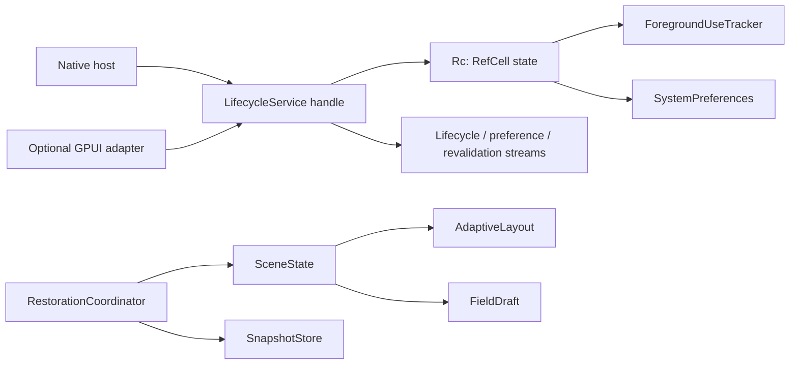

# Lifecycle, preferences and state restoration

This is the compilable substrate for [#21](https://github.com/jihuayu/gpui-box/issues/21)
under the system integration roadmap [#18](https://github.com/jihuayu/gpui-box/issues/18)
and [#19](https://github.com/jihuayu/gpui-box/issues/19). It defines contracts and
deterministic harnesses. Native providers are implemented by their individual
issues; #2 owns the Android host boundary and is not modified here.

## Architecture

`gpui-lifecycle` owns process-lifecycle observation, system-preference modelling,
versioned UI restoration and monotonic foreground-use accounting. Its default
build depends only on `gpui-system` and the Rust standard library. The optional
`gpui` feature adds adapters over the workspace's coordinated GPUI identity.



`LifecycleService` is a cheap-to-clone handle over one
`Rc<RefCell<..>>` state. `SystemServices` stores it as `Rc<LifecycleService>`,
so callers holding `&LifecycleService` can query it, subscribe to streams, and
apply host transitions without `&mut`. Every mutator first checks
`require_ui_thread()`. State borrows are always released before an event is
published, so a synchronous `Waker::wake` callback may query, subscribe or
mutate the service while an event is being delivered without panicking.

Queries include `phase`, `preferences`, `network_status`, `session_lock`,
`memory_pressure`, `surface`, `rejections`, `active_duration`, `idle_state`,
`last_wall_clock` and `revision`. Host transitions include `register_surface`,
`rotate_surface`, `apply_surface_at`, `detach_surface_at`, `set_phase_at`,
`set_preferences`, `set_network_status`, `set_session_lock`,
`set_memory_pressure`, `record_input_at`, `set_idle_state` and
`record_wall_clock_observation`.

Host callbacks are accepted only for the exact registered generation of an
attached surface. Older callbacks, callbacks for detached surfaces and
callbacks for unknown surfaces return `Ok(false)` and append to a bounded log of
redacted `RejectedCallback` records containing only numeric identities and
`DiagnosticPhase::LateCallbackDiscarded`. A stale callback cannot detach, mutate
or revive a surface, and rotating a surface closes the old visibility interval
before the recreated surface is reported.

## Multi-subscriber event streams

Three bounded streams are available through `&self`:

- `subscribe_lifecycle()` yields `LifecycleEvent` values for phase, device lock,
  memory pressure, surface changes and surface detachments.
- `subscribe_preferences()` yields the full `SystemPreferences` snapshot.
- `subscribe_revalidation(scope)` yields `RevalidationEvent` values with a
  `QueryClient` or `ScreenModel` scope.

Each caller gets its own bounded `gpui_system::event_channel`. The service keeps
one sender per subscriber, removes it in the channel's drop cleanup, and also
prunes senders whose `send` reports a closed receiver. Any number of subscribers
may attach concurrently.

Entering a foreground phase from `Background` or `Suspended` automatically
publishes `RevalidationEvent::AppResumed { generation }` with a fresh resume
generation. A network-status change automatically publishes
`RevalidationEvent::NetworkChanged(status)`. Overflow is reported per subscriber
as `Event::ResyncRequired` and cleared with `acknowledge_snapshot`.

## Preferences and adaptive layout

`PreferenceValue<T>` distinguishes `Known(T)` from `Unavailable`. Missing
platform signals never masquerade as OS defaults. `TextScale` rejects
non-finite or out-of-range values instead of clamping them. `LocaleTag`
accepts only ASCII BCP-47-style subtags. `SystemPreferences` covers appearance,
text scale, locale, reduced motion and high contrast.

`ViewportMetrics` carries logical size, scale factor, safe-area insets and
keyboard occlusion. `SizeClass` derives `Compact`, `Medium` or `Expanded` from
available width divided by the effective text scale. `SceneState` retains the
route identity, focus target, every `FieldDraft` (committed value, draft text,
UTF-16 and byte selections, active composition) while preferences and viewport
metrics change. Adaptation never rewrites drafts or selection.

## Foreground-use intervals and the background guard

`ForegroundUseTracker` records this application's foreground-visible intervals
with a `ProcessId`, `SessionId` and monotonic `Instant` timestamps.

`VisibilityUnion` opens an interval only when the phase is
`ForegroundActive`/`ForegroundInactive` **and** at least one surface is
logically `Visible`. A surface reported visible during `Launching`, `Background`
or `Suspended` is retained as visible but does not accrue foreground time.
Leaving foreground closes the open interval at `now` while keeping the visible
surface set, so a later resume opens a fresh interval at the resume instant.

All windows share one union: opening the first window during foreground starts
an interval and hiding the last one closes it, so overlapping windows contribute
once. With window A visible on `[0, 10]` and window B visible on `[5, 15]`, the
union is a single `15`-unit interval, not `20`. `active_duration(now)` includes a
still-open interval.

`LastInputActivity` and platform-measured `IdleState` are separate observations.
Input never extends visibility time, and `IdleState::Unavailable` is distinct
from measured idleness. Wall-clock observations are retained only for
diagnostics; every elapsed duration uses `Instant`, so `SystemTime` jumps
backwards or forwards cannot corrupt active elapsed time.

## Versioned restoration and multi-hop migrations

`VersionedSnapshot` encodes route parameters, focus, selection ranges and
uncommitted drafts behind a `SchemaVersion`. `SnapshotStore` is the pluggable
byte-storage boundary. The core ships `InMemorySnapshotStore`; persistent
storage integrates through [#22](https://github.com/jihuayu/gpui-box/issues/22)
by implementing the same trait. No `gpui-app-data` dependency is required.

Each `SchemaMigration` declares an explicit `from` and `to` version. `restore`
follows registered hops in a bounded loop, requiring strict forward progress on
every hop: `next > current` and `next <= expected`. After each hop it peeks the
encoded schema and requires the bytes to carry the declared `to` version.
Missing hops, cycles, downgrades, overshoot, mismatched output or a migration
error return `SchemaMismatch`. A `v1 -> v2 -> v3` chain therefore restores into
a `v3` coordinator and reports `Migrated { from: v1, snapshot }`.

`RestorationCoordinator` reports an explicit `RestoreOutcome`:

- `Restored` for a matching schema.
- `Migrated` when the chain reaches the expected version.
- `SchemaMismatch` when a hop is missing or violates forward progress.
- `CorruptSnapshot` for malformed bytes, truncated payloads or invalid UTF-8.
- `AbsentSnapshot` when nothing is stored.
- `SaveFailed` when the store rejects a write.
- `StaleGeneration` when the host generation advanced after the restore was
  requested. Live scene state is left untouched.

No outcome panics. `restore_into` applies a snapshot only for `Restored` or
`Migrated`, so a late callback cannot clobber newer host state.

## Five-platform capability and evidence matrix

`PROVIDER_MANIFEST` is deliberately conservative. This crate installs no
native lifecycle provider on any platform; host/runtime evidence belongs to the
platform and service issues.

| Platform | Core contract | GPUI adapter | Native provider and runtime |
| --- | --- | --- | --- |
| Windows x86_64 | Available with std and `gpui-system` only | Feature-gated mapping over workspace GPUI | Not installed; `ContractOnly` evidence |
| macOS | Available with std and `gpui-system` only | Feature-gated mapping over workspace GPUI | Not installed; #8 platform qualification |
| Linux | Available with std and `gpui-system` only | Feature-gated mapping over workspace GPUI | Not installed; #8 session/portal evidence |
| Android | Available with std and `gpui-system` only | Feature-gated; requires an Android host build | Not installed; #2 owns host safety and device/emulator acceptance |
| iOS | Available with std and `gpui-system` only | Feature-gated; requires an iOS host build | Not installed; #9 host/device qualification |

These contracts make no claim about a native lifecycle provider, OS dialog or
persistent store; those belong to the platform and service issues above.

## Optional GPUI adapter

With `--features gpui`, `gpui_adapter` maps `gpui::AppLifecyclePhase` and
`gpui::WindowAppearance` onto the distribution vocabulary, reads
`gpui::App::window_appearance`, creates entity-owned
`gpui_system::gpui_adapter::EntityScope` values, observes lifecycle selectors
through `gpui_system::gpui_adapter::observe_selector`, and installs a
`LifecycleService` into the global `SystemServices` registry.
`lifecycle_service(cx)` returns the shared `Rc<LifecycleService>` handle for
`&self` queries, subscriptions and transitions.

The facade exposes the crate through `gpui-box`'s `lifecycle` feature and the
adapter through `lifecycle-gpui`.

## Example

`crates/gpui-lifecycle/examples/restoration_flow.rs` demonstrates the shared
service through `SystemServices`, multiple lifecycle/preference/revalidation
subscribers, the foreground background guard across `Launching -> Foreground ->
Background -> Foreground`, and a `v1 -> v2 -> v3` restoration. Run it with:

```sh
cargo run --locked -p gpui-lifecycle --example restoration_flow
```

## Validation commands

```sh
cargo test -p gpui-lifecycle
cargo fmt --all
cargo fmt --all -- --check
cargo test --locked -p gpui-system -p gpui-lifecycle -p gpui-box
cargo test --locked -p gpui-lifecycle --features gpui
cargo clippy --locked -p gpui-system -p gpui-lifecycle -p gpui-box --all-targets -- -D warnings
cargo clippy --locked -p gpui-lifecycle --features gpui --all-targets -- -D warnings
cargo check --locked -p gpui-lifecycle --features gpui --all-targets
cargo check --locked -p gpui-box --features "app-data lifecycle-gpui"
cargo run --locked -p gpui-lifecycle --example restoration_flow
git diff --check
```

Behavioral coverage includes preference and text-scale transitions preserving
route, focus, selection and composition; host recreation rejecting stale
callbacks; background/resume and lock/unlock; overlapping visible windows
producing one monotonic union; visibility during `Launching`/`Background` not
accruing foreground time until `ForegroundActive` and reopening cleanly on
resume; wall-clock shifts leaving elapsed time untouched; save failures; corrupt
bytes; multi-hop `v1 -> v2 -> v3` migration plus cycle, non-progress,
missing-hop and mismatched-output rejection; external byte-store integration;
multiple concurrent subscribers on all three streams; synchronous `Waker`
reentrancy during publication; scoped subscription cleanup; and bounded overflow
with `ResyncRequired` plus `acknowledge_snapshot`.
