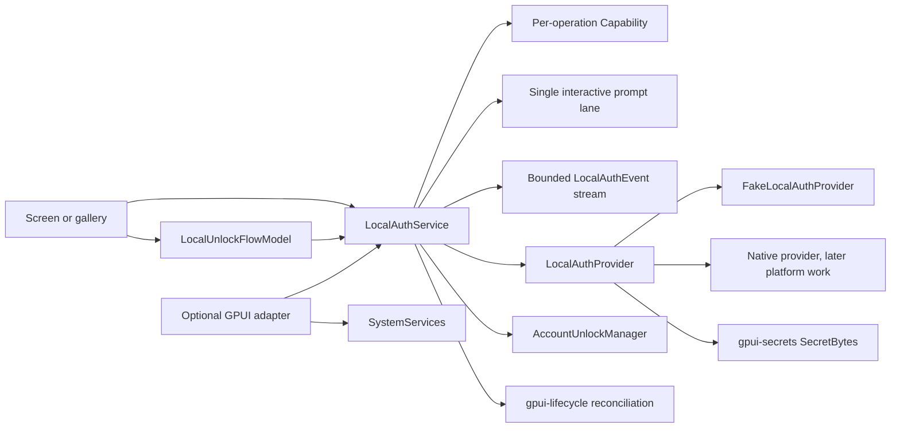

# Local authentication contracts

This document describes `crates/gpui-local-auth` for
[#28](https://github.com/jihuayu/gpui-box/issues/28). The crate builds on the
`gpui-system` request and capability contracts, `gpui-lifecycle` for foreground
and session state, and `gpui-secrets` for zeroizing credential bytes. It installs
no native provider and never synthesizes a Windows Hello, Touch ID, Android
BiometricPrompt or Linux portal dialog.

## Three operations that must not be conflated

| Concern | Contract here | What it proves |
| --- | --- | --- |
| Local user presence | `LocalAuthOperation::VerifyUser` | A local factor was accepted for one bounded operation. |
| Authentication-bound key or secret access | `UnlockProtectedSecret`, `SignChallenge` | The provider released a protected secret or signed a bounded challenge after local verification. |
| Remote account authentication | **Not in this crate** | Nothing. Passkey, WebAuthn and server-side account sessions are separate protocols. |

A `LocalVerificationReceipt` is not an account session, an OAuth token, a
Passkey assertion or durable authorization. It is a narrow, unforgeable
observation with private fields and crate-private construction. An application
must still apply its own `UnlockPolicy` before treating local verification as an
unlock.

Likewise, `ProtectedSecretOutcome::Unlocked` and
`ProtectedSignatureOutcome::Signed` are provider outcomes, not proof of remote
identity. A local signature over a challenge does not replace a server-issued
nonce, audience check or account binding.

## Crate and feature surface

`gpui-box` exposes the crate through two opt-in features:

```toml
gpui-box = { features = ["local-auth"] }
gpui-box = { features = ["local-auth-gpui"] }
```

The first imports `gpui_box::local_auth`; the second also enables the GPUI
adapter and the shared GPUI system/lifecycle adapters. Neither selects a desktop
or Android backend by itself.

`gpui-local-auth` has no GUI dependency in its normal dependency graph. Its optional `gpui` feature
adds `gpui-system/gpui`, `gpui-lifecycle/gpui` and the adapter. The adapter's
`#[gpui::test]` suite uses a dev-dependency on `gpui/test-support`; that larger
test-only dependency graph is compiled only for tests and is never enabled for
production consumers.

## Architecture



`LocalAuthService` is `Rc`-backed and UI-local. It can be registered as a
concrete service with `SystemServices::register`, or installed in a GPUI app with
`gpui_adapter::install_local_auth_service`. Clones share one provider, one active
prompt lane and all observations.

## Capability and operation contracts

Each operation publishes its own `Capability<LocalAuthOperation>` and `Evidence`.
A snapshot is a point-in-time observation, not a grant. Providers must recheck
conditions when executing.

Before invoking a provider, `LocalAuthService` gates the requested operation on
a fresh capability observation. `Support::Unsupported` completes immediately
with `ErrorCode::Unsupported`; `Configuration::Ready` is required, otherwise the
request completes with `ErrorCode::InvalidConfiguration`. Both use
`RetryAdvice::Never` and never occupy the prompt lane or enqueue a fake prompt.
`Support::Native` and `Support::Conditional` continue to execution-time checks.

| Operation | Interactive | Contract |
| --- | --- | --- |
| `QueryAvailability(VerificationPolicy)` | No | `query_availability` returns `LocalAuthSnapshot`. It never displays UI, even when unenrolled. A background `OperationContext` is valid. |
| `VerifyUser(VerificationPolicy)` | Yes | `verify_user(VerificationRequest, OperationContext)` returns `Request<VerificationOutcome>`; requires a live UI context and an unlocked, foreground owner surface. |
| `UnlockProtectedSecret` | Yes | `unlock_protected_secret(ProtectedSecretRequest, OperationContext)` returns `Request<ProtectedSecretOutcome>` and composes with `SecretBytes`. |
| `SignChallenge` | Yes | `sign_challenge(SignatureRequest, OperationContext)` returns `Request<ProtectedSignatureOutcome>` over 1–4096 bounded challenge bytes. |

`VerificationPolicy` is `BiometricOnly` or `BiometricOrDeviceCredential`.
`VerifiedFactor` distinguishes an actual biometric acceptance from
`DeviceCredentialFallback`. `PolicyFallbackRequired` is returned when the caller
requested biometric-only and the OS or device policy insisted on the
device-credential fallback.

`LocalAuthReadiness` distinguishes `Available`, `NotEnrolled`, `LockedOut`,
`HardwareMissing`, `PolicyRestricted` and `Unavailable`. These are readiness
states, not interactive outcomes; a stale snapshot cannot authorize a prompt.

`VerificationPurpose`, `AccountId` and `ProtectedKeyId` are validated and
control-character free. Purposes are trimmed and bounded to 256 UTF-8 bytes;
account and key identifiers are bounded to 128 bytes. Their `Debug`
implementations are redacted (`AccountId([REDACTED])`,
`ProtectedKeyId([REDACTED])`, `VerificationPurpose([REDACTED])`). Provider
errors use static messages and never interpolate an account, purpose, key or
secret. `ProtectedSecretOutcome` custom `Debug` prints `Unlocked([REDACTED])`.

## Prompt serialization and stale callbacks

Only one interactive prompt may be active across all three interactive
operations. A concurrent request immediately fails with `ErrorCode::Busy` and
`RetryAdvice::AfterConditionsChange`; it does not queue behind the active prompt.

Interactive requests require:

- a live `UiContext` obtained on the owning UI thread (`require_ui`);
- a current context (`check_at`);
- no cancellation;
- if lifecycle state has been reconciled: a foreground phase, an unlocked
  session, and a visible owning surface at the exact registered generation.

A native completion is accepted only for the active token, operation, surface
and generation. The callback is then revalidated against cancellation, deadline,
owner generation and lifecycle. A late completion returns `false`, records a
redacted `RejectedAuthCallback` with `DiagnosticPhase::LateCallbackDiscarded`,
emits `LocalAuthEvent::CallbackRejected`, and never produces `Verified`,
`Unlocked` or `Signed`.

Stale callbacks are rejected after window close (`UiOwner::dispose`), surface
recreation (`advance_generation` or lifecycle generation change), backgrounding,
session lock, `CancellationToken` cancellation and deadline timeout.

`reconcile_lifecycle(&LifecycleState, now)` and
`reconcile_host_state(&LocalAuthHostState, now)` cancel an in-flight prompt for
those hazards and emit `PromptCancelled` so screens can return to a coherent
state on resume. Hosts that only have lifecycle attributes can build a
`LocalAuthHostState` directly; it carries phase, session lock, surface snapshots
and the lifecycle revision.

Readiness observations are retained per `VerificationPolicy`.
`snapshot_for_policy(policy)` returns the last snapshot for one policy, while
`snapshot()` returns the most recent observation overall. `AvailabilityChanged`
is emitted on the first observation for a policy and whenever that policy's
readiness changes; querying another policy does not overwrite its state.

## Protected secrets, protected keys and invalidation

`ProtectedSecretOutcome` is one of `Unlocked(SecretBytes)`, `UserCancelled`,
`NotEnrolled`, `LockedOut`, `HardwareMissing`, `PolicyFallbackRequired`,
`KeyInvalidated` or `SecretNotFound`. `SecretBytes` has no `Debug`, `Clone` or
serde implementation and zeroizes its owned buffer on drop. Those boundaries are
frozen by `compile_fail` doc tests.

`SignatureReceipt` carries the algorithm (`EcdsaP256Sha256` or `Ed25519`), the
signature bytes, the verification instant and the factor. A signature is public
data; the protected key is not.

`KeyInvalidated` is distinct from `SecretNotFound` or `KeyNotFound`. A provider
must report it when biometric enrollment changed, a key was rotated or the
protected material can no longer be released under the current enrollment.
Callers should treat it as a re-enrollment and re-verification recovery path, not
as a transient retry.

The crate does not specify native storage formats. `FakeLocalAuthProvider` keeps
secrets in `SecretBytes` and models an enrollment epoch; it is a deterministic
test provider, never a runtime fallback. Tests may override one operation's
advertised support or configuration with `set_operation_support`,
`set_operation_configuration` and `clear_capability_overrides`. Its `Debug`
output is redacted to readiness, revision, epoch and counts; it never prints
accounts, key identifiers, purposes or secret bytes.

## Application unlock and relock policy

`UnlockPolicy` is owned by the application:

| Field | Rule |
| --- | --- |
| `idle_timeout` | Non-zero; extended by `touch_activity` but never beyond the receipt lifetime. |
| `max_lifetime` | Non-zero; absolute cap from the receipt's `verified_at`. |
| `max_receipt_age` | Non-zero; a receipt older than this cannot start an unlock. |
| `relock_on_background` | Relock when lifecycle leaves the foreground. |
| `relock_on_session_lock` | Relock when the device session locks. |
| `relock_on_account_switch` | Relock the previous active account on switch. |
| `allow_device_credential_fallback` | When false, reject `DeviceCredentialFallback` receipts. |

`AccountUnlockManager::grant_unlock` rejects future receipts, stale receipts,
already-consumed `(surface, generation, revision)` receipts and fallback factors
when the policy forbids them. `status` resolves idle and maximum-lifetime expiry,
`touch_activity` extends the idle deadline monotonically and never revives an
expired grant, and `reconcile_lifecycle` applies background and session-lock
relocking at an explicit instant. Accounts are tracked independently, so
`alice` does not inherit `bob`'s unlock.

`LocalUnlockFlowModel` is the screen-owned state machine
`Locked → CheckingAvailability → Prompting → Unlocked` (or
`RecoveryRequired`). It couples an account, an `UnlockPolicy` and a
`VerificationPolicy` without owning components or native UI.

## Five-platform capability and evidence matrix

| Platform | Native provider installed | `QueryAvailability` | `VerifyUser` | `UnlockProtectedSecret` / `SignChallenge` | Evidence |
| --- | --- | --- | --- | --- | --- |
| Windows | No | Contract only | Contract only; Windows Hello provider remains platform work | Contract only | `ContractOnly` |
| macOS | No | Contract only | Contract only; LocalAuthentication provider remains platform work | Contract only | `ContractOnly` |
| Linux | No | Contract only; `LinuxLocalAuthConfig` is `Unconfigured` or a host-selected backend id | Contract only; no portal/PAM prompt is synthesized | Contract only | `ContractOnly` |
| Android | No | Contract only | Contract only; BiometricPrompt provider remains platform work | Contract only | `ContractOnly` |
| iOS | No | Contract only | Contract only; LocalAuthentication provider remains platform work | Contract only | `ContractOnly` |

`PROVIDER_MANIFEST` in the crate records all five platforms with no installed
native provider and `Evidence::ContractOnly`. On Linux,
`UnavailableLocalAuthProvider` reports `Availability::Unavailable`,
`Evidence::ContractOnly`, and `Configuration::Required` for an unconfigured
backend (the shared `gpui-system` configuration vocabulary has no separate
"missing configuration" variant). A configured backend id is still reported as
unavailable until a real provider publishes runtime evidence. No path fakes a
biometric prompt.

A successful compile is not runtime evidence. Platform providers must update the
manifest and publish per-operation runtime evidence before claiming support.

## Validation

Run from the repository root:

```sh
cargo fmt --all -- --check
cargo test --locked -p gpui-local-auth
cargo test --locked -p gpui-local-auth --features gpui
cargo run --locked -p gpui-local-auth --example protected_secret_unlock
cargo clippy --locked -p gpui-local-auth --all-targets -- -D warnings
cargo clippy --locked -p gpui-local-auth --features gpui --all-targets -- -D warnings
cargo check --locked -p gpui-box --features "app-data permissions-gpui lifecycle-gpui activation-gpui secrets files-gpui local-auth-gpui"
mise tasks validate
git diff --check
```

The adapter's `#[gpui::test]` suite runs under `--features gpui`. The
`gpui/test-support` dependency is test-only and is not enabled for production
consumers.

Behavioral coverage includes non-interactive readiness versus interactive
verification, biometric and device-credential factors, fallback policy, prompt
serialization, all five stale-callback hazards, receipt anti-replay, account
isolation, idle and maximum-lifetime relocking, resume reconciliation, protected
secret and signature invalidation on enrollment change, redaction and
multi-subscriber `Waker` reentrancy.
