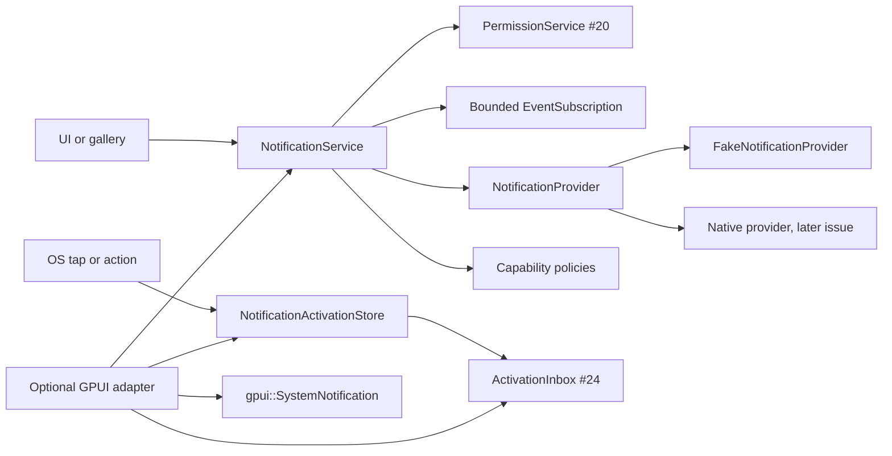

# Local notifications, receipts and activation routing

This document describes `crates/gpui-notifications`, the immediate local
notification service for
[#26](https://github.com/jihuayu/gpui-box/issues/26). It is built on the shared
contracts from [#19](https://github.com/jihuayu/gpui-box/issues/19), permission
status and recovery from [#20](https://github.com/jihuayu/gpui-box/issues/20),
private settings from [#22](https://github.com/jihuayu/gpui-box/issues/22) and
durable activation routing from [#24](https://github.com/jihuayu/gpui-box/issues/24).
It installs no native provider. Platform notification providers and their host
acceptance remain separate work.

## Scope and ownership

`gpui-notifications` owns:

- bounded notification identities and validated content;
- submission receipts for immediate post, stable-ID replacement and withdrawal;
- the distinction between provider submission, observed display and user
  activation;
- capability-gated action buttons, progress and delivery receipts;
- durable activation reconstruction metadata and warm/cold-launch routing;
- an optional GPUI bridge over the coordinated engine's desktop notification API.

The crate never stores notification title, body, action labels or channel text in
activation metadata. It persists only route reconstruction targets. Native
providers, manifest generation, APK/bundle packaging and device acceptance remain
platform-owned.

`gpui-box` exposes the crate through opt-in features:

```toml
gpui-box = { features = ["notifications"] }
gpui-box = { features = ["notifications-gpui"] }
```

The first imports `gpui_box::notifications`; the second also compiles the GPUI
adapter against the workspace GPUI package. Neither feature selects a desktop or
Android backend on its own.

## Architecture



`NotificationService` is `Rc`-backed and UI-local. It owns one provider and a
shared `PermissionService`, can be registered as a concrete typed service with
`SystemServices::register`, and is installed into a GPUI `App` with
`gpui_adapter::install_notification_service`. The durable store and inbox are
blocking background primitives; they reject UI-bound operation contexts.

## Identities, content and redaction

`NotificationId` accepts 1–128 ASCII alphanumeric, `-`, `_` or `.` bytes. This is
the same shape accepted by `gpui_activation::ActivationId::new`, so a notification
identity can be reconstructed as a durable activation payload without lossy
conversion. Its `Debug` output is always redacted. `ProviderNotificationId` is an
optional opaque provider handle with its own bounded validation and redacted
`Debug`.

`NotificationContent` validates:

- a non-empty single-line title up to 256 bytes;
- a body up to 4096 bytes (empty and multi-line bodies are allowed);
- an optional channel identity of up to 64 identifier bytes;
- at most eight action buttons with unique identities and bounded labels;
- optional progress with `1 <= total <= 1_000_000` and `completed <= total`;
- an optional activation binding with a default target and one target per
  declared action.

Content and binding `Debug` implementations intentionally reveal only counts and
presence flags. Title, body, channel, labels and route parameters never appear in
diagnostics or `SystemError` messages. Route parameters are still persisted where
reconstruction requires them; applications must not put credentials or
authentication tokens in activation parameters.

## Capabilities and authorization

`NotificationOperation` covers:

| Operation | Source |
| --- | --- |
| `QueryAuthorization` | Delegated to the permission provider for `PermissionKind::Notifications` |
| `RequestAuthorization` | Delegated to `PermissionService`, which serializes the single native prompt |
| `PostImmediate` | Notification provider |
| `ReplaceById` | Notification provider |
| `WithdrawById` | Notification provider |
| `ActionButtons` | Notification provider |
| `ProgressUpdates` | Notification provider |
| `DeliveryReceipt` | Notification provider |
| `ActivationRouting` | Notification provider contract |

`PROVIDER_MANIFEST` has all five platform entries at
`native_provider_installed: false` and `Evidence::ContractOnly`. Capability
snapshots never prompt and confer no authorization. `post` and `replace` re-probe
the permission provider and the notification provider at execution time.

`NotificationService::post` and `replace` return
`Result<PostOutcome, SystemError>`. Malformed content is `InvalidInput`.
Expected platform conditions are `PostOutcome::Rejected(PostRejectReason)`, which
callers can turn into a typed error with `into_result()` or inspect for recovery:

| Condition | `PostRejectReason` | Error code | Recovery |
| --- | --- | --- | --- |
| User denial or not determined | `PermissionDenied { can_request_again, recovery }` | `PermissionDenied` | `OpenSettings` at notification settings |
| Notification center/server or channel disabled | `ChannelOrServerDisabled` | `Unavailable` | `OpenSettings` at notification settings |
| Missing bundle/AUMID/application identity or provider configuration | `MissingApplicationIdentity` | `InvalidConfiguration` | `RepairConfiguration` |
| Provider capability unavailable | `UnavailableProvider` | `Unavailable` | `ProbeAgain` |
| Operation not implemented by this provider | `Unsupported(operation)` | `Unsupported` | none |

`PermissionStatus::NotDetermined` is treated as requestable
(`can_request_again: true`) but is still a rejection until a contextual request
succeeds. A permanently denied status never loops on a prompt the OS will not
show. `Limited` and `NotRequired` are usable.

Action buttons, progress and delivery receipts are gated by actual provider
capability:

- `ActionPolicy::RequireSupported` rejects the submission when
  `ActionButtons` is unsupported; `ActionPolicy::OmitIfUnsupported` strips the
  buttons and sets `PostReceipt::omitted_actions`. Action-specific activation
  targets are cleared with the buttons, while the default body-tap target is
  retained so the normalized provider submission remains valid.
- `ProgressPolicy` has the same strict/omit behavior and sets
  `PostReceipt::omitted_progress`.
- `ReceiptPolicy::RequireSupported` rejects when `DeliveryReceipt` is
  unsupported; `ReceiptPolicy::OmitIfUnsupported` downgrades the receipt to
  `AcceptedByProvider` with no provider identity.

`Support::FallbackAvailable` is not treated as native support. A caller asking
for `RequireSupported` gets a rejection rather than a silent substitution.

## Submission, display and activation evidence

`PostReceipt` has only these fields:

- `notification_id`;
- optional `provider_id`;
- `submission`: `AcceptedByProvider` or `PostedToCenter`;
- `replaced_existing`: `None` when the provider cannot observe whether a prior
  tag existed;
- `omitted_actions` and `omitted_progress`.

A successful `post` never asserts that the notification was displayed. The
bounded `NotificationEvent` stream keeps the evidence separate:

| Event | Meaning |
| --- | --- |
| `Submitted` | The provider accepted a submission or posted to the center |
| `ObservedDisplayed` | A provider or host observed presentation |
| `Suppressed` | The submission was rejected before provider delivery |
| `Withdrawn` | The provider accepted a withdrawal handoff |
| `DismissedByUser` | The user dismissed without activating |
| `Activated` | The user tapped the body or an action button |

`NotificationService::subscribe` creates an independent bounded
`EventSubscription<NotificationEvent>` with capacity 32. Multiple entities may
subscribe at once. All subscriber-list borrows are released before
`EventSender::send`, so a synchronous `Waker::wake` callback may post, replace,
withdraw, subscribe or drop another subscriber without panicking or losing events.
Dead subscriber slots are pruned on emission, subscription and count.

## Replacement and withdrawal

`replace` uses the same stable `NotificationId` and asks the provider to update the
existing notification in place. Where `ReplaceById` is unsupported, the outcome is
`Unsupported(ReplaceById)` rather than a second unrelated notification.
`replaced_existing` is `Some(true)` only when the provider actually observed the
previous tag.

`withdraw` returns `WithdrawOutcome::Withdrawn`,
`NotFoundOrAlreadyDismissed` or `Unsupported`. A provider that cannot retract an
already displayed notification must report `Unsupported`; the application must not
assume that a withdrawal erased screen evidence. Withdrawal attempts are distinct
from display observations.

## Durable activation metadata

`NotificationActivationStore` is backed by `gpui_app_data::SettingsStore` in the
application config scope. Every method requires a background
`OperationContext` (`context.ui.is_none()`) and performs blocking file I/O. Open,
remember, lookup, route, ingest, forget and expire on a background worker.

Configuration is bounded:

- `capacity` is 1–64 entries; the default is 32.
- `retention` is positive and at most 30 days; the default is 7 days.
- persisted state uses `#[serde(deny_unknown_fields)]`;
- a per-namespace OS lock under `config/notification-locks` prevents two store
  objects sharing one `AppData` owner from conflicting load/save cycles;
- `NotificationId` values, action identities and every `ActivationTarget` are
  validated on load and on save, including route-version registration in the
  supplied `RouteRegistry`.

An entry contains only `NotificationId`, the
`NotificationActivationBinding` and its stored timestamp. It never contains
notification title, body, action labels or channel text. The application calls
`remember` when it schedules a notification; the UI-local service deliberately
does not perform background file I/O. A new identity at capacity evicts the
oldest entry; metadata is reconstruction state, not an unhandled event queue.
Retention uses the store's accepted UTC timestamp. Future timestamps survive
backward wall-clock corrections; a large forward change may expire entries.

`route_activation` resolves one host callback into a
`gpui_activation::ActivationEvent` with:

- the host's `activation_event_id` (reused across redelivery of the same native
  event, never derived from the route);
- `ActivationSource::Notification`;
- `ActivationPayload::Notification { notification_id, target }`, selecting the
  default target for a body tap or the action-specific target for an action press;
- the host's `received_at`.

`ingest_activation` performs the lookup, constructs the event and enqueues it in
`gpui_activation::ActivationInbox`. Because only reconstruction metadata is
persisted, this works in a brand-new process after a cold launch or host
recreation. A replay with the same `ActivationId` returns
`EnqueueStatus::Duplicate`; acknowledgment tombstones preserve that answer. An
unready `ActivationInbox` buffers durable events until `set_ready(true)`, and
business handling must acknowledge only after the document/window action
succeeds.

A stable-ID replacement can remove an action while an earlier banner is still on
screen. A late callback for that removed action returns
`ActivationRoute::UnboundAction { notification_id, action_id }` without
enqueueing; it is an ordinary non-routing miss, not an `InvalidInput` error. A
body tap still routes to the replacement's default target. `MissingBinding` is
reserved for absent or expired notification metadata.

Corrupt or out-of-bounds persisted metadata fails with `IntegrityFailure`;
unregistered route versions fail with `InvalidConfiguration`. Both preserve the
original file. Recovery is explicit: quarantine
`app.settings(DataScope::Application, "notification-activation-<namespace>", 1, 2 * 1024 * 1024)`
and reopen. There is no silent reset. Changing registered routes may require an
application-owned migration.

## Optional GPUI adapter

The `gpui` feature adds `src/gpui_adapter.rs`:

- `to_gpui_system_notification` and `to_gpui_system_notification_action` reuse
  vendored `gpui::SystemNotification` types;
- `from_gpui_notification_response` and
  `from_gpui_notification_response_at` validate the response tag and action and
  produce a durable `NotificationActivationCallback`;
- `install_notification_service`, `notification_service` and
  `run_notification_request` integrate with GPUI's typed `SystemServices` global
  and local foreground executor;
- `NotificationEntityScope` retains notification subscriptions and invalidates
  the UI owner on entity release;
- `GpuiDesktopNotificationBridge` wraps `App::show_system_notification` for both
  `post` and stable-tag `replace`, plus `App::dismiss_system_notification` and
  `App::on_system_notification_response`.

The bridge's response handler publishes `Activated` on the UI thread, then sends
the store lookup and inbox enqueue to `cx.background_executor()`. Routing failures
are retained in a bounded list and exposed through `drain_route_failures`; they are
never written into notification content or diagnostics.

### Vendored GPUI behavior and gaps

The coordinated GPUI desktop API has important limits that this crate documents
rather than hides:

- `SystemNotification` requires a stable `tag`. Posting the same tag replaces the
  previous notification only where the platform supports it; the API returns no
  replacement observation.
- GPUI requires packaged application identity (for example a Windows AUMID or a
  macOS bundle identifier) before notifications can be delivered. The bridge
  cannot read the current identity back, so missing identity is detected by the
  provider contract, not by the GPUI void call.
- `show_system_notification` and `dismiss_system_notification` return `()`. They
  provide no acceptance, center-delivery, display or retraction evidence. The
  bridge therefore returns `AcceptedByProvider` with no provider identity and
  publishes no `ObservedDisplayed` event.
- `post` and `replace` both submit through the same stable tag. GPUI exposes no
  `ReplaceById` capability query and no replacement observation, so `replace` is
  an explicit intent and both receipts report `replaced_existing: None`. An
  explicit provider `Support::Unsupported` declaration for `ReplaceById` is
  rejected; unavailable or unknown provider evidence does not block the attempt.
- GPUI has no progress field. The bridge omits progress or rejects it according to
  `ProgressPolicy`; it cannot present an OS progress bar.
- Action-button presentation varies by platform. GPUI passes actions through, but
  the bridge cannot observe whether the platform displayed them; it does not claim
  `omitted_actions` for that platform variance. Because the void bridge cannot
  prove action support, it rejects `ActionPolicy::RequireSupported` when actions
  are present; `OmitIfUnsupported` passes actions through without claiming that
  the platform displayed them.
- `on_system_notification_response` is process-local and replaces the previous
  handler. A notification tap that starts a new process is not delivered through
  this callback. The host must forward the native cold-launch payload to the same
  store and inbox, supplying a stable `ActivationId` for redelivery.

These gaps keep the API honest: a receipt is not display evidence, and a response
callback is not a durable native launch record.

## Deterministic provider and failure coverage

`FakeNotificationProvider` never contacts a platform. Tests configure operation
capabilities, application identity, server/channel enablement, submission
evidence, automatic display observations, replacement and withdrawal tracking,
and manual displayed/dismissed/activated transitions. Permission coupling uses
`FakePermissionProvider` behind a real `PermissionService`, so denial, recovery
guidance and permission changes exercise the same service path as a native
provider.

The integration suite covers:

1. staged `gpui-app-data` export, post with a document activation target,
   stable-ID replacement, transient progress withdrawal, and warm plus cold-launch
   reconstruction that opens each document once without duplicate replays;
2. denied permission with settings recovery, disabled channel/server, missing
   identity and unavailable provider outcomes;
3. separate `AcceptedByProvider`, `ObservedDisplayed` and `Activated` evidence,
   plus capability-gated actions, progress, replacement, withdrawal and receipt
   downgrades;
4. host recreation, duplicate `ActivationId` replay, bounded capacity/retention,
   explicit quarantine recovery and redaction of content and route parameters from
   `Debug` and `SystemError`;
5. multi-subscriber nested `Waker::wake` reentrancy while a third subscriber is
   dropped.

GPUI test-context coverage installs the typed service, retains and releases an
entity-owned subscription, and exercises bridge `post`, `replace`, `withdraw` and
simulated notification-response routing through the durable store and inbox.

## Platform evidence

No native notification provider is installed or advertised in this slice.

| Platform | Current implementation | Evidence | Remaining gate |
| --- | --- | --- | --- |
| Windows | Shared contracts, fake provider, GPUI bridge | Contract-only; no native runtime claim | AUMID/packaged identity, toast activation forwarding and runtime evidence |
| macOS | Shared contracts, fake provider, GPUI bridge | Contract-only; no native runtime claim | Bundle identity, authorization, action categories and response forwarding |
| Linux | Shared contracts, fake provider, GPUI bridge | Contract-only; no native runtime claim | Portal/server capability probing, actions and activation forwarding |
| Android | Shared contracts and host-injected private storage | Contract-only; no native runtime claim | Notification channels, permission/runtime integration, Intent forwarding (#2) |
| iOS | Shared contracts and host-injected private storage | Contract-only; no native runtime claim | Authorization, categories, cold-launch payloads and device acceptance (#9) |

`PROVIDER_MANIFEST` remains conservative on all five platforms. Compile and test
evidence in this revision is not a substitute for platform runtime acceptance.

## Verification

Run with the repository's mise-selected toolchain:

```sh
cargo fmt --all -- --check
cargo test --locked -p gpui-box -p gpui-box-cli -p gpui-android -p gpui-system -p gpui-permissions -p gpui-lifecycle -p gpui-activation -p gpui-secrets -p gpui-notifications
cargo test --locked -p gpui-notifications --features gpui
cargo clippy --locked -p gpui-box -p gpui-box-cli -p gpui-android -p gpui-system -p gpui-app-data -p gpui-permissions -p gpui-lifecycle -p gpui-activation -p gpui-secrets -p gpui-notifications --all-targets -- -D warnings
cargo check --locked -p gpui-box --features "app-data permissions-gpui lifecycle-gpui activation-gpui secrets notifications-gpui"
cargo run --locked -p gpui-notifications --example export_and_activate
mise tasks validate
git diff --check
```

The sample uses only public crate APIs, a temporary private root and fake
providers. It does not launch an OS notification, open a browser or require a
native callback.
