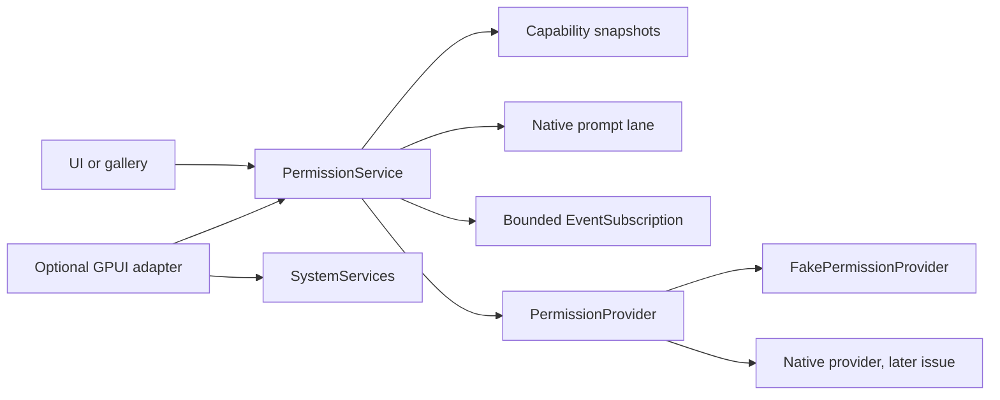

# Permission contracts

This document describes `crates/gpui-permissions`, the permission service for
[#20](https://github.com/jihuayu/gpui-box/issues/20). It is built on the
`gpui-system` contracts from [#19](https://github.com/jihuayu/gpui-box/issues/19)
and deliberately installs no native provider. Platform providers, manifest
generation and host acceptance remain separate work.

## Scope and ownership

`gpui-permissions` owns the UI-facing permission domain, status model,
contextual request flow, native-prompt serialization, settings handoff receipts
and resume reconciliation. Its default build has no external dependencies
beyond `gpui-system`; the optional `gpui` feature adds a GPUI adapter only.

File-picker and share-sheet grants are **not** `PermissionKind` values. Those are
resource-scoped, single-use grants owned by the resource workflow in #23. A
resource grant must never be promoted into durable app-wide permission state.

`gpui-box` exposes the crate through opt-in features:

```toml
gpui-box = { features = ["permissions"] }
gpui-box = { features = ["permissions-gpui"] }
```

The first imports `gpui_box::permissions`; the second also compiles the GPUI
adapter. Neither feature selects a desktop or Android backend on its own.

## Architecture



`PermissionService` is `Rc`-backed and UI-local. It can be registered as a
concrete typed service with `SystemServices::register`, replaced explicitly with
`override_provider`, and installed in a GPUI `App` with
`gpui_adapter::install_permission_service`. Existing handles retain their
provider; install overrides before starting operations.

Every provider operation is explicit. `PermissionProvider` exposes:

- `capability(operation)` — a `Capability<PermissionOperation>` snapshot with no
  native prompt or settings side effect.
- `query(kind)` — a fresh, side-effect-free status probe.
- `request_permission(prompt, completion)` — begins exactly one native prompt.
- `open_settings(target)` — presents an OS settings destination and returns a
  handoff receipt.
- `tracked_kinds()` — kinds re-probed by `reconcile_on_resume`.

The service exposes the matching `Request`-returning operations:
`query`, `request_permission` and `open_settings`. A caller can inspect
capabilities before acting, but a capability snapshot is not a durable grant.

## Status and error model

`PermissionStatus` has seven states:

| Status | Meaning |
| --- | --- |
| `NotRequired` | The platform needs no runtime prompt for this operation. |
| `Granted` | Authorized for normal use. |
| `Denied { can_request_again }` | Denied; a repeat prompt is possible only when the flag is true. |
| `Restricted` | Blocked by platform policy, parental controls or an equivalent restriction. |
| `Limited` | Usable with a platform-defined subset of resources (for example selected photos). |
| `NotDetermined` | The user has not been asked yet. |
| `Unavailable` | Provider state cannot be read; this is not a user denial. |

Configuration failure and user denial are intentionally distinct:

- Missing manifest entry, usage description, entitlement or equivalent provider
  declaration returns `ErrorCode::InvalidConfiguration` with
  `RecoveryAction::RepairConfiguration`.
- A denied or restricted user state maps to `ErrorCode::PermissionDenied` with
  `RecoveryAction::OpenSettings`. A permanently denied request resolves
  immediately with settings recovery; it does not leave a request hanging.
- An unreadable provider state maps to `ErrorCode::Unavailable` with
  `RecoveryAction::ProbeAgain`.

`PermissionOutcome` records the previous and final status, whether a native
prompt was actually presented, whether state changed, and the provider
observation revision. `SettingsHandoff::Opened`/`Unavailable` report only
whether the platform accepted the settings handoff. They never claim that the
user toggled a switch. Only a later fresh probe, normally through
`reconcile_on_resume`, can produce a `Granted` result.

## Contextual requests and prompt serialization

`request_permission` re-probes the provider first:

1. `NotRequired`, `Granted` and permanently denied states complete without an
   interactive prompt and without requiring a UI context. This is the desktop
   no-prompt path; no shown or synthetic dialog is involved.
2. A promptable state (`NotDetermined` or `Denied { can_request_again: true }`)
   calls `OperationContext::require_ui` and `check_at`. A worker thread, expired
   generation, disposed owner, expired deadline or cancelled token is rejected.
3. The service takes the single native prompt lane. A second interactive prompt
   is rejected with `ErrorCode::Busy` and
   `RetryAdvice::AfterConditionsChange`; it is not queued invisibly.
4. Provider completion is accepted once. Duplicate, cancelled, disposed and
   generation-stale callbacks are rejected. The lane is released on completion,
   cancellation, owner disposal, generation advance, or the next prompt when the
   old owner is detected as stale.
5. An authoritative post-prompt status updates the known state, emits deltas
   automatically and completes the `Request`.

A native prompt is never synthesized for a platform that reports `NotRequired`.
The provider receives `PermissionPrompt` and a cloneable
`PermissionPromptCompletion`; it must not block the UI thread while presenting
the prompt.

## Observation and resume reconciliation

`subscribe` creates an independent bounded
`EventSubscription<PermissionChange>` from `gpui_system::event_channel`.
Multiple UI entities or views may subscribe to the shared service at the same
time. Each stream has its own cleanup flag; dead slots are pruned when the
service subscribes, computes a revision, or emits a change.

Every emitted `PermissionChange` carries the receiving stream's next local
sequence (`sender.revision() + 1`), so the event envelope sequence and payload
revision agree on each independent stream. `reconcile_on_resume` reports the
maximum revision across live streams. `acknowledge_snapshot` with that revision
therefore clears queued events and overflow state on every live stream; a
stream that started later has a lower local sequence and is still covered by
the snapshot.

`reconcile_on_resume` re-queries every kind the service has observed plus the
provider's `tracked_kinds`. It emits one `PermissionChange` per changed status
and returns `PermissionReconciliation`. On overflow the stream emits
`ResyncRequired`; the caller reconciles and calls
`subscription.acknowledge_snapshot(reconciliation.revision)`. A later overflow
is retained by the core and cannot be cleared by an older acknowledgment.

Capability snapshots and request results use provider revisions. Each stream's
revisions are its own observation sequence; `PermissionReconciliation::revision`
is the maximum live stream revision. They describe the same provider observation
only when read from the same service session, and neither is a durable
authorization token.

## Five-platform contract

Native providers are not installed in this revision. `PROVIDER_MANIFEST` has all
five entries at `native_provider_installed: false` and
`Evidence::ContractOnly`. The table is a capability/configuration contract, not
a claim of runtime verification.

| Platform | Contracted operations | Required configuration | Runtime status |
| --- | --- | --- | --- |
| Windows x86_64 | Notification status/request and app/notification settings; other kinds via a future provider | Packaged identity and manifest capabilities, or documented unpackaged fallback | Contract only; no native provider |
| macOS | Notification, camera, microphone, photos, contacts, location, biometrics and app/special settings | `Info.plist` usage descriptions, entitlements, bundle identity | Contract only; no native provider |
| Linux | Portal/session-mediated notifications, camera and microphone where the portal supports them; app/special settings where available | Portal version, session policy and desktop-specific declarations | Contract only; no native provider |
| Android arm64 | Runtime permissions, special access and app/notification settings | Manifest declarations, target SDK, activity/context and host lifecycle acceptance (#2) | Contract only; no native provider |
| iOS | Notification, camera, microphone, photos, contacts, location and biometrics; app/special settings | `Info.plist` usage descriptions, entitlements and device qualification (#9) | Contract only; no native provider |

`FakePermissionProvider` provides deterministic headless coverage for tests,
prototypes and gallery overrides. It records requested kinds, queued prompts
and opened settings targets, and never touches a native API.

The optional `gpui` feature adds:

- `install_permission_service` and `permission_service` over GPUI's typed
  `SystemServices` global.
- `run_permission_request`, which supplies GPUI's deadline timer.
- `PermissionEntityScope`, which retains permission subscriptions alongside a
  `gpui_system::gpui_adapter::EntityScope` and invalidates the UI owner on
  entity release.

## Verification

Use the repository toolchain selected by `mise.toml` (`rust 1.98.1`):

```sh
cargo generate-lockfile
cargo fmt --all
cargo fmt --all -- --check
cargo test --locked -p gpui-box -p gpui-box-cli -p gpui-android -p gpui-system -p gpui-app-data -p gpui-permissions
cargo clippy --locked -p gpui-box -p gpui-box-cli -p gpui-android -p gpui-system -p gpui-app-data -p gpui-permissions --all-targets -- -D warnings
cargo check --locked -p gpui-box --features "app-data permissions-gpui"
cargo run --locked -p gpui-permissions --example permission_recovery
git diff --check
```

The behavioral suite covers the notification request/denial/settings/resume
flow, missing configuration, desktop no-prompt status, concurrent prompt
serialization with cancellation and owner disposal, worker-thread rejection,
generation recreation, late and duplicate native callbacks, bounded event
overflow and snapshot resync acknowledgment, concurrent independent subscribers,
waker reentrancy, and typed service registration with explicit override.
