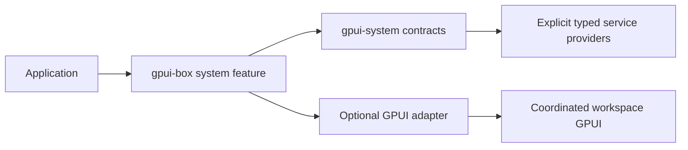

# System-service contracts

This is the initial compilable substrate for [#19](https://github.com/jihuayu/gpui-box/issues/19)
and the system integration roadmap [#18](https://github.com/jihuayu/gpui-box/issues/18).
It implements contracts and deterministic harnesses. Native service providers are
implemented by their individual issues. No native capabilities are installed or
advertised automatically.

## Dependency and ownership decision

The `gpui-system` crate owns shared service contracts. Its default build uses only
the Rust standard library. Applications opt in through `gpui-box`'s `system`
feature and import `gpui_box::system`. `system-gpui` additionally enables the
adapters over the already coordinated workspace GPUI package. Neither feature
selects an unrelated desktop backend. An application still enables `desktop` or
`android` for its platform runtime.



Keeping the core independent permits headless tests and platform cross-checks.
The cost is that a host must supply its executor and deadline timer. The optional
GPUI adapter supplies both. A registry owns concrete typed service wrappers in
`Rc`; providers containing platform UI objects remain on the UI thread. A service
wrapper can contain a provider trait object, and `override_provider` replaces it
explicitly for tests. Existing service handles retain their provider. Install
overrides before starting operations. GPUI installation uses
`gpui_adapter::install_system_services(services, cx)`; configurations and native
provider factories remain owned by their service issues and #4/#5.

## Capabilities and errors

`Capability<O>` independently reports operation support, runtime availability,
required configuration, permission state, constraints, evidence and observation
revision. A snapshot has no permission side effects and confers no authorization.
Providers must freshly probe and check conditions when executing. Fallback
availability requires the caller to select a documented fallback; it does not
authorize replacing a requested native operation silently.

`ServiceResult<T>` is `Result<Completion<T>, SystemError>`. User or caller
cancellation is `Completion::Cancelled`; denied permission is an error with a
recovery action. Provider-specific receipts must say whether the OS accepted a
request, actually presented UI or confirmed an effect. A cancelled await does not
undo a notification, export or native handoff already accepted by the OS.

`SystemError` has a typed code, public-safe static message, optional recovery,
retry advice and diagnostic ID. Native exception messages, paths, URLs, content,
account IDs and credentials must never be copied into messages. `DiagnosticEvent`
has only request identity, phase and optional error code. It deliberately has no
arbitrary payload field. Protected native diagnostics, if needed, belong to the
specific provider's access policy.

## Requests and host lifetime

`request(context)` returns a `Request<T>` Future and cloneable `CompletionPort<T>`.
Native callbacks complete the port. Exactly one completion is accepted; duplicate
or abandoned callbacks return false. Cancellation and owner changes wake a pending
request. The context is checked again on delivery so a result queued before a
native recreation cannot deliver stale success. Once observed, a request never
returns a second result. As with ordinary Rust futures, do not poll after Ready.

The UI host owns `UiOwner`. Its logical `SurfaceId` survives attachment changes;
`advance_generation` invalidates prior `UiContext`s and wakes pending work.
`dispose` or dropping the final owning guard invalidates all contexts. Contexts
hold only weak attachment state and never keep a native window alive. Anchors use
client-area logical coordinates. Native handles remain private to providers.
`UiOwner::new` records the current owning UI thread. `is_current`, `require_ui`
and execution-time `OperationContext::check_at` validate that thread as well as
the live generation. Creating a context or advancing a generation on another
thread returns `ContextExpired`. Providers must create owners on the actual
platform UI thread and validate any anchor geometry required by their native API.

Cloned `OperationContext`s share cooperative cancellation and UI generation.
Cancellation is first-reason-wins. Dropping one Request abandons only that request;
it does not cancel siblings sharing the token. Providers should retain native
request cancellation/cleanup state separately and never block in Drop. The core
does not roll back native side effects.

The default core owns no timer thread. A host must schedule
`CompletionPort::expire_at` at the deadline, or await
`Request::with_deadline_signal` with its own correctly scheduled timer.
`gpui_adapter::run_request` supplies GPUI's timer and local foreground executor,
so even a provider that never calls back times out. Deadline checks use monotonic
`Instant`. Tests inject an elapsed instant through `expire_at`, without sleeping.

Request receivers are explicitly non-Send; this keeps their execution and result
delivery local even for Send payloads. Completion ports and event senders are
Send when their payloads are Send. Worker callback completion validates attachment
lifetime, cancellation and deadline without requiring the UI thread; the receiver
then validates execution ownership when delivering the result on the local thread.
Registry providers, UI futures, Entity scopes and native listeners stay local.
Background I/O should use GPUI's background executor and send only owned Send
data back. Release GPUI borrows and internal locks before native calls or user
callbacks: native APIs may synchronously reenter Rust. Completion payloads and
discarded events are destroyed after releasing internal locks.

## Scoped observations

`event_channel(capacity, cleanup)` creates a bounded, single-consumer event stream.
`try_next` returns a future independent of the subscription; a second outstanding
reader returns `Busy`. Dropping the pending future releases the reader slot.
Dropping the subscription closes and wakes a pending future, then runs native
listener cleanup outside the stream lock on the owning thread. Dropping all
senders drains buffered events and then ends the stream.

Events carry a service-session identity, session-local sequence and UTC
`SystemTime` observation timestamp. Overflow discards buffered deltas and emits
`ResyncRequired`; `snapshot_required` remains true until the caller obtains a
provider snapshot and acknowledges its sequence. A snapshot and revision must
describe the same provider state. A later overflow cannot be cleared by an older
snapshot acknowledgment. Durable activation inboxes require their own protocols
under #24; this state stream is intentionally process-local.

The GPUI `EntityScope` retains subscriptions and invalidates its owner on scope or
Entity release. `observe_selector` compares selected values before invoking its
callback. GPUI's own notify cycle retains invalidation batching; this layer does
not introduce another signal graph or promise paint-only updates. Stable
ReactiveScope/ReadSignal/Store work remains in #3.

## Verification and remaining platform work

Initial evidence was collected on Windows x86_64 on November 11, 2026 using the
repository's `+1.98.1` toolchain selector. The host's cargo binary is a custom
`1.101.0` build; rustc reports `1.98.1`. No OS dialogs or native service effects are
claimed by the headless sample or contract tests.

| Platform | Core contract | GPUI adapter | Native providers/runtime |
| --- | --- | --- | --- |
| Windows x86_64 | Unit/integration tests and fake sample | Compiled against workspace GPUI | Not installed; services tracked in #20–#28, host/runtime gate #8 |
| Android arm64 | Cross-compilation check | Requires actual Android host integration | Not installed; #2 owns host safety and emulator/device acceptance |
| macOS | Shared contract only | Not compiled on this host | #8 platform qualification and individual service issues |
| Linux | Shared contract only | Not compiled on this host | #8; session/portal/backend evidence remains required |
| iOS | Shared contract only | Not compiled on this host | #9 host/device qualification and individual service issues |

The exported `PROVIDER_MANIFEST` is conservative: all five entries declare no
native provider installed and ContractOnly evidence. Compile and test evidence
above describes this revision and environment; real providers must publish their
own per-operation runtime evidence. #19 remains open until required host/runtime
acceptance is recorded. #3 owns the integrated accessible gallery.

Validation commands:

```sh
cargo +1.98.1 fmt --all -- --check
cargo +1.98.1 test --locked -p gpui-box -p gpui-box-cli -p gpui-android -p gpui-system
cargo +1.98.1 clippy --locked -p gpui-box -p gpui-box-cli -p gpui-android -p gpui-system --all-targets -- -D warnings
cargo +1.98.1 check --locked -p gpui-box --features system-gpui
cargo +1.98.1 check --locked -p gpui-box --features system --target aarch64-linux-android
cargo +1.98.1 run --locked -p gpui-system --example fake_service
```

Behavioral coverage includes execution-time authorization changes, unavailable
and misconfigured providers, duplicate registrations, fake overrides, cancellation
before registration, pending cancellation wakeup, concurrent duplicate callbacks,
deadline expiry without callbacks, stale generation/disposal, abandoned requests,
event overflow/resync, single-reader enforcement and reentrant listener cleanup.
The ownership regression additionally rejects worker-thread UI execution while
accepting a worker callback delivered to the local receiver. A compile-fail doc
test freezes Request's non-Send boundary.
