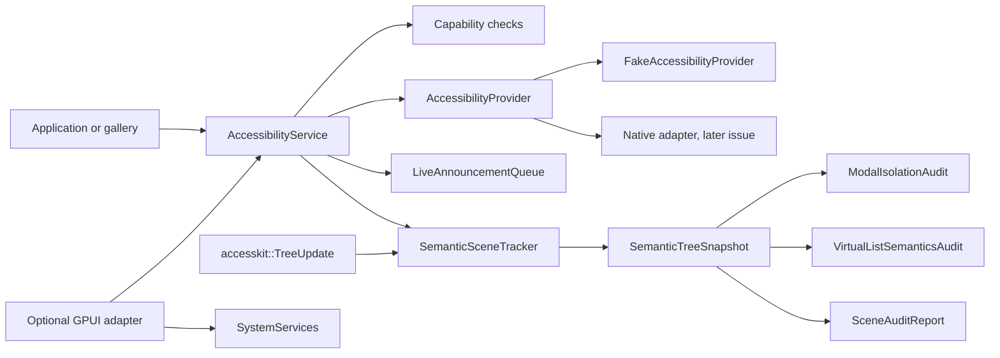

# Accessibility semantics and assistive-technology acceptance

This document describes `crates/gpui-accessibility`, the semantic inventory and
acceptance substrate for
[#47](https://github.com/jihuayu/gpui-box/issues/47), coordinated through the
Phase 1 sequencing in
[#18](https://github.com/jihuayu/gpui-box/issues/18). It builds on the typed
`gpui-system` contracts from
[#19](https://github.com/jihuayu/gpui-box/issues/19) and the shared component
semantics owned by [#3](https://github.com/jihuayu/gpui-box/issues/3).

The crate installs no native accessibility provider. It defines deterministic,
cross-platform semantics, scene reconciliation, audits, bounded live-region
queuing and separate acceptance evidence channels. Native adapters and
assistive-reader qualification remain owned by the platform issues listed below.

## Scope and feature wiring

`gpui-accessibility` owns:

- The serializable semantic inventory, scene revision model and persistent
  identity model.
- AccessKit `TreeUpdate` ingestion, incremental reconciliation and pruning.
- Directed text-selection conversion across UTF-8, Unicode scalar and UTF-16
  offsets.
- Modal isolation, virtual-list and whole-scene audits.
- A bounded live-announcement queue.
- The capability-gated `AccessibilityService`, provider contract and deterministic
  fake provider.
- Six-platform support policy, ownership links and the foreign-key-style
  separation between automation evidence and real assistive-reader sessions.

The default build depends on `gpui-system`, AccessKit and serde only. It has no
GUI dependency. The optional `gpui` feature adds a GPUI adapter and enables
`gpui-system/gpui`.

`gpui-box` exposes the crate through two opt-in features:

```toml
gpui-box = { features = ["accessibility"] }
gpui-box = { features = ["accessibility-gpui"] }
```

The first imports `gpui_box::accessibility`; the second also enables the GPUI
adapter. Neither feature selects a desktop or Android backend on its own.
`mise.toml` includes `-p gpui-accessibility` in its test, lint and check tasks.

## Architecture



`AccessibilityService` is an `Rc`-backed, UI-local handle over one provider,
semantic tracker, live queue and evidence ledger. Clones share state. It can be
registered as a concrete typed service with `SystemServices::register`, and
`shares_state_with` verifies shared state without exposing the inner `Rc`.
Overrides must be installed before work begins.

## Scene correlation

A surface attachment and every displayed semantic revision are correlated by:

```rust
pub struct SceneRevision(pub u64);

pub struct DisplayedScene {
    pub surface: SurfaceId,
    pub generation: u64,
    pub revision: SceneRevision,
}
```

`SurfaceId` is the logical GPUI surface; `generation` advances when the native
attachment is recreated; `revision` advances strictly within one generation.
A scene from an older generation or an equal/older revision is stale and is
rejected before it can replace current state. A newer generation resets the
tracked tree and requires a full AccessKit tree before incremental updates can
resume. Disposing a surface clears its tree and pending live speech; scenes from
the disposed generation or older are rejected. A later generation may start a
new native surface lifecycle.

The service validates exact scene identity for actions, text edits,
announcements and audits, so an action queued before a repaint cannot silently
target a newer tree with different node IDs.

## Semantic inventory

### Persistent identity

```rust
pub struct SemanticIdentity {
    pub node_id: u64,          // accesskit::NodeId.0, render-local
    pub author_id: Option<String>, // stable cross-render key
}
```

`same_identity` compares the stable `author_id` when both sides have one and
falls back to the numeric node ID otherwise. A re-render that moves a keyed
control to a new AccessKit node is therefore retained, while reusing the same
numeric node for a different author ID is reported as a replacement. Empty
author IDs are rejected. The tracker reports retained, relocated, added,
churned and replaced identities per accepted revision.

### Roles

`SemanticRole` maps AccessKit roles into the shared component vocabulary:

| Semantic role | AccessKit roles covered |
| --- | --- |
| `Window` | `Window`, `Application`, `RootWebArea` |
| `Group` | `Group`, `GenericContainer`, `Pane`, `Section`, `Region`, `Main`, `Navigation`, `Form`, `Article`, `Complementary`, `Banner`, `ContentInfo`, `Header`, `Footer` |
| `Button` | `Button`, `DefaultButton` |
| `TextInput` | `TextInput`, `MultilineTextInput`, `SearchInput`, email/number/password/phone/URL/date/time inputs and `EditableComboBox` |
| `StaticText` | `Label`, `Paragraph`, `TextRun` |
| `CheckBox` | `CheckBox`, `MenuItemCheckBox` |
| `Switch` | `Switch` |
| `Dialog` | `Dialog`, `AlertDialog` |
| `BottomSheet` | Application-defined sheet; converts to AccessKit `Dialog` |
| `List` / `ListItem` | `List`, `ListBox` / `ListItem`, `ListBoxOption`, `TreeItem` |
| `Heading` | `Heading` |
| `LiveRegion` | `Status`, `Alert`, `Log`, `Timer`, `Marquee`, `ProgressIndicator` |
| `ScrollView`, `Toolbar`, `Tab`, `TabList` | matching AccessKit roles |
| `Unknown` | all other roles |

Every node retains `name` (AccessKit label), `description`, `value` and
`placeholder`, even when a platform adapter does not expose all of them.

### States and relationships

```rust
pub struct SemanticStates {
    pub focused: bool,
    pub focusable: bool,
    pub disabled: bool,
    pub hidden: bool,
    pub selected: bool,
    pub checked: Option<SemanticChecked>, // False / True / Mixed
    pub expanded: Option<bool>,
    pub modal: bool,
    pub live: Option<LivePriority>,
    pub read_only: bool,
}
```

`Option` preserves the difference between an absent property and an explicit
false/off value. `checked` is tri-state, so mixed checkboxes are not flattened
into unchecked. `live` maps AccessKit `Live::Off` to `None`, and `Polite` /
`Assertive` to `LivePriority`.

`SemanticRelationships` carries `parent`, ordered `children`, `labelled_by`,
`described_by`, `active_descendant` and `controls`. Structural parent/child
links must be mutually consistent and reachable from the root; auxiliary
relations retain the referenced identity even when the adapter keeps that node
outside the current snapshot.

### Bounds

`SemanticBounds` stores finite `f64` physical-pixel edges
`{ x0, y0, x1, y1 }`. Construction rejects:

- `NaN` and positive/negative infinity (`BoundsError::NonFinite`);
- `x1 < x0` or `y1 < y0` (`BoundsError::Inverted`);
- negative width or height in `from_origin_size`.

Zero-area rectangles remain legal. `from_accesskit_rect` uses the same checks;
`accesskit_rect()` converts back losslessly. Invalid bounds during AccessKit
ingestion are a typed scene error, not a silently clipped rectangle.

### Actions and payloads

`SemanticAction` supports:

| Action | Required payload |
| --- | --- |
| `Click` | `SemanticActionPayload::None` |
| `Focus` | `SemanticActionPayload::None` |
| `SetValue` | `SemanticActionPayload::Value(String)` |
| `SetTextSelection` | `SemanticActionPayload::TextSelection(TextSelectionSpan)` |
| `ScrollIntoView` | `SemanticActionPayload::None` |
| `Dismiss` | `SemanticActionPayload::None` |

AccessKit actions map onto the first five; `Dismiss` is an application-level
sheet/dialog action. `SemanticActionRequest` includes the `DisplayedScene`,
target identity and payload, and validates action/payload compatibility before
dispatch. The service additionally verifies that the target node exists in the
exact current revision and advertises the action. Receipts report local bridge
acceptance, not proof that the platform completed the effect.

### Directed text selection across UTF-8, scalars and UTF-16

`TextSelectionSpan` is the validated canonical directed selection, stored in
Unicode scalar indices:

- `anchor` is the fixed end.
- `focus` is the moving/active end.
- `anchor > focus` is a backward selection.
- `anchor == focus` is a collapsed caret.
- `min()`/`max()` and `slice()` preserve ordering; `slice()` never splits a
  scalar.

Three public offset-value units are supported:

| Unit | Type | Used by |
| --- | --- | --- |
| UTF-8 byte offsets | `Utf8Selection` | Rust strings and byte-oriented text APIs |
| Unicode scalar (`char`) offsets | `ScalarSelection` | Rust char indexing, AccessKit `TextPosition::character_index` |
| UTF-16 code-unit offsets | `Utf16Selection` | Windows UIA, Android `AccessibilityNodeInfo`, NSString/VoiceOver and DOM/ARIA |

Validation rules are strict:

1. A UTF-8 offset must be `<= text.len()` and `text.is_char_boundary(offset)`.
   A mid-scalar byte offset returns `Utf8NotCharBoundary`.
2. A scalar offset must be `<= text.chars().count()`, otherwise
   `ScalarOutOfRange`.
3. A UTF-16 offset must be `<=` the code-unit count and must not fall between
   the two code units of a surrogate pair; otherwise
   `Utf16NotCodeUnitBoundary`.
4. AccessKit conversion can additionally require the exact text-run
   `NodeId`; a mismatch returns `AccessKitNodeMismatch`.
5. All conversions validate both anchor and focus before producing a result.
   No conversion panics or slices a string mid-character.

Examples used by the integration suite:

| Text | Scalars | UTF-8 bytes | UTF-16 code units |
| --- | ---: | ---: | ---: |
| `"纪要 ✅"` | 4 | 10 | 4 |
| `"Primary draft 你好 ✅"` | 18 | 24 | 18 |
| `"a😀b"` (surrogate-pair coverage) | 3 | 6 | 4 |

For `"纪要 ✅"`, scalar `2` maps to UTF-8 byte `6` and UTF-16 unit `2`; the
space is at scalar `2`, and `✅` (U+2705, BMP) occupies scalar `3`. For the
surrogate-pair case, UTF-16 offset `2` is inside `😀` and is rejected; offsets
`1` and `3` are the adjacent scalar boundaries. The tests cover forward,
backward and collapsed selections, full-span round trips, all out-of-range
cases, mid-UTF-8-scalar bytes and mid-surrogate UTF-16 offsets for the exact CJK
and mixed-language strings above.

`TextSelectionReceipt` returns the same selection as `Utf8Selection`,
`ScalarSelection` and `Utf16Selection`, allowing an adapter to forward the
platform-native unit without recomputing boundaries.

## AccessKit and coordinated GPUI

The crate depends on AccessKit through `accesskit = "0.24.0"`; the workspace
lock resolves `accesskit 0.24.1`, the same compatible release used by the
coordinated GPUI tree. `ACCESSKIT_VERSION` records `"0.24.0"` as the contract
requirement.

The distribution pins GPUI at:

```text
f8cfc7ed9e57503def9479138894f3139f5400cc
```

`GPUI_REVISION` exports that value. AccessKit `Tree`, `TreeUpdate`, `Node`,
`NodeId`, `Role`, `Toggled`, `Live`, `Rect` and `TextSelection` values are
accepted directly. `SemanticTreeSnapshot::from_accesskit_update` and
`SemanticTreeSnapshot::to_accesskit_nodes` convert between the semantic
inventory and AccessKit nodes; `SemanticNodeSnapshot::accesskit_node` is the
single-node conversion. Tree IDs other than `TreeId::ROOT` are rejected per
surface because a surface owns one root semantic tree here.

### Preserved Android bridge evidence

`crates/gpui-android/src/android/accessibility.rs` is **read-only** for this
issue and was not modified. It is preserved as the existing semantic bridge
evidence for the Android adapter tracked by
[#2](https://github.com/jihuayu/gpui-box/issues/2). Its implemented behaviors
include:

- Incremental `accesskit::TreeUpdate` application, retained nodes and pruning
  to nodes reachable from the current root.
- Semantic virtual-node snapshots through Android's
  `AccessibilityNodeProvider`, including root/parent/children relationships,
  roles, labels, values, author IDs, bounds, focused/enabled/hidden state,
  checked state, live state, text-run identity and selection.
- Composition of ancestor AccessKit transforms before Android consumes
  physical-pixel bounds.
- UTF-16 selection conversion for Android's text APIs, including clamping to
  scalar boundaries and rejecting malformed offsets.
- Click, focus, set-value and set-text-selection action dispatch through the GPUI
  accessibility callbacks.
- Surface-generation and active-state checks that reject stale native
  requests.

The platform-neutral tracker in this crate mirrors the incremental/pruning
model but adds explicit `DisplayedScene` revision checks, identity-retention
audits and cross-platform selection validation. Any corrections needed to the
Android transport remain follow-up work under **#2**; they must not be applied
to the read-only file as part of #47.

## Incremental scene tracking

`SemanticSceneTracker` owns one `TrackedSurface` per surface, with bounded
defaults of 8 surfaces and 100,000 nodes (`with_limits` configures both).

`ingest_accesskit(scene, update)`:

1. Rejects non-root tree IDs and scenes from a disposed generation or older.
2. Accepts a newer generation by resetting the surface state; a full
   `update.tree` is then required.
3. Rejects an equal/older `SceneRevision` within the same generation.
4. Overwrites existing nodes with the update's nodes and records the update's
   focus.
5. Prunes every node not reachable from the root through `children`. A missing
   child reference is a typed error, never a silently retained orphan.
6. Requires focus to resolve inside the retained tree.
7. Builds and validates a `SemanticTreeSnapshot`, updates the identity audit and
   stores the accepted revision.

`commit(snapshot)` accepts complete semantic scenes built without AccessKit.
It validates root/parent/children consistency, duplicate node IDs and author
IDs, focus reachability and unreachable nodes. The snapshot is converted back to
AccessKit nodes, so later incremental updates can continue on the same surface.

The service applies tracker mutations to a clone first and copies the clone back
only after the provider accepts the commit. A failed native handoff therefore
cannot silently advance canonical semantics.

`IdentityRetentionAudit` reports:

| Field | Meaning |
| --- | --- |
| `retained` | Stable keys present in both revisions |
| `relocated` | Same author identity with a different numeric node ID (benign) |
| `added` | New stable keys |
| `churned` | Stable keys removed from the scene |
| `replaced` | Same numeric node ID reused for a different stable key |

`stable()` is true when neither churn nor replacement occurred; relocation is
benign and is reported separately.

## Modal isolation audit

`ModalIsolationAudit` is constructed with the retained pre-modal trigger
identity.

- `inspect(tree, modal_root)` / `audit` verifies the modal node exists and is
  visible; computes the modal subtree; counts background
  interactive/focusable nodes; and reports background controls that are neither
  effectively hidden nor disabled as leaks. Ancestor hidden/disabled state is
  inherited, so a hidden background container does not generate false-positive
  leaks.
- `focus_inside_modal` requires the active focus to be the modal root or one of
  its descendants.
- `audit_active` discovers the preferred active modal (modal-flag dialog first).
- `audit_dismissal` requires the modal to be absent or hidden/disabled, the
  trigger identity to be retained, and focus to compare equal to the retained
  trigger identity. Because comparison prefers `author_id`, a trigger revisited
  under a new numeric node ID is still recognized.
- `ModalIsolationReport::passed()` requires modal presence, focus inside the
  modal and no leaks. `ModalDismissalReport::passed` additionally requires
  trigger retention and focus restoration.

Bottom sheets use `SemanticRole::BottomSheet`; they share the same modal
isolation and dismissal rules as dialogs.

## Virtual-list semantics audit

`VirtualListSemanticsAudit::new(list, selection)` audits a `SemanticRole::List`
subtree across revisions.

Checks include:

- The audited identity resolves and has role `List`; otherwise `NotAList`.
- Every descendant `ListItem` has finite bounds, `index_in_set` and
  `size_of_set`. `index_in_set` is zero-based, converted from AccessKit's
  one-based `position_in_set`.
- Every index is `< size_of_set`; indices are unique; all items agree on the
  set size; the visible index set is contiguous.
- Items whose bounds do not intersect the list viewport are reported as
  `OffscreenItem`.
- `ListItem` nodes with no `List` ancestor are reported as `OrphanItem`, even
  when they remain structurally attached elsewhere.
- The active selection is found by persistent identity. If it is present, its
  index is retained for the next revision. If it is temporarily absent because
  the visible window moved past its last index, retention is still true. If the
  window still covers that slot but the identity is missing, or the identity is
  attached outside the audited list, `SelectionNotRetained` is reported.

The stateful audit therefore distinguishes “selected and visible”, “selected but
temporarily scrolled out”, and “selection dropped or replaced”. Presentation
order changes are allowed: the selection is matched by identity, and the visible
indices are treated as a set for contiguity. The report exposes visible items,
visible indices/range, set size, selection visibility/retention, orphans,
offscreen items and typed violations.

## Bounded live announcements

`LiveAnnouncementQueue` coordinates live-region output correlated with a
`DisplayedScene` and `SceneRevision`.

- Announcements carry `source`, `priority` (`Polite` or `Assertive`) and text.
- Empty/whitespace text is rejected with `SemanticError::InvalidAnnouncement`.
- An equal or older revision on the same surface/generation is rejected as
  stale.
- Identical consecutive announcements in the same scene revision are
  deduplicated. Identity includes the scene, source, priority and text, so two
  different live regions are not conflated merely because their text matches.
- Capacity is explicit (default 32 at the service boundary). When full, the
  oldest queued announcement is removed, the newest remains speakable and
  `dropped_count()` increments. Producers never block and storage never grows
  without bound.
- A generation bump clears queued announcements for that surface. Disposing a
  surface clears its announcements and records the disposed generation; later
  enqueues at that generation or older fail with `SurfaceDisposed`.

`LiveAnnouncementReceipt` reports whether the item was queued or deduplicated,
the current queue length and the cumulative dropped count. Native providers
receive only accepted, non-duplicate announcements.

## Service, provider and GPUI adapter

`AccessibilityProvider` exposes:

- `platform()` and `capability(operation)`.
- `commit_snapshot(&snapshot)` for native transport after service validation.
- `perform_action(&request, &snapshot)` and
  `edit_text_selection(&request, &snapshot)`.
- `announce_live(&announcement)`.
- `record_automation_evidence` and `record_assistive_reader_evidence`.

`AccessibilityService` exposes `Request`-returning operations:

| Service method | Operation | UI context |
| --- | --- | --- |
| `observe_tree` / `commit_scene` | `ObserveTree` | Optional; surface must match if present |
| `perform_action` | `PerformAction` | Required, current owner thread and surface |
| `edit_text_selection` | `EditTextSelection` | Required, current owner thread and surface |
| `announce` | `AnnounceLive` | Required, current owner thread and surface |
| `audit_scene` | `AuditScene` | Optional; surface must match if present |

Every call checks `Capability::check`, the operation context and deadline,
cancellation (returning `Completion::Cancelled` rather than an error), and the
exact current scene where applicable. Provider failures remain typed
`SystemError` values with public-safe messages.

`FakeAccessibilityProvider` is deterministic and UI-local. It supports
configurable capabilities, records committed snapshots, dispatched actions,
text-selection requests, live announcements and both evidence kinds, and never
touches a native API.

With `--features gpui`:

- `install_accessibility_service` registers a service in typed
  `SystemServices`.
- `init_accessibility` installs a dedicated GPUI `Global` and returns the shared
  handle.
- `accessibility_service` resolves the dedicated global first and falls back to
  `SystemServices`.
- `run_accessibility_request` supplies GPUI's foreground executor and deadline
  timer.
- `AccessibilitySurfaceScope` disposes the semantic surface, clears pending live
  speech and invalidates the `UiOwner` when dropped.
- `AccessibilityAppExt` exposes `init_accessibility` and `accessibility_service`
  directly on `App`.

## Acceptance evidence: two separate channels

This is the central acceptance rule for #47: **programmatic checks are not
assistive-reader sessions.**

### `AutomationEvidence`

Records one deterministic harness check:

```text
platform, operation, suite, test, command,
tool/tool_version (optional),
scene, snapshot summary (root/focus/node count/revision/modal, optional),
passed
```

It proves that a semantic tree, action payload, selection conversion or audit
behaved as specified in the test process. It says nothing about speech output,
reader traversal order, verbosity, braille, virtual-node navigation, touch
exploration or the user's actual device.

### `AssistiveReaderSessionEvidence`

Records a real human/device session:

```text
reader: Narrator | NVDA | VoiceOver (macOS) | VoiceOver (iOS) | Orca |
        TalkBack | Other(name)
reader_version, platform, os_version, device, channel,
scenarios: keyboard traversal, reader traversal, CJK text selection,
           dynamic virtual list, modal focus isolation, live announcements,
status: Passed | Failed | Incomplete,
recorded_at, evidence_reference
```

Validation requires every field to be non-empty (except the version string of
`Other`, which is still supplied), the reader to belong to the stated platform
when it has a fixed platform, and at least one scenario. A session is accepted
only when its status is `Passed` and all six required scenarios are present.
`Other` allows a browser/screen-reader pair on Web without pretending it is one
of the native reader products.

### Qualification gates

`AccessibilityAcceptanceReport` keeps two independent gates:

```text
automation: Pending | Recorded(AutomationEvidence)
assistive_reader_session: PendingReaderSession | Recorded(AssistiveReaderSessionEvidence)
```

Status transitions are:

| Automation | Reader | `AcceptanceStatus` |
| --- | --- | --- |
| Pending | any | `PendingAutomation` |
| Failed | any | `AutomationFailed` |
| Passed | `PendingReaderSession` | `PendingReaderSession` |
| Passed | failed/incomplete | `ReaderSessionFailed` |
| Passed | passed with full coverage | `Accepted` |

Recording a passing automation run therefore leaves the report at
`PendingReaderSession`; it cannot produce `Accepted` on its own. Recording
automation evidence also cannot populate the reader gate. Failed or incomplete
reader sessions remain recorded but do not satisfy acceptance.

`AccessibilityAcceptanceMatrix` starts with all six reports pending, tracks the
gates per platform and exposes `all_automation_passed`,
`all_reader_sessions_pending` and per-platform statuses.

Why the channels cannot be conflated:

- A harness can serialize an AccessKit tree correctly while Narrator or TalkBack
  still speaks the wrong order, skips a node or fails to announce a live region.
- Selection byte/scalar/UTF-16 tests do not prove that an IME, native text
  service and screen reader agree on a directed CJK selection in a real field.
- Modal tree isolation does not prove that a reader's touch exploration cannot
  escape the sheet or that focus returns to the correct trigger on a device.
- Virtual-list window assertions do not prove reader scroll/filter behavior or
  selection recovery on a platform's virtual-node implementation.
- Browser/ARIA policy is experimental; DOM accessibility-tree checks are not a
  JAWS/NVDA/VoiceOver browser session.

The Android bridge file is preserved evidence for the adapter contract, but
TalkBack speech/gesture qualification remains an external gate under #2. Desktop
screen-reader sessions remain under #8, iOS under #9, and Web under #70.

## Ownership and six-platform policy

| Issue | Ownership |
| --- | --- |
| [#2](https://github.com/jihuayu/gpui-box/issues/2) | Android host, AccessibilityNodeProvider/TalkBack adapter acceptance |
| [#3](https://github.com/jihuayu/gpui-box/issues/3) | Shared component semantics, gallery and integrated accessible controls |
| [#8](https://github.com/jihuayu/gpui-box/issues/8) | Windows, macOS and Linux desktop adapters and platform qualification |
| [#9](https://github.com/jihuayu/gpui-box/issues/9) | iOS host, UIAccessibility/VoiceOver device qualification |
| [#18](https://github.com/jihuayu/gpui-box/issues/18) | Phase 1 sequencing and integration gate |
| [#43](https://github.com/jihuayu/gpui-box/issues/43), [#68](https://github.com/jihuayu/gpui-box/issues/68) | Cross-issue coordination and acceptance review |
| [#70](https://github.com/jihuayu/gpui-box/issues/70) | Web backend/browser capability coordination |

Every `PlatformOperationPolicy` carries the adapter, component, phase and
coordination links. `ACCESSIBILITY_PROVIDER_MANIFEST` declares no native
provider installed on any platform and `Evidence::ContractOnly` everywhere.
The matrix below is policy, not runtime proof. “Native” for `AuditScene` means
the local semantic audit path, not a native bridge.

| Platform | Operation | Support | Required configuration | Bridge | Runtime evidence |
| --- | --- | --- | --- | --- | --- |
| Windows | `ObserveTree` | Native | UI Automation provider bound to the foreground HWND | `UiAutomation` | None (`ContractOnly`) |
| Windows | `PerformAction` | Native | Same UI Automation provider | `UiAutomation` | None |
| Windows | `EditTextSelection` | Native | UI Automation TextPattern provider and focused HWND | `UiAutomation` | None |
| Windows | `AnnounceLive` | Conditional | UI Automation notification listener, reader notification opt-in | `UiAutomation` | None |
| Windows | `AuditScene` | Native | Committed AccessKit semantic scene | `UiAutomation` | None |
| macOS | `ObserveTree` | Native | NSAccessibility bridge on the AppKit main thread | `NsAccessibility` | None (`ContractOnly`) |
| macOS | `PerformAction` | Native | Same NSAccessibility bridge | `NsAccessibility` | None |
| macOS | `EditTextSelection` | Native | Same NSAccessibility bridge | `NsAccessibility` | None |
| macOS | `AnnounceLive` | Native | NSAccessibility announcement bridge | `NsAccessibility` | None |
| macOS | `AuditScene` | Native | Committed AccessKit semantic scene | `NsAccessibility` | None |
| Linux | `ObserveTree` | Conditional | AT-SPI D-Bus accessibility bus, active desktop accessibility session | `AtSpi` | None (`ContractOnly`) |
| Linux | `PerformAction` | Conditional | Same AT-SPI session | `AtSpi` | None |
| Linux | `EditTextSelection` | Conditional | Same AT-SPI session | `AtSpi` | None |
| Linux | `AnnounceLive` | Conditional | Same AT-SPI session | `AtSpi` | None |
| Linux | `AuditScene` | Native | Committed AccessKit semantic scene | `AtSpi` | None |
| Android | `ObserveTree` | Conditional | AccessibilityNodeProvider bridge (#2), TalkBack session for reader acceptance | `TalkBack` | None (`ContractOnly`) |
| Android | `PerformAction` | Conditional | Same Android bridge and TalkBack session | `TalkBack` | None |
| Android | `EditTextSelection` | Conditional | Same Android bridge and UTF-16 text service | `TalkBack` | None |
| Android | `AnnounceLive` | Conditional | Same Android bridge and live-region transport | `TalkBack` | None |
| Android | `AuditScene` | Native | Committed AccessKit semantic scene | `TalkBack` | None |
| iOS | `ObserveTree` | Conditional | UIAccessibility bridge in the iOS host (#9), VoiceOver session | `VoiceOver` | None (`ContractOnly`) |
| iOS | `PerformAction` | Conditional | Same UIAccessibility host and VoiceOver session | `VoiceOver` | None |
| iOS | `EditTextSelection` | Conditional | Same UIAccessibility host and UTF-16 text service | `VoiceOver` | None |
| iOS | `AnnounceLive` | Conditional | Same UIAccessibility host and announcement transport | `VoiceOver` | None |
| iOS | `AuditScene` | Native | Committed AccessKit semantic scene | `VoiceOver` | None |
| Web | `ObserveTree` | Conditional | gpui_web DOM/ARIA bridge (#70), browser accessibility tree in a secure context | `BrowserAria` | None (`ContractOnly`) |
| Web | `PerformAction` | Conditional | Same DOM/ARIA bridge and browser tree | `BrowserAria` | None |
| Web | `EditTextSelection` | Conditional | Same bridge and browser selection model | `BrowserAria` | None |
| Web | `AnnounceLive` | Conditional | Same bridge and ARIA live-region support | `BrowserAria` | None |
| Web | `AuditScene` | Native | Committed AccessKit semantic scene | `BrowserAria` | None |

All entries use `Configuration::Required`, `Availability::Unknown`,
`PermissionState::NotRequired`, `Evidence::ContractOnly` and empty
`runtime_evidence`. `PlatformOperationPolicy::runtime_capability` lets an adapter
report fresh availability/configuration/evidence without changing the static
policy.

### Browser capability policy

`web_capability_policy()` aligns Web with the current `gpui_web` maturity:

- `WebBackendMaturity::Experimental`.
- Secure context required.
- DOM accessibility tree required.
- Same-origin frame required.
- Maximum observed tree size: 5,000 nodes.
- All five operations listed, with `ObserveTree`, `PerformAction`,
  `EditTextSelection` and `AnnounceLive` conditional; `AuditScene` is the local
  semantic audit.

Web remains a later platform track. Browser automation (for example an
accessibility-tree dump) is `AutomationEvidence`; it is not a screen-reader
session.

## Verification

`mise.toml` pins Rust **1.98.1**. The current validation container reports
`rustc 1.99.1` and `cargo 1.99.1`; the commands below were run with that host
toolchain. Re-run under the pinned selector before publishing packaged runtime
evidence.

| Tool/source | Version or identity |
| --- | --- |
| Rust toolchain pin (`mise.toml`) | `1.98.1` |
| Validation host compiler observed | `rustc 1.99.1` / `cargo 1.99.1` |
| AccessKit requirement | `0.24.0` (`accesskit 0.24.1` resolved in `Cargo.lock`) |
| Coordinated GPUI revision | `f8cfc7ed9e57503def9479138894f3139f5400cc` |
| Formatting | `cargo fmt --all -- --check` |
| Task validation | `mise tasks validate` |

Run:

```sh
cargo fmt --all
cargo fmt --all -- --check
mise tasks validate
cargo test --locked -p gpui-accessibility -p gpui-box
cargo test --locked -p gpui-accessibility --features gpui
cargo test --locked -p gpui-box --features accessibility,accessibility-gpui
cargo clippy --locked -p gpui-accessibility -p gpui-box --all-targets -- -D warnings
cargo clippy --locked -p gpui-accessibility --features gpui --all-targets -- -D warnings
cargo clippy --locked -p gpui-box --features accessibility,accessibility-gpui --all-targets -- -D warnings
git diff --check
git status -sb
```

### Test coverage

The integration suite is deterministic and makes no OS-specific path or native
API assumption, so it runs on Linux and Windows:

| File | Coverage |
| --- | --- |
| `tests/tracker.rs` | Incremental `TreeUpdate` ingestion, pruning of removed/orphan nodes, author-ID retention and relocation, replacement, stale revision/generation rejection, disposal, generation reset and semantic commits followed by incremental updates |
| `tests/text_actions.rs` | All six actions and payload validation; CJK/emoji forward/backward/collapsed selections through UTF-8, scalar and UTF-16; out-of-range, mid-scalar-byte and mid-surrogate rejection; bounds validation; capability gating and cancellation |
| `tests/modal.rs` | Dialog/bottom-sheet background leak detection, hidden-ancestor inertness, focus-inside-modal checks, dismissal and relocated trigger focus restoration |
| `tests/virtual_live.rs` | Visible window bounds, contiguous indices, offscreen/orphan detection, selection retention across scroll/filter/order changes, `Polite`/`Assertive` dedup, capacity/drop counts, generation and disposal cleanup |
| `tests/service_evidence.rs` | Capability gating for all five operations, six-platform policy/bridge/ownership matrix, strict automation-vs-reader separation, SystemServices registration, surface/generation/disposal/cancellation, GPUI adapter (feature-gated) |
| `tests/accessibility.rs` (`gpui-box`) | `gpui_box::accessibility` re-export and `accessibility-gpui` adapter/SystemServices symbols |

At this revision the default suite runs 30 accessibility integration tests.
With `--features gpui` it runs 35 tests (including the GPUI adapter), and the
`gpui-box` feature suite runs two facade tests. These counts are descriptive;
the commands above are authoritative.

## Remaining acceptance work

- Windows/macOS/Linux real UI Automation, NSAccessibility and AT-SPI sessions
  under #8, with automation and reader evidence recorded separately.
- Android TalkBack speech/gesture and virtual-node qualification under #2,
  including any corrections to the preserved transport file.
- iOS UIAccessibility/VoiceOver device qualification under #9.
- Browser/ARIA bridge implementation and browser screen-reader sessions under
  #70; Web policy remains experimental until then.
- Coordinated gallery/component acceptance under #3 and Phase 1 sequencing under
  #18, including the coordination reviews in #43 and #68.

No row in this document claims a native provider or a passed reader session that
has not been recorded.
