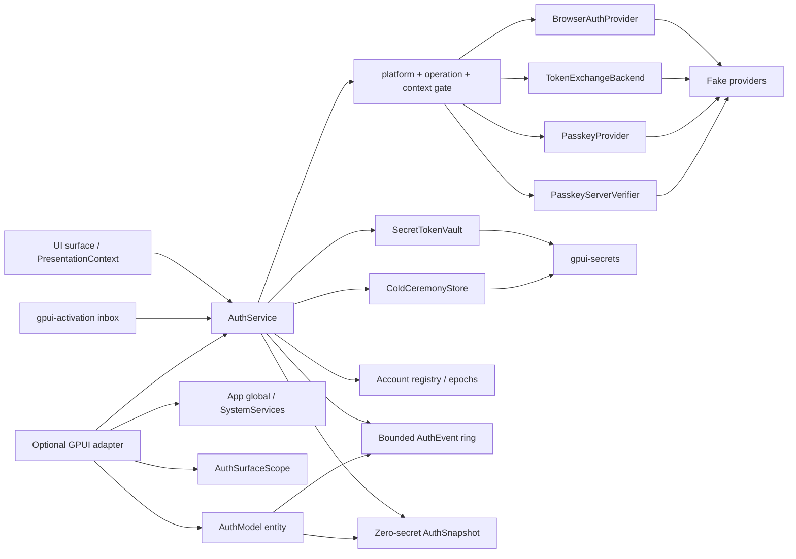

# Browser account authentication and Passkey request flows

This document specifies `crates/gpui-auth` for
[#46](https://github.com/jihuayu/gpui-box/issues/46). The crate builds on the
typed system contracts from
[#19](https://github.com/jihuayu/gpui-box/issues/19) (`gpui-system`), URL
activation from [#24](https://github.com/jihuayu/gpui-box/issues/24)
(`gpui-activation`), the background-only credential boundary from
[#27](https://github.com/jihuayu/gpui-box/issues/27) (`gpui-secrets`), the
permission contracts from [#20](https://github.com/jihuayu/gpui-box/issues/20)
(`gpui-permissions`) and host lifecycle from
[#21](https://github.com/jihuayu/gpui-box/issues/21) (`gpui-lifecycle`). It is
deliberately independent of [#28](https://github.com/jihuayu/gpui-box/issues/28)
(`gpui-local-auth`).

The default build has no GPUI dependency. It installs no native browser,
WebAuthn or keychain provider, performs no network I/O and never claims runtime
qualification. Every cell in the platform matrix is
`Evidence::ContractOnly`. Authentication succeeds only after an application
supplies a real `TokenExchangeBackend` and, for passkeys, a real
`PasskeyServerVerifier` on `ExecutionOwner::Background`.

## Status and toolchain

| Item | Value |
| --- | --- |
| Workspace Rust pin (`Cargo.toml`, `mise.toml`) | `1.98.1` |
| Observed host toolchain | `rustc 1.99.1 (58cf8f9c3 2026-10-13)` |
| Observed host Cargo | `cargo 1.99.1 (5f94df478 2026-08-27)` |
| Upstream GPUI revision (`vendor/gpui/UPSTREAM.json`) | `f8cfc7ed9e57503def9479138894f3139f5400cc` |
| External crates added | none |
| Default feature | none (headless, contract-only) |
| Optional feature | `gpui` (entity/global/`SystemServices` adapter) |

The upstream revision is also exposed as
`gpui_auth::UPSTREAM_GPUI_REVISION`. The enclosing repository checkout used
while validating this work was `1e2f919fa03026cea83df5049705c839a8aa3746`;
`vendor/gpui` is materialized content, not a nested Git checkout.

## Scope and ownership

`gpui-auth` owns:

- Browser OAuth 2.0/OIDC authorization-code ceremonies with S256 PKCE,
  single-use `state`, optional OIDC `nonce`, bounded scopes and explicit
  presentation epochs.
- A pure-Rust FIPS 180-4 SHA-256, RFC 4648 §5 base64url and RFC 7636 S256
  implementation. The PKCE verifier is 43..=128 unreserved characters, is never
  cloned or formatted, and is overwritten on `Drop`.
- Strict URL parsing for authorization endpoints, callback URLs, origins,
  relying-party ids and redirect shapes. Userinfo, fragments, non-HTTPS
  endpoints (except explicit loopback development), zero ports, whitespace and
  control characters are rejected.
- Loopback (IPv4 and IPv6), custom-scheme, universal-link and Web same-origin
  redirect targets, with exact scheme/host/port/path matching and ephemeral
  port resolution.
- Warm redirect ingestion from `gpui-activation::ActivationSource::WarmLaunch`
  and cold redirect ingestion from `ActivationSource::ColdLaunch`, including
  `gpui-secrets`-persisted PKCE verifier/cold descriptors and hydration after a
  process restart.
- A typed `RedirectCaptureOutcome` that distinguishes ignored unrelated URIs,
  stale/unknown `state`, malformed callbacks, OAuth protocol errors, user
  cancellation, expired/unknown cold ceremonies and ready exchanges.
- A `TokenExchangeBackend` boundary invoked only on
  `ExecutionOwner::Background`, outside every service lock.
- A `gpui-secrets`-backed `SecretTokenVault` for access, refresh and ID tokens,
  with background-only reads and explicit account cleanup.
- A multi-account registry with a primary account, monotonic session epochs,
  single-flight refresh, token rotation, `InvalidGrant`/permanent-failure
  handling and logout/revocation races.
- Passkey/WebAuthn creation and assertion contracts, strict RP ID/origin/
  challenge validation, single-use challenges, allow/exclude credential checks,
  optional session establishment and explicit background server verification.
- A six-platform × ten-operation qualification matrix, every cell
  `Evidence::ContractOnly`.
- A bounded cursor event ring (`DEFAULT_AUTH_EVENT_CAPACITY = 64`) that never
  carries token material, authorization codes, PKCE verifiers, raw challenges or
  callback query values.
- An optional GPUI adapter with an `App` global, `SystemServices` registration,
  a generation-safe `AuthSurfaceScope`/`SurfaceAuthScope` and an `AuthModel`
  entity with resync reporting.

It does **not** own:

- Native browser launches, `ASWebAuthenticationSession`/Custom Tabs/
  `WebView2`/`xdg-open` bridges, platform WebAuthn UI or native keychains.
  Those are supplied through the provider traits.
- HTTP, TLS, DNS or OAuth server metadata. The caller's `TokenExchangeBackend`
  performs the token request; the caller's `PasskeyServerVerifier` validates
  attestation and assertion signatures.
- Account profile storage, server-side sessions, refresh scheduling policy or
  password reset. The service exposes monotonic expiry evaluation; the host
  decides when to call it.
- Local device authentication. `LocalUserPresenceGate` may gate sensitive local
  actions, but its receipt is not a token and cannot authenticate an account.
- Telemetry, authorization codes, tokens, PKCE material, raw WebAuthn
  signatures/attestations, query strings or user handles in logs.

`gpui-box` exposes the crate through two opt-in features:

```toml
gpui-box = { features = ["auth"] }
gpui-box = { features = ["auth-gpui"] }
```

`auth` enables system, activation, secrets, permissions, lifecycle and
`gpui-auth`. `auth-gpui` additionally enables the shared GPUI integrations and
`gpui-auth/gpui`. Neither feature selects a desktop or Android backend by
itself. `mise.toml` includes `-p gpui-auth` in `tasks.test`, `tasks.lint` and
both cargo commands in `tasks.check`.

## Architecture



`AuthService` is a clonable `Send + Sync + 'static` handle over `Arc`-shared
state. It can be installed headlessly, registered as a concrete typed service
in `gpui_system::SystemServices`, or installed as a GPUI `App` global. Clones
share accounts, ceremonies, the vault handle, the event ring and refresh
single-flight state; `shares_state_with` compares the inner `Arc`.

### Ownership model

`ExecutionOwner` is local to this crate because the current `gpui-system`
revision exposes `UiContext`/`OperationContext` but no reusable execution-owner
enum.

| Owner | Meaning | Allowed auth work |
| --- | --- | --- |
| `Ui` | A live surface generation | Launch browser/passkey ceremonies, read snapshots, select primary, cancel |
| `Background` | Non-UI executor | Token exchange, refresh, logout, token leases, server verification, hydration |
| `Renderer` | Draw-only context | Snapshot/event reads; all secret and backend calls rejected |

Every method that touches secrets, invokes a provider, exchanges a code or
verifies a passkey calls `ExecutionOwner::require_background(...)` before doing
work. Lock guards are never held across a provider, backend, verifier, presence
gate, secrets call or observer.

## Browser OAuth/OIDC and PKCE

### Request

`BrowserAuthRequest::new` binds:

- a strict HTTPS `AuthEndpointUrl` (explicit loopback HTTP may be enabled);
- a `RedirectTarget`;
- validated `AuthScopes`;
- an `OAuthState` (16..=128 URL-safe ASCII characters, no whitespace/control);
- a `PkcePair` created from a `PkceVerifier`;
- a non-zero `PresentationContext { surface, generation }`;
- an optional expected account for step-up;
- a `BrowserSessionPreference` (`Persistent` or `Ephemeral`);
- an optional OIDC nonce;
- a monotonic expiry (default 300 seconds).

The generated authorization URL uses `response_type=code`,
`code_challenge_method=S256`, `client_id`, `redirect_uri`, `scope`, `state` and
an optional `nonce`. The verifier is never placed in a URL, snapshot, event or
`Debug` output.

### PKCE primitives

- SHA-256 follows FIPS 180-4, including the 55/56-byte padding boundary.
- Base64url follows RFC 4648 §5 with no padding and the URL-safe alphabet.
- The RFC 7636 Appendix B vector
  `dBjftJeZ4CVP-mB92K27uhbUJU1p1r_wW1gFWFOEjXk` →
  `E9Melhoa2OwvFrEMTJguCHaoeK1t8URWbuGJSstw-cM` is tested exactly.
- `PkceVerifier` has no `Clone`, redacts `Debug`, and overwrites its bytes plus
  a `black_box` barrier on `Drop`.

### Ceremony state machine

```text
Prepared -> Launched -> ReadyForExchange -> Exchanging -> Committing -> Completed
     |          |              |               |             |
     +----------+--------------+---------------+-------------+--> Cancelled / Expired
```

- `Prepared` exists only for the cold two-phase flow, between persistence and
  `launch_prepared_browser_auth`.
- `Launched` accepts exactly one callback for the matching `state` and redirect.
- A valid authorization code moves the ceremony to `ReadyForExchange` and marks
  the `state` consumed immediately. Replaying the same callback before exchange
  returns `RejectedStaleOrUnknownState`.
- `Exchanging` is set before invoking `TokenExchangeBackend`.
- `Committing` is set before installing tokens; a concurrent cancel, expiry,
  logout or surface disposal makes the install fail and the late tokens are
  deleted from the vault.
- A completed ceremony is removed. Its `state` remains in a bounded used-state
  set for deterministic replay rejection.

Ceremonies are bounded by `AuthConfig::max_ceremonies` (default 16), one active
ceremony per `(surface, generation)`, and a default 300-second lifetime.
`AuthConfig::event_capacity` bounds the event ring (default 64).

### Redirect capture

`submit_callback` (warm) and `ingest_activation` (cold/warm) feed
`CallbackUrl`. The service:

1. Parses the URL and rejects fragments/control characters.
2. Matches only against active ceremonies whose redirect target matches the
   scheme, host, port and path exactly.
3. Compares `state` in constant-time byte order; unknown or consumed states are
   `RejectedStaleOrUnknownState` without touching any ceremony.
4. Maps `error=access_denied` to `CeremonyCancelled { reason: User }` and other
   known OAuth errors to `RejectedOAuthError { code }` without retaining
   `error_description`.
5. Requires `code` and `state` for success; missing parameters are malformed.
6. Deletes any matching cold descriptor and verifier from `gpui-secrets` after
   capture, before returning, so a restart cannot replay the verifier.

An unrelated URI returns `IgnoredUnmatchedUri` and does not cancel the pending
ceremony. A callback for an unknown cold ceremony returns
`ColdCeremonyUnavailable`; the browser is never launched as a side effect of an
arbitrary URI.

### Cold and warm activation

`gpui-activation` currently exposes `ActivationSource::{ColdLaunch, WarmLaunch,
Notification, Forwarded}` and an `ActivationInbox`; it has no
`InitialLaunch`/`AlreadyRunning` variants and no activation service. The mapping
is therefore:

| Activation source | Auth treatment |
| --- | --- |
| `ColdLaunch` | Cold redirect; hydrate `gpui-secrets` descriptors, then capture |
| `WarmLaunch` | Warm redirect; match an in-memory ceremony |
| `Notification` / `Forwarded` | Open URL if it matches; otherwise ignored |

Cold flow:

1. UI calls `begin_cold_resumable_browser_auth(Background, request, now)`. The
   service generates/accepts the PKCE pair, writes the verifier and a descriptor
   (ceremony id, provider, redirect, state, nonce/scopes, remaining TTL) to
   `gpui-secrets`, records a `Prepared` in-memory ceremony and returns a handle.
2. UI calls `launch_prepared_browser_auth(Ui, ceremony_id, now)` to launch the
   system browser. The verifier is never returned to the UI.
3. After a process restart, `hydrate_cold_ceremonies(Background, now)` lists the
   bounded index, loads descriptors/verifiers, deletes malformed/expired
   entries, reconstructs ceremonies and returns the count.
4. A `ColdLaunch` activation is captured against the hydrated ceremony. A
   successful capture deletes its cold secrets before token exchange.
5. A hydrated ceremony has no persisted authorize URL and cannot be relaunched
   with `launch_prepared_browser_auth`; a cold launch must already be in flight
   or a fresh ceremony must be created.

The cold descriptor stores the *remaining* TTL as a `Duration`. A monotonic
`Instant` cannot be persisted across processes, so hydration starts a fresh
window of that remaining duration; hosts that need wall-clock cold expiry must
add an explicit clock source. Cross-store writes are not atomic (the current
secret provider has no transaction API). Persistence writes the verifier, then
the descriptor, then the bounded index; a crash before index publication can
leave unindexed verifier/descriptor entries that hydration cannot discover.
Those orphans require provider-level cleanup or an account reset. This is a
documented recovery limitation, not hidden.

### Errors and cancellation

`AuthError` is exhaustive and maps to `gpui_system::SystemError` with a static
message:

| Auth error | System code | Meaning |
| --- | --- | --- |
| `NotAuthenticated` | `Unavailable` | No live session/account |
| `ReauthRequired` | `Unavailable` | Refresh/access invalid; user must reauthenticate |
| `WrongExecutionOwner` | `Unavailable` | Secret/backend work attempted on UI/renderer |
| `Expired` | `DeadlineExceeded` | Ceremony or challenge deadline passed |
| `Cancelled(reason)` | `Unavailable` | Explicit/user/policy/surface cancellation |
| `StaleCeremony` / `StaleOrUnknownState` | `Unavailable` | Replay or lost race |
| `Busy` | `Unavailable` | A single-flight operation is already running |
| `AlreadyActive` / `CeremonyLimit` | `Unavailable` | Surface/concurrency bound |
| `Unsupported` | `Unsupported` | Platform/operation unavailable |
| `InvalidInput` | `InvalidArgument` | Malformed URL/request |
| `VerificationFailed` | `PermissionDenied` | Provider/verifier rejected the assertion |
| `UserPresenceDenied` | `PermissionDenied` | Local presence gate denied |
| `NoMatchingCredentials` | `Unavailable` | No passkey matched |

`cancel_ceremony` cancels exactly one ceremony and its provider session; a
second cancel returns `false`. `dispose_surface_generation(surface, generation)`
cancels only ceremonies bound to that exact pair; zero ids and stale generations
are no-ops. `evaluate_expiries` removes expired browser/passkey ceremonies,
cancels provider work and deletes cold secrets only for a `Background` owner.

## Token vault, accounts and refresh

### Vault

`SecretTokenVault` wraps `gpui_secrets::Secrets`. Targets use the service
`gpui-auth/v1` and purposes:

- `access-token`
- `refresh-token`
- `id-token`
- `pkce-verifier`
- cold descriptor/index keys under the reserved account `gpui-auth/cold`

`store_issued`, `read_access_token`, `read_refresh_token`, `delete_account` and
`discard_tokens` all require `ExecutionOwner::Background`; `Ui` and `Renderer`
receive `WrongExecutionOwner` before any provider call. Values are
`SecretBytes`; reads return `SecretAccess` and are copied into zeroizing
`SecretTokenMaterial` only for the duration of a backend call or `TokenLease`.

`delete_account` removes exactly this crate's `access-token`, `refresh-token`
and `id-token` keys under `gpui-auth/v1`; it never calls
`gpui-secrets::remove_account`, which would delete the same account name in
unrelated services. It returns the number of keys that actually existed.
`Locked`, `KeyInvalidated` and cancellation are propagated as typed errors, not
silently reported as success.

Cold ceremonies use the reserved provider account `gpui-auth/cold`. A `/` is
valid for `gpui_secrets::CredentialKey` but invalid for `AccountId`, so
`AccountId::new("cold")` (or any other valid account id) cannot collide with the
cold namespace and cannot overflow the 128-byte key account bound.

An RFC 6749 §6 refresh response may omit a new refresh token while leaving the
existing token valid. `store_refreshed` preserves the stored `refresh-token` in
that case; the account record also keeps `has_refresh_token = true` and its
existing refresh expiry.

`TokenLease` exposes the access token only through
`expose_access_token() -> &[u8]`; it has no `Clone`, redacts `Debug`, and
zeroizes on drop. Callers must not retain or log the slice.

### Accounts

`AccountId`, `ProviderId`, `AccountLabel` and `AuthScope` are validated,
non-empty and bounded. `AuthSnapshot` contains only
`AccountSessionSummary` values:

- account/provider/label/scopes;
- `AuthMethodKind` (`BrowserOAuth` or `Passkey`);
- `AccountSessionState` (`Active`, `AccessTokenExpired`, `Refreshing`,
  `ReauthRequired`, `LoggingOut`);
- `authenticated_at` plus access/refresh expiry instants (for local scheduling,
  not credentials);
- `has_refresh_token` and `is_primary`.

No token, code, verifier, challenge, user handle, raw credential id or callback
query is present in a snapshot. `Debug` for tokens, verifiers, user handles,
provider responses and requests is redacted.

`max_accounts` defaults to 16. `install_tokens` enforces the bound, replaces an
existing account in place, preserves the primary if still valid and emits
`AccountAuthenticated`. `select_primary_account` is UI-safe and emits
`PrimaryAccountChanged`.

### Refresh and logout

`refresh_account(Background, account_id, now)`:

1. Rejects UI/renderer owners.
2. Atomically claims the account's single-flight slot; a concurrent call gets
   `Busy`.
3. Reads the refresh token on `Background` only.
4. Calls `TokenExchangeBackend::refresh_tokens` outside locks.
5. On success, rotates access/refresh tokens, updates expiry, clears the
   single-flight slot and emits `AccountRefreshed`.
6. On `InvalidGrant`/`ReauthRequired` or a permanent failure, marks the account
   `ReauthRequired`, drops the refresh token and emits
   `AccountReauthRequired`.
7. On cancellation/expiry, retains the prior valid tokens and clears the slot.

Each account has a monotonic session epoch. `logout_account` is a
retryable, vault-gated state machine. It first moves the account to
`AccountSessionState::LoggingOut` without removing it, advances the epoch,
clears single-flight state, repairs the primary account, and cancels
account-bound browser and passkey ceremonies (including deleting their cold
records). It then revokes the refresh token best-effort and deletes only this
crate's three token keys while holding `vault_gate`. If the vault is locked,
invalidated or cancels, the account stays in `LoggingOut`, no
`AccountLoggedOut` event is emitted, and `access_token`, `refresh_account` and
`select_primary_account` all reject it. After unlocking, retrying
`logout_account` deletes the remaining keys and removes the record. On success
it emits `AccountLoggedOut`. `logout_all` repeats this and propagates the same
vault error so a retry can finish every account.

All token-vault mutations are serialized by `ServiceInner::vault_gate`. The
lock order is always `vault_gate` -> `state`; the gate is never held across a
browser/passkey provider, `TokenExchangeBackend`, `PasskeyServerVerifier`,
`LocalUserPresenceGate` or event emission. `install_tokens` and
`refresh_account` verify the ceremony/account epoch before writing, and they
only discard late tokens when no newer live session owns the account. A stale
refresh that completes after a newer login for the same `AccountId` returns
`StaleCeremony` without touching the newer session's vault entries.

`evaluate_expiries` is monotonic-clock-only:

- expired access + no refresh token → `ReauthRequired`;
- expired refresh token → `ReauthRequired`;
- expired access with a refresh token → `AccessTokenExpired` (refreshable);
- `access_token` returns `ReauthRequired` for an expired access state and
  `NotAuthenticated` for absent/logged-out accounts.

## Passkeys / WebAuthn

### Contracts

`PasskeyCreationRequest::new` requires:

- a strict `RelyingPartyId` (lowercase DNS labels, no IP literal, no trailing
  dot, no port);
- an optional `AuthOrigin`; if present it must be a secure context and the RP ID
  must be an effective domain of the origin's host (label-safe suffix match);
- a `PasskeyChallenge` of 16..=128 bytes;
- a non-zero `PresentationContext` and monotonic expiry;
- a redacted `PasskeyUserHandle`, `AccountLabel` and COSE algorithm;
- optional exclude credentials and `PasskeyMediation` (`Required` or
  `Conditional`).

`PasskeyAssertionRequest::new` adds optional allow credentials and an optional
expected account. Web platform requests require an explicit origin; conditional
mediation is checked against the matrix.

Provider output is checked before server verification:

- returned RP ID must equal the request RP ID;
- returned credential id must be in the exclude list for creation (reject as
  `CredentialExcluded`) or the allow list for assertion (reject as
  `VerificationFailed`);
- `user_verified` must satisfy the requirement;
- response bytes are redacted/zeroized.

The server verifier receives the expected challenge, RP ID, origin and account
and is responsible for signature, client-data and attestation validation. The
service's local checks are defense in depth, not a substitute for that
verification.

`PasskeyServerVerifier::verify_registration`/`verify_assertion` run only on
`Background`, outside locks. A verification result may include an
`IssuedPasskeySession`; the service installs it through the same vault/account
path as browser tokens, marked `AuthMethodKind::Passkey`. Without a session the
ceremony completes but no account is created.

### Ceremony lifecycle

```text
InProvider -> ProviderComplete -> Verifying -> Committing -> Completed
      |              |               |            |
      +--------------+---------------+------------+--> Cancelled / Expired / Stale
```

- Challenges are single-use and stored as SHA-256 digests in a bounded set;
  replay returns `StaleOrUnknownState` before provider work.
- Expired challenges return `Expired`.
- `NoMatchingCredentials` maps to `AuthError::NoMatchingCredentials` (system
  code `Unavailable` in the current `gpui-system` vocabulary; there is no
  distinct `NotFound` code).
- `AlreadyExists`/excluded credentials map to `CredentialExcluded`.
- `UserVerificationRequired` maps to `UserPresenceRequired`.
- Provider/verifier rejection maps to `VerificationFailed`; no session, token
  or credential is published.
- `dispose_surface_generation` and `cancel_passkey_ceremony` call the provider's
  cancel method and remove the ceremony. A late provider/verifier completion
  sees `StaleCeremony`.

Two-phase passkey flows (`begin_*` on UI, `complete_*` on Background) exist for
hosts that need a platform UI prompt between them. One-shot
`register_passkey`/`assert_passkey` require the call itself to be on
`Background`.

## Platform matrix

Legend: **S** = `Supported`, **C** = `Conditional`, **U** = `Unsupported`.
Every cell is `Evidence::ContractOnly`; `AUTH_PLATFORM_MANIFEST` reports
`native_adapter_installed: false` for all six platforms. "Conditional" means the
contract exists but the native API/permission/configuration may be absent and
must be probed at runtime by a later provider.

| Operation | Windows | macOS | Linux | Android | iOS | Web |
| --- | --- | --- | --- | --- | --- | --- |
| `browser_oauth_session` | S | S | S | S | S | S |
| `ephemeral_browser_session` | S | S | C | C | S | C |
| `loopback_redirect` | S | S | S | U | U | U |
| `custom_scheme_redirect` | S | S | S | S | S | U |
| `universal_link_redirect` | U | U | U | S | S | U |
| `web_same_origin_redirect` | U | U | U | U | U | S |
| `passkey_registration` | S | S | C | S | S | C |
| `passkey_assertion` | S | S | C | S | S | C |
| `passkey_conditional_mediation` | C | C | C | C | C | C |
| `token_vault_persistence` | S | S | C | S | S | C |

Native API anchors recorded per cell include:

- **Windows**: WebView2/WebAuthenticationBroker, WebAuthn API, Windows
  Credential Manager, DPAPI.
- **macOS**: `ASWebAuthenticationSession`, `AuthenticationServices`,
  `ASAuthorization`, Keychain Services.
- **Linux**: `xdg-open`/portal, `libfido2`, Secret Service (D-Bus), sandbox
  portals.
- **Android**: Custom Tabs / App Links, Credential Manager, Android Keystore,
  Play Services.
- **iOS**: `ASWebAuthenticationSession`, Universal Links,
  `ASAuthorizationPlatformPublicKeyCredential`, Keychain.
- **Web**: `window.open`/redirect, `navigator.credentials`,
  `PublicKeyCredential.isConditionalMediationAvailable()`, WebCrypto.

No adapter is installed for any platform, so all runtime evidence remains
contract-only. `gpui-auth` intentionally defines its own six-value
`AuthPlatform`; the current `gpui_system::Platform` has five native variants and
no `Web` variant.

## Local presence (#28) separation

`gpui-local-auth` is **not** a dependency of `gpui-auth` (`cargo tree -p
gpui-auth` contains no `gpui-local-auth`). The only overlap is the optional
`LocalUserPresenceGate` trait:

- It receives `LocalPresencePurpose::{StepUpCeremony, RemoveAccount}` and an
  `OperationContext`.
- It returns an opaque `LocalPresenceReceipt { verified, issued_at }`.
- A verified receipt is never accepted by `TokenExchangeBackend`,
  `PasskeyServerVerifier`, `SecretTokenVault`, `AuthService::install_tokens` or
  any account-creating API.
- A step-up browser launch may require local presence as a *precondition*, but
  still needs a browser callback, a valid PKCE verifier and a successful
  background token exchange.
- A passkey assertion may require local presence on the host, but still needs
  provider output and background server verification.
- Local unlock cannot mint `IssuedAccountTokens`, cannot read the vault and
  cannot mark an account `Active`.

The separation tests verify that presence alone leaves the snapshot and vault
empty, and that removing the gate does not change remote validation.

## GPUI adapter

Enable `gpui-auth/gpui` (or `gpui-box/auth-gpui`). The adapter lives in
`gpui_auth::gpui_adapter` and is desktop-gated for entity tests.

- `install_auth_service(service, cx)` sets the `App` global.
- `init_auth(cx, service)` sets the global and registers a concrete
  `SystemServices` provider.
- `auth_service(cx)` resolves global first, then `SystemServices`.
- `AuthAppExt` exposes the same helpers as methods on `App`.
- `AuthSurfaceScope` (`SurfaceAuthScope` alias) captures the exact
  `(surface, generation)`, exposes a `Ui` `OperationContext`, and on `Drop`
  disposes only that generation, then disposes the owner only if still current.
  A stale scope never cancels a newer generation.
- `AuthModel::new(owner, service, cx)` is a GPUI entity with a monotonic
  `AuthEventCursor`, a 64-event retained buffer, `drain_events(cx)` that calls
  `cx.notify()` on changes, and sticky `ResyncRequired { dropped_events }` when
  the ring overflows. `refresh_snapshot`, `select_primary_account` and
  `evaluate_expiries` update the cached snapshot.

The adapter never performs token exchange, refresh, logout or server
verification itself; those remain `Background` service calls.

## Lifecycle and failure policy

- All clocks are monotonic `Instant`/`Duration`; no `SystemTime`, wall clock or
  floating point is used.
- Every mutex is poison-resilient, including `Drop` paths.
- No lock is held across a provider/backend/verifier/gate/secrets/observer call.
- Backend failures never create partial sessions. Successful tokens are written
  only inside `Committing`; a lost race deletes them.
- Unsupported platform/operation combinations fail before launch with
  `Unsupported` and do not mutate state.
- Surface disposal is idempotent and generation-scoped.
- Event overflow is explicit: consumers receive `ResyncRequired` and must take a
  fresh `snapshot`; silent gaps are forbidden.
- Cold cross-store writes are best-effort; hydration cleans malformed,
  duplicate and expired entries.

## Verification

All commands were run from the repository root with an external target
directory:

```bash
export CARGO_TARGET_DIR=/tmp/gpui-box-target
mise tasks validate
cargo fmt --all -- --check
cargo test --locked -p gpui-auth --all-features
cargo test --locked -p gpui-box --features auth,auth-gpui --test auth --lib
cargo clippy --locked -p gpui-auth -p gpui-box --all-features --all-targets -- -D warnings
cargo check --locked -p gpui-box-example-desktop
git diff --check
! grep -rn "$HOME/antigravity" crates/gpui-auth docs/S_ACCOUNT_AUTH.md crates/gpui-box/tests/auth.rs
! grep -rn 'thread::sleep\|println!\|eprintln!\|dbg!\|todo!\|unimplemented!\|SystemTime' crates/gpui-auth crates/gpui-box/tests/auth.rs
```

Test counts:

| Target | Tests |
| --- | --- |
| `gpui-auth` lib (PKCE/URL + GPUI adapter) | 14 |
| `tests/accounts.rs` | 16 |
| `tests/browser.rs` | 13 |
| `tests/event.rs` | 4 |
| `tests/passkey.rs` | 13 |
| `tests/pkce.rs` | 10 |
| `tests/platform.rs` | 4 |
| **`gpui-auth` total** | **74** |
| `gpui-box` lib | 1 |
| `gpui-box` `tests/auth.rs` | 5 |
| **`gpui-box` total** | **6** |

Coverage highlights:

- FIPS SHA-256 vectors, RFC 4648 base64url, RFC 7636 Appendix B, verifier
  bounds/redaction.
- IPv4/IPv6 loopback, ephemeral ports (including empty-port rejection), custom
  scheme, universal link, Web same-origin, fragments, userinfo, RP ID suffix
  safety and origin matching.
- Warm/cold activation, cold hydration/restart, PKCE deletion after capture,
  unknown state/unmatched URI isolation, OAuth error mapping, callback replay
  before and after exchange, cold expiry cleanup.
- Ceremony bounds, surface conflicts, cancellation, mid-exchange TOCTOU,
  surface-generation disposal.
- Multi-account primary switching, single-flight refresh, non-rotating refresh,
  stale-refresh/newer-login disjointness, locked-vault logout retry,
  `LoggingOut` rejection, invalid grant, expiry, vault service isolation,
  `gpui-auth/cold` collision safety, vault owner enforcement and zero-secret
  snapshots/events/Debug.
- Passkey registration/assertion, account-bound assertion cancellation on
  logout, allow/exclude checks, challenge replay/expiry, RP/origin/user-
  verification checks, verifier failure, session establishment, surface
  disposal.
- #28 separation, event overflow/resync, six×ten matrix invariants.
- GPUI global/`SystemServices` registration, generation-safe scope drop, entity
  event drain and notification.

## Known gaps and follow-ups

- No native browser, WebAuthn, keychain, network or HTTP implementation ships in
  this crate. Every platform cell remains `Evidence::ContractOnly` until a
  provider is implemented and qualified.
- The current `gpui-secrets` provider API has no transaction; cold descriptor +
  verifier writes are not atomic.
- Cold expiry uses a remaining `Duration` because `Instant` cannot cross a
  process boundary; wall-clock expiry needs a future clock source.
- `gpui-activation` has no `InitialLaunch`/`AlreadyRunning`; cold/warm mapping is
  `ColdLaunch`/`WarmLaunch` as documented above.
- `gpui-system` has no `NotFound` error code; missing passkey credentials map to
  `Unavailable` with a static message.
- OAuth discovery, DPoP, PAR, JAR and token introspection are out of scope for
  this issue.
- Follow-ups: [#8](https://github.com/jihuayu/gpui-box/issues/8) (native
  packaging), [#9](https://github.com/jihuayu/gpui-box/issues/9) (platform
  provider qualification), [#70](https://github.com/jihuayu/gpui-box/issues/70)
  (cross-capability contract harness and evidence matrix),
  [#43](https://github.com/jihuayu/gpui-box/issues/43) (system capability
  backlog umbrella), [#74](https://github.com/jihuayu/gpui-box/issues/74)
  (end-to-end account UX).
