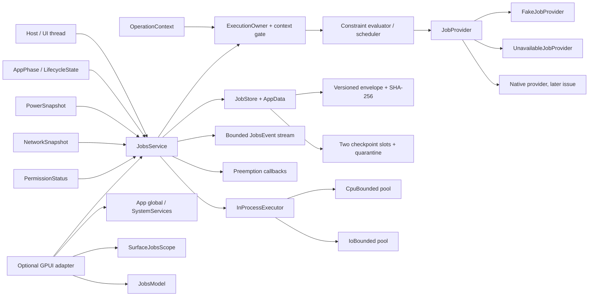

# Persistent background jobs, constraint gating and checkpoint recovery

This document specifies `crates/gpui-jobs` for
[#54](https://github.com/jihuayu/gpui-box/issues/54). The crate builds on the
shared system contracts from
[#19](https://github.com/jihuayu/gpui-box/issues/19) (`gpui-system`), lifecycle
and surface ownership from
[#21](https://github.com/jihuayu/gpui-box/issues/21) (`gpui-lifecycle`), private
application storage from
[#22](https://github.com/jihuayu/gpui-box/issues/22) (`gpui-app-data`), power
observations from [#55](https://github.com/jihuayu/gpui-box/issues/55)
(`gpui-power`), permission state from
[#20](https://github.com/jihuayu/gpui-box/issues/20) (`gpui-permissions`) and
network cost/reachability from
[#69](https://github.com/jihuayu/gpui-box/issues/69) (`gpui-network`). It
coordinates durable work, bounded in-process work and UI-owned cancellation
with the query cache from [#3](https://github.com/jihuayu/gpui-box/issues/3)
without claiming an OS provider that is not installed.

The default build has no GPUI dependency. It installs no native OS scheduling
provider, never promises a wall-clock start time, and does not synthesize
success when a platform API or permission is missing. Every cell in the
platform matrix is `Evidence::ContractOnly`; `Native` or `Conditional` in the
`Support` column describes the intended host mechanism, not compiled or
runtime-qualified evidence.

## Scope and ownership

`gpui-jobs` owns:

- Strict job identity (`JobNamespace`/`JobKey`), bounded names and hex-encoded
  storage ids that cannot traverse a path.
- Six durable/in-process operations with a six-platform, thirty-six-cell
  qualification matrix and a Web capability policy.
- Registration policies (`KeepExisting`, `RejectConflict`, `Replace`,
  `UpdateConstraints`), stable idempotency tokens and monotonic `run_epoch`
  fencing.
- Constraint gating for network cost/reachability/captive portal/data saver,
  AC charging, battery saver, critical thermal, device idle, low storage and
  permission requirements, plus initial delay, periodic cadence, execution
  budget and absolute deadline.
- Advisory `ScheduleReceipt`s and a provider boundary that treats duplicate
  wakeups, skipped runs and short OS execution slices as normal.
- A durable per-job journal with a versioned envelope, SHA-256 integrity digest,
  two committed checkpoint slots, staging-file sync + rename commits and
  quarantine of corrupt/truncated files.
- Deterministic restart reconciliation of jobs left `Running`.
- Integer-only linear/exponential retry with an attempt cap and overflow-safe
  millisecond saturation.
- Cooperative preemption (`PreemptReason`), a grace period, optional final
  checkpoint and fail-closed stale fencing.
- Independent bounded in-process CPU and I/O pools, surface-generation
  disposal and `ExecutionOwner` enforcement for blocking work.
- A bounded `EventSubscription<JobsEvent>` using
  `gpui_system::event_channel` (`DEFAULT_JOBS_EVENT_CAPACITY = 64`).
- An optional GPUI adapter with an `App` global, `SystemServices` registration,
  `SurfaceJobsScope` and `JobsModel`.

It does **not** own:

- Native Windows Background Tasks/Task Scheduler, macOS
  `NSBackgroundActivityScheduler`/launchd, Linux systemd user timers/XDG
  Background Portal, Android WorkManager, iOS `BGTaskScheduler` or browser
  Service Worker/Background Sync adapters. Those are tracked under
  [#8](https://github.com/jihuayu/gpui-box/issues/8),
  [#2](https://github.com/jihuayu/gpui-box/issues/2),
  [#9](https://github.com/jihuayu/gpui-box/issues/9),
  [#18](https://github.com/jihuayu/gpui-box/issues/18) and
  [#43](https://github.com/jihuayu/gpui-box/issues/43).
- UI rendering, query invalidation or task-presentation policy. The service
  emits events that those owners consume.
- Encryption-at-rest. Storage is private application data; confidentiality and
  backup policy belong to `gpui-app-data` and the host.
- OS process supervision. A killed process is reconstructed from its committed
  journal; an in-process task is never durable.

`gpui-box` exposes the crate through two opt-in features:

```toml
gpui-box = { features = ["jobs"] }
gpui-box = { features = ["jobs-gpui"] }
```

`jobs` imports `gpui_box::jobs` and enables system, app-data, lifecycle,
permissions, power and network dependencies. `jobs-gpui` additionally compiles
the optional GPUI adapter and the shared GPUI integrations. Neither feature
selects a desktop or Android backend by itself. `mise.toml` includes
`-p gpui-jobs` in `tasks.test`, `tasks.lint` and both cargo commands in
`tasks.check`.

## Architecture



`model` defines public identities, constraints, records, checkpoints and
integer progress. `clock` supplies monotonic host milliseconds and the
deterministic `ManualClock`. `store` owns the versioned on-disk envelope,
atomic replacement, slot selection, integrity checks and quarantine.
`provider` owns the OS boundary, schedule request/handle types and
`FakeJobProvider`/`UnavailableJobProvider`. `executor` owns bounded CPU/I-O
pools and surface-generation fencing. `platform` owns the 36-cell policy.
`service` coordinates state, persistence, scheduling, preemption, events and
restart reconciliation. `gpui_adapter` is only compiled with the `gpui`
feature and adds GPUI-owned handles around the same `Send + Sync` service.

`JobsService` is a clonable `Send + Sync + 'static` handle over
`Arc<ServiceInner>`. Clones share records, active attempts, checkpoints,
constraint snapshots, subscribers, preemption callbacks, the in-process
executor and the provider listener. `shares_state_with` compares the inner
`Arc`.

The provider boundary is deliberately small:

```rust
pub trait JobProvider: Send + Sync + 'static {
    fn capability(&self, operation: JobsOperation) -> Capability<JobsOperation>;
    fn schedule(&self, request: &JobScheduleRequest)
        -> Result<JobScheduleHandle, SystemError>;
    fn cancel(&self, key: &JobKey) -> Result<(), SystemError>;
    fn attach_listener(&self, listener: Weak<dyn JobProviderListener>);
    fn as_any(&self) -> &dyn Any;
}
```

Providers push `JobProviderNotice::{Wakeup, TimeSliceExpired,
ProviderUnavailable}` synchronously through a weak listener and never while
holding their own state lock. The service rechecks the execution context,
platform policy, capability and current constraints at execution time rather
than trusting a cached snapshot.

### Lock discipline

Service state, the operation lock and provider state are separate mutexes. The
service never holds the state lock while:

- calling `JobProvider::schedule` or `JobProvider::cancel`;
- invoking a preemption callback;
- delivering an event to subscribers.

Callbacks may therefore call `list_jobs`, `job_record`, `unmet_constraints`,
`subscribe` or `on_preemption` without deadlocking. The reentrant callback
integration test proves this explicitly. Every lock acquisition, including
`PreemptionSubscription::drop`, recovers a poisoned guard with
`PoisonError::into_inner`; no destructor panics.

## Identity and registration

`JobNamespace` is a lowercase ASCII DNS-like identifier: 1–64 bytes, labels of
alphanumerics/hyphens, no empty label, leading/trailing hyphen, dot at the
edge, slash, backslash, whitespace or non-ASCII. `JobKey` combines a namespace
and a job name with the same rules and displays as `namespace/name`.
`JobKey::parse` accepts exactly one `/`; `storage_id` is the lowercase hex of
the complete key, so no user-controlled bytes ever become a file name.

`JobConstraints` is validated before any side effect:

| Field | Meaning and bound |
| --- | --- |
| `network` | `None`, `Connected`, `Unmetered`, `NotRoaming` |
| `requires_charging` | AC power required; unknown power is unmet |
| `disallow_battery_saver` | battery saver must be off |
| `require_device_idle` | interactive device idle required |
| `require_storage_not_low` | storage must not be low |
| `deny_captive_portal` | a suspected/detected portal blocks work |
| `respect_data_saver` | constrained data saver blocks work |
| `initial_delay_ms` | 0 ms–7 days |
| `cadence` | `OneShot` or periodic with 60 s–7 day interval and optional jitter no larger than the interval |
| `execution_budget_ms` | 1 ms–24 h per attempt |
| `deadline_ms` | 1 ms–30 days from registration |
| `required_permission` | optional `PermissionKind` that must be `Granted` |
| `retry` | linear/exponential base and cap, 1–1000 attempts |

Unknown observations are never nominal. Missing power provenance or unknown
network provenance produces `PowerUnknown`/`NetworkUnknown`; a pending job is
not silently treated as runnable.

`ExistingJobPolicy` is deterministic:

| Policy | Result |
| --- | --- |
| `KeepExisting` | Existing constraints, epoch and schedule are preserved; receipt says `KeptExisting` |
| `RejectConflict` | Typed `InvalidInput` with `RetryAdvice::ModifyRequest`; no mutation |
| `Replace` | Cancels the provider admission, bumps `run_epoch`, clears checkpoints and creates a fresh schedule |
| `UpdateConstraints` | Replaces constraints in place, keeps the epoch while idle, re-evaluates and preempts an active run if it no longer qualifies |

`IdempotencyToken` is bounded ASCII (`alphanumeric`, `._:-`) and is generated
deterministically from the key and registration time when the caller does not
supply one. The token survives retries of the same logical job; `run_epoch`
and `attempt` distinguish executions.

## Advisory scheduling receipts

`ScheduleReceipt` contains the key, registration disposition, status, earliest
eligible time, unmet constraints and a `SchedulingGuarantee`:

- `AdvisoryOpportunistic` for normal registration;
- `ExpeditedBestEffort` for `schedule_job_expedited`.

`guarantee.is_advisory()` is always `true`. A receipt records only that the
provider admitted a request (or that constraints deferred it). It never
promises an exact wall-clock start, a maximum delay or completion. The OS may
coalesce runs, defer under thermal/power pressure, skip a period, or never
invoke the handler. `JobStatus::Scheduled` therefore means "eligible and
admitted", not "running now". `handle_wakeup` is the only transition to
`Running`, and it rechecks every constraint at that instant.

The Web policy is explicit: Service Worker Background Sync and Periodic
Background Sync are optional. Without them, scheduling returns `Unavailable`
and the caller must use an in-process bounded task while a visible page exists.
A page timer is never described as durable background execution.

## Checkpoints, atomicity and fencing

`JobCheckpoint` carries the job key, `run_epoch`, `attempt`, a monotonically
increasing `sequence`, `JobProgress`, an optional stage, created time, payload
and a SHA-256 checksum. The digest covers a domain separator
(`gpui-jobs-checkpoint\0`), the key storage id, epoch, attempt, sequence,
progress basis points/units, stage, created time and payload. Payloads are
bounded to 64 KiB; records are bounded to 256 KiB.

On-disk layout under the private `jobs` data location:

```text
jobs/
  job-<hex-key>.json
  checkpoint-<hex-key>.0.json
  checkpoint-<hex-key>.1.json
  quarantine/
```

Every file is an envelope `{ schema_version, checksum, payload }`. The envelope
digest covers `gpui-jobs-envelope\0`, schema version and payload bytes. Writes
go to a uniquely named staging file in the same directory, are synced, then
atomically renamed over the target. A failed write or rename leaves the
previous committed file intact. A write hook can fail the next write, truncate
it or corrupt it for deterministic fault-injection tests.

Checkpoint commits alternate slots by `sequence % 2`. Loading validates the
envelope schema, digest, payload shape, checkpoint digest and job-key match.
If the newest slot is corrupt or truncated, the previous valid slot is used,
the damaged file is moved into `quarantine/`, and a
`CheckpointRecovered` event is emitted. A completed job keeps its last
committed checkpoint, but reconciliation never regresses progress below the
persisted record. A corrupt job record is moved to quarantine and reported as
`CorruptRecordQuarantined`; it never panics or aborts loading other jobs.

`run_epoch` is monotonically increasing across replace, cancel, preemption
acknowledgement, retry and restart reconciliation. A `FencingToken` contains
the key, `run_epoch`, `attempt` and idempotency token. Every mutation validates
the token against the currently active attempt. Once superseded, cancelled,
preempted or reconstructed after restart, old tokens fail closed with
`ErrorCode::ContextExpired` (the shared error vocabulary has no `Canceled`
variant; this is the documented adaptation). `complete_job`, `fail_job`,
`report_progress`, `heartbeat`, `save_checkpoint` and `ack_preemption` cannot
clobber newer state.

A preemption handoff is the one exception: the active token may write **one
final checkpoint** after `PreemptionRequested`, but progress reports,
heartbeats, completion and failure are rejected until the attempt acknowledges
the handoff. `ack_preemption` advances `run_epoch`, removes the active attempt
and moves to `PendingConstraints` (constraint/lifecycle/permission loss) or
`ExpiredBudget` (execution budget, provider time slice or deadline). If the
handler does not acknowledge within `PREEMPTION_GRACE_MS` (5 s), `tick`
finalizes the same transition, so a lost UI task cannot pin the job forever.

## Retry, preemption and reconciliation

`RetryBackoffPolicy` is integer-only:

- linear: `base_delay_ms * attempt`, capped at `max_delay_ms`;
- exponential: `base * 2^(attempt - 1)`, saturating at `max_delay`;
- `max_attempts` is 1–1000; `allows_another_attempt(attempt)` is strict.

No floating point, wall-clock or unbounded shift is used. `u64` saturation is
tested at attempt 63 and `u64::MAX`.

Dynamic inputs preempt an active run cooperatively:

| Input | `PreemptReason` |
| --- | --- |
| Power/network/device/storage constraint lost | `ConstraintsLost` |
| Lifecycle leaves the foreground/active phase | `LifecycleSuspending` |
| Execution budget or deadline reached | `BudgetExpired` |
| Required permission revoked | `PermissionRevoked` |
| `cancel_job` | `Cancelled` |
| Provider reports the execution slice exhausted | `ProviderTimeSliceExpired` |

When constraints return, the service evaluates the pending record, clears the
stale admission, and reschedules through the provider. A pending job always
reports its current unmet reasons; it never reports an exact start time.

`reconcile_after_restart` is deterministic and idempotent:

1. Load every valid record and checkpoint; quarantine corrupt files.
2. Any record persisted as `Running` is unclean: advance `run_epoch`, keep the
   last valid checkpoint, and clear the active attempt.
3. If the deadline has passed or the attempt budget is exhausted, transition
   to `ExpiredBudget`.
4. Else if the next attempt is still in the future, transition to
   `RetryBackoff` with the remaining delay.
5. Else evaluate current constraints; if any are unmet, transition to
   `PendingConstraints`.
6. Otherwise transition to `Scheduled` and re-register with the provider.

A second call returns the cached report and does not advance the epoch again.
The report counts scanned jobs, reconciled running jobs, rescheduled, retried,
pending, expired, quarantined records and recovered checkpoints.

## In-process pools vs OS-scheduled jobs

These are distinct execution models and must not be conflated:

| Property | `JobProvider` durable job | `InProcessExecutor` |
| --- | --- | --- |
| Lifetime | Survives the process | Dies with the process |
| Admission | OS/provider, advisory | Explicit queue + concurrency bounds |
| Wakeup | OS callback, may duplicate/skip | Host pumps `start_next`/`run_ready` |
| Recovery | Journal + reconciliation | None; output is fenced |
| Owner | `ExecutionOwner::Background` | `ExecutionOwner::Background` only |
| Cancellation | Epoch fencing + provider cancel | Surface generation disposal |

`InProcessExecutor::new(cpu_concurrency, cpu_queue, io_concurrency, io_queue)`
rejects zero bounds. The pools are independent: a saturated CPU pool does not
consume I/O capacity and vice versa. `DEFAULT_CPU_CONCURRENCY = 2`,
`DEFAULT_IO_CONCURRENCY = 4`, `DEFAULT_POOL_QUEUE_DEPTH = 64`. Queue overflow
returns `ErrorCode::Busy`; unbounded queues are not offered.

`ExecutionOwner` is defined locally because `gpui-system` currently models
ownership through `OperationContext::ui`. A context with a UI attachment is
`Ui`; without one it is `Background`; `Renderer` must be declared explicitly.
`require_background` rejects UI and Renderer owners, rejects a context with
`ui.is_some()`, then checks cancellation/deadline. Durable writes and blocking
pool tasks therefore cannot run on the UI or render thread.

`SurfaceTaskScope` binds queued work to `(SurfaceId, generation)`. A zero
generation is invalid. Submitting a newer generation makes older scopes stale
with `ContextExpired`. `dispose_surface_generation` cancels all queued work for
that surface at or below the generation, marks the generation disposed, and
fences the output of an already-running task. `dispose_surface` disposes the
latest known generation. Dropping a `SurfaceJobsScope` performs the same exact
generation disposal, so an older surface cannot cancel a newer one.

## Events and the GPUI adapter

`JobsEvent` covers registration/scheduling, attempt start/completion/failure,
progress, checkpoints, cancellation, preemption request/ack/finalization,
constraint changes, quarantine/recovery, provider failure and reconciliation.
The stream uses `gpui_system::event_channel` with capacity 64. On overflow the
backlog is dropped and `Event::ResyncRequired` is delivered; subscribers must
refetch records rather than pretend no events were lost. Event delivery is
non-blocking and never occurs while the service state lock is held.

The `gpui` feature adds:

- `impl Global for JobsService` and `install_jobs_service`;
- `install_jobs_in_services` for `SystemServices`;
- `init_jobs`/`jobs_service`/`JobsAppExt` for `App` lookup;
- `SurfaceJobsScope` with optional `EntityScope` and exact-generation `Drop`;
- `JobsModel` with a bounded retained-event queue
  (`MAX_RETAINED_EVENTS = 64`), sticky `resync_required`,
  `drain_events`, `snapshot`, `refresh_jobs`, `submit_cpu` and `submit_io`;
- `spawn_local` and `complete` helpers for UI-thread completion.

Installation and lookup must run on the owning GPUI UI thread. The core service
remains usable headlessly.

## Six-platform × six-operation qualification matrix

`PlatformTarget` and `JobsOperation` each have six values; the matrix has
exactly 36 unique rows. Every row is `Evidence::ContractOnly`. No native
provider is installed, so no row claims `Compiled` or `RuntimeVerified`
qualification. `Native`/`Conditional` describe the intended host mechanism and
its conditionality; they do not imply that this build can execute the
operation.

| Platform | Operation | Support | Required host configuration |
| --- | --- | --- | --- |
| `Windows` | `ScheduleDurableJob` | `Native` | Windows Background Tasks (BackgroundTaskBuilder + SystemTrigger/TimeTrigger) registered by a packaged host, or Task Scheduler 2.0 (ITaskService) for unpackaged agents. Declare the entry point and register the task in the app manifest. |
| `Windows` | `CheckpointAndRecover` | `Native` | Per-user private app data through SHGetKnownFolderPath(FOLDERID_LocalAppData); stage, FlushFileBuffers and MoveFileEx(REPLACE_EXISTING) for atomic replacement, with an application-owned quarantine directory. |
| `Windows` | `CancelAndInspectJob` | `Native` | Unregister the BackgroundTaskRegistration or delete the Task Scheduler task; retain the last committed job/checkpoint envelope until the host acknowledges cancellation. |
| `Windows` | `EvaluateConstraints` | `Native` | SystemConditionType for AC power, battery saver through SYSTEM_POWER_STATUS/SystemParametersInfo, thermal through GetSystemCpuSetInformation or host telemetry, and NetworkListManager cost/reachability. |
| `Windows` | `RunBoundedCpuTask` | `Native` | Bound work with the Windows thread pool (CreateThreadpoolWork) or a host executor; keep UI/Compositor capacity separate and never run blocking CPU work on the UI thread. |
| `Windows` | `RunBoundedIoTask` | `Native` | Use overlapped I/O or a bounded host executor with explicit cancellation; the process must remain responsive to suspend/terminate notifications. |
| `macOS` | `ScheduleDurableJob` | `Conditional` | NSBackgroundActivityScheduler or a launchd user agent (LaunchAgent plist with StartInterval/StartCalendarInterval). The app must register the activity and tolerate coalescing, delays and skipped runs. |
| `macOS` | `CheckpointAndRecover` | `Native` | Application Support under the app sandbox/container; write a temporary file in the same directory, fsync, then rename. Store a last-known-good slot and quarantine corrupt files. |
| `macOS` | `CancelAndInspectJob` | `Native` | Invalidate NSBackgroundActivityScheduler activities or unload the launchd job; inspection reads the app-owned durable journal, never private scheduler state. |
| `macOS` | `EvaluateConstraints` | `Native` | IOPSCopyPowerSourcesInfo / IOPSGetPowerSourceDescription for AC and battery, NSProcessInfo.isLowPowerModeEnabled for battery saver, ProcessInfo.thermalState for thermal, and NWPathMonitor for network cost. |
| `macOS` | `RunBoundedCpuTask` | `Native` | Use DispatchQueue/QoS or a bounded host pool with a hard concurrency cap; never block the main run loop. |
| `macOS` | `RunBoundedIoTask` | `Native` | Use URLSession background/foreground tasks or bounded DispatchQueue I/O with cancellation; background URLSession completion may arrive after relaunch. |
| `Linux` | `ScheduleDurableJob` | `Conditional` | systemd --user timers (OnCalendar/OnUnitActiveSec with Persistent=true) or the XDG Background Portal (org.freedesktop.portal.Background) for sandboxed applications. Hosts without systemd or a portal must fall back to an explicit unavailable provider. |
| `Linux` | `CheckpointAndRecover` | `Native` | XDG data directory (XDG_DATA_HOME or ~/.local/share/<app-id>); write, fsync, rename and fsync the directory. Respect the XDG background portal's private storage rules. |
| `Linux` | `CancelAndInspectJob` | `Native` | Stop and disable the systemd --user timer/unit or close the portal request; inspection uses app-owned checkpoint files and never shells out to systemctl with user input. |
| `Linux` | `EvaluateConstraints` | `Native` | UPower/Login1 D-Bus for AC, battery and low-power mode; thermal from the platform thermal zone; device idle from the session idle hint; network cost from NetworkManager Metered. |
| `Linux` | `RunBoundedCpuTask` | `Native` | Use a bounded host thread pool or Rayon-style pool with an explicit worker cap; do not compete with the compositor or the UI thread. |
| `Linux` | `RunBoundedIoTask` | `Native` | Use non-blocking/async I/O with a bounded queue and cancellation; never assume a writable home directory in a sandbox. |
| `Android` | `ScheduleDurableJob` | `Conditional` | WorkManager (PeriodicWorkRequest/OneTimeWorkRequest) with Constraints for network type, charging, battery-not-low, device idle and storage-not-low. WorkManager is opportunistic; enqueue is not an execution guarantee. |
| `Android` | `CheckpointAndRecover` | `Native` | App-private filesDir/noBackupFilesDir with atomic staging and rename; use WorkManager's own database only through its API and keep app checkpoints in a separate journal. |
| `Android` | `CancelAndInspectJob` | `Native` | WorkManager.cancelUniqueWork/cancelWorkById and observe WorkInfo; app inspection reads the encrypted-at-rest job journal, never private WorkManager rows. |
| `Android` | `EvaluateConstraints` | `Native` | ConnectivityManager NetworkCapabilities (VALIDATED, NOT_METERED, NOT_ROAMING, CAPTIVE_PORTAL), getRestrictBackgroundStatus for data saver, BatteryManager/IsCharging and PowerManager.isDeviceIdleMode, thermal status and StorageManager.getAllocatableBytes. |
| `Android` | `RunBoundedCpuTask` | `Conditional` | Use a bounded host executor/Dispatchers.Default with an explicit parallelism cap; background work must not starve the main looper. |
| `Android` | `RunBoundedIoTask` | `Native` | Use a bounded Dispatchers.IO/host executor (or a foreground service for user-visible long work) with cooperative cancellation. |
| `iOS` | `ScheduleDurableJob` | `Conditional` | BGTaskScheduler with a registered BGTaskSchedulerPermittedIdentifiers entry and BGProcessingTask/BGAppRefreshTask handlers; background URLSession for downloads. The system alone decides whether a task runs. |
| `iOS` | `CheckpointAndRecover` | `Native` | Application Support in the app container with atomic replace and complete file protection; exclude caches from backup. Background URLSession events may resume the app. |
| `iOS` | `CancelAndInspectJob` | `Native` | Cancel BGTaskScheduler pending task requests or invalidate URLSession tasks; inspection reads the app-owned journal through a background context. |
| `iOS` | `EvaluateConstraints` | `Native` | NWPathMonitor for reachability/cost, ProcessInfo.isLowPowerModeEnabled, ProcessInfo.thermalState and UIDevice battery state; BGTaskScheduler constraints are advisory and rechecked by the system. |
| `iOS` | `RunBoundedCpuTask` | `Conditional` | Use a bounded DispatchQueue/OperationQueue with QoS and a hard concurrency cap; respect background time limits and beginBackgroundTask where appropriate. |
| `iOS` | `RunBoundedIoTask` | `Native` | Use background URLSession or bounded async I/O; completion may arrive while the app is suspended or relaunched. |
| `Web` | `ScheduleDurableJob` | `Conditional` | Capability-gated Service Worker with the Background Sync API (SyncManager) or Periodic Background Sync. Both are optional and unavailable in several browsers; without them return Unavailable and use an in-process bounded task instead. |
| `Web` | `CheckpointAndRecover` | `Conditional` | Origin Private File System (OPFS) or IndexedDB with a schema version and integrity digest; storage may be evicted unless navigator.storage.persist() is granted. Use two committed slots. |
| `Web` | `CancelAndInspectJob` | `Conditional` | Unregister the Background Sync tag or stop the Service Worker task; inspection reads only app-owned IndexedDB/OPFS records. |
| `Web` | `EvaluateConstraints` | `Conditional` | navigator.onLine plus online/offline events are coarse hints; Network Information API and Battery Status API are optional or removed. Report unknown rather than assuming nominal power or unmetered network. |
| `Web` | `RunBoundedCpuTask` | `Conditional` | Web Workers with a host-owned pool size bound; there is no guaranteed minimum parallelism, and workers may be terminated when the page is frozen. |
| `Web` | `RunBoundedIoTask` | `Conditional` | fetch/OPFS/IndexedDB with AbortController and a bounded queue; browser storage and network policy remain authoritative. |

### Qualification links

| Issue | Ownership |
| --- | --- |
| [#2](https://github.com/jihuayu/gpui-box/issues/2) | Android runtime and WorkManager host integration |
| [#3](https://github.com/jihuayu/gpui-box/issues/3) | Query cache and revalidation consumer of job completion events |
| [#8](https://github.com/jihuayu/gpui-box/issues/8) | Native desktop packaging, installers and runtime qualification |
| [#9](https://github.com/jihuayu/gpui-box/issues/9) | iOS backend packaging and device validation |
| [#18](https://github.com/jihuayu/gpui-box/issues/18) | Phase sequencing and integration gate |
| [#19](https://github.com/jihuayu/gpui-box/issues/19) | Shared `OperationContext`, capabilities, errors, events and `SystemServices` |
| [#20](https://github.com/jihuayu/gpui-box/issues/20) | Permission status and revocation signals |
| [#21](https://github.com/jihuayu/gpui-box/issues/21) | Lifecycle phases, surface generations and background/resume coordination |
| [#22](https://github.com/jihuayu/gpui-box/issues/22) | Private app-data roots, locking and atomic storage |
| [#43](https://github.com/jihuayu/gpui-box/issues/43) | System capability backlog umbrella and background-execution coordination |
| [#54](https://github.com/jihuayu/gpui-box/issues/54) | This crate's contract and acceptance |
| [#55](https://github.com/jihuayu/gpui-box/issues/55) | Power, thermal, battery-saver and device-idle observations |
| [#68](https://github.com/jihuayu/gpui-box/issues/68) | `gpui-diagnostics` |
| [#69](https://github.com/jihuayu/gpui-box/issues/69) | `gpui-network` and network cost/reachability contracts |
| [#70](https://github.com/jihuayu/gpui-box/issues/70) | Cross-capability contract harness and platform evidence matrix |

## Determinism, privacy and portability

- The workspace's `unsafe_code = "forbid"` lint applies to every module.
- No blocking sleeps in source or tests. Tests use `ManualClock`, explicit
  instant arithmetic and bounded atomic/channel synchronization.
- No debug-print macros or panics in `Drop`; no `todo!` or `unimplemented!` in
  shipped code. Lock poisoning is recovered, not panicked.
- No wall-clock or floating-point model fields. Progress is integer basis
  points/units; retry delays are integer milliseconds with saturation.
- Public records contain job identity, bounded payloads and typed observations;
  they contain no filesystem path, account identifier, URL query token, SSID,
  MAC address or credential.
- Storage ids are hex, names are length-checked and payloads are capped.
- Every event and callback path is bounded; overflow requires an explicit
  resync.
- The service does not call native APIs. A missing provider, permission or
  observation is typed as `Unavailable`/`Unknown`, never as success.

## Verification

The workspace pins Rust **1.98.1** in `mise.toml`. The validation host observed:

| Tool/source | Version or identity |
| --- | --- |
| Rust toolchain pin | `1.98.1` |
| `rustc` observed | `1.99.1 (58cf8f9c3 2026-10-13)` |
| `cargo` observed | `1.99.1 (5f94df478 2026-08-27)` |
| `mise` observed | `2026.11.5 linux-x64` |
| OS/kernel | Debian GNU/Linux 12 (bookworm), Linux `6.12.105+` |
| Session | Headless validation host (`XDG_SESSION_TYPE` unset) |
| Coordinated GPUI revision | `f8cfc7ed9e57503def9479138894f3139f5400cc` |
| `gpui-jobs` package version | `0.1.0-dev` |
| serde / serde_json | workspace-pinned `1.0` |
| SHA-256 | `sha2 0.10` |
| Temporary staging | `tempfile 3.27` |

Run:

```sh
cargo fmt --all
mise tasks validate
cargo fmt --all -- --check
cargo test --locked -p gpui-jobs --all-features
cargo test --locked -p gpui-box --features jobs,jobs-gpui --test jobs --lib
cargo clippy --locked -p gpui-jobs -p gpui-box --all-features --all-targets -- -D warnings
git diff --check
git status -sb
```

### Test coverage

The suite is deterministic and does not assume a native provider, a network
connection, OS-specific paths or wall-clock behavior.

| File | Coverage |
| --- | --- |
| `tests/scheduling.rs` | Identity bounds/parse, integer progress/stage, cadence and constraint validation, linear/exponential saturation, advisory receipts, all four registration policies, `UpdateConstraints` provider cancel/reschedule symmetry, power/network/captive-portal/data-saver/permission/device/storage gating, lifecycle suspension/resume, deadline expiry |
| `tests/persistence.rs` | Background-owner enforcement, checkpoint round trip, corrupt/truncated newest-slot fallback with `CheckpointRecovered`, consecutive-quarantine behavior, checksum and schema tamper, semantically invalid records with a valid envelope digest, corrupt record without panic, oversized payload rejection, clean restart |
| `tests/reconcile.rs` | `Running` restart to scheduled/retry-backoff/pending/expired, non-running scheduled/pending re-registration with a fresh provider, deadline expiry of persisted non-running records, checkpoint and epoch preservation, stale pre-restart fence, idempotent duplicate reconciliation |
| `tests/preemption.rs` | Duplicate wakeup coalescing, cancel terminality, replace fencing with active/checkpoint cleanup and callback delivery, one-final-checkpoint enforcement, transactional checkpoint/progress write failures, constraint/lifecycle/permission preemption, ack and grace-finalization rescheduling, budget/deadline/attempt exhaustion, progress/complete stale fences, reentrant callbacks, poisoned-lock drop |
| `tests/executor.rs` | Zero-bound rejection, independent CPU/I-O concurrency and queue caps, Busy backpressure, UI/Renderer/UI-context rejection, zero/stale generation, disposal before submission advancing `latest_generation`, queued cancellation, running-output fencing, consumed-once results, preserved task errors |
| `tests/events.rs` | Capacity-1 overflow with `ResyncRequired`, independent non-replaying subscriptions, revision growth only on emission, capacity constant |
| `tests/platform.rs` | 36 unique pairs, all `ContractOnly`, bounded links/notes/configs, support policy distinct from evidence, Web conditional policy, manifest/availability honesty |
| `tests/provider.rs` | Request/receipt shape, cancel recording, unavailable/contract provider, failed schedule retry, time-slice epoch matching, unavailable notice, listener release |
| `src/gpui_adapter.rs` (`#[gpui::test]`) | App global + `SystemServices`, typed missing-service error, generation-exact `SurfaceJobsScope` disposal and output fence, bounded `JobsModel` drain |
| `crates/gpui-box/tests/jobs.rs` | Facade contract, app-data checkpoint recovery across restart, cross-service power/network/lifecycle/permission gating and reschedule, typed unknown fallback, `jobs-gpui` registration and scope |

At this revision the `gpui-jobs` suite runs **71** integration tests with default
features and **76** tests with `--all-features` (four GPUI adapter unit tests
and the feature-gated poisoned-lock test included). The required `gpui-box`
jobs feature command runs **8** tests (three facade unit tests and five jobs
integration tests). Counts are descriptive; the commands above are
authoritative.

## Remaining acceptance work

- Native scheduling providers and packaged-host evidence under #8/#70:
  Windows Background Tasks/Task Scheduler, macOS `NSBackgroundActivityScheduler`
  or launchd, Linux systemd user timers/XDG Background Portal.
- Android WorkManager and `WorkManager` constraint mapping under #2.
- iOS `BGTaskScheduler`/background URLSession integration under #9.
- Browser Service Worker/Background Sync host under #18/#43, including
  persistent-storage and eviction qualification.
- Real capability probes replacing `UnavailableJobProvider` defaults; no row in
  this document claims native or runtime qualification.
- Optional integration with task-presentation and diagnostics for user-visible
  failure/retry affordances; the jobs contract emits typed events but does not
  own presentation.

No row in this document claims `Evidence::Compiled` or
`Evidence::RuntimeVerified`. Contract compilation is not native qualification.
