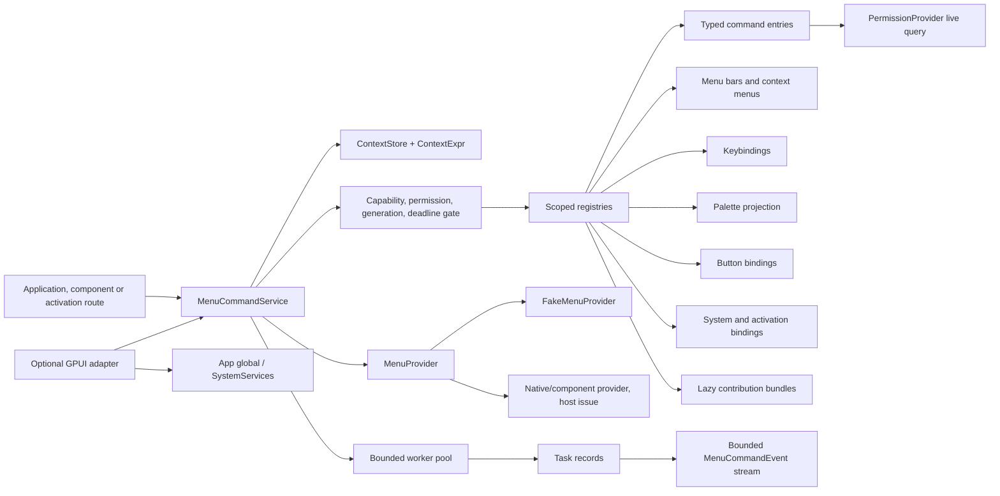

# Native menus and typed command contributions

This document specifies `crates/gpui-menus` for
[#49](https://github.com/jihuayu/gpui-box/issues/49), Phase 1 of the command and
menu work coordinated by [#18](https://github.com/jihuayu/gpui-box/issues/18).
It builds on the typed system-service contracts from
[#19](https://github.com/jihuayu/gpui-box/issues/19), the shared permission
service from `gpui-permissions`, the validated activation routes from
`gpui-activation` ([#24](https://github.com/jihuayu/gpui-box/issues/24)), and the
component semantics owned by [#3](https://github.com/jihuayu/gpui-box/issues/3).

The crate installs no native menu provider and never claims platform
qualification it has not earned. Native menu-shell integration remains host
work owned by [#8](https://github.com/jihuayu/gpui-box/issues/8) and
[#9](https://github.com/jihuayu/gpui-box/issues/9). Runtime acceptance is
tracked by [#75](https://github.com/jihuayu/gpui-box/issues/75).

## Scope and ownership

`gpui-menus` owns:

- Stable, validated command identity and typed command descriptors.
- Compile-time typed `CommandHandle<I, O>` bindings over the same dynamic
  payload bridge used by every non-typed trigger surface.
- Explicit `ExecutionDomain::Ui` and `ExecutionDomain::Background` registration
  paths with no silent domain fallback.
- Reactive context keys, values, snapshots, stores and composable expressions.
- Scoped contribution leases with immediate revocation and in-flight
  cancellation.
- Lazy contribution bundles, deterministic materialization and duplicate-ID
  diagnostics.
- Native menu bars, context menus, system menu roles and resolved projections.
- Keybinding precedence, palette ranking, component button projection and
  system/activation action routing.
- A bounded background worker pool, per-command concurrency policies and
  terminal task lifecycle events.
- A six-platform by five-operation support matrix and browser shortcut policy.

It does **not** own:

- Native `NSMenu`, Windows `HMENU`, Linux desktop-shell menu integration, Android
  activity menus, iOS `UIMenu`, or browser chrome menus.
- Keyboard focus, raw key event delivery or IME handling. Hosts translate
  platform key events into `KeystrokeSpec` values.
- OS permission prompts. Permission status is queried through the shared
  `gpui-permissions` provider at registration and again at invocation.
- Command handler internals, file I/O, network access or business logic.

`gpui-box` exposes the crate through two opt-in features:

```toml
gpui-box = { features = ["menus"] }
gpui-box = { features = ["menus-gpui"] }
```

`menus` imports `gpui_box::menus` and enables the system, permissions and
activation dependencies. `menus-gpui` additionally compiles the optional GPUI
adapter and the shared system/permissions/activation GPUI integrations. Neither
feature selects a desktop or Android backend by itself.

`mise.toml` includes `-p gpui-menus` in its test, lint and check tasks.

## Architecture



`MenuCommandService` is a clonable, UI-local `Rc` handle over one provider,
permission provider, context store, registry, worker pool and event
broadcaster. Clones share all state; `shares_state_with` verifies identity
without exposing the inner pointer. Install overrides before starting work.

The default build depends only on `gpui-system`, `gpui-permissions`,
`gpui-activation`, serde and serde_json. The optional `gpui` feature adds the
GPUI adapter and enables the shared GPUI integrations.

## Typed commands and the dynamic bridge

`CommandId` is a validated stable identity:

- Non-empty, at most 128 bytes.
- ASCII alphanumeric plus `.`, `_`, `-`, `:`.
- Examples: `file.save`, `editor.format`, `app:window.new`.
- Invalid input returns `ErrorCode::InvalidInput`; deserialization re-validates.

A `CommandDescriptor` declares:

| Field | Meaning |
| --- | --- |
| `id` | Stable `CommandId`. |
| `title` | Human-readable label, at most 512 bytes. |
| `category` | Optional grouping label, for example `File`. |
| `summary` | Optional longer description. |
| `domain` | `Ui` or `Background`. |
| `concurrency` | `AllowParallel { max_in_flight }`, `SingleFlightReject` or `ReplaceInFlight`. |
| `required_permissions` | Live `PermissionKind` preconditions. |
| `required_capabilities` | Additional `MenusOperation` preconditions. |
| `enabled_when` | Reactive enablement expression. |
| `visible_when` | Reactive visibility expression. |
| `checked_key` | Optional context key projected as a check mark. |

`AllowParallel { max_in_flight: 0 }` is rejected with
`ErrorCode::InvalidInput` at construction, registration and invocation.

`CommandHandle<I, O>` binds a typed request/response pair to one command and
domain. It uses `PhantomData<fn(I) -> O>` so it is always `Clone`, `Debug`,
`PartialEq`, `Eq`, `Send` and `Sync`, even when `I` or `O` is not. The handle is
a lookup key only; it grants no execution authority.

`CommandPayload` is the dynamic bridge:

```rust
pub enum CommandPayload {
    Unit,
    Json(serde_json::Value),
}
```

`Unit` and `Value::Null` are interchangeable. `from_typed` serializes any
`Serialize` value (`()` becomes `Unit`); `into_typed` deserializes into the
registered input or output. This lets one command be invoked from a typed
`invoke_typed(&handle, input, cx)` call and from a menu item, keybinding,
palette entry, button or activation route with exactly the same validation and
event lifecycle.

```rust
let registration = service.register_ui(
    CommandDescriptor::ui(CommandId::new("file.save")?, "Save")?
        .with_category("File")
        .enabled_when(ContextExpr::has_key(ContextKey::new("editor.focused")?)),
    |request: SaveRequest, _context| Ok(SaveReceipt { saved: true }),
)?;

// Typed path.
let receipt = service
    .invoke_typed(registration.handle(), SaveRequest { all: false }, invocation)
    .await?;

// Dynamic path (menu payload, palette, activation route).
let result = service.invoke_command(
    &CommandId::new("file.save")?,
    CommandPayload::Unit,
    invocation,
);
```

## Explicit execution domains

Registration is domain-specific. A descriptor/handler mismatch is rejected
before any contribution becomes visible:

- `register_ui` requires `ExecutionDomain::Ui`.
- `register_background` requires `ExecutionDomain::Background`.

Both have deferred variants (`register_ui_deferred`,
`register_background_deferred`) returning an outcome that can complete later
through an explicit completion handle. `CommandTaskState::Running` is retained
until the underlying handler, future or completion port actually resolves.

### UI commands

UI handlers execute on the owning UI thread. They may be non-`Send` and may
capture `Rc`/`RefCell` state. Before the handler runs, the service requires:

1. An active UI-bound `OperationContext` (`require_ui` + `check_at`).
2. The owning thread, matching surface generation and a live `SurfaceId`.
3. A matching `(SurfaceId, generation)` or live `UiOwner` when the registration
   scope is surface- or owner-bound.
4. No cancellation (`Completion::Cancelled(reason)`) and no elapsed deadline
   (`ErrorCode::TimedOut`).
5. `MenusOperation::InvokeCommand` plus every descriptor capability.
6. A live permission query returning `Granted` or `NotRequired` for every
   `PermissionKind`; anything else returns `ErrorCode::PermissionDenied`.
7. A true `enabled_when` expression evaluated against the live context store,
   surface, scope and invocation overlay.
8. The descriptor's concurrency policy.

Missing UI context returns `ErrorCode::InvalidInput`; a stale or wrong-thread UI
context returns `ErrorCode::ContextExpired`. The handler is never touched on a
failed validation.

A deferred UI handler returns `UiCommandOutcome::Deferred(completion)`. The task
remains `Running`; `MenuCommandEvent::CommandStarted` is emitted once at
dispatch, and `MenuCommandEvent::CommandFinished` only when the completion
handle resolves, fails or cancels.

### Background commands

Background handlers must be `Send + Sync + 'static`. They execute on the
service's bounded worker pool, never on unbounded ad-hoc threads. The service
enforces two independent limits:

1. A service-wide bound: at most `max_workers` running worker threads and
   `max_workers + max_queued` active invocations. Saturation returns
   `ErrorCode::Busy`.
2. A per-command `ConcurrencyPolicy`:
   - `AllowParallel { max_in_flight }` caps concurrent runs.
   - `SingleFlightReject` returns `Busy` while any invocation is running.
   - `ReplaceInFlight` cancels the superseded invocation's
     `CancellationToken` with `CancelReason::ProcessPolicy` and marks it
     `Cancelled` before starting the replacement.

`BackgroundCommandContext` exposes the invocation identity, trigger, surface,
scope, deadline and cancellation token. Deadlines and cancellation are
re-checked at worker start and at completion. A handler that ignores
cancellation cannot make a terminal task non-terminal, and cannot emit a second
terminal event.

Deferred background completion uses `BackgroundCommandCompletion<T>`, which is
`Send` when `T` is `Send` and may be resolved from a worker, native callback
thread or completion port.

## Reactive context expressions

Context is logical application state, never a native handle. Lookup precedence
is:

1. Invocation overlay.
2. Contribution scope values.
3. Surface values.
4. Global values.

`ContextStore` tracks a monotonic revision and supports global, per-surface and
per-scope keys. `ContextValue` is one of `Bool`, `Int`, `Text` or `StringSet`.
`ContextExpr` composes:

| Expression | Semantics |
| --- | --- |
| `Always` / `Never` | Constant true/false. |
| `HasKey(key)` | Key exists in the effective view. |
| `Equals(key, value)` | Present value equals the expected value. |
| `NotEquals(key, value)` | Present value differs; a missing key also differs. |
| `Contains(key, text)` | Text contains the substring, or a set contains the member. |
| `Not(expr)` | Logical negation. |
| `All([...])` | Conjunction; an empty list is true. |
| `Any([...])` | Disjunction; an empty list is false. |

`Not`, `and` and `or` flatten into the same tree. Every trigger surface projects
`visible`, `enabled`, `checked` and `disabled_reason` from the same evaluation,
and every invocation re-evaluates the command's `enabled_when` rather than
trusting a previously resolved menu/palette/button state.

## Five trigger surfaces

### 1. Native menus

Source contributions use `MenuBar`, `TopLevelMenu`, `MenuSection` and
`MenuNode`:

- `Submenu`: title, child nodes, optional lazy contribution ID, optional
  visible/enabled overrides.
- `CommandItem`: command ID, payload, optional visible/enabled overrides.
- `CheckItem`: command ID, payload, checked key and visible/enabled overrides.
- `Separator`.
- `SystemRole(SystemMenuRole)`: About, Preferences, Quit, Close, Undo, Copy,
  Paste, Select All and the other platform-recognized roles.

`resolve_menu_bar` produces `ResolvedMenuBar` / `ResolvedMenuNode` with
`visible`, `enabled`, `checked`, `disabled_reason` and `shortcut_hint`.
`install_menu_bar` additionally requires a live UI context, the
`InstallMenuBar` capability and hands the resolved bar to the provider. The
provider records surface, generation and anchors where applicable.

`present_context_menu` resolves a `ContextMenu` against the presenting surface,
records the anchor and rejects stale generations. `activate_menu_item` and
`activate_context_menu_item` reject items whose surface generation has advanced
with `ErrorCode::ContextExpired` before invoking the command. Unregistered
commands resolve as disabled placeholders with a reason; activation is rejected
with `InvalidInput`.

### 2. Keybindings

`Modifiers` records control, alt, shift and platform (Command) modifiers.
`KeystrokeSpec` normalizes printable ASCII keys to lowercase and has a
deterministic display form (`Shift+Cmd+S`, `Ctrl+Enter`).

A `KeychordBinding` carries the chord, command ID, payload, `when` expression,
`CommandScope` and numeric priority. Resolution order is:

1. Scope specificity: live `UiOwner` scope, then matching surface scope, then
   global scope.
2. Higher explicit priority.
3. Later registration order for an exact tie.

`resolve_keychord` returns the winning `ResolvedKeybinding`.
`sync_keybindings` materializes lazy keybindings, resolves one winner per chord,
requires the `SyncKeybindings` capability and reports the result to the
provider. `dispatch_keychord` resolves and invokes the command with
`TriggerSource::Keybinding`; a missing binding returns `Unavailable`.

Bindings whose `when` expression is false do not participate, so removing focus
or a context key immediately changes the winner.

### 3. Command palette

`PaletteQuery` filters commands whose `visible_when` is true and whose category
matches an optional case-insensitive category. Querying materializes lazy
contributions. Ranking is deterministic:

1. Exact title match: score 1000.
2. Title prefix match: 900 minus remaining-length penalty.
3. Title substring match: 700 minus position penalty.
4. Command identity substring: 500.
5. Fuzzy subsequence: 300 plus a gap-limited bonus.

Ties sort by title, then command ID. Limits are clamped to 256 and a zero limit
returns no entries. `PaletteEntry` includes title, category, summary, score,
shortcut hint, enabled state and disabled reason. Disabled but visible entries
remain visible; `invoke_palette_entry` re-validates live permissions, context
and capabilities.

### 4. Component buttons and toolbar actions

`ButtonCommandBinding` pairs a command with an optional payload, label,
`visible_when` and `enabled_when`. `project_button` returns:

```rust
pub struct ButtonCommandState {
    pub label: String,
    pub summary: String,
    pub accessible_name: String,
    pub accessible_checked: Option<bool>,
    pub visible: bool,
    pub enabled: bool,
    pub disabled_reason: Option<String>,
    pub shortcut_hint: Option<String>,
}
```

`invoke_button` checks the binding's own visibility/enablement and then uses
`TriggerSource::Button` for the normal invocation validation.

### 5. System and activation actions

`SystemActionBinding` maps either a validated external `ActionId` or a
`gpui_activation::ActivationTarget` route to a command. Route bindings are
validated against `RouteRegistry` at registration and again at dispatch.
`parameter_mapping` maps payload object fields to activation parameter names;
missing required parameters return `InvalidInput`.

`dispatch_system_action` resolves the most specific live binding for an action
ID. `dispatch_activation` accepts `Route` and `Notification` targets, validates
the route, extracts parameters and invokes with
`TriggerSource::Activation`. `OpenUrl` activations are rejected as
`Unsupported`; a bare `Activate` payload maps to the `activate` action ID.

## Scopes, leases and lazy contributions

`ContributionScopeId` is a monotonically allocated service-local identity.
`CommandScope` is one of:

- `Global`.
- `Surface { surface, generation }`.
- `UiOwner(UiOwner)`, resolved to the owner's live surface generation.

`create_scope` validates the binding against the live surface generation and,
for owner scopes, against `UiOwner::context`. `ContributionScope` is RAII:
revoking it or dropping the last clone revokes every registration made through
it. `RegistrationLease` is the smaller RAII guard for one registration:

- `revoke()` is idempotent and returns true exactly once.
- `is_active()` checks both the lease and the service registry.
- `Drop` revokes.

Revoking a lease, revoking a scope, advancing a surface generation or disposing
a surface immediately removes:

- Commands and their palette projections.
- Menu bars and context menus.
- Keybindings and their shortcut hints.
- Button bindings and button states.
- System/activation action bindings.
- Unmaterialized and materialized lazy contributions.
- Materialized commands, menu nodes, keybindings, buttons and actions produced
  by those lazy bundles.

All in-flight tasks owned by the revoked scope/lease are marked
`Cancelled(CancelReason::OwnerDisposed)`, their cancellation token is triggered
and their completion port resolves immediately. A late worker completion cannot
overwrite that terminal state.

`LazyContribution` wraps a `FnOnce() -> ContributionBundle` factory. A bundle
can add typed UI or background commands, menu nodes, keybindings, buttons and
system action bindings. Factories run at most once, and only when a query
actually needs them:

- Opening/resolving a submenu materializes that submenu's factory.
- Looking up or invoking a command materializes unmaterialized bundles until the
  command is found.
- Palette queries, keybinding sync/resolution and explicit `materialize_all`
  materialize all remaining bundles.

State is `Unmaterialized`, `Materializing`, `Materialized` or `Revoked`.
Materialization detects duplicate `CommandId`s, records a bounded
`DuplicateCommandDiagnostic`, emits `MenuCommandEvent::DuplicateCommandRejected`
and rejects the duplicate without replacing the existing owner. Other commands
in the bundle still materialize. Revoking before materialization guarantees the
factory never runs; revoking after materialization removes all bundle
contributions.

`DuplicateCommandDiagnostic` is:

```rust
pub struct DuplicateCommandDiagnostic {
    pub command_id: CommandId,
    pub existing_scope: ContributionScopeId,
    pub conflicting_scope: ContributionScopeId,
    pub domain: ExecutionDomain,
}
```

The service retains at most 64 diagnostics.

## Concurrency, task state and terminal events

`ConcurrencyPolicy` is checked for both UI and background commands. The service
reserves a per-command slot before dispatch; the slot is released exactly once
by the terminal transition, never at dispatch.

`WorkerPoolConfig { max_workers, max_queued }` validates:

- `1 <= max_workers <= 64`.
- `max_queued <= 1024`.
- Active invocations are capped at `max_workers + max_queued`; new work returns
  `Busy` rather than growing queues or threads without bound.

Worker threads are named `gpui-menus-worker-{n}` and are intentionally detached
on service drop, so a stuck host handler cannot block the destructor. Panics
inside a background handler are caught and converted to a terminal
`Failed(ErrorCode::PlatformFailure)` rather than leaving a permanently running
task.

`CommandTaskState` is:

```rust
pub enum CommandTaskState {
    Running,
    Completed,
    Cancelled(CancelReason),
    Failed(ErrorCode),
}
```

`CommandTaskSnapshot` includes the invocation identity, command ID, domain,
trigger source, scope, surface and state. `MenuCommandEvent` is:

```rust
pub enum MenuCommandEvent {
    CommandStarted(CommandTaskSnapshot),
    CommandFinished(CommandTaskSnapshot),
    DuplicateCommandRejected(DuplicateCommandDiagnostic),
}
```

`CommandStarted` is emitted immediately after a validated task is registered.
`CommandFinished` is emitted only by the one terminal transition. A worker that
is blocked remains `Running`; a deferred handler remains `Running` until its
completion handle resolves, cancels or fails. Subscriptions use the bounded
`gpui_system::event_channel`; overflow reports `Event::ResyncRequired` and
snapshot recovery is explicit.

`cancel_invocation(id, reason)` and `expire_invocations_at(now)` are
deterministic host/test controls. Deadlines are also enforced from the request's
`OperationContext`, but no internal timer thread is required.

## Capability-gated provider

`MenusOperation` has exactly five variants:

| Operation | Meaning |
| --- | --- |
| `InstallMenuBar` | Resolve and install a menu bar. |
| `PresentContextMenu` | Resolve and present a context menu. |
| `SyncKeybindings` | Resolve winners and synchronize them. |
| `QueryPalette` | Evaluate, materialize and rank palette entries. |
| `InvokeCommand` | Execute any registered command. |

`MenuProvider` exposes a `Capability<MenusOperation>` per operation plus three
host-facing methods: install a resolved menu bar, present a resolved context
menu with surface/generation/anchor, and synchronize resolved keybindings.

`FakeMenuProvider` is fully deterministic. It records:

- Installed resolved menu bars.
- Presented context menus with surface, generation and anchor.
- Synced keybinding sets.
- Callback attempts and stale-generation rejections.
- Capability overrides, including unsupported/unavailable combinations.
- One-shot failure injection per operation.

`record_callback(surface, generation)` validates a late native callback against
the latest recorded generation; a mismatch is recorded and rejected with
`ErrorCode::ContextExpired` before it can reach a command.

## Optional GPUI adapter

With `features = ["gpui"]`, `src/gpui_adapter.rs` provides:

- `install_menu_service(&mut SystemServices, service)`.
- `init_menus(&mut App, provider)` / `init_menu_service(&mut App, service)` in a
  dedicated `App` global.
- `menus_service(&App)` resolving the global or the typed registry.
- `MenusAppExt` methods on `App`.
- `run_command_request(request, cx)` on GPUI's foreground executor with the
  runtime deadline timer installed.
- `MenuContributionScope`, an entity/host-owned scope that creates a
  `UiOwner`-bound contribution scope. Dropping it revokes retained leases,
  revokes the scope, disposes the surface in `MenuCommandService` and disposes
  the `UiOwner`. `for_entity` additionally ties cleanup to a GPUI entity release
  callback.

Neither `gpui-menus` nor the adapter installs a native menu or picks a desktop
backend. The host must supply a `MenuProvider` and a platform surface.

## Six-platform support matrix

`MenuPlatform::ALL` has six values: `Windows`, `MacOs`, `Linux`, `Android`,
`Ios`, `Web`. `MenusOperation::ALL` has five values. The programmatic matrix
therefore contains 30 rows, exposed by `platform_support_matrix()`,
`platform_support(platform)` and `operation_support(platform, operation)`.

Evidentiary labels:

- `Compiled`: the platform-independent contract compiles for the target and the
  host adapter is the only missing integration.
- `ContractOnly`: only the platform-neutral contract is compiled; native host
  integration and runtime acceptance remain outstanding.

Understanding the table:

- **Configuration** `Ready` means the host configuration required by the
  contract is described and can be supplied; `Unknown` accompanies an
  unsupported operation.
- **Availability** `Unavailable` means the operation has no platform surface.
- **Permission** is `NotRequired` for the menu contract itself. Individual
  commands may declare `PermissionKind`s; those are checked live at invocation.
- **Constraints** include `ForegroundOwner`, `Hardware` and `Provider("gpui_web")`.

| Platform | Install bar | Context menu | Sync keys | Palette | Invoke |
| --- | --- | --- | --- | --- | --- |
| Windows | Native | Native | Native | Native | Native |
| macOS | Native | Native | Native | Native | Native |
| Linux | Conditional | Native | Native | Native | Native |
| Android | Unsupported | Conditional | Conditional (`Hardware`) | Native | Native |
| iOS | Unsupported | Conditional | Conditional (`Hardware`) | Native | Native |
| Web | Unsupported | Conditional (`gpui_web`) | Conditional (`Hardware`, `gpui_web`) | Native | Native |

The 30 rows in `platform_support_matrix()` additionally carry:

- Evidence (`Compiled` on Windows/macOS/Linux; `ContractOnly` on
  Android/iOS/Web).
- Required host configuration text.
- Runtime evidence notes.
- Operation notes.
- Owner links `#3`, `#8`, `#9`, `#18`, `#19`, `#24`, `#43`, `#75`.

No mobile or browser platform has a native OS menu bar. The host must render an
in-canvas/component menu bar, or omit the bar and expose commands through the
palette, buttons and hardware-keyboard keybindings.

## Browser capability and shortcut policy

`gpui_web` is experimental. Browser-reserved shortcuts remain browser-owned:

| Reserved chord | Browser meaning |
| --- | --- |
| `Ctrl/Cmd+W` | Close tab/window |
| `Ctrl/Cmd+T` | New tab |
| `Ctrl/Cmd+N` | New window |
| `Ctrl/Cmd+L` | Focus address bar |
| `Ctrl/Cmd+Q` | Quit browser/application |

`browser_shortcut_policy()` returns these reservations, the reserved key set
and a hardware-keyboard support flag. `is_browser_reserved_shortcut(chord)` is
true for Ctrl/Cmd plus `w`, `t`, `n`, `l` or `q` without Alt/Shift.
`browser_shortcut_allowed` is its complement. Hosts must choose another chord
or an explicit alternative for application commands on Web.

Android and iPadOS may expose hardware keyboards, but they remain subject to the
host's keyboard focus policy. `Constraint::Hardware` records that dependency in
the matrix; it does not imply that a software keyboard can dispatch chords.

## Determinism and cross-platform notes

- No test uses `sleep` for ordering. Worker progress is released through
  explicit channels, barriers or completion handles.
- No test assumes a Unix-only path, executable, signal or environment.
- The worker pool uses only the standard library and is bounded on all targets.
- `CommandId`, `ContextKey` and surface generations are platform-neutral.
- Provider recording uses deterministic vectors and maps; no hash-order output
  leaks into resolution or ranking.
- Surface generation checks use explicit `advance_surface_generation` /
  `dispose_surface` controls, so stale callbacks are reproducible on Linux and
  Windows.

## Verification

Run these from the repository root. They are portable and contain no
VM-specific paths or build-directory overrides:

```sh
cargo fmt --all
cargo fmt --all -- --check
mise tasks validate
cargo test --locked -p gpui-menus
cargo test --locked -p gpui-menus --all-features
cargo test --locked -p gpui-box --features menus,menus-gpui
cargo clippy --locked -p gpui-menus --all-targets -- -D warnings
cargo clippy --locked -p gpui-menus --all-features --all-targets -- -D warnings
cargo clippy --locked -p gpui-box --features menus,menus-gpui --all-targets -- -D warnings
git diff --check
```

`mise run check` runs the workspace test, lint, formatting, task validation and
whitespace checks with `-p gpui-menus` included.

### Test coverage

The integration suites use explicit channels and completion handles for
ordering. They contain no sleeps, native UI assumptions or OS-specific paths,
so the same assertions run on Linux and Windows. The `gpui` adapter suites are
`#[gpui::test]` and are gated on
`all(feature = "gpui", any(target_os = "windows", target_os = "macos", target_os = "linux"))`.

| File | Coverage |
| --- | --- |
| `src/*` unit tests | Command identity and payloads, context precedence and revisions, keybinding normalization, palette ranking, platform matrix and browser policy, worker-pool bounds, duplicate owner retention and scope teardown |
| `tests/typed_commands.rs` | UI-thread context requirements, foreign-thread rejection, deferred UI completion, bounded worker slots, `ReplaceInFlight`, deadline expiry, cancellation-token delivery, typed/dynamic payload bridge, lookup-only handles, `AllowParallel`, `SingleFlightReject`, deferred background completion and terminal `Failed` events |
| `tests/permissions_context.rs` | Live permission revalidation across all five surfaces, activation routes and parameter mapping, revoked-permission activation, capability gating, unregistered-command projection and ordered events |
| `tests/scopes_lazy.rs` | Scoped contributions, lease drop and idempotent revocation, lazy materialization before/after revocation, surface generation bump, disposal, `OwnerDisposed` cancellation and eager/lazy duplicate diagnostics |
| `tests/triggers.rs` | Native bar/check/submenu/system-role projection, context-menu generation rejection and provider overrides, keybinding `when`/specificity/priority, palette filtering/ranking/shortcuts, button projection/invocation and system-action/activation dispatch |
| `tests/platform_provider.rs` | Thirty-row matrix and issue links, browser reservation policy, stale provider callbacks, menu-bar/context-menu/sync recording, failure injection and capability overrides |
| `tests/gpui_adapter.rs`, `src/gpui_adapter.rs` tests | `App` global installation, `SystemServices` fallback, command-request execution, `MenuContributionScope` drop revocation and `UiOwner` disposal |
| `crates/gpui-box/tests/menus.rs` | `gpui_box::menus` facade and `menus-gpui` adapter symbol/feature wiring |

At this revision the default `gpui-menus` suite runs 62 tests. With
`--all-features` it runs 66 (including four feature-gated adapter tests). The
`gpui-box` menu feature suite runs two facade tests. These counts are
descriptive; the commands above are authoritative.

## Issue ownership

| Issue | Ownership |
| --- | --- |
| [#3](https://github.com/jihuayu/gpui-box/issues/3) | Shared component semantics and button/menu rendering. |
| [#8](https://github.com/jihuayu/gpui-box/issues/8) | Windows/macOS/Linux native menu-shell qualification. |
| [#9](https://github.com/jihuayu/gpui-box/issues/9) | Android/iOS host menu and hardware-keyboard qualification. |
| [#18](https://github.com/jihuayu/gpui-box/issues/18) | Phase 1 sequencing for command/menu services. |
| [#19](https://github.com/jihuayu/gpui-box/issues/19) | Shared capability, context, request and event contracts. |
| [#24](https://github.com/jihuayu/gpui-box/issues/24) | Activation route validation and durable routing. |
| [#43](https://github.com/jihuayu/gpui-box/issues/43) | Bounded background execution and cancellation. |
| [#75](https://github.com/jihuayu/gpui-box/issues/75) | Six-platform runtime acceptance evidence. |

`gpui-menus` provides the contract and deterministic projections. It does not
check off native menu integration or runtime acceptance for any host platform
until the owning issue records that evidence.
