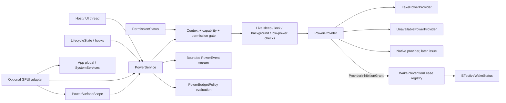

# Power, session and thermal observations with wake-prevention leases

This document specifies `crates/gpui-power` for
[#55](https://github.com/jihuayu/gpui-box/issues/55). The crate builds on the
typed system contracts from
[#19](https://github.com/jihuayu/gpui-box/issues/19) (`gpui-system`), the
permission vocabulary from
[#20](https://github.com/jihuayu/gpui-box/issues/20) (`gpui-permissions`) and
the host lifecycle snapshots from
[#21](https://github.com/jihuayu/gpui-box/issues/21) (`gpui-lifecycle`). It
coordinates background execution policy with
[#43](https://github.com/jihuayu/gpui-box/issues/43) without claiming a native
provider that is not installed.

The default build has no GPUI dependency. It installs no native OS provider,
does not synthesize a wake lock, and never claims runtime qualification. Every
inhibition must be granted by an explicit [`PowerProvider`] before the service
reports it as effective.

## Scope and ownership

`gpui-power` owns:

- Six power/session observation domains with explicit provenance.
- A validated battery model, monotonic sleep/resume epochs and lifecycle lock
  and memory-pressure conversions.
- Scoped system-idle and display/system wake-prevention leases with bounded,
  public-safe reasons.
- Provider-authoritative grant, release and revocation semantics, including
  idempotent `release()` plus `Drop`.
- Lifecycle- and permission-driven revocation for backgrounding, session lock,
  system sleep, low-power mode, surface disposal, generation expiry and
  permission loss.
- An explicit, serializable `PowerBudgetPolicy` and deterministic
  `WorkPacingRecommendation`.
- A bounded `EventSubscription<PowerEvent>` stream using
  `gpui_system::event_channel`.
- A thirty-row (six platforms × five operations) support matrix and a browser
  Screen Wake Lock policy.
- An optional GPUI adapter with an `App` global, `SystemServices` registration
  and entity-owned `PowerSurfaceScope`.

It does **not** own:

- Native Windows power/session/thermal collectors, IOKit/NSProcessInfo
  collectors, systemd-logind/UPower/portal clients, Android `PowerManager` /
  `BatteryManager` bridges, iOS `UIDevice` / `ProcessInfo` bridges or browser
  JavaScript hosts.
- Background-mode entitlements, Android manifest declarations or Apple usage
  descriptions. Missing declarations surface as
  `ErrorCode::InvalidConfiguration`, never as a synthetic success.
- Rendering, scene composition or whether a visible surface should do work.
- Remote telemetry or consent for power observations.

`gpui-box` exposes the crate through two opt-in features:

```toml
gpui-box = { features = ["power"] }
gpui-box = { features = ["power-gpui"] }
```

`power` imports `gpui_box::power` and enables the system, lifecycle and
permissions dependencies. `power-gpui` additionally compiles the optional GPUI
adapter and the shared system/lifecycle/permissions GPUI integrations. Neither
feature selects a desktop or Android backend by itself. `mise.toml` includes
`-p gpui-power` in the test, lint and check tasks.

## Architecture



`PowerService` is a clonable `Send + Sync + 'static` handle over
`Arc<ServiceInner>`. It can be registered as a concrete typed service in
`gpui_system::SystemServices`, installed as a GPUI `App` global, or created
directly from a provider. Clones share the cached snapshot, lease registry,
pacing policy and bounded subscriber list; `shares_state_with` compares the
inner `Arc` without exposing it.

The provider boundary is authoritative:

```rust
pub trait PowerProvider: Send + Sync + 'static {
    fn capability(&self, operation: PowerOperation) -> Capability<PowerOperation>;
    fn snapshot(&self) -> Result<PowerSnapshot, SystemError>;
    fn permission_status(&self, kind: PermissionKind) -> PermissionStatus;
    fn acquire_inhibition(
        &self,
        request: &PowerInhibitionRequest,
    ) -> Result<ProviderInhibitionGrant, SystemError>;
    fn release_inhibition(&self, native_token: u64) -> bool;
    fn attach_listener(&self, listener: Weak<dyn PowerProviderListener>);
    fn as_any(&self) -> &dyn Any;
}
```

Providers notify the service synchronously through a weak listener, never while
holding their own state lock. The service rechecks permission and live state at
execution time rather than trusting a capability snapshot.

## Observation domains and honest unknowns

`SignalSource` has five values:

| Source | Meaning |
| --- | --- |
| `Observed` | The platform or provider reported a fresh value. |
| `UnsupportedByPlatform` | No public API exists for this domain on this platform. |
| `PermissionDenied` | The host or user denied the permission required to observe. |
| `ProviderUnavailable` | The provider exists but could not be reached. |
| `Unknown` | No observation has been attempted or none is trustworthy. |

Only `Observed` makes `is_observed()` true. The six snapshot domains each retain
their own source:

| Snapshot field | Type | Values |
| --- | --- | --- |
| `power_source` | `PowerSourceStatus` | `Ac`, `Battery`, `Ups`, `Usb`, `Unknown` |
| `battery` | `BatteryStatus` | validated percentage, charging state, low-power mode, remaining seconds |
| `sleep_resume` | `SleepResumeStatus` | `Awake`, `PreparingSleep`, `Sleeping`, `Resumed`, `Unknown` plus `resume_epoch` |
| `session_lock` | `SessionLockStatus` | `Unlocked`, `Locking`, `Locked`, `Unknown` |
| `thermal` | `ThermalStatus` | `Nominal`, `Fair`, `Serious`, `Critical`, `Unknown` |
| `memory` | `MemoryStatus` | `Normal`, `Moderate`, `Critical`, `Unknown` |

`PowerSnapshot::unknown(source)` initializes all six domains to their `Unknown`
variants and `revision: 0`. It never claims `Ac`, `Unlocked`, `Nominal` or
`Normal` when nothing was probed. `PowerSnapshot::default()` uses
`SignalSource::Unknown`.

### Battery validation

`BatteryStatus::new(level_percent, charging, low_power_mode, remaining_seconds,
source)` rejects `Some(pct)` with `pct > 100` with `ErrorCode::InvalidInput`
before retaining any value. The field is private; callers read it through
`level_percent()`. Serde deserialization uses the same validating constructor,
so an invalid payload can never produce an out-of-range value. Zero and 100 are
valid.

`BatteryStatus::unknown(source)` reports `ChargingState::Unknown`,
`LowPowerMode::Unknown`, no percentage and no remaining estimate. A battery
percentage of `Some(0)` is a real observation; `None` is unknown.

### Sleep/resume monotonicity

`SleepResumeStatus` carries `state`, `resume_epoch` and `source`. Every
transition from `PreparingSleep` or `Sleeping` to `Resumed` or `Awake`
increments `resume_epoch` exactly once in the deterministic fake provider. The
epoch never decreases, a repeated `Resumed` does not bump it, and a second
sleep/resume cycle produces the next epoch. Consumers can therefore discard
stale resume work without comparing wall-clock times.

### Conversions and severity

`SessionLockState::from(gpui_lifecycle::SessionLockState)` maps `Unlocked` and
`Locked`; `Locking` is retained in the power model for OS transition reporting.
`MemoryCondition::from(gpui_lifecycle::MemoryPressure)` maps `Normal -> Normal`,
`Warning -> Moderate` and `Critical -> Critical`. It never maps an unknown
pressure to `Normal`.

`ThermalCondition::is_elevated` and `is_serious_or_worse` plus `severity_rank`
support deterministic product policy. `Unknown` is not elevated, matching the
conservative pacing rule rather than pretending the device is cool.

## Scoped wake-prevention leases

### Kinds, reasons and scopes

`WakeInhibitionKind::SystemIdleSleep` prevents idle system sleep while allowing
the display to dim or turn off. `WakeInhibitionKind::DisplayAndSystem` prevents
both display sleep/dimming and idle system sleep.

`WakeReason::new` accepts a non-empty, non-whitespace string of at most
`MAX_WAKE_REASON_BYTES` (128) bytes with no control characters. Empty,
whitespace-only, over-length and control-character inputs fail with
`ErrorCode::InvalidInput`. Deserialization runs the same validation.

`WakeLeaseScope` is either:

- `Application { policy }` for process/app-scoped background work.
- `Surface { surface, generation, policy }` for one UI attachment generation.

`WakeLeaseRequest` carries `kind`, `reason` and `scope`; constructors and fluent
`with_scope` / `with_policy` keep product intent visible. The default scope for
a kind is application-scoped with `ReleasePolicy::for_kind(kind)`.

`ReleasePolicy` makes automatic release explicit:

| Flag | `SystemIdleSleep` default | `DisplayAndSystem` default |
| --- | --- | --- |
| `revoke_on_background` | false | true |
| `revoke_on_session_lock` | false | true |
| `revoke_on_system_sleep` | true | true |
| `revoke_on_low_power_mode` | false | false |

Platform invariants override the flags. A `DisplayAndSystem` lease can never
remain effective while the session is `Locking`/`Locked`, and no lease can
remain effective once the OS reports `PreparingSleep`/`Sleeping`, regardless of
`revoke_on_session_lock` or `revoke_on_system_sleep`.

### Acquisition pipeline

`PowerService::acquire_wake_lease` runs in this order, before any provider
mutation:

1. Validate the `OperationContext`. An elapsed deadline returns
   `ErrorCode::TimedOut`; a current UI attachment must be live. Cancellation
   returns `Ok(Completion::Cancelled(reason))` and is not an error.
2. For a surface scope with `context.ui == Some(ui)`, verify the UI owner is
   current, the `SurfaceId` matches (`ErrorCode::InvalidInput` on mismatch) and
   the generation matches (`ErrorCode::ContextExpired` on staleness). Then check
   the service's tracked surface registry: an unknown or disposed surface, or a
   generation different from the registered generation, returns
   `ErrorCode::ContextExpired`.
3. Check the capability for `InhibitSystemSleep` (`SystemIdleSleep`) or
   `InhibitDisplaySleep` (`DisplayAndSystem`), and freshly query the
   `wake_lock` permission. Unsupported, unconfigured, unavailable and denied
   states map to `Unsupported`, `InvalidConfiguration`, `Unavailable` and
   `PermissionDenied` respectively.
4. Check live state: system sleep, session lock, backgrounded/suspended/
   terminating app phase, hidden surface and low-power mode. These fail with
   `ErrorCode::Unavailable` before the provider is touched.
5. Ask the provider for a grant. `ProviderInhibitionGrant::Effective {
   native_token }` is provisional. `Ineffective { reason }` maps to a typed
   error, emits `PowerEvent::OperationFailed`, registers **no** lease, leaves
   `EffectiveWakeStatus` at zero and returns `Err`.
6. Re-enter the state lock and atomically reject a provisional grant if
   cancellation arrived, the all-revocation epoch changed, the native token has
   an early-revocation tombstone, permission no longer allows use, the
   surface/generation expired, or live sleep/lock/background/hidden/low-power
   preconditions stopped holding. The rejected grant's native token is released
   and `WakeLeaseAcquired` is never emitted. Only a grant that survives all
   post-grant checks is inserted as `Effective`.

Provider failures are mapped deterministically:

| `IneffectiveInhibitionReason` | `ErrorCode` |
| --- | --- |
| `UnsupportedKind` | `Unsupported` |
| `PermissionDenied` | `PermissionDenied` |
| `ConfigurationRequired` | `InvalidConfiguration` |
| `HiddenSurfaceOrDocument`, `BatterySaverOverride`, `SessionLocked`, `SystemSleeping`, `AppBackgrounded`, `ProviderUnavailable` | `Unavailable` |

### The acceptance invariant

> Ineffective inhibition never reports effective success.

A lease exists only after a provider returned an `Effective` native grant. A
refusal, simulated hidden Web document, OS battery-saver override, sleeping
system, lock, background phase, stale generation or missing permission produces
`Err` with `inhibits_system_sleep == false`, `inhibits_display_sleep == false`
and `active_lease_count == 0`. No code path increments the effective counters
for an ineffective grant.

### Effective wake status and idempotence

`EffectiveWakeStatus` aggregates only currently effective leases:

```rust
pub struct EffectiveWakeStatus {
    pub inhibits_system_sleep: bool,
    pub inhibits_display_sleep: bool,
    pub active_lease_count: usize,
    pub system_lease_count: usize,
    pub display_lease_count: usize,
}
```

`system_lease_count` counts `SystemIdleSleep` leases, `display_lease_count`
counts `DisplayAndSystem` leases, `active_lease_count` is their sum,
`inhibits_system_sleep` is true whenever any effective lease exists, and
`inhibits_display_sleep` is true only when a display lease exists. Releasing or
revoking the last lease immediately produces `false` / `0`.

`WakePreventionLease` exposes `id`, `kind`, `reason`, `scope`, `state`,
`is_effective`, `revocation_reason` and `release() -> bool`. `release()` removes
the lease from the registry first and releases the provider token at most once.
Calling it again, dropping an already-released lease, or dropping a revoked
lease returns false and performs no second provider release. `Drop` invokes the
same idempotent path.

### Revocation reasons

| Reason | Trigger |
| --- | --- |
| `SystemRevoked` | The OS or provider revoked a native token. |
| `SessionLocked` | Lifecycle or provider reports `Locking`/`Locked`. |
| `SystemSleeping` | The system is preparing for or in sleep. |
| `AppBackgrounded` | Background/suspended/terminating phase or hidden surface. |
| `LowPowerSaver` | Low-power mode with `revoke_on_low_power_mode`. |
| `SurfaceDisposed` | The owning surface was disposed or disappeared from lifecycle. |
| `GenerationExpired` | A newer attachment generation superseded the lease. |
| `PermissionRevoked` | The `wake_lock` permission stopped allowing use. |

Every revocation instructs the provider to release the native token unless the
OS already revoked it; an already-revoked token is handled cleanly once and
never corrupts remaining lease counts.

## Lifecycle-bound release

`PowerService::notify_lifecycle(&gpui_lifecycle::LifecycleState)` is the
coherent lifecycle entry point:

- Phase `Background`, `Suspended` or `Terminating` revokes leases whose policy
  requires background revocation, including every default `DisplayAndSystem`
  lease, with `WakeRevocationReason::AppBackgrounded`.
- Surface snapshots are synchronized. A previously tracked surface absent from
  a state that has already observed surfaces is disposed and its leases are
  revoked with `SurfaceDisposed`. A generation mismatch revokes with
  `GenerationExpired`. An invisible surface revokes leases that require
  visibility (`DisplayAndSystem` or `revoke_on_background`) with
  `AppBackgrounded`.
- `SessionLockState::Locked` updates the cached snapshot and revokes
  `DisplayAndSystem` plus `revoke_on_session_lock` leases with `SessionLocked`.
- `MemoryPressure` is converted into `MemoryCondition` with
  `SignalSource::Observed`, which immediately changes the pacing recommendation.
- The default `Launching` state (revision 0) does not overwrite provider-owned
  domain observations.

Granular host hooks are also public:

```rust
service.notify_app_phase(phase);
service.attach_surface(surface, generation, visible);
service.advance_surface_generation(surface, generation);
service.dispose_surface(surface);
```

Provider pushes are handled by the same re-evaluation path. A `SnapshotUpdated`
notice with `PreparingSleep`/`Sleeping` revokes all leases with
`SystemSleeping`; a `Locking`/`Locked` snapshot revokes lock-sensitive leases
with `SessionLocked`; `LowPowerMode::Enabled` revokes flagged leases with
`LowPowerSaver`. `TokenRevoked` and `AllTokensRevoked` notices revoke the
matching leases with the provider's `WakeRevocationReason`
(`SystemRevoked` for OS-initiated loss). A `PermissionChanged` notice that no
longer allows use revokes every effective lease with `PermissionRevoked`.

## Explicit power budget and pacing

`PowerBudgetPolicy` is plain serializable data with a `Default` and fluent
setters:

- `pause_speculative_on_low_power` (default true)
- `pause_speculative_on_locked` (default true)
- `reduce_on_battery_discharging` (default true)
- `treat_unknown_thermal_conservatively` (default true)
- `low_battery_threshold_percent` (default 20)

`PowerService::set_budget_policy` stores the policy and emits
`PolicyUpdated { recommendation }`; `budget_policy()` returns it;
`recommend_pacing()` evaluates the cached snapshot. `PacingTier` is
`Normal < Reduced < Throttled < Paused`; `WorkCadence` is a compatibility alias.
The poll multipliers are `1`, `2`, `4` and `0`.

Evaluation precedence is deterministic:

| Condition | Tier | Speculative work | Discretionary sync | Multiplier |
| --- | --- | --- | --- | --- |
| `PreparingSleep` / `Sleeping` | `Paused` | false | false | 0 |
| `ThermalCondition::Critical` | `Paused` | false | false | 0 |
| `MemoryCondition::Critical` | `Paused` | false | false | 0 |
| `ThermalCondition::Serious` | `Throttled` | false | false | 4 |
| Low-power mode (policy enabled) | `Throttled` | false | false | 4 |
| Session `Locking`/`Locked` (policy enabled) | `Throttled` | false | false | 4 |
| Low battery while discharging | `Throttled` | false | false | 4 |
| `ThermalCondition::Fair` | `Reduced` | true | true | 2 |
| `MemoryCondition::Moderate` | `Reduced` | true | true | 2 |
| Discharging battery (policy enabled) | `Reduced` | true | true | 2 |
| Conservative unknown thermal (policy enabled) | `Reduced` | true | true | 2 |
| Nominal conditions | `Normal` | true | true | 1 |

Reasons are accumulated in a fixed order and never duplicated. A policy that
disables low-power or lock speculation produces `Reduced` or `Normal`
respectively, except severe thermal/memory and sleep, which cannot be relaxed.

## Bounded observation stream

Each `PowerService::subscribe()` creates an independent bounded channel with
capacity `DEFAULT_POWER_EVENT_CAPACITY = 64` (or
`PowerService::with_event_capacity(provider, capacity)` for deterministic
tests). Uses `gpui_system::event_channel`; producers never block on consumers.

Events:

```text
SnapshotUpdated { snapshot }
SleepResumeChanged { state, resume_epoch }
SessionLockChanged { state }
ThermalChanged { condition }
MemoryChanged { condition }
WakeLeaseAcquired { id, kind }
WakeLeaseReleased { id, kind }
WakeLeaseRevoked { id, kind, reason }
EffectiveWakeStatusChanged { status }
PolicyUpdated { recommendation }
OperationFailed { operation, code }
```

If the queue is full, the channel discards the oldest queued events, announces
`Event::ResyncRequired` once, and continues with the newest event. Consumers
must acknowledge a fresh `PowerSnapshot` and call
`EventSubscription::acknowledge_snapshot(sequence)` to clear the loss marker.
Tests use capacity 1 to prove deterministic overflow without sleeps or threads.

## GPUI adapter

The optional `gpui` feature adds:

- `impl gpui::Global for PowerService`
- `install_power_service(service, cx)`
- `install_power_in_services(&mut SystemServices, service)`
- `init_power(cx, provider)` which installs both the `App` global and the
  `SystemServices` provider
- `power_service(cx)` which checks the `App` global first and falls back to
  `SystemServices`
- `PowerAppExt` for `gpui::App`
- `PowerSurfaceScope`

`PowerSurfaceScope` captures the owner's current `SurfaceId` and generation,
registers the surface as visible, retains `EventSubscription<PowerEvent>`
streams and can optionally own a
`gpui_system::gpui_adapter::EntityScope`. `context()` returns a UI-attached
`OperationContext` or `ContextExpired` after disposal. On drop it:

1. Drops retained subscriptions.
2. Calls `dispose_surface(surface)`, revoking every surface-scoped lease with
   `SurfaceDisposed` and releasing native tokens.
3. Calls `owner.dispose()`.

Creating a scope from an already disposed owner is inert (`SurfaceId(0)`,
generation 0) and its `context()` reports `ContextExpired`; it never panics.
`try_new` exposes the fallible form.

## Six-platform support matrix

`PlatformTarget` has six values and `PowerOperation` has five. The complete
matrix contains exactly 30 rows, one per pair. All rows are
`Evidence::ContractOnly`: no native provider is installed by this crate, so no
row claims `Compiled` or `RuntimeVerified` qualification.

`Support` values: `Native`, `Conditional`, `Unsupported`. “Native” describes the
platform API contract, not an installed adapter.

| Platform | Operation | Support | Required host configuration | Evidence |
| --- | --- | --- | --- | --- |
| Windows | `ObservePower` | Native | `GetSystemPowerStatus`; `RegisterPowerSettingNotification` for `GUID_ACDC_POWER_SOURCE`, `GUID_BATTERY_PERCENTAGE_REMAINING`, `GUID_POWER_SAVING_STATUS` | ContractOnly |
| Windows | `ObserveSession` | Native | `WTSRegisterSessionNotification` (`WM_WTSSESSION_CHANGE` / `WTS_SESSION_LOCK`, `WTS_SESSION_UNLOCK`); `PowerRegisterSuspendResumeNotification` (`PBT_APMSUSPEND`, `PBT_APMRESUMEAUTOMATIC`) | ContractOnly |
| Windows | `ObserveThermalMemory` | Conditional | `GlobalMemoryStatusEx` / `CreateMemoryResourceNotification`; OEM thermal zones may be absent and must report `UnsupportedByPlatform` / `Unknown` | ContractOnly |
| Windows | `InhibitSystemSleep` | Native | `PowerCreateRequest` + `PowerSetRequest(PowerRequestSystemRequired)` or `SetThreadExecutionState(ES_CONTINUOUS \| ES_SYSTEM_REQUIRED)` | ContractOnly |
| Windows | `InhibitDisplaySleep` | Native | `PowerCreateRequest` + `PowerSetRequest(PowerRequestDisplayRequired)` or `SetThreadExecutionState(ES_CONTINUOUS \| ES_SYSTEM_REQUIRED \| ES_DISPLAY_REQUIRED)` | ContractOnly |
| macOS | `ObservePower` | Native | `IOPSCopyPowerSourcesInfo` (`IOKit.ps`); `NSProcessInfo.isLowPowerModeEnabled` with `NSProcessInfoPowerStateDidChangeNotification` | ContractOnly |
| macOS | `ObserveSession` | Native | `NSWorkspace.screensDidSleepNotification`, `willSleepNotification`, `didWakeNotification` plus session/screen lock notifications | ContractOnly |
| macOS | `ObserveThermalMemory` | Native | `NSProcessInfo.thermalState` with `NSProcessInfoThermalStateDidChangeNotification`; `dispatch_source_create(DISPATCH_SOURCE_TYPE_MEMORYPRESSURE, ...)` | ContractOnly |
| macOS | `InhibitSystemSleep` | Native | `IOPMAssertionCreateWithName(kIOPMAssertionTypePreventUserIdleSystemSleep, ...)` | ContractOnly |
| macOS | `InhibitDisplaySleep` | Native | `IOPMAssertionCreateWithName(kIOPMAssertionTypePreventUserIdleDisplaySleep, ...)` | ContractOnly |
| Linux | `ObservePower` | Conditional | UPower D-Bus `org.freedesktop.UPower` `DisplayDevice`; `net.hadess.PowerProfiles` / `org.freedesktop.UPower.PowerProfiles` | ContractOnly |
| Linux | `ObserveSession` | Conditional | systemd-logind `org.freedesktop.login1.Manager` `PrepareForSleep`; `org.freedesktop.login1.Session` `Lock` / `Unlock` / `LockedHint`; portal `Inhibit` for sandboxes | ContractOnly |
| Linux | `ObserveThermalMemory` | Conditional | `/proc/pressure/memory` PSI; `org.freedesktop.LowMemoryMonitor`; sysfs thermal zones are distro/container conditional | ContractOnly |
| Linux | `InhibitSystemSleep` | Conditional | systemd-logind `Inhibit("sleep:idle", ...)` fd lock or portal `Inhibit` Idle flag (`4`) | ContractOnly |
| Linux | `InhibitDisplaySleep` | Conditional | `org.freedesktop.ScreenSaver.Inhibit`; portal `Inhibit` (Idle + Suspend); `zwp_idle_inhibit_manager_v1` bound to a visible `wl_surface` | ContractOnly |
| Android | `ObservePower` | Native | `BatteryManager` `ACTION_BATTERY_CHANGED`; `PowerManager.isPowerSaveMode` with `ACTION_POWER_SAVE_MODE_CHANGED` | ContractOnly |
| Android | `ObserveSession` | Conditional | `KeyguardManager.isDeviceLocked`, `ACTION_SCREEN_OFF` / `ACTION_USER_PRESENT`, Activity/Process lifecycle, `ACTION_DEVICE_IDLE_MODE_CHANGED` for Doze | ContractOnly |
| Android | `ObserveThermalMemory` | Conditional | `PowerManager.addThermalStatusListener` (API 29+) and `ComponentCallbacks2.onTrimMemory` | ContractOnly |
| Android | `InhibitSystemSleep` | Conditional | `PARTIAL_WAKE_LOCK` with `android.permission.WAKE_LOCK` in `AndroidManifest.xml`; Doze / App Standby / battery-restriction revocations apply | ContractOnly |
| Android | `InhibitDisplaySleep` | Conditional | `FLAG_KEEP_SCREEN_ON` on a visible foreground Activity/Surface; automatically ineffective when backgrounded or locked | ContractOnly |
| iOS | `ObservePower` | Native | `UIDevice.current.isBatteryMonitoringEnabled` with `batteryLevel` / `batteryState`; `ProcessInfo.isLowPowerModeEnabled` with `NSProcessInfoPowerStateDidChange` | ContractOnly |
| iOS | `ObserveSession` | Native | `UIApplicationProtectedDataWillBecomeUnavailable` / `DidBecomeAvailable` and `UIScene` lifecycle | ContractOnly |
| iOS | `ObserveThermalMemory` | Native | `ProcessInfo.thermalState` with `thermalStateDidChangeNotification`; `UIApplicationDidReceiveMemoryWarningNotification` / `os_proc_available_memory` | ContractOnly |
| iOS | `InhibitSystemSleep` | Unsupported | No general-purpose app API prevents background system idle sleep; use narrow background modes or `BGTaskScheduler` under #43, never a wake lock | ContractOnly |
| iOS | `InhibitDisplaySleep` | Conditional | `UIApplication.shared.isIdleTimerDisabled = true` only in a foreground active scene; reset on background/lock; Low Power Mode can override | ContractOnly |
| Web | `ObservePower` | Conditional | `navigator.getBattery()` (Chromium-only secure context); absent APIs report `UnsupportedByPlatform` / `Unknown`, never AC | ContractOnly |
| Web | `ObserveSession` | Conditional | Page Visibility API observes tab visibility, not OS screen lock; lock state remains `Unknown` | ContractOnly |
| Web | `ObserveThermalMemory` | Unsupported | Compute Pressure / `performance.memory` are non-standard or experimental; report `Unknown` | ContractOnly |
| Web | `InhibitSystemSleep` | Unsupported | `navigator.wakeLock` supports only `'screen'`; there is no system wake lock | ContractOnly |
| Web | `InhibitDisplaySleep` | Conditional | `navigator.wakeLock.request('screen')` requires HTTPS, `Permissions-Policy: screen-wake-lock` and `document.visibilityState === "visible"` | ContractOnly |

### Browser Screen Wake Lock policy

`web_capability_policy()` returns a `WebWakeLockPolicy` with
`WebBackendMaturity::Experimental`:

- `backend_name = "navigator.wakeLock"`.
- `secure_context_required = true` (`window.isSecureContext`).
- `permissions_policy = "screen-wake-lock"`.
- `visible_document_required = true`
  (`document.visibilityState === "visible"`).
- `system_wake_lock_available = false` and `screen_wake_lock_type = "screen"`.
- `releases_on_visibility_hidden = true`; the browser releases the screen lock
  when the document becomes hidden, mapped to
  `WakeRevocationReason::AppBackgrounded`.
- `rejects_hidden_requests = true`; a request while hidden fails rather than
  reporting effective success.
- `low_power_mode_overrides = true`; browser or OS battery saver may refuse or
  release the lock.

`WebWakeLockPolicy::display_lease_effective(secure_context, visible)` is true
only when the context is secure, the document is visible and the display
operation is supported.

### Qualification links

| Issue | Ownership |
| --- | --- |
| [#2](https://github.com/jihuayu/gpui-box/issues/2) | Android host, JNI/`PowerManager` bridge and packaged wake-lock acceptance |
| [#8](https://github.com/jihuayu/gpui-box/issues/8) | Windows/macOS/Linux desktop native provider qualification |
| [#9](https://github.com/jihuayu/gpui-box/issues/9) | iOS host, `UIDevice`/`ProcessInfo` and scene qualification |
| [#18](https://github.com/jihuayu/gpui-box/issues/18) | Phase 1 sequencing and integration gate |
| [#19](https://github.com/jihuayu/gpui-box/issues/19) | Shared system-service scopes, capabilities, cancellation and error vocabulary |
| [#20](https://github.com/jihuayu/gpui-box/issues/20) | Permission status and `wake_lock` special-access integration |
| [#21](https://github.com/jihuayu/gpui-box/issues/21) | Lifecycle phases, surface generations, session lock, memory pressure |
| [#43](https://github.com/jihuayu/gpui-box/issues/43) | Background execution, durable work and cancellation policy |
| [#55](https://github.com/jihuayu/gpui-box/issues/55) | This crate's contract and acceptance |

## Verification

`mise.toml` pins Rust **1.98.1**. The validation host observed
`rustc 1.99.1` and `cargo 1.99.1`. Re-run under the pinned selector before
publishing packaged runtime evidence.

| Tool/source | Version or identity |
| --- | --- |
| Rust toolchain pin (`mise.toml`) | `1.98.1` |
| Validation host compiler observed | `rustc 1.99.1` / `cargo 1.99.1` |
| Coordinated GPUI revision | `f8cfc7ed9e57503def9479138894f3139f5400cc` |
| `gpui-power` package version | `0.1.0-dev` |
| serde | `1.0` |
| Formatting | `cargo fmt --all -- --check` |
| Task validation | `mise tasks validate` |

Run:

```sh
cargo fmt --all
cargo fmt --all -- --check
mise tasks validate
cargo test --locked -p gpui-power
cargo test --locked -p gpui-power --all-features
cargo test --locked -p gpui-box --features power,power-gpui
cargo clippy --locked -p gpui-power --all-targets -- -D warnings
cargo clippy --locked -p gpui-power --all-features --all-targets -- -D warnings
cargo clippy --locked -p gpui-box --features power,power-gpui --all-targets -- -D warnings
git diff --check
git status -sb
```

### Test coverage

The suite is deterministic and makes no OS-specific path, shell or wall-clock
assumption, so it runs on Linux and Windows.

| File | Coverage |
| --- | --- |
| `tests/model.rs` | Six domains, `SignalSource` honesty, unknown initialization, battery constructor/serde bounds, snapshot serde, lifecycle conversions, all fake transitions and monotonic revisions |
| `tests/lease.rs` | Reason validation and serde, release-policy defaults, request/scope construction, concurrent status aggregation, repeated release/drop idempotence, unique ids/tokens, cancellation |
| `tests/pacing.rs` | Nominal, discharging, low-battery threshold, low-power, lock, serious/critical thermal, moderate/critical memory, sleeping, unknown-thermal and custom-policy evaluation; policy serde |
| `tests/service.rs` | Capability/configuration/availability/permission gates, every ineffective grant reason, hidden document, battery saver, sleep/lock/low-power acquisition blocks, deadline/cancel/UI validation, surface disposal and generation expiry, lifecycle background/lock/memory, OS token and permission revocation, acquisition/revocation TOCTOU races, bounded overflow, event ordering, `Send + Sync` |
| `tests/platform.rs` | 30-row uniqueness, per-platform support contract, iOS/Web system-wake-lock refusal, API/config names, qualification links, Web policy, honest evidence |
| `src/gpui_adapter.rs` (`#[gpui::test]`) | `App` global + `SystemServices`, missing-service error, `PowerSurfaceScope` lease revocation and owner disposal on entity drop |
| `crates/gpui-box/tests/power.rs` | Facade re-export, lease lifecycle, ineffective rejection, surface disposal, platform matrix and `power-gpui` adapter symbols/registration |

At this revision the default `gpui-power` suite runs **68** tests. With
`--all-features` it runs **71** tests (including the three GPUI adapter tests),
and the `gpui-box` feature suite runs **7** tests (one facade unit test and six
integration tests). These counts are descriptive; the commands above are
authoritative.

## Remaining acceptance work

- Windows/macOS/Linux native providers under #8: power setting notifications,
  session/suspend callbacks, thermal/memory collectors, `PowerCreateRequest` /
  IOKit assertions / logind inhibitions, with runtime evidence recorded per
  operation.
- Android provider under #2: `BatteryManager`, `PowerManager` wake locks,
  Doze/App Standby handling and `FLAG_KEEP_SCREEN_ON`, with manifest and device
  evidence.
- iOS provider under #9: battery/low-power/thermal/memory observations and
  foreground-only idle-timer handling. System idle sleep remains unsupported.
- Browser host under #18/#43: JavaScript `navigator.wakeLock` bridge, visibility
  release handling and secure-context/permissions-policy qualification.
- Coordinated background policy and cancellation acceptance under #43,
  including product overrides of `PowerBudgetPolicy`.
- Real capability and permission probes replacing the fake provider defaults;
  no row in this document claims a native provider or runtime qualification.

No row in this document claims `Evidence::Compiled` or
`Evidence::RuntimeVerified`. Contract compilation is not native qualification.
