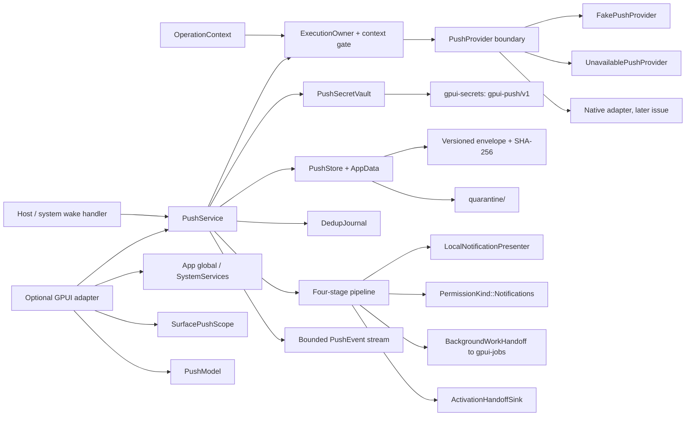

# Remote push providers, device registration and message routing

This document specifies `crates/gpui-push` for
[#45](https://github.com/jihuayu/gpui-box/issues/45). The crate builds on the
shared system contracts from
[#19](https://github.com/jihuayu/gpui-box/issues/19) (`gpui-system`), surface
ownership and lifecycle from
[#21](https://github.com/jihuayu/gpui-box/issues/21) (`gpui-lifecycle`), private
application storage from
[#22](https://github.com/jihuayu/gpui-box/issues/22) (`gpui-app-data`),
permission state from [#20](https://github.com/jihuayu/gpui-box/issues/20)
(`gpui-permissions`), blocking account-scoped credentials from
[#27](https://github.com/jihuayu/gpui-box/issues/27) (`gpui-secrets`), local
presentation from [#26](https://github.com/jihuayu/gpui-box/issues/26)
(`gpui-notifications`), activation routing from
[#24](https://github.com/jihuayu/gpui-box/issues/24) (`gpui-activation`) and
bounded background work from [#54](https://github.com/jihuayu/gpui-box/issues/54)
(`gpui-jobs`). It coordinates registration, account binding and a bounded
four-stage routing pipeline without claiming an OS push provider that is not
installed.

The default build has no GPUI dependency. It installs no native push provider,
never sleeps, and never synthesizes success when a platform API, permission or
credential is missing. Every cell in the platform matrix is
`Evidence::ContractOnly`; `Native` or `Conditional` in the `Support` column
describes the intended host mechanism, not compiled or runtime-qualified
evidence.

## Scope and ownership

`gpui-push` owns:

- Six transport families (`Apns`, `Fcm`, `Wns`, `LinuxTransport`, `WebPush`,
  `CustomChannel`), fail-closed discovery and an explicit provider selection
  policy.
- A six-platform, thirty-six-cell qualification matrix with qualification links,
  plus a mandatory-requirement `WebPushCapabilityPolicy`.
- Device registration, monotonic token revision, server-sync acknowledgement,
  caller-requested and provider-notified rotation, unregistration and explicit
  token deletion.
- Opaque `PushAccountId` binding, `PushTopic` subscriptions owned by a
  `PushDevice` or an account, and a monotonically increasing
  `registration_epoch` that fences every routing decision.
- Retryable `logout_account` with a durable tombstone written before secret
  deletion, and explicit `Locked`/`KeyInvalidated` reporting.
- Bounded `PushMessageId` deduplication with a TTL, a durable journal, a
  SHA-256 envelope and corruption quarantine.
- The four-stage pipeline: provider handoff, client receipt, local presentation
  and user activation, with a bounded background-work handoff to `gpui-jobs`.
- A bounded `EventSubscription<PushEvent>` using
  `gpui_system::event_channel` (`DEFAULT_PUSH_EVENT_CAPACITY = 64`).
- An optional GPUI adapter with an `App` global, `SystemServices` registration,
  `SurfacePushScope` and `PushModel`.

It does **not** own:

- Native APNs/FCM/WNS/Linux/Web-Push registration adapters, token refresh
  callbacks or transport sockets. Those are tracked under
  [#2](https://github.com/jihuayu/gpui-box/issues/2),
  [#8](https://github.com/jihuayu/gpui-box/issues/8),
  [#9](https://github.com/jihuayu/gpui-box/issues/9),
  [#18](https://github.com/jihuayu/gpui-box/issues/18) and
  [#43](https://github.com/jihuayu/gpui-box/issues/43).
- Visible notification rendering. The presenter boundary is implemented by the
  host; `gpui-notifications` (#26) owns the notification model.
- Activation route registration, deep-link parsing beyond bounded safety checks,
  or UI navigation. `gpui-activation` (#24) owns the route registry and inbox.
- Server-side push sending, VAPID request signing, APNs JWT signing or FCM HTTP
  v1 credentials. Server credentials never enter a client.
- Encryption-at-rest. Storage is private application data; confidentiality and
  backup policy belong to `gpui-app-data` and the host.

`gpui-box` exposes the crate through two opt-in features:

```toml
gpui-box = { features = ["push"] }
gpui-box = { features = ["push-gpui"] }
```

`push` imports `gpui_box::push` and enables system, app-data, lifecycle,
permissions and secrets dependencies. `push-gpui` additionally compiles the
optional GPUI adapter and the shared GPUI integrations. Neither feature selects
a desktop or Android backend by itself. `mise.toml` includes `-p gpui-push` in
`tasks.test`, `tasks.lint` and both cargo commands in `tasks.check`.

## Architecture



`model` defines identities, provider descriptors, registration state, receipts,
outcomes and the bounded pipeline vocabulary. `clock` supplies host milliseconds
and a deterministic `ManualPushClock`. `store` owns the versioned on-disk
envelope, atomic replacement, integrity checks and quarantine. `dedup` owns the
bounded message-ID journal. `provider` owns the transport boundary and the
`FakePushProvider`/`UnavailablePushProvider` implementations. `secrets` owns the
strict `gpui-secrets` projection and the background-only credential lease.
`platform` owns the 36-cell policy and the browser capability policy.
`validation` owns the client/server credential boundary. `service` coordinates
state, persistence and the pipeline. `gpui_adapter` is only compiled with the
`gpui` feature and adds GPUI-owned handles around the same `Send + Sync`
service.

`PushService` is a clonable `Send + Sync + 'static` handle over
`Arc<ServiceInner>`. Clones share durable state, the dedup journal, discovered
providers, retained messages, background handoffs and subscribers.
`shares_state_with` compares the inner `Arc`.

The provider boundary is deliberately small:

```rust
pub trait PushProvider: Send + Sync + 'static {
    fn descriptor(&self) -> PushProviderDescriptor;
    fn register(&self) -> Result<RegistrationMaterial, SystemError>;
    fn rotate(&self) -> Result<RegistrationMaterial, SystemError>;
    fn revoke(&self, fingerprint: &TokenFingerprint)
        -> Result<ProviderRevocation, SystemError>;
    fn as_any(&self) -> &dyn Any;
}
```

`RegistrationMaterial` has no `Clone`, no serialization and a redacted `Debug`.
It moves the raw bytes into `gpui-secrets` and zeroizes the remainder on drop.
`ProviderRevocation::{Revoked, NotFound, Unsupported, Unreachable}` treats a
missing remote record and an unsupported revocation as normal outcomes, never as
a registration failure.

### Lock discipline

Service state is a single mutex, plus a dedicated `mutation_gate` mutex that
serializes background mutations. The service never holds **either** mutex while:

- calling any `PushProvider` method;
- reading or writing `gpui-secrets`;
- reading or writing `gpui-app-data`;
- probing notification permission;
- invoking a presenter or an activation sink;
- delivering an event to subscribers.

`mutation_gate` is acquired only by background mutating paths: `register_device`,
`rotate_token`, `remove_registration` (and therefore `unregister_device` and
`delete_token`), `acknowledge_server_sync`, `bind_account`, `switch_account`,
`logout_account`, `retry_pending_secret_cleanup`, `add_subscription`,
`remove_subscription`, `commit_frame`, `queue_cold_activation` and the durable
drain step of `attach_ui_surface`. It is always released before any
`presenter.present`, `activation.handoff` or `emit` callback, so a host callback
can never re-enter a mutation. Read-only paths (`snapshot`, `registration`,
`counters`, `subscribe`, `provider_handoff`'s Stage 1 evaluation,
`route_push_activation`'s fencing, `present_message`'s re-fence,
`SurfacePushScope::drop` and `PushModel`) never acquire it. The gate is always
acquired before the state mutex and never after, so no lock-order inversion is
possible, and a slow registration cannot block a UI snapshot.

Credential writes are reversible. `PushSecretVault::store_registration_reversible`
snapshots the four `gpui-push/v1` purposes before writing, deletes the purposes
the new material does not use (so an `Fcm` <-> `WebPush` switch never leaves
`device-token` beside `web-push-*`), and restores the snapshot when any `put`,
any cleanup `delete` or the following `save_state` fails. `persist_tombstone`
and the blocked-logout path update in-memory `state.durable` only after
`save_state` succeeds, so a failed disk write never claims a tombstone or a
pending cleanup the disk does not have.

The one exception is a bounded in-memory bookkeeping update that cannot call
out. Every lock acquisition, including `SurfacePushScope::drop` and
`PushModel::drop`, recovers a poisoned guard with `PoisonError::into_inner`; no
destructor panics. `Drop` for a presenter recording stub, a model or a scope
never acquires more than one service lock and never calls a host boundary.

## Device registration and token lifecycle

`register_device`, `rotate_token`, `acknowledge_server_sync`, `unregister_device`
and `delete_token` require a background `ExecutionOwner` with no UI attachment.
`ExecutionOwner::require_background` rejects `Ui`, `Renderer` and a context whose
`ui` field is set **before** any provider, clock, vault or file side effect.

| Operation | Effect |
| --- | --- |
| `register_device` | Resolves one provider, calls `register`, writes the material to `gpui-secrets`, increments `token_revision`, stores a fingerprint prefix and sets `PendingServerSync { revision }` |
| `acknowledge_server_sync` | Accepts only the exact current revision; a stale acknowledgement is a typed `ContextExpired` with `RetryAdvice::Never` |
| `rotate_token(CallerRequested)` | Same flow, driven by the host |
| `rotate_token(ProviderNotice)` | Same flow, driven by an OS token-refresh callback |
| `unregister_device` | Best-effort remote `revoke`, deletes every `gpui-push/v1` purpose, clears registration and advances the epoch |
| `delete_token` | Local deletion only; no provider call |

`token_revision` is monotonic and never reused. `TokenFingerprint` is the first
16 hex characters of `SHA-256("gpui-push-token\0" || material)`. It is the only
representation of a device token that may appear in a receipt, event, snapshot,
durable record or error. On a durable-state write failure the freshly written
secret material is deleted again so the vault cannot retain an unregistered
token.

## Client/server credential boundary

A push **client** only receives public material. `PushClientConfiguration`
accepts an opaque application identifier plus public FCM sender, APNs team and
WNS package identifiers, and a VAPID **public** key.

`validate_vapid_public_key` accepts exactly 65 bytes `0x04 || X || Y` with
non-zero X and Y coordinates. A 32-byte value is a private scalar and is
rejected. `validate_vapid_public_key_text` accepts base64url (standard base64 is
tolerated on decode) and then applies the same rule.

`reject_server_credentials` deterministically refuses PEM private-key headers,
FCM service-account JSON, WNS client secrets and VAPID private material before it
can reach client state. Detection does not attempt to parse the credential; it
refuses the shape and reports
`RecoveryAction::RepairConfiguration` with `RetryAdvice::ModifyRequest`.

`validate_activation_route` refuses `javascript:`, `data:`, `file:`,
`vbscript:`, `shell:`, `blob:`, path traversal (`..`), control characters,
leading/trailing whitespace and oversize routes. An `https` route must carry an
authority; any other scheme must be syntactically valid.

## `gpui-secrets` isolation

Every secret is written under the `gpui-push/v1` service and one explicit
purpose:

| Purpose | Content |
| --- | --- |
| `device-token` | APNs/FCM/WNS/Linux transport token |
| `web-push-endpoint` | Endpoint capability URL |
| `web-push-p256dh` | Subscription `p256dh` key |
| `web-push-auth` | Subscription `auth` secret |

The `gpui-secrets` account segment is the opaque account identity for a bound
device and the reserved `gpui-push/device` name for an unbound device. `/` is
legal in a `gpui-secrets` component but illegal in a `PushAccountId`, so a real
account can never collide with the device namespace.

The crate **never** calls `Secrets::remove_account`. That method deletes every
service under one account segment, including `gpui-auth` and `gpui-network`
secrets. Deletion always targets the four `gpui-push/v1` purposes exactly, so a
logout provably preserves sibling service secrets. The facade test asserts this
directly: an `gpui-auth/v1` secret survives a full push logout and retry.

`RegistrationCredentialLease` is the only way to read raw material. It is
returned solely by `lease_registration_credentials`, which requires a background
owner, rejects a tombstoned or logged-out account, and verifies the active
`registration_epoch` and `token_revision`. The lease has no `Clone`, no
serialization, a redacted `Debug` and a zeroizing `Drop`.

## Account binding, epochs and retryable logout

| Type | Meaning |
| --- | --- |
| `PushAccountId` | Opaque bounded ASCII (`alnum`, `-_.:@+=!#%`, 1–96 bytes) |
| `PushTopic` | Bounded topic (`alnum`, `-_.:@/+=`, 1–96 bytes) |
| `SubscriptionOwner::Device` | Device-scoped topic, valid with or without an account |
| `SubscriptionOwner::Account(id)` | Account-scoped topic; must equal the active account |
| `registration_epoch` | Advanced on every account switch, logout and unregistration |

`bind_account` and `switch_account` re-key the existing device credentials from
the previous namespace into the new one and delete the old namespace only after
the new write succeeded. A switch advances `registration_epoch`, keeps only
device-owned subscriptions and re-marks registration as `PendingServerSync`. A
stale owner, a tombstoned account and a mismatched epoch are rejected before any
side effect.

`logout_account` writes a durable `TombstoneState::LoggingOut` tombstone
**before** deleting secrets. If the vault is `Locked` or `KeyInvalidated`, the
tombstone becomes `PendingSecretCleanup` and the caller receives a typed
`ErrorCode::Unavailable` with `RetryAdvice::AfterConditionsChange` and
`RecoveryAction::Authenticate`. While a tombstone exists the account cannot be
bound, leased or routed to. `retry_pending_secret_cleanup` completes the logout
after the vault is unlocked and clears the tombstone only after deletion
succeeded.

## Deduplication and durable storage

`DedupJournal` is bounded (`DEFAULT_DEDUP_CAPACITY = 512`,
`MAX_DEDUP_CAPACITY = 4096`) and time-bounded (`DEFAULT_DEDUP_TTL_MS = 24 h`,
`MAX_DEDUP_TTL_MS = 30 days`). Recording prunes expired entries, suppresses a
live duplicate and evicts the oldest entry deterministically at capacity.
`first_seen` returns the original timestamp so a duplicate receipt is stable.

On-disk layout under the private `push` data location:

```text
push/
  push-state.json
  dedup-journal.json
  quarantine/
```

Every file is an envelope `{ format_version, checksum, payload }`. The digest
covers `gpui-push-envelope\0`, the schema version and the payload bytes. Writes
go to a uniquely named staging file in the same directory, are flushed, synced
and atomically renamed over the target, so a failed write leaves the previous
committed file intact. A corrupt, truncated, symlinked or oversize payload is
moved into `quarantine/` and recovered as an empty default; loading never panics
and never silently accepts damaged evidence. Quarantine retains at most eight
files.

`PushDurableState::validate` is enforced on every save and load: the schema
version, the revision/fingerprint/provider consistency, the bounded collections,
unique topics, subscription ownership and the sync revision must all agree.
`PushStore::save_state` rejects an inconsistent state rather than persisting it.

## Four-stage routing pipeline

| Stage | Entry point | Output | Side effects |
| --- | --- | --- | --- |
| 1. Provider handoff | `provider_handoff` | `ProviderHandoff { outcome }` | Commits the message ID to the durable dedup journal |
| 2. Client receipt | `accept_message` | `MessageReceipt` | Queues a bounded `BackgroundWorkHandoff` |
| 3. Local presentation | `present_message` | `LocalPresentationOutcome` | Calls the presenter boundary only when permitted |
| 4. User activation | `activate_notification` / `route_push_activation` | `PushActivationOutcome` | Calls the activation sink, or queues a cold-launch activation |

`deliver` runs Stages 1–3. Stage 4 is **never** triggered implicitly: a push
delivery cannot fabricate a user activation.

Stage 1 rejects, in order, an oversize payload
(`MAX_PUSH_PAYLOAD_BYTES = 4096`), an elapsed expiry, a device with no active
registration or a device-scoped cleanup tombstone (`DeviceNotRegistered`), an
unknown provider/channel, a provider the host has not selected for this device
(`UnknownProvider`, including a channel mismatch), a non-ready provider, an
unsupported payload kind, a notification frame without content, an account
mismatch or logged-out target, a stale epoch, an unsafe activation route and a
live duplicate. Only `ProviderHandoffOutcome::Accepted` may create a receipt.

Stage 2 records the receipt with the exact payload byte count, the account, the
epoch, the provider kind and the delivery condition, and appends a
`BackgroundWorkHandoff` (class, recommendation, advisory budget, payload bytes)
when the payload is silent or the wake was not foreground-active. The queue is
bounded by `MAX_PENDING_BACKGROUND_HANDOFFS = 256`; overflow evicts the oldest
handoff and increments `background_handoffs_dropped`. The handoff never spawns
work by itself; `gpui-jobs` (#54) owns execution.

Stage 3 evaluates `ForegroundPresentationPolicy` and
`PermissionKind::Notifications` before calling any presenter:

| Condition | Outcome |
| --- | --- |
| Silent payload | `NotApplicableSilentPush` |
| Foreground + `SuppressInForeground` | `SuppressedForegroundPolicy` |
| Foreground + `DelegateToHost` | `DelegatedToHost` |
| Permission `Denied`/`Restricted`/`NotDetermined` | `SuppressedPermissionDenied { status }` |
| Registration cleared, switched or tombstoned since Stage 2 | `SuppressedRegistrationChanged` |
| Presenter error | `PresenterError { code }` |

`present_message` re-reads durable state immediately before presenting and
verifies `token_revision > 0`, the absence of a device-scoped tombstone, the
accepted message's registration epoch and its account, so a delayed
presentation after a logout or account switch never displays a stale account's
notification.

A suppressed presentation still keeps the Stage 2 receipt and the background
handoff. A `Presented` receipt is not proof of display: it records that the
platform accepted a submission.

Stage 4 validates the route, the account, the epoch and the message identity
before calling the sink. A duplicate activation, a silent message and an unknown
non-cold-launch message are rejected with a typed outcome. When an accepted
Stage 2 message is present, its `account` and `registration_epoch` are fenced
even if the request omits them, so a tap on a message accepted under
`account-first`/epoch 1 can never route after `switch_account` or
`logout_account`.

A `TerminatedColdLaunch` activation received before a UI surface attaches is
retained in a bounded queue (`MAX_PENDING_COLD_ACTIVATIONS = 128`, duplicate
`message_id` values rejected) and re-fenced when `attach_ui_surface` drains it:
the drain first persists the emptied queue and only then sets `ui_attached`, and
each activation is re-checked for an active registration, a device-scoped
tombstone, a safe route, the current account, the current epoch and duplicate
activation before `ActivationHandoffSink::handoff` runs. A rejected drained
activation emits `ActivationRejected` and is dropped; a sink failure emits
`HandoffFailed { code }` preserving the sink's error code.

## Events and the GPUI adapter

`PushEvent` covers discovery and selection, registration/rotation/unregistration,
sync acknowledgement, account binding/switching/logout, pending and completed
secret cleanup, subscriptions, handoff rejection, acceptance, background work,
local presentation, activation routed/queued/rejected, quarantine, operational
failure and cancellation. The stream uses `gpui_system::event_channel` with
capacity 64. On overflow the backlog is dropped and `Event::ResyncRequired` is
delivered; subscribers must refetch a snapshot rather than pretend no events were
lost. Delivery is non-blocking and never occurs while the service state lock or
the background `mutation_gate` is held.

Events, snapshots, receipts and `Debug` output carry fingerprints and metadata
only. They never carry a raw token, endpoint URL, `p256dh` key or `auth` secret.

The `gpui` feature adds:

- `impl Global for PushService` and `install_push_service`;
- `install_push_in_services` for `SystemServices`;
- `init_push`/`push_service`/`PushAppExt` for `App` lookup;
- `SurfacePushScope` with optional `EntityScope` and exact
  `(SurfaceId, generation)` `Drop` disposal;
- `PushModel` with a bounded retained-event ring
  (`MAX_RETAINED_EVENTS = 64`), sticky `resync_required`, `drain_events`,
  `snapshot` and `refresh_snapshot`.

Installation and lookup must run on the owning GPUI UI thread. Dropping a stale
scope never disposes a newer generation of the same surface, and the core service
remains usable headlessly.

## Six-platform × six-operation qualification matrix

`PushPlatform` and `PushOperation` each have six values; the matrix has exactly
36 unique rows. Every row is `Evidence::ContractOnly`. No native provider is
installed, so no row claims `Compiled` or `RuntimeVerified` qualification.

| Platform | Discover | Register/Rotate | Bind/Topics | Silent data | Present | Activate |
| --- | --- | --- | --- | --- | --- | --- |
| `Windows` | `Conditional` | `Conditional` | `Native` | `Conditional` | `Conditional` | `Conditional` |
| `MacOs` | `Conditional` | `Conditional` | `Native` | `Conditional` | `Conditional` | `Conditional` |
| `Linux` | `Conditional` | `Conditional` | `Native` | `Conditional` | `Conditional` | `Conditional` |
| `Android` | `Conditional` | `Conditional` | `Native` | `Conditional` | `Conditional` | `Conditional` |
| `Ios` | `Conditional` | `Conditional` | `Native` | `Conditional` | `Conditional` | `Conditional` |
| `Web` | `Conditional` | `Conditional` | `Native` | `Conditional` | `Conditional` | `Conditional` |

Account/topic binding is application-owned state and needs no OS push transport,
so it reports `Native` while remaining `ContractOnly`. Every other cell depends
on a host adapter, an entitlement, a packaged identity or a browser capability,
so it reports `Conditional`. The full per-cell configuration text and notes are
in `platform_configuration`/`platform_notes`; each row carries the same
qualification links.

`WebPushCapabilityPolicy` treats every browser requirement as mandatory: a
secure context, a registered Service Worker, `PushManager`, the `Notification`
API and a configured VAPID public key. A missing requirement reports
`Unavailable` with the first unmet reason; there is no page-local fallback.

### Qualification links

| Issue | Ownership |
| --- | --- |
| [#2](https://github.com/jihuayu/gpui-box/issues/2) | Android runtime and FCM host integration |
| [#8](https://github.com/jihuayu/gpui-box/issues/8) | Native desktop packaging, installers and runtime qualification |
| [#9](https://github.com/jihuayu/gpui-box/issues/9) | iOS/macOS backend packaging and device validation |
| [#18](https://github.com/jihuayu/gpui-box/issues/18) | Phase sequencing, browser backend and integration gate |
| [#19](https://github.com/jihuayu/gpui-box/issues/19) | Shared `OperationContext`, capabilities, errors, events and `SystemServices` |
| [#20](https://github.com/jihuayu/gpui-box/issues/20) | Notification permission status and revocation signals |
| [#21](https://github.com/jihuayu/gpui-box/issues/21) | Lifecycle phases, surface generations and background/resume coordination |
| [#22](https://github.com/jihuayu/gpui-box/issues/22) | Private app-data roots, locking and atomic storage |
| [#24](https://github.com/jihuayu/gpui-box/issues/24) | Activation routes, inbox and cold-launch handoff |
| [#26](https://github.com/jihuayu/gpui-box/issues/26) | Notification presentation and the local notification model |
| [#27](https://github.com/jihuayu/gpui-box/issues/27) | Account-scoped credential storage and lock/invalidation states |
| [#43](https://github.com/jihuayu/gpui-box/issues/43) | System capability backlog umbrella and background-execution coordination |
| [#45](https://github.com/jihuayu/gpui-box/issues/45) | This crate's contract and acceptance |
| [#46](https://github.com/jihuayu/gpui-box/issues/46) | Opaque account identity shared with `gpui-auth` |
| [#54](https://github.com/jihuayu/gpui-box/issues/54) | Bounded background work execution |
| [#70](https://github.com/jihuayu/gpui-box/issues/70) | Cross-capability contract harness and platform evidence matrix |
| [#74](https://github.com/jihuayu/gpui-box/issues/74) | Capability manifest and evidence reporting |

## Determinism, privacy and portability

- The workspace's `unsafe_code = "forbid"` lint applies to every module.
- No blocking sleeps in source or tests. Tests advance `ManualPushClock` and use
  explicit integer timestamps.
- No debug-print macros, `todo!` or `unimplemented!` in shipped code. Lock
  poisoning is recovered, not panicked.
- No wall-clock reads in the service; the injected `PushClock` is the only time
  source, and the default `SystemPushClock` uses Unix-epoch milliseconds so
  persisted dedup expiry stays comparable across a restart.
- Public records contain opaque identities, fingerprints, bounded metadata and
  typed observations; they contain no filesystem path, raw token, endpoint URL,
  `p256dh`/`auth` bytes or account secret.
- Every queue, journal, ring and stream is bounded; overflow requires an explicit
  resync and is counted.
- The service does not call native APIs. A missing provider, permission or
  credential is typed as `Unavailable`/`Unsupported`/`Denied`, never as success.

## Verification

The workspace pins Rust **1.98.1** in `mise.toml`. Run:

```sh
cargo fmt --all
cargo fmt --all -- --check
mise tasks validate
cargo test --locked -p gpui-push
cargo test --locked -p gpui-push --all-features
cargo test --locked -p gpui-box --features push,push-gpui --test push --lib
cargo clippy --locked -p gpui-push -p gpui-box --all-features --all-targets -- -D warnings
cargo check --locked -p gpui-push --all-targets
cargo check --locked -p gpui-push --all-features --all-targets
git diff --check
git status -sb
```

The suite is deterministic and does not assume a native provider, a network
connection, a desktop session or wall-clock behavior.

### Test coverage

| File | Coverage |
| --- | --- |
| `src/model.rs` | Identifier bounds and control characters, semantic `try_from` validation on every deserialized ID, SHA-256 fingerprint prefixes and redacted `Debug`, descriptor selectability, durable-state consistency (tombstones, pending activations, subscription ownership) |
| `src/platform.rs` | 36 unique pairs, all `ContractOnly`, per-requirement browser fail-closed policy |
| `src/validation.rs` | Strict base64url padding, trailing-quantum and non-zero padding-bit rejection, 65-byte uncompressed VAPID key, private-scalar and PEM rejection, service-account JSON and client-secret rejection, unsafe activation schemes and zero coordinates |
| `src/dedup.rs` | Live duplicate suppression, TTL expiry, deterministic oldest-first eviction, configuration and record validation |
| `src/store.rs` | Envelope round trip, checksum/schema tamper quarantine, private namespace and atomic recovery, and quarantine of a valid-checksum envelope whose account, activation route or journal identity is semantically unsafe |
| `src/secrets.rs` | Account namespace projection, redacted lease, snapshot and Web Push material `Debug`, `Locked`/`KeyInvalidated` mapping, provider-type switching that deletes unused purposes, and mid-rotation rollback to the prior revision |
| `src/service.rs` | Configuration bounds, ambiguous provider selection failure, UI/Renderer owner rejection before side effects |
| `src/gpui_adapter.rs` (`#[gpui::test]`) | App global + `SystemServices`, typed missing-service error, generation-exact scope disposal, bounded `PushModel` drain |
| `tests/push_contract.rs` | 36-cell matrix and qualification links, empty/ambiguous/unconfigured provider failure, vault isolation and lease redaction, dedup journal across a restart and across a corrupt-file quarantine, account-switch epoch fencing, sibling secret survival, `Locked` and `KeyInvalidated` retryable logout, silent-push background handoff, `NotDetermined` suppression with a preserved receipt, user-tap routing and duplicate/silent activation rejection, unregistration and provider revocation, `ui.is_some()` and cancellation gating, the client/server credential boundary, cold-launch re-fencing after an account switch, a round-trip switch and a logout, duplicate cold-launch rejection, delayed-presentation suppression, stale accepted-message routing, handoff error-code preservation, unregistered and unselected-provider frame rejection, and a concurrent rotate/logout serialization invariant |
| `crates/gpui-box/tests/push.rs` | Facade surface, durable redacted registration, background-owner enforcement, rotation and stale sync acknowledgement, retryable logout without `remove_account`, duplicate/expired/oversize rejection, permission-gated and granted presentation, cold-launch activation, outage recovery, a failed `save_state` restoring the prior revision, a failed tombstone write not claiming a pending cleanup, `push-gpui` registry |

At this revision the `gpui-push` suite declares **29** unit tests and **24**
integration tests with default features, and **33** unit tests plus **24**
integration tests with `--all-features`. The `gpui-box` `push` feature test
target declares **12** integration tests (**13** with `push-gpui`) plus one
facade unit test. Counts are descriptive; the commands above are authoritative.

## Remaining acceptance work

- Native transport adapters and packaged-host evidence under #8/#9/#70:
  APNs device-token registration, FCM `FirebaseMessaging`, WNS
  `PushNotificationChannelManager`, Linux D-Bus transports and a browser
  Service Worker.
- Real capability probes replacing `UnavailablePushProvider` defaults; no row in
  this document claims native or runtime qualification.
- Host implementations of `LocalNotificationPresenter` over `gpui-notifications`
  (#26) and of `ActivationHandoffSink` over `gpui-activation` (#24).
- A server-sync worker built on `gpui-jobs` (#54) that consumes
  `BackgroundWorkHandoff` and uses `lease_registration_credentials`; the push
  crate intentionally does not perform network I/O.
- Optional diagnostics and task-presentation integration for user-visible
  registration and delivery failures.

No row in this document claims `Evidence::Compiled` or
`Evidence::RuntimeVerified`. Contract compilation is not native qualification.
