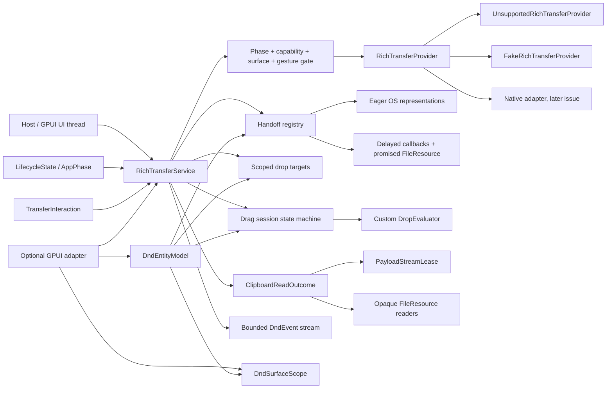
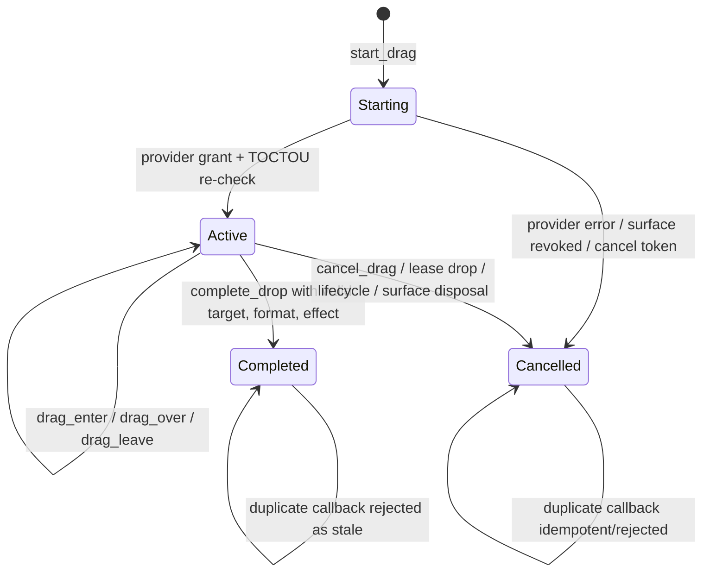

# Typed rich clipboard, resource leases and drag-and-drop

This document specifies `crates/gpui-dnd` for
[#52](https://github.com/jihuayu/gpui-box/issues/52). The crate extends the
coordinated system contracts from
[#19](https://github.com/jihuayu/gpui-box/issues/19) (`gpui-system`), the
foreground interaction and permission rules from
[#20](https://github.com/jihuayu/gpui-box/issues/20) and
[#25](https://github.com/jihuayu/gpui-box/issues/25) (`gpui-clipboard`), the host
lifecycle snapshots from
[#21](https://github.com/jihuayu/gpui-box/issues/21) (`gpui-lifecycle`), the
opaque resource and streaming contracts from
[#23](https://github.com/jihuayu/gpui-box/issues/23) (`gpui-files`), and the
lifecycle-residency rules from
[#43](https://github.com/jihuayu/gpui-box/issues/43). Native Win32/OLE, AppKit,
X11/Wayland/Portal, Android, iOS and browser backends remain separate adapter
work under [#8](https://github.com/jihuayu/gpui-box/issues/8),
[#9](https://github.com/jihuayu/gpui-box/issues/9),
[#2](https://github.com/jihuayu/gpui-box/issues/2) and
[#70](https://github.com/jihuayu/gpui-box/issues/70).

The default build has no GPUI dependency. It installs no native provider, does
not touch the user's clipboard and never claims runtime qualification. Every
row of the qualification matrix is `Evidence::ContractOnly`.

Enable the facade:

```toml
gpui-box = { features = ["dnd"] }
gpui-box = { features = ["dnd-gpui"] }
```

`dnd` enables the system, lifecycle, files and plain-text clipboard features and
re-exports the crate as `gpui_box::dnd`. `dnd-gpui` additionally compiles the
optional GPUI adapter. Neither feature selects a desktop or Android backend.

## Scope and ownership

`gpui-dnd` owns:

- Six coordinated operations and a six-platform, thirty-six-cell contract-only
  qualification matrix.
- Validated MIME/UTI format identities, canonicalization and deterministic
  clipboard/drag negotiation.
- Typed payload bounds for plain text, rich text, images, raw RGBA, files and
  vendor data.
- A foreground user-gesture attestation bound to one live service identity and
  one live UI context or explicit surface generation.
- Producer clipboard handoffs with eager OS representations and revocable
  delayed callbacks.
- Consumer read outcomes and RAII payload stream leases with a service-wide
  64-lease cap.
- Opaque `gpui-files::FileResource` transfer and consumer readers. No raw path,
  `file://` URL or `content://` URI ever appears in a public field, `Debug`
  output, event or error.
- Scoped drop targets, drag sessions, custom `DropEvaluator` callbacks and the
  full enter/over/leave/drop/cancel state machine.
- Integer milli-pixel geometry, total `Eq`/`Ord`/`Hash`, and validated logical
  rectangles.
- Bounded `EventSubscription<DndEvent>` streams through
  `gpui_system::event_channel` (`DEFAULT_DND_EVENT_CAPACITY = 64`).
- Optional GPUI `App` globals, `SystemServices` registration,
  `DndSurfaceScope` and `DndEntityModel`.

It does **not** own:

- Native clipboard, drag and drop sessions. Providers are explicit
  `Rc<dyn RichTransferProvider>` values attached by the host.
- Permission status, authentication or Settings recovery. Those remain under
  `gpui-permissions` / #20.
- File picking, durable grants, save policy or filesystem I/O. Files remain
  opaque `gpui-files` resources.
- Plain-text clipboard parsing or normalization. `#25` semantics are preserved
  exactly; the bridge only calls the existing `gpui-clipboard` API.
- Window/activity lifecycle or native foreground detection. Hosts synchronize
  `LifecycleState`; native providers re-check their own conditions.
- Native content validation such as decoding image bytes or verifying an RTF
  grammar. The contract validates size, UTF-8 and NUL bounds only.

## Architecture



`RichTransferService` is a clonable UI-local handle over `Rc<ServiceInner>`.
Clones share state and identity. The provider handle remains an explicit
`Rc<dyn RichTransferProvider>`; a provider never receives the service's internal
mutex and is never called while that mutex is held.

The service state mutex is **never** held while calling:

- any provider method (`capability`, `clipboard_snapshot`, `publish_clipboard`,
  `release_delayed`, `start_drag`, `complete_drag`, `cancel_drag`,
  `attach_listener`);
- a `LazyRepresentation` callback;
- a custom `DropEvaluator`;
- `FileResource::release`;
- event delivery or `Drop` cleanup.

This is required for correctness, not only latency. Fake hooks re-enter the
service during publication/start; evaluators cancel sessions; lazy callbacks
dispose the surface that authorized them. The service always re-validates after
such a callback returns.

## Canonical MIME and UTI identities

Both identity types validate on construction **and** on `Deserialize`.

### `MimeType`

- 1 through `MAX_MIME_TYPE_BYTES = 128` ASCII bytes.
- Exactly one `/`; valid RFC token primary type and subtype.
- Canonical lowercase primary type, subtype and parameter names.
- Parameter values are validated tokens or quoted strings; quoted values may
  contain separators and escaped quotes. Whitespace, control bytes and NUL are
  rejected.
- Parameters are sorted by name; duplicate names are rejected.
- `charset` values are lowercased as part of canonicalization.
- `essence()` returns `type/subtype`; `media_type()`, `subtype()` and
  `parameter(name)` are available.
- Missing slash, extra slash, empty parts, non-ASCII, malformed quoting and
  unquoted separators return `ErrorCode::InvalidInput`.
- Deserialization uses the same parser, so JSON cannot smuggle an invalid value.

### `UtiIdentifier`

- 1 through `MAX_UTI_BYTES = 128` ASCII bytes.
- Lowercase canonical form using `a-z`, `0-9`, `-` and `.`.
- At least one dot; no leading, trailing or empty segments.
- No whitespace, control or NUL bytes.
- Deserialization validates identically to `parse`/`new`.

## Canonical format table and bounds

| Standard format | MIME | UTI | Class | Bound and validation |
| --- | --- | --- | --- | --- |
| Plain text | `text/plain;charset=utf-8` | `public.utf8-plain-text` | Text | `MAX_TEXT_BYTES = 1 MiB`; UTF-8 `String`; no NUL. Bare `text/plain` essence matches in negotiation. |
| HTML | `text/html` | `public.html` | Rich text | `MAX_RICH_TEXT_BYTES = 4 MiB`; UTF-8; no NUL. |
| RTF | `text/rtf` | `public.rtf` | Rich text | 4 MiB; UTF-8; no NUL. |
| Markdown | `text/markdown` | `net.daringfireball.markdown` | Rich text | 4 MiB; UTF-8; no NUL. |
| PNG | `image/png` | `public.png` | Image | Non-empty, `MAX_IMAGE_BYTES = 16 MiB`. |
| JPEG | `image/jpeg` | `public.jpeg` | Image | Non-empty, 16 MiB. |
| WebP | `image/webp` | `org.webmproject.webp` | Image | Non-empty, 16 MiB. |
| Raw RGBA8 | `image/x-rgba` | `org.gpui-box.rgba8` | Image | `width > 0`, `height > 0`, checked `width * height * 4 == bytes.len()`, `<= 16 MiB`. |
| Files | `text/uri-list` | `public.file-url` | Files | `1..=MAX_TRANSFERRED_FILES = 256` opaque `FileResource` handles; never a path, URL or URI. |
| Vendor | `application/vnd.*` | custom reverse-DNS UTI | Custom | Non-empty bytes, `MAX_CUSTOM_BYTES = 4 MiB`. |

`MAX_OFFERED_FORMATS = 32` bounds one clipboard write or drag source. Duplicate
`FormatDescriptor` values are rejected.

Binary payloads implement a custom `Debug` that prints dimensions and byte
counts instead of raw bytes. `TypedPayload::Files` prints the opaque resource
count and numeric ids only.

## Deterministic negotiation

`negotiate_format(available_offers, target_preferences)` evaluates target
preferences in declaration order. For each preference:

1. Collect offers whose descriptor exactly equals the preference, whose
   canonical MIME essence equals it (`text/plain` matches
   `text/plain;charset=utf-8`), or whose UTI equals it.
2. Prefer an eager offer over a delayed offer.
3. Break remaining ties by the earliest offer index.
4. Return `NegotiatedFormat { offer_index, descriptor, delivery }` using the
   offer's canonical descriptor.

The first target preference with any match wins. Target preference order is
therefore authoritative; a later eager offer never outranks an earlier target
preference. If no offer matches, the clipboard read returns
`ClipboardReadOutcome::NoMatchingFormat { available_offers }`; an empty provider
snapshot returns `Empty`.

## Foreground gesture attestation

`TransferInteraction` is issued only by `RichTransferService`:

- `user_initiated()` uses a service-level `UiContext`.
- `user_initiated_with(ui)` requires a current UI attachment on its owning
  thread.
- `user_initiated_for_surface(surface, generation)` requires an explicitly
  attached, live and visible service surface generation.
- `user_initiated_in_context(&context)` clones a live UI-bound context.
- `.with_cancellation(token)` and `.with_deadline(instant)` attach the common
  `gpui-system` operation fields.

Execution re-validates all of the following before any provider effect:

- the interaction's service identity (`InvalidInput` for a foreign service,
  checked **before** cancellation so a foreign cancelled token cannot mask the
  identity error);
- the live UI context on its owning thread, or the explicit attached surface
  generation (`ContextExpired` for stale, foreign-thread or unattached scopes);
- foreground visibility (`PermissionDenied` for hidden surfaces);
- `AppPhase` (`PermissionDenied` for Launching/Background/Suspended,
  `ContextExpired` for Terminating);
- the required provider capability;
- cancellation and deadline state.

A user gesture is a host attestation, not an unforgeable OS permission grant.
Native providers re-check foreground ownership at execution.

## Producer ownership: eager handoffs versus delayed promises

`RichClipboardWrite` is application-scoped or surface-scoped and carries bounded
eager `TypedPayload`s and/or delayed `LazyRepresentation`s.

`HandoffReceipt` records:

- `handoff_id`;
- optional provider `sequence`;
- `eager_formats`;
- `delayed_formats`.

A receipt means the OS/provider accepted the clipboard offer. It is **not** proof
of a paste into another application and never authorizes later clearing.

### Eager representations

Dropping a `HandoffLease` does not clear eager OS clipboard representations.
Copied text, HTML, PNG or file handles remain pasteable across applications, as
users expect, until the OS clipboard is replaced or the host explicitly clears
it. The service never synthesizes a "clear" from lease drop.

### Delayed representations and promised files

Dropping a `HandoffLease`, calling `revoke_delayed()`/`revoke()`, source exit,
`AppPhase::Terminating`, surface generation advance or surface disposal
immediately:

1. removes every delayed callback from the handoff;
2. calls `FileResource::release()` on every promised producer-side resource;
3. asks the provider to release delayed native entries
   (`release_delayed(native_handoff_token)`);
4. emits `DndEvent::HandoffRevoked` with the public-safe reason.

Calling `revoke_delayed` twice is idempotent and returns `false` the second time.
Replacing the clipboard revokes the previous handoff's delayed callbacks (reason
`Replaced`) while allowing the new eager publication to proceed.

### Delayed generation TOCTOU

Before invoking a delayed callback the service verifies:

- the handoff still exists and is not revoked;
- a surface-scoped handoff's generation is still live;
- the application is foreground and not terminating;
- the interaction context is uncancelled and before its deadline.

If any condition fails, the callback is **not invoked** and the request fails
with `ResourceExpired` or `ContextExpired`.

The callback always runs outside service locks. After it returns, the service
re-validates handoff, surface, phase and context. If the handoff was revoked while
the callback was running, any returned `FileResource`s are released and the
request fails with `ResourceExpired`/`ContextExpired`. The generated
`TypedPayload` must conform to the promised descriptor and satisfy all byte,
UTF-8 and NUL bounds before ownership transfers.

## Consumer ownership: reads, payloads and streams

`read_clipboard(interaction, target_preferences)` returns one of:

- `ClipboardReadOutcome::Empty` — no formats exist;
- `NoMatchingFormat { available_offers }` — formats exist but none matched;
- `Matched(ConsumedPayload)` — a negotiated owned payload.

`ConsumedPayload` exposes the negotiated descriptor and delivery mode, direct
typed inspection (`as_text`, `as_bytes`, `rgba8`, `files`), and RAII opening of a
`PayloadStreamLease`.

`PayloadStreamLease`:

- increments a shared atomic budget; opening the 65th simultaneous lease fails
  with `ErrorCode::Busy`;
- requires a background `OperationContext` without a UI attachment for every
  chunk read; a UI-attached context is `ErrorCode::InvalidInput`, matching
  `gpui-files`;
- checks cancellation before and after a read (`Completion::Cancelled`) and the
  deadline (`ErrorCode::TimedOut`);
- `read_chunk(context, max_bytes)` bounds chunks to `1..=1 MiB`; EOF is
  `Completed(None)`;
- `read_to_end(context)` uses 64 KiB chunks;
- `release()` and `Drop` are idempotent, decrement the budget exactly once and
  invalidate further reads with `ErrorCode::ResourceExpired`;
- `ConsumedPayload::revoke()` invalidates every lease opened from that consumer
  grant.

Files are consumed through `ConsumedPayload::files()` and
`open_file_stream(index, context) -> ServiceResult<ResourceReader>`. The reader
retains the opaque `FileResource`; no path or URI is exposed. Byte-stream
`open_stream()` on a files payload is `ErrorCode::Unsupported`.

## `#25` plain-text interoperability bridge

The bridge functions preserve the untouched `gpui-clipboard` contract:

```text
write_plain_text_through(&Clipboard, text) -> ClipboardReceipt
read_plain_text_through(&Clipboard) -> ClipboardText
write_plain_text_through_with(..., cancellation, deadline)
read_plain_text_through_with(..., cancellation, deadline)
write_plain_text_via_provider(&dyn ClipboardProvider, text, context)
read_plain_text_via_provider(&dyn ClipboardProvider, context)
```

They delegate to `Clipboard::user_initiated()` and `read_text`/`write_text`
rather than reimplementing clipboard state. Therefore:

- `MAX_TEXT_BYTES` remains one MiB;
- embedded NUL is rejected with `InvalidInput`;
- `Empty`, `NoText` and `Text("")` remain distinct;
- `ClipboardReceipt.sequence` remains a provider observation;
- a completed native effect keeps its actual receipt even if cancellation races
  the synchronous call.

`crates/gpui-clipboard/**` is not modified by #52.

## Drag-and-drop model and state machine

### Coordinates

`DragPoint { x_milli, y_milli }` stores integer milli-pixels. `from_logical`
rejects `NaN`, infinities and values outside the `i64` milli-pixel range with
`InvalidInput`. Integer storage makes `Eq`, `Ord` and `Hash` total.

`LogicalRect { x_milli, y_milli, width_milli, height_milli }` is validated at
construction:

- width and height must be positive;
- `x + width` and `y + height` must not overflow;
- `contains` uses a half-open rectangle: left/top inclusive, right/bottom
  exclusive.

### Effects and modifiers

`DragEffect::{Copy, Move, Link}` and a non-empty `AllowedEffects` set model source
and target permissions. Effective effects are the intersection of source and
target sets. `DragModifiers { shift, ctrl, alt, meta }` select deterministically
within that intersection: `ctrl` prefers copy, `alt` link, `shift` move, and the
default preference order is copy, move, link. A custom evaluator may request a
different effect only if it remains inside both allowed sets.

`DragPreview` labels are bounded to `MAX_PREVIEW_LABEL_BYTES = 256` with no
NUL/control characters. A preview visual is either a validated `RgbaImageBuffer`
or a portable relative asset key. Absolute paths, drive letters/colons,
backslashes, empty segments and `.`/`..` segments are rejected.

### Drop targets

`DropTargetSpec` is bound to `(SurfaceId, generation)`, a validated
`LogicalRect`, a non-empty accepted-format list, a non-empty allowed-effect set,
a `z_index` and an optional `DropEvaluator`.

`register_drop_target` returns an idempotent RAII `DropTargetLease`. Targets are
automatically removed when their surface generation advances or is disposed.
`DropEvaluator` runs outside every internal lock with a
`DropEvaluationContext`; after it returns the service re-checks session, token,
epoch, source surface, target surface and target registry before honoring the
verdict.

### Session lifecycle



`start_drag`:

- validates the gesture, source surface generation, preview, effects and
  payloads;
- enforces at most one active drag session (`ErrorCode::Busy`);
- calls `provider.start_drag` outside locks to obtain
  `ProviderDragGrant { native_session_token, session_epoch }`;
- rejects a zero token/epoch grant;
- re-validates source surface, phase, context and cancellation after the
  provider returns.

If the provider call raced a surface disposal, generation advance, backgrounding,
termination or cancellation, the service immediately calls
`provider.cancel_drag(token)` outside locks, releases promised `FileResource`s
and returns `Completion::Cancelled` or a typed `ContextExpired` error. No orphan
native session remains.

Callbacks are correlated by `(DragSessionId, native_session_token,
session_epoch)`. Unknown sessions, token mismatches, epoch mismatches, completed
sessions, cancelled sessions, stale surfaces and removed targets emit
`DndEvent::StaleCallbackIgnored` and return an ignored `DragUpdate` (or
`DropCompletion::Ignored`). They never mutate active state.

`complete_drop` re-evaluates target hit-testing, format negotiation, effect
permission and the custom evaluator at the drop point. A drop with no valid
target cancels the session with `DragCancelReason::ForbiddenTarget`, releases
promised resources and returns `DropCompletion::Cancelled(ForbiddenTarget)`.

A valid drop resolves eager bytes or invokes the delayed generator outside locks
with post-callback TOCTOU checks, releases all unconsumed delayed promises,
notifies the provider, emits `DndEvent::DropCompleted`, marks the session
`Completed` and returns `DropCompletion::Dropped { outcome, payload }` where
`DropOutcome` contains `session_id`, `target_id`, `effect` and `format`.

Cancellation reasons are public-safe enums: `User`, `PointerCancel`,
`ForbiddenTarget`, `SourceSurfaceDisposed`, `TargetSurfaceDisposed`,
`AppBackgrounded`, `AppTerminating`, `SourceExited`, `LeaseDropped`,
`ProviderCancelled` and `CallerCancelled`.

## Events and bounded streams

`RichTransferService::subscribe()` returns an `EventSubscription<DndEvent>` from
`gpui_system::event_channel(DEFAULT_DND_EVENT_CAPACITY = 64)`. Producers never
block. When the bounded queue overflows, the next reader observes
`Event::ResyncRequired`; the overflow remains sticky until the consumer
acknowledges/snapshots.

Events carry identities, descriptors, effects, delivery modes and numeric
tokens only. They never carry payload bytes, paths, URLs or native handles beyond
numeric correlation tokens.

## Six-platform × six-operation qualification matrix

Every row is `Evidence::ContractOnly`.

| # | Platform | Operation | Support | Backend contract |
| --- | --- | --- | --- | --- |
| 1 | Windows | `ReadRichClipboard` | Native | `OpenClipboard`; decode `CF_UNICODETEXT`, `CF_HTML`, RTF, `CF_DIB`/PNG and `CF_HDROP`/`IShellItemArray`; close on every path. |
| 2 | Windows | `WriteRichClipboard` | Native | `EmptyClipboard`, `SetClipboardData` per eager format, `SetClipboardData(CF_x, NULL)` + `WM_RENDERFORMAT`/`WM_RENDERALLFORMATS`. |
| 3 | Windows | `ProvideDelayedPayload` | Native | Live clipboard-owner window answers render messages; revoke on exit or replacement. |
| 4 | Windows | `StartDragSession` | Native | OLE `IDataObject`/`IDropSource`/`DoDragDrop`; `CF_HDROP`/`IShellItemArray` wrapped in opaque resources. |
| 5 | Windows | `AcceptDropTarget` | Native | `RegisterDragDrop` + `IDropTarget::DragEnter`/`DragOver`/`DragLeave`/`Drop`; honor `DROPEFFECT_*`. |
| 6 | Windows | `TransferFileResources` | Native | `CF_HDROP`/shell item handles stay inside `FileResource`; no public path. |
| 7 | macOS | `ReadRichClipboard` | Native | `NSPasteboard` on the main thread for `public.utf8-plain-text`, `public.html`, `public.rtf`, image UTIs. |
| 8 | macOS | `WriteRichClipboard` | Native | `NSPasteboardItem` eager values or `NSPasteboardItemDataProvider` delayed values. |
| 9 | macOS | `ProvideDelayedPayload` | Native | `pasteboard:item:provideDataForType:` re-checks handoff liveness; file promises release on exit. |
| 10 | macOS | `StartDragSession` | Native | `NSDraggingSession`/`NSDraggingSource` with validated preview and pasteboard item. |
| 11 | macOS | `AcceptDropTarget` | Native | `NSDraggingDestination`; re-negotiate pasteboard types at drop. |
| 12 | macOS | `TransferFileResources` | Native | `NSFilePromiseProvider` or security-scoped URLs wrapped in `FileResource`. |
| 13 | Linux | `ReadRichClipboard` | Conditional | X11 `CLIPBOARD` selection or Wayland `wl_data_device` offer on a focused seat; no guaranteed clipboard manager. |
| 14 | Linux | `WriteRichClipboard` | Conditional | Selection ownership must outlive the source; owner answers `SelectionRequest`. |
| 15 | Linux | `ProvideDelayedPayload` | Conditional | X11/Wayland delayed callbacks require a live owner, focused seat and valid input serial. |
| 16 | Linux | `StartDragSession` | Conditional | Xdnd or `wl_data_device.start_drag` with fd-backed source and current serial. |
| 17 | Linux | `AcceptDropTarget` | Conditional | `XdndAware` / Wayland drop offers; re-validate generation at drop. |
| 18 | Linux | `TransferFileResources` | Conditional | `text/uri-list`; XDG Desktop Portal `FileTransfer` for sandboxed cross-app files. |
| 19 | Android | `ReadRichClipboard` | Native | `ClipboardManager` on the UI thread; Android 10+ input-focus clipboard gate. |
| 20 | Android | `WriteRichClipboard` | Native | `ClipData` text/HTML/`content://` items with minimum read grants. |
| 21 | Android | `ProvideDelayedPayload` | Conditional | `ContentProvider` stream/URI grants; revoke on handoff, Activity or generation disposal. |
| 22 | Android | `StartDragSession` | Native | `View.startDragAndDrop` + `DRAG_FLAG_GLOBAL` + `DRAG_FLAG_GLOBAL_URI_READ`. |
| 23 | Android | `AcceptDropTarget` | Native | `OnDragListener` + `requestDragAndDropPermissions`; release permissions at drop/generation end. |
| 24 | Android | `TransferFileResources` | Conditional | Only `content://`/SAF URI grants or `DragAndDropPermissions`; never raw paths. |
| 25 | iOS | `ReadRichClipboard` | Native | `UIPasteboard` on the main thread; iOS 16+ paste banner and explicit gesture rules. |
| 26 | iOS | `WriteRichClipboard` | Native | `UIPasteboard` items for text/HTML/RTF/image types. |
| 27 | iOS | `ProvideDelayedPayload` | Conditional | `NSItemProvider` load handlers; thread-safe and revoked when the scene/session ends. |
| 28 | iOS | `StartDragSession` | Conditional | `UIDragInteraction`; iPadOS multi-window vs single-scene iPhone constraints. |
| 29 | iOS | `AcceptDropTarget` | Conditional | `UIDropInteraction`; load item providers asynchronously after drop. |
| 30 | iOS | `TransferFileResources` | Conditional | `NSItemProvider` + security-scoped URLs inside `FileResource`; release scope on completion. |
| 31 | Web | `ReadRichClipboard` | Conditional | Async Clipboard `read`/`readText`; Secure Context + transient user activation. |
| 32 | Web | `WriteRichClipboard` | Conditional | `navigator.clipboard.write`/`writeText` with `ClipboardItem`; Secure Context + activation. |
| 33 | Web | `ProvideDelayedPayload` | Unsupported | Browsers cannot register persistent OS delayed-rendering callbacks; service returns `ErrorCode::Unsupported`. |
| 34 | Web | `StartDragSession` | Conditional | HTML5 `dragstart`, `DataTransfer`, `setDragImage`; portable strings/files only. |
| 35 | Web | `AcceptDropTarget` | Conditional | `dragover` must prevent default; payload data hidden until drop. |
| 36 | Web | `TransferFileResources` | Conditional | `DataTransfer.files` appears only on drop; object URLs are page-scoped and must be revoked. |

Cross-platform invariants:

- Windows and macOS rows are `Support::Native` but remain contract-only until a
  native adapter publishes qualification evidence.
- Linux rows are `Support::Conditional`: selection ownership disappears when a
  source process exits unless a clipboard manager already harvested eager data;
  Wayland requires focus and input serials.
- Android clipboard/drag rows require a foreground Activity; delay/file rows
  require `content://` grants and permission leases.
- iOS clipboard rows are native but paste privacy and scene constraints apply;
  drag/file rows are conditional on iPadOS/iPhone behavior.
- Web delayed rendering is universally unsupported and enforced by the service
  gate before any callback can run. The other five Web operations are
  conditional on a Secure Context and transient user activation.

## Providers and fakes

`RichTransferProvider` is the explicit native boundary. A conforming provider:

- reports truthful `Capability<DndOperation>` snapshots and re-checks conditions
  at execution;
- returns a nonzero unique `ProviderDragGrant` only after the native session
  exists;
- implements idempotent `cancel_drag`, returning false for an
  already-completed/unknown token;
- never holds its own state lock while notifying a
  `RichTransferProviderListener`;
- keeps native clipboard/drag objects on the owning UI thread;
- exposes only opaque `FileResource` handles for files.

`UnsupportedRichTransferProvider` is the conservative default: every operation
is unsupported, the clipboard snapshot is unavailable and no native state is
fabricated.

`FakeRichTransferProvider` is deterministic and records:

- clipboard publications/grants and released delayed tokens;
- hosted clipboard entries and external clipboard simulation;
- drag start requests/grants, active sessions, completions and cancellations;
- incoming external drag notifications;
- fault injection for snapshot/publication/start/completion;
- mid-publication and mid-drag-start hooks for TOCTOU tests.

Hooks and listener notifications run outside the fake's state borrow.

## Optional GPUI adapter

With `gpui` enabled:

- `impl Global for RichTransferService`;
- `install_dnd_service`, `install_dnd_in_services`, `init_dnd`,
  `dnd_service`, `DndAppExt` and `sync_lifecycle`;
- `DndSurfaceScope` attaches `(surface, generation)`, provides scoped
  `user_initiated`, `write_clipboard`, `read_clipboard`,
  `register_drop_target`, `start_drag`, drag callbacks and `subscribe`;
- `DndEntityModel` is created with
  `cx.new(|cx| DndEntityModel::new(owner, service, cx))`, retains the scope,
  handoff leases, target leases and optional drag session, keeps a bounded
  64-event history and releases everything on drop/entity release.

`DndSurfaceScope::drop` calls
`service.dispose_surface_generation(self.surface, self.generation)` so only the
scope's own generation is disposed — never a newer generation on the same
`SurfaceId`. It calls `owner.dispose()` only when `self.ui` is still current.
Dropping a stale scope after `owner.advance_generation()` therefore never
invalidates the newer generation.

## Security, privacy and determinism

- No `unsafe` code. The workspace forbids it.
- No `std::thread::sleep`, `dbg!`, `todo!` or `unimplemented!`.
- No machine-local absolute paths, `file://` URIs or `content://` URIs in public
  fields, `Debug` output, event payloads or errors.
- `SystemError` messages are static public-safe `&'static str` values.
- No payload bytes or user content are logged.
- `DragPoint`/`LogicalRect` integer storage eliminates `NaN` and infinity from
  live drag geometry.
- Delayed callbacks and evaluators are re-validated after they return; a
  callback cannot resurrect a revoked handoff, a completed session or a disposed
  surface.
- Providers are called outside locks, so re-entrant host/fake hooks are safe.
- Events are bounded and non-blocking; overflow surfaces as
  `Event::ResyncRequired`.

## Verification

`UPSTREAM_GPUI_REVISION` is
`f8cfc7ed9e57503def9479138894f3139f5400cc`. The workspace pins Rust `1.98.1`
(`rust-version` in `Cargo.toml`; `mise.toml` selects the same toolchain).

From the workspace root:

```text
cargo +1.98.1 fmt --all
cargo +1.98.1 fmt --all -- --check
mise tasks validate
cargo +1.98.1 test --locked -p gpui-dnd
cargo +1.98.1 test --locked -p gpui-dnd --all-features
cargo +1.98.1 test --locked -p gpui-clipboard
cargo +1.98.1 test --locked -p gpui-box --features dnd,dnd-gpui --test dnd --lib
cargo +1.98.1 clippy --locked -p gpui-dnd -p gpui-box --all-features --all-targets -- -D warnings
git diff --check
```

`mise run check` also runs the workspace test/lint lists plus
`mise tasks validate`, formatting checks and `git diff --check`.

The default `cargo test -p gpui-box` dependency graph has no GPUI
normal/dev dependency; the empty default-feature test targets therefore do not
compile `vendor/gpui`. GPUI-backed assertions live in
`crates/gpui-dnd/src/gpui_adapter.rs`, where `gpui` with `test-support` is a
dev-dependency.

### Test coverage

- `gpui-dnd` unit tests: 26 in the default build, 28 with `--all-features`
  (the two extra tests exercise `DndSurfaceScope` generation isolation and
  `DndEntityModel` write/read/drag/event cleanup).
- `gpui-box` facade library test: 1 (`dnd_facade_reexports_the_coordinated_contracts`).
- `gpui-box/tests/dnd.rs`: 22 end-to-end tests. With `dnd` only, 21 run; with
  `dnd-gpui`, the non-GPUI adapter-registration/scope test also runs.

Coverage includes:

- 36-cell matrix and facade constants;
- MIME/UTI canonicalization, rejection and deserialization validation;
- eager-vs-delayed negotiation and deterministic tie-breaking;
- payload byte/UTF-8/NUL/RGBA/files bounds and bounded `Debug`;
- `#25` plain-text `Empty`/`NoText`/`Text("")`, receipt, NUL, size,
  cancellation and deadline behavior;
- rich clipboard eager persistence and immediate delayed/promised revocation;
- mid-publish cancellation and post-provider failure cleanup without dead
  handoff records or spurious `Replaced` revocation;
- surface generation advance/disposal and mid-handoff TOCTOU;
- delayed clipboard generation revocation during callback;
- consumer stream cap, background-only reads, cancellation, deadline, release
  and consumer revoke;
- opaque file transfer, readers and path-free `Debug`/events;
- drag hit-testing with z-order and evaluator fallback;
- reentrant evaluator cancellation, effect override bounds and forbidden drops;
- stale token/epoch/session/surface callbacks and duplicate terminal callbacks;
- mid-drag-start TOCTOU provider cancellation and promised resource release;
- `DragSessionLease` drop, source exit, target surface disposal, lifecycle
  background/termination and Web delayed rejection;
- external incoming drag token tracking, generation liveness, stale
  leave/drop rejection and bounded event resync;
- GPUI global installation, generation-checked scope drop and entity-model
  cleanup.

## Issue ownership and remaining native work

This crate owns the #52 typed transfer contract. The following remain separate
native adapter work and must reuse this crate's validated identities, provider
boundary, lease/token discipline, TOCTOU re-validation and path-free errors:

- Win32/OLE clipboard, delayed rendering, `IDropSource`/`IDropTarget` and
  `CF_HDROP`/`IShellItemArray`: [#8](https://github.com/jihuayu/gpui-box/issues/8).
- AppKit `NSPasteboard`, `NSDraggingSession` and `NSFilePromiseProvider`:
  [#8](https://github.com/jihuayu/gpui-box/issues/8).
- X11 selection/XDND, Wayland `wl_data_device` and XDG Desktop Portal
  `FileTransfer`: [#8](https://github.com/jihuayu/gpui-box/issues/8).
- Android `ClipboardManager`, `View.startDragAndDrop`,
  `DragAndDropPermissions` and `ContentProvider` URI grants:
  [#2](https://github.com/jihuayu/gpui-box/issues/2).
- iOS `UIPasteboard`, `UIDragInteraction`/`UIDropInteraction`,
  `NSItemProvider` and security-scoped URLs:
  [#9](https://github.com/jihuayu/gpui-box/issues/9).
- Browser Async Clipboard and HTML5 `DataTransfer`: [#70](https://github.com/jihuayu/gpui-box/issues/70).

No adapter may claim a support row changed from `Evidence::ContractOnly` until it
publishes runtime qualification evidence.
