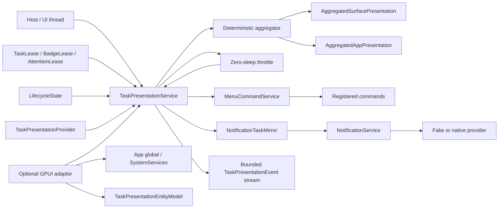

# Taskbar, Dock and notification task-presentation adapters

This document specifies `crates/gpui-task-presentation` for
[#53](https://github.com/jihuayu/gpui-box/issues/53). The crate builds on the
typed system contracts from [#19](https://github.com/jihuayu/gpui-box/issues/19)
(`gpui-system`), host lifecycle snapshots from
[#21](https://github.com/jihuayu/gpui-box/issues/21) (`gpui-lifecycle`), typed
command domains from [#49](https://github.com/jihuayu/gpui-box/issues/49)
(`gpui-menus`) and immediate notifications from
[#26](https://github.com/jihuayu/gpui-box/issues/26) (`gpui-notifications`).

The default build has no GPUI dependency and installs no native provider. It
never claims that a taskbar, Dock, launcher or notification center rendered an
indicator. A presentation that was submitted to a shell or daemon is reported as
`AcceptedByHost`, not as visual confirmation.

## Scope and ownership

`gpui-task-presentation` owns:

- Five presentation operations: task progress, application badge, user
  attention, ongoing notification mirroring and task action dispatch.
- Validated `TaskKey` / `TaskPresentationId`, task action identities and
  `TaskProgressState` values with integer per-mille math only.
- Concurrent task aggregation across priorities, state severity, scopes and
  registration order.
- UI-local task, badge and attention leases with idempotent release and `Drop`.
- Explicit badge and attention clearing ownership.
- Deterministic throttling with injectable `Instant` timestamps and immediate
  discrete-state bypass.
- Surface attachment, focus, recreation and generation disposal.
- Presentation receipts that are structurally separate from business results.
- Command links to `gpui-menus` and an optional `gpui-notifications` mirror.
- A bounded event stream and an optional GPUI adapter.

It does **not** own:

- Native Windows `ITaskbarList3` COM calls, macOS `NSDockTile` rendering, Linux
  D-Bus launchers, Android notification channels, iOS `UNUserNotificationCenter`
  bridges or browser JavaScript hosts.
- The `gpui-notifications` provider itself, notification permission prompts or
  durable activation routing. The mirror consumes those existing contracts.
- Command registration, context evaluation or command execution. Task action
  buttons invoke an already-registered `gpui-menus` command through
  `MenuCommandService`.
- Rendering and scene composition, remote telemetry, or proof that a user saw an
  indicator.

`gpui-box` exposes the crate through two opt-in features:

```toml
gpui-box = { features = ["task-presentation"] }
gpui-box = { features = ["task-presentation-gpui"] }
```

`task-presentation` enables the system, lifecycle, menus and notifications
facades. `task-presentation-gpui` additionally compiles the optional GPUI adapter
and the coordinated system/lifecycle/menus/notifications GPUI integrations.
Neither feature selects a desktop or Android backend. `mise.toml` includes
`-p gpui-task-presentation` in the test, lint and check tasks.

## Architecture



`TaskPresentationService` is a clonable `Rc`-backed, UI-local handle. It is
deliberately not `Send`: native taskbar, Dock and notification providers are UI
objects. Clones share task state, surface records, leases and subscribers;
`shares_state_with` compares the inner allocation without exposing it.

The provider boundary is explicit:

```rust
pub trait TaskPresentationProvider {
    fn capability(
        &self,
        operation: TaskPresentationOperation,
        surface: SurfaceId,
    ) -> Capability<TaskPresentationOperation>;

    fn apply_surface_progress(
        &self,
        surface: SurfaceId,
        generation: u64,
        progress: Option<&TaskProgressState>,
    ) -> Result<AcknowledgmentPrecision, SystemError>;

    fn apply_app_badge(&self, badge: &BadgeValue)
        -> Result<AcknowledgmentPrecision, SystemError>;
    fn apply_surface_badge(
        &self,
        surface: SurfaceId,
        generation: u64,
        badge: &BadgeValue,
    ) -> Result<AcknowledgmentPrecision, SystemError>;
    fn request_attention(
        &self,
        request: &AttentionRequest,
    ) -> Result<AcknowledgmentPrecision, SystemError>;
    fn apply_actions(
        &self,
        surface: SurfaceId,
        generation: u64,
        actions: &[TaskActionButton],
    ) -> Result<AcknowledgmentPrecision, SystemError>;

    fn as_any(&self) -> &dyn Any;
}
```

`UnsupportedTaskPresentationProvider` reports every operation as
`Support::Unsupported` / `Availability::Unavailable` and every apply or clear as
an `ErrorCode::Unsupported` error, which the service converts to
`SkippedUnavailable`. `FakeTaskPresentationProvider` is the deterministic test
double. It records every applied/cleared state and call count, and supports
per-operation/per-surface precision and availability overrides, permission
denial, badge downgrade and simulated surface loss.

## Identity and validated models

`TaskKey` is the stable task identity. `TaskPresentationId` is an alias with the
same validation. The accepted shape is ASCII alphanumeric plus `.`, `_`, `-` and
`:`, with `1..=128` bytes. Construction and serde deserialization both validate
the value.

`TaskActionId` accepts the same character set with `1..=64` bytes. Task action
labels are trimmed, control-free and at most 64 bytes.

### Progress states

`TaskProgressState` has six variants:

| Variant | Meaning |
| --- | --- |
| `Determinate { completed_units, total_units, per_mille }` | Integer units and a per-mille value in `0..=1000`. |
| `Indeterminate` | Work is active without a known completion ratio. |
| `Paused { per_mille }` | Paused, optionally retaining validated progress. |
| `Error { per_mille, message }` | Failed, optionally retaining progress and a bounded public-safe message. |
| `Completed` | Terminal success presentation. |
| `Cancelled` | Terminal cancellation presentation. |

`TaskProgressState::determinate(completed_units, total_units)` rejects
`completed_units > total_units` with `ErrorCode::InvalidInput` and computes:

```text
per_mille = (completed_units as u128 * 1000 / total_units as u128) as u16
```

No floating-point arithmetic is used. `u64::MAX / u64::MAX` is exactly 1000 and
`(u64::MAX - 1) / u64::MAX` is 999 without overflow.
`TaskProgressState::determinate_clamped` is the explicit opt-in for callers that
prefer clamping over rejection.

Deserialization revalidates every invariant, including `total_units != 0`,
`completed_units <= total_units`, a consistent per-mille value and
`per_mille <= 1000`. `Paused` and `Error` also reject out-of-range per-mille
values. Error messages are trimmed, non-empty, control-free and at most 256
bytes. `Debug` renders an error message as `[redacted]`; it is never copied into
diagnostics.

### Badge values

`BadgeValue` is one of `Clear`, `Count(u32)`, `Dot` or `ShortStatus(String)`.
`ShortStatus` is a trimmed, non-control UTF-8 glyph/tag with
`chars().count() in 1..=8`; construction and serde enforce the same rule.
`BadgeValue::downgraded_to_dot` maps `Count(n > 0)` and `ShortStatus` to `Dot`,
and `Count(0)` to `Clear` for boolean/dot-only surfaces. The provider reports the
narrower rendering as `AcknowledgmentPrecision::DowngradedApplied { note }`.

### Attention

`AttentionRequest { urgency, surface, generation }` is bound to one live surface
generation. `AttentionUrgency` distinguishes `Informational` from `Critical`.
Clearing ownership is explicit; a lease is not a permanent authorization.

## Clearing ownership and RAII leases

| Owner | Clear policy | Cleared by |
| --- | --- | --- |
| `BadgeClearPolicy::ClearOnSurfaceFocus` | Focus-owned | `notify_surface_focused`, `sync_lifecycle` focus, or explicit lease release |
| `BadgeClearPolicy::ClearOnAllTasksTerminal` | Task-lifetime-owned | last task in scope reaching `Completed`/`Cancelled` or dropping, or explicit lease release |
| `BadgeClearPolicy::ExplicitCallerOnly` | Caller-owned | explicit `clear_badge` or lease release |
| `BadgeClearPolicy::LeaseScoped` | Lease-owned | lease `release`/`release_at` or `Drop` |
| `AttentionClearPolicy::ClearOnSurfaceFocus` | Focus-owned | `notify_surface_focused` or explicit lease release |
| `AttentionClearPolicy::LeaseScoped` | Lease-owned | lease `release`/`release_at` or `Drop` |

Focus clears matching `ClearOnSurfaceFocus` attention requests and badges while
preserving `ExplicitCallerOnly`, `LeaseScoped` and
`ClearOnAllTasksTerminal` badges. `ClearOnAllTasksTerminal` is evaluated after a
task completes, cancels or drops, and only clears when no live task remains in
the badge scope.

`TaskLease`, `BadgeLease` and `AttentionLease` release idempotently. Dropping a
task lease removes that task's progress, aggregated actions, notification mirror
contribution and stale-click authority immediately, even when a throttle
interval has not elapsed. Dropping a badge or attention lease only auto-clears a
`LeaseScoped` lease; for `ExplicitCallerOnly`, `ClearOnSurfaceFocus` and
`ClearOnAllTasksTerminal`, `Drop` detaches without clearing. Explicit
`release()` / `release_at(now)` calls and `clear_badge` / `clear_attention` clear
any policy. Dropping a surface model disposes its surface generation. Native
failures in a destructor are ignored; they never abort a business result or
panic.

## Concurrent aggregation

`TaskPriority` is `Background < Normal < High < Critical`. `TaskScope` is either
`Application` or `Surface { surface, generation }`.

Every attached surface is aggregated from:

- All active application-scoped tasks.
- Active surface-scoped tasks whose `(surface, generation)` exactly matches the
  live attachment.

Application-wide aggregation considers every active task. The deterministic lead
selection is:

1. Highest `TaskPriority`.
2. Highest state severity: `Error > Paused > Determinate > Indeterminate`.
3. Earliest monotonic registration `sequence` for exact ties.

Terminal states never participate. When the lead completes, cancels or drops,
the next task becomes the lead. When the last active task leaves, the aggregate
progress becomes `None`, which clears the provider indicator.

`AggregateMode::HighestPriorityLead` reports the winning task's state.
`AggregateMode::WeightedDeterminateSum` sums every determinate task's completed
and total units with `u128` arithmetic when the winning state is determinate:

```text
per_mille = min(1000, sum_completed * 1000 / sum_total)
```

`Error` and `Paused` still override determinate progress immediately, regardless
of the aggregation mode. Action buttons are ordered by lead priority then
registration sequence, and duplicate action identities are deduplicated
deterministically.

## Zero-sleep throttling

`ThrottleConfig` has two intervals:

```rust
pub struct ThrottleConfig {
    pub progress_min_interval: Duration,
    pub notification_min_interval: Duration,
}
```

Every throttling API accepts an explicit `Instant`:

- `register_task_at`
- `update_task_at`
- `complete_task_at`
- `cancel_task_at`
- `complete_task_with_business_result_at`
- `flush_coalesced_at`
- `attach_surface_at`
- `recreate_surface_at`
- `dispose_surface_at`
- `notify_surface_focused_at`
- `sync_lifecycle_at`

Ergonomic wrappers (`register_task`, `update_task`, `complete_task`,
`complete_task_with_business_result`, `flush_coalesced`, ...) use
`Instant::now()`. Tests never sleep; they pass synthetic instants and assert
provider call counts.

Continuous `Determinate -> Determinate` ticks whose lead has not changed are
coalesced in memory and produce
`AcknowledgmentPrecision::CoalescedInMemory` plus
`PresentationDeliveryStatus::CoalescedPending` semantics on
`TaskPresentationOutcome::coalesced`. No provider or `NotificationService` call
is made. `flush_coalesced_at(later)` delivers the pending indicator only after
the configured interval has elapsed. Progress and notification intervals are
independent.

Discrete transitions always bypass throttling:

| Transition | Delivery |
| --- | --- |
| `None -> Active` | Immediate |
| `Determinate <-> Indeterminate` | Immediate |
| `-> Paused`, `-> Error` | Immediate |
| `Paused -> Determinate`, `Error -> Determinate` | Immediate |
| Priority takeover changing the lead/state | Immediate |
| Surface attach, recreation or disposal | Immediate |
| Focus clearing | Immediate |
| `-> Completed`, `-> Cancelled`, task lease drop | Immediate |
| Badge or attention change | Immediate |

Terminal cleanup is never delayed by a pending progress tick.

## Business completion versus presentation receipts

Business success and presentation evidence are different facts:

```rust
pub enum BusinessTaskCompletion<T> {
    Succeeded(T),
    Failed(String),
    Cancelled(CancelReason),
}

pub struct TaskCompletionRecord<T> {
    pub business: BusinessTaskCompletion<T>,
    pub presentation: TaskPresentationOutcome,
}
```

`complete_task_with_business_result` and its `_at` form return
`TaskCompletionRecord<T>`; `TaskLease` has matching methods. Unavailable,
permission-denied, downgraded or failing surfaces are recorded in
`presentation` and never rewrite `business`.

`SurfacePresentationReceipt` carries the surface, generation, presentation kind,
operation, precision and an optional `provider_error`. A provider
`SystemError` is captured in the receipt while other surfaces continue.

`AcknowledgmentPrecision` values:

| Precision | Meaning |
| --- | --- |
| `AppliedConfirmed` | The host confirmed the indicator update. |
| `AcceptedByHost` | Submitted to an OS shell/daemon without a visual-render guarantee. |
| `CoalescedInMemory` | Throttled; the next flush will deliver it. |
| `DowngradedApplied { note }` | Rendered with narrower precision than requested. |
| `SkippedUnavailable` | Surface unsupported or absent. Business work continues. |
| `SkippedPermissionDenied` | Permission denied. Business work continues. |
| `Failed { code }` | The provider failed while applying this surface. |

Notifications are not display evidence. A `PostReceipt` is translated to
`AppliedConfirmed` only for a posted-to-center receipt, `AcceptedByHost` for an
accepted-by-provider receipt, and downgraded/omitted actions or progress become
`DowngradedApplied`.

## Surface lifecycle and generation disposal

```text
attach_surface(surface, generation, focused)
recreate_surface(surface, new_generation)   // requires new_generation > old
dispose_surface(surface, generation)
```

`recreate_surface` removes every task, badge and attention request scoped to the
old `(surface, generation)`, withdraws or summarizes their notification mirrors,
clears the old provider generation, advances the live handle and immediately
replays the current application-scoped aggregate onto the new generation.
Stale or non-increasing generations are rejected with `ErrorCode::InvalidInput`.
`dispose_surface` performs the same cleanup for one generation and removes the
surface record. Application-scoped tasks are not removed by either operation.

`sync_lifecycle` consumes `gpui_lifecycle::LifecycleState`: unknown surfaces are
attached, newer generations are recreated, and focused surfaces clear
focus-owned badges and attention. Older lifecycle snapshots are ignored.

## Command links with gpui-menus

A `TaskActionButton` declares:

- `action_id`: validated `TaskActionId`.
- `label`: bounded user-visible text.
- `command_id`: a `gpui_menus::CommandId`.
- `payload`: `gpui_menus::CommandPayload`.
- `enabled_in_states`: declared `TaskStateKind`s; empty means every state.

`dispatch_task_action` / `invoke_task_action` validate, in order:

1. The task exists and is not terminal or dropped.
2. The click's surface and generation match the task scope and live attachment.
3. The action is declared on the task.
4. The action is enabled in the task's current state.
5. A `MenuCommandService` is installed and the linked command is registered.

Only then is `MenuCommandService::invoke_command` called with
`TriggerSource::Button` and the scoped surface. Rejections are typed
`TaskActionRejection` values with `ActionRejectionReason`:
`UnknownTask`, `TaskTerminal`, `UnknownAction`, `ActionDisabled`,
`SurfaceMismatch`, `GenerationMismatch`, `NoCommandService` and
`CommandNotRegistered`. A rejected click never invokes a handler.

## Notification mirror with gpui-notifications

`NotificationTaskMirror` bridges one task to one stable `NotificationId`:

```text
task-<two 64-bit stable hashes of the task identity>
```

Task identities allow `:` while notification identities do not, so the mapping
uses two independent FNV-1a hashes rather than lossy replacement. Action
identities use the same deterministic mapping prefixed with `act-`.

The mirror submits/replaces one ongoing notification with the task title, body,
progress bar and up to eight action buttons that are enabled in the current state. Continuous determinate ticks honour
`notification_min_interval`; discrete transitions and terminal cleanup bypass it.
On completion, cancellation or lease drop the configured
`TerminalNotificationPolicy` applies:

- `Withdraw` (default): withdraw the ongoing notification.
- `ReplaceWithSummary`: replace it with a short terminal summary.

`PostOutcome::Rejected` translation:

| Notification rejection | Receipt precision |
| --- | --- |
| `PermissionDenied` | `SkippedPermissionDenied` |
| `ChannelOrServerDisabled`, `UnavailableProvider`, `Unsupported` | `SkippedUnavailable` |
| `MissingApplicationIdentity` | `Failed { InvalidConfiguration }` |

`NotificationService::record_activated` events are drained by
`pump_notification_activations`, mapped back to the task action and dispatched
through `MenuCommandService`. Activation after task completion or a generation
change is rejected without invoking a command.

## Bounded events

`DEFAULT_TASK_PRESENTATION_EVENT_CAPACITY` is 64. `subscribe` returns an
independent `EventSubscription<TaskPresentationEvent>` built on
`gpui_system::event_channel`. Subscriber-list borrows are released before each
send so a synchronous waker may re-enter the service without a `RefCell` panic.
When the ring overflows, the channel emits `Event::ResyncRequired` before newer
values; consumers must take a fresh aggregate snapshot.

Events cover task registration/progress/termination, aggregated surface and app
changes, badge and attention clears with a `ClearReason`, surface
attach/recreate/dispose, action dispatch/rejection, notification action
rejection and mirror outcomes.

Terminal task tombstones used for stale-click diagnosis are capped at
`MAX_TASK_TOMBSTONES` (256) with deterministic FIFO eviction. Re-registering a
live task identity removes its tombstone.

## GPUI adapter

Enable the `gpui` feature. Installation and lookup must run on the owning GPUI UI
thread:

```rust
use gpui::App;
use gpui_task_presentation::gpui_adapter::{
    TaskPresentationAppExt, TaskPresentationEntityModel, init_task_presentation,
};
use std::rc::Rc;

fn install(cx: &mut App, provider: Rc<dyn gpui_task_presentation::TaskPresentationProvider>) {
    let service = cx.init_task_presentation(provider);
    let owner = gpui_task_presentation::UiOwner::new(gpui_task_presentation::SurfaceId(1));
    let model = TaskPresentationEntityModel::new(owner, service);
    // Retain `model` in the entity. Dropping it disposes the surface generation.
    drop(model);
}
```

The adapter provides:

- `install_task_presentation_service` for the `App` global.
- `init_task_presentation` for the global plus `SystemServices`.
- `task_presentation_service` for global-first lookup.
- `TaskPresentationAppExt` convenience methods.
- `TaskPresentationEntityModel` bound to `UiOwner` and
  `gpui_system::gpui_adapter::EntityScope`, with `subscribe`, `recreate`,
  `notify_focused` and `sync_lifecycle`.

Dropping the entity model disposes the surface generation, clears surface-scoped
leases and invalidates outstanding subscriptions. Application-scoped tasks
registered by the host remain active.

## Six-platform support matrix

`platform_support_matrix()` returns 30 rows: six platforms times five
operations. Every row is `Evidence::ContractOnly` in this crate; native adapters
must publish their own qualification evidence before changing that.

### Cell summary

| Platform | PresentTaskProgress | PresentAppBadge | RequestUserAttention | MirrorProgressNotification | InvokeTaskAction |
| --- | --- | --- | --- | --- | --- |
| Windows | Native | Native | Native | Conditional | Conditional |
| macOS | Native | Native | Native | Conditional | Conditional |
| Linux | Conditional | Conditional | Conditional | Conditional | Conditional |
| Android | Unsupported | Conditional | Conditional | Native | Conditional |
| iOS | Unsupported | Native | Unsupported | Conditional | Conditional |
| Web | Unsupported | Conditional | Unsupported | Conditional | Unsupported |

### Windows

- Progress uses a live `HWND` and `ITaskbarList3` on a message-pumping UI thread.
  COM initialization must already be balanced.
- Badges use the taskbar overlay icon. Overlay icons are boolean/icon-shaped, so
  numeric and short-status badges downgrade to a dot and report
  `DowngradedApplied`.
- Attention uses `FlashWindowEx`; `Critical` is a request, not a promise that the
  taskbar visibly flashes.
- Notification mirroring uses `gpui-notifications` over WinRT toast
  notifications and requires an application identity.
- Task actions use thumbbar buttons or notification action buttons routed back
  to `MenuCommandService`.

### macOS

- Progress and badges use `NSDockTile` on the main run loop. `NSDockTile`
  `badgeLabel` is text-shaped, so a numeric badge is not automatically reduced
  to a dot.
- Attention uses `NSApplication.requestUserAttention` with informational or
  critical requests and clears on focus.
- Notification mirroring and action buttons use
  `UNUserNotificationCenter`; action support depends on the notification style
  and authorization.
- No native provider is installed by this contract crate.

### Linux

- Progress uses `com.canonical.Unity.LauncherEntry` over the session D-Bus where
  the shell exports it. The daemon accepts the handoff without a visual-render
  guarantee; plain Wayland compositors may show nothing.
- Badges prefer `LauncherEntry` count properties and may fall back to a dot.
  Shell coverage is conditional.
- Attention uses the X11 urgency hint where the window manager honors it, or a
  Wayland `xdg-activation-v1` token from a user action. There is no universal
  global attention API.
- Notification mirroring uses `org.freedesktop.Notifications`; progress and hints
  may be omitted by the daemon.
- Actions require daemon action support or a host-provided thumbbar surface.

### Android

- Taskbar/Dock progress is unsupported for ordinary applications. Progress
  belongs to the ongoing notification mirror.
- Badges use `NotificationChannel.setShowBadge` plus a notification count.
  Launcher behavior is conditional and requires `POST_NOTIFICATIONS` on
  Android 13+.
- Attention uses a heads-up or foreground-service notification; exact taskbar
  blinking is not available.
- Progress notifications use a foreground-service or ongoing notification with
  `setProgress` and a stable identity.
- Action buttons route `PendingIntent` broadcasts back to the UI thread and are
  revalidated before execution.

### iOS

- Dock/taskbar progress is unsupported; there is no such surface for apps.
- Badges use `UNUserNotificationCenter` or the application icon badge after
  authorization. Badge authorization is distinct from alert authorization.
- Taskbar attention is unsupported. A local notification is the honest fallback.
- Notification mirroring uses `UNUserNotificationCenter`. Live Activities are
  eligible only for explicitly supported task boundaries and require an
  ActivityKit extension; an ordinary local notification is not a progress bar.
- Notification actions route through `UNUserNotificationCenterDelegate`; Live
  Activity buttons require ActivityKit intents.

### Web

- Taskbar/Dock progress is unsupported.
- Badges use `navigator.setAppBadge` / `clearAppBadge` in a secure context when
  available, with a removable document-title fallback. Installed-PWA and browser
  support is conditional.
- Taskbar attention is unsupported; do not shake the favicon or play audio as a
  substitute.
- Notification mirroring uses the Notification API after
  `Notification.requestPermission`; progress bars are not standardized and may be
  omitted.
- Thumbbar action buttons are unsupported; notification actions where
  implemented require service-worker registration and remain outside this
  contract.

### Qualification links

Each row points at the shared issue references used by the power/menus/
notifications contracts: `#53`, `#19`, `#21`, `#43` where applicable, plus the
platform-specific evidence expected from a future native adapter.

## Failure and recovery rules

- A provider `SystemError` is captured per surface. One failing surface never
  aborts another surface or the business task.
- `Unsupported`, `Unknown` support, non-ready configuration and unavailable
  availability map to `SkippedUnavailable`.
- A denied, restricted or not-determined permission maps to
  `SkippedPermissionDenied`.
- Other provider failures map to `Failed { code }` and retain the original
  `provider_error` when available.
- `ErrorCode::InvalidInput` is used for malformed identities, inconsistent
  progress, invalid badge status, non-increasing generations and disabled
  actions.
- `ErrorCode::ContextExpired` is used for inactive tasks, stale generations and
  disposed surfaces.
- Missing command services or unregistered commands are rejected before any
  handler runs.
- No path in this crate silently converts a failed presentation into business
  success or a business failure into presentation success.

## Deterministic testing

The test suite uses only explicit `Instant` values and provider call histories;
it contains no thread-sleep calls. Coverage includes:

- `tests/model.rs`: identifier/badge/serde validation, zero and `u64::MAX`
  per-mille math, completed-over-total rejection and the 30-cell matrix.
- `tests/aggregation.rs`: priority/severity/sequence ordering, both aggregation
  modes, lead fallback and terminal cleanup to `None`.
- `tests/throttle.rs`: progress and notification coalescing, flush boundaries,
  discrete bypass and terminal cleanup.
- `tests/service.rs`: lease idempotence and `Drop`, all badge/attention clearing
  policies, recreation replay, unavailable/denied/failing receipts, bounded-ring
  `ResyncRequired` and GPUI adapter behavior under `--all-features`.
- `tests/notifications_and_menus.rs`: real `NotificationService` and
  `MenuCommandService` integration, stable replacement, permission denial,
  terminal withdraw/summary, valid action dispatch and stale-click rejection.
- `tests/platform.rs`: all 30 cells, evidence/capability invariants and badge
  downgrade rules.
- `crates/gpui-box/tests/task_presentation.rs`: facade integration alongside
  `gpui_box::menus` and `gpui_box::notifications`.
