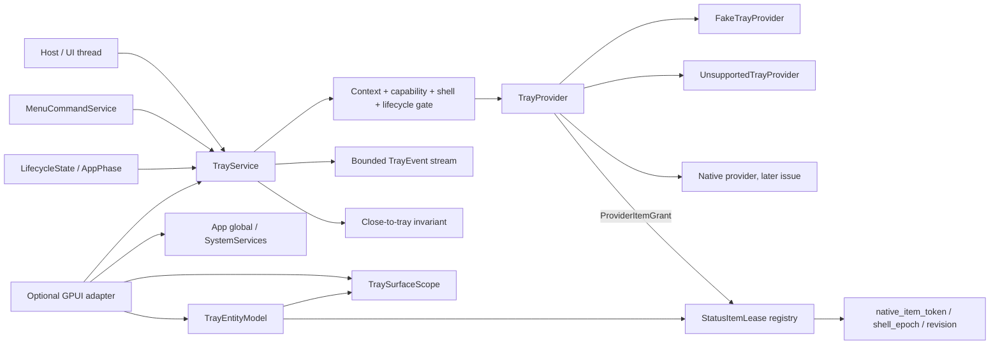

# Tray and menu-bar status items with lifecycle-aware residency

This document specifies `crates/gpui-tray` for
[#50](https://github.com/jihuayu/gpui-box/issues/50). The crate builds on the
typed system contracts from
[#19](https://github.com/jihuayu/gpui-box/issues/19) (`gpui-system`), the host
lifecycle snapshots from
[#21](https://github.com/jihuayu/gpui-box/issues/21) (`gpui-lifecycle`) and the
typed command/menu model from
[#49](https://github.com/jihuayu/gpui-box/issues/49) (`gpui-menus`). It
coordinates close-to-tray residency with the process-lifecycle rules from
[#43](https://github.com/jihuayu/gpui-box/issues/43) without claiming a native
provider that is not installed.

The default build has no GPUI dependency. It installs no native OS provider,
does not synthesize a status item, and never claims runtime qualification. Every
status item must be granted by an explicit [`TrayProvider`] before the service
returns a [`StatusItemLease`].

## Scope and ownership

`gpui-tray` owns:

- Five status-item operations with a six-platform, thirty-cell qualification
  matrix.
- Validated status-item identity, bounded UTF-8 text, effective accessibility
  labels and portable relative icon assets.
- Deterministic icon-variant selection for light/dark appearance, high contrast,
  macOS template-image semantics and five DPI buckets.
- Explicit click-trigger mappings to menu presentation, restore/focus, typed
  `gpui-menus` commands and validated system actions.
- Live `gpui_menus::ContextMenu` projection with enabled/hidden/checked state
  evaluated against the current command context.
- Scoped RAII status-item leases with idempotent removal and no lock held across
  provider or menu callbacks.
- Monotonic native-token, shell-epoch and item-revision correlation with full
  post-provider TOCTOU re-validation and orphan native-item cleanup.
- Close-to-tray residency policy, the "no invisible non-quittable process"
  invariant, mid-residency anti-orphan recovery and explicit-quit override.
- Windows Explorer and Linux `StatusNotifierWatcher` restart recovery with fresh
  native tokens.
- A bounded `EventSubscription<TrayEvent>` stream using
  `gpui_system::event_channel` (`DEFAULT_TRAY_EVENT_CAPACITY = 64`).
- Explicit Android, iOS and Web alternative surfaces, with native tray
  operations always reported as `Support::Unsupported`.
- An optional GPUI adapter with `App` globals, `SystemServices` registration,
  `TraySurfaceScope`, `TrayEntityModel`, and preference/lifecycle synchronization.

It does **not** own:

- Native Windows `Shell_NotifyIconW` hosts, macOS `NSStatusBar` objects, Linux
  D-Bus objects, Android notification bridges, iOS scene bridges or browser
  hosts.
- Command registration, context storage or command execution. Those remain in
  `gpui-menus`; tray clicks route back to the same `MenuCommandService`.
- Window composition, native window restore/focus or the actual process exit.
  The service emits typed outcomes/events; the host performs those actions.
- Notification permissions, Android notification channels, iOS shortcut
  declarations or browser manifest configuration. Missing declarations surface
  as typed errors or `UnsupportedNone`, never as a synthetic success.
- Remote telemetry or user-content logging.

`gpui-box` exposes the crate through two opt-in features:

```toml
gpui-box = { features = ["tray"] }
gpui-box = { features = ["tray-gpui"] }
```

`tray` imports `gpui_box::tray` and enables the system, lifecycle and menus
dependencies. `tray-gpui` additionally compiles the optional GPUI adapter and
the shared system/lifecycle/menus GPUI integrations. Neither feature selects a
desktop or Android backend by itself. `mise.toml` includes `-p gpui-tray` in the
test, lint and check tasks.

## Architecture



`TrayService` is a clonable UI-local handle over `Rc<ServiceInner>`. It can be
registered as a concrete typed service through `SystemServices`, installed as a
`gpui::Global`, or used headlessly. Provider handles remain explicit
`Rc<dyn TrayProvider>` values. Clones share the same state; `shares_state_with`
compares the shared identity.

The service state and provider are deliberately separate. Service state is
protected by a mutex, but that mutex is never held while calling:

- `TrayProvider::capability`, `shell_status`, `create_item`, `update_item`,
  `remove_item`, `present_menu` or `attach_listener`;
- `MenuCommandService` resolution, invocation, activation or surface
  registration;
- `Drop`, `remove()`, callbacks or event delivery.

This is required for correctness, not only latency: a fake provider can call a
listener synchronously from inside `create_item`, a menu handler can re-enter the
tray service, and a surface release can remove the lease that is being updated.
The tests exercise those re-entrant paths.

## Status-item identity and validation

### `StatusItemKey`

A key is a stable application-local identity, never a display string or a path:

- 1 through 64 ASCII bytes;
- only `[a-zA-Z0-9._-]`;
- non-ASCII, whitespace, slash, control and NUL bytes are rejected with
  `ErrorCode::InvalidInput`.

Keys are validated on construction and on deserialization. Two active or
in-flight leases cannot share a key. The service reserves a key before calling
the provider and returns `ErrorCode::Busy` for a duplicate or racing create.
Failed creates always release the reservation.

### Text fields and accessibility

`StatusItemSpec` carries optional `title`, optional `tooltip` and optional
`accessibility_label`.

- `title` and `tooltip` are optional. A blank/whitespace-only value is treated as
  absent. A present value is trimmed, must be at most 256 UTF-8 bytes and must
  not contain control or NUL characters.
- An explicit `accessibility_label` must be non-blank after trimming, at most
  256 UTF-8 bytes and free of control or NUL characters. A blank explicit label
  is an error, not a request to fall back.
- If the label is omitted, the effective label is a non-blank tooltip, then a
  non-blank title, in that order.
- If label, tooltip and title are all absent or blank, creation is rejected as
  `ErrorCode::InvalidInput`. An unlabeled status item would be unusable with
  assistive technology and is never handed to a provider.

`StatusItemSpec::validate()` returns a `ValidatedStatusItemSpec`. Provider
requests contain only validated text and icons.

### Icon payloads

`IconPayload` has two forms:

- `AssetKey(String)` is a portable relative identifier. It must be 1 through 256
  bytes, must not contain control/NUL characters, must not start with `/` or
  `\`, must not contain backslashes or colons, must not have empty path
  segments, and must not contain `.` or `..` segments. Drive prefixes such as
  `C:` are therefore rejected.
- `Rgba { width, height, bytes }` requires both dimensions in `1..=256` and a
  checked `width * height * 4 == bytes.len()`. A mismatch, zero dimension or
  multiplication overflow is `ErrorCode::InvalidInput`.

`StatusIconSet` requires at least one variant. Empty sets are rejected at
construction; `select_best` can therefore never fail at runtime.

### Theme, contrast, template and DPI selection

Each `StatusIconVariant` declares:

- `payload`;
- `ColorSchemeMatch::{Any, Light, Dark}`;
- `HighContrastMatch::{Any, StandardOnly, HighContrastOnly}`;
- `ScaleBucket::{X1, X1_25, X1_5, X2, X3}` representing 1000, 1250, 1500, 2000
  and 3000 milli-scale factors;
- `is_template`, preserved for macOS monochrome template-image semantics.

`StatusIconSet::select_best(&SystemPreferences, scale_factor_milli)` uses a
total, stable ranking:

1. The requested high-contrast class (`HighContrastOnly` when the host reports
   high contrast on, `StandardOnly` when it reports off), then `Any`, then the
   other class. An unavailable preference is ranked as `Any`.
2. The requested light/dark appearance, then `Any`, then the other scheme. An
   unavailable appearance is ranked as `Any`.
3. The smallest bucket at or above the requested milli-scale. If every bucket is
   below the request, the largest available bucket is used. Icons therefore
   downscale cleanly instead of being upscaled blurrily.
4. Declaration order for a complete tie.

A scale of `0` is invalid host input; it is deterministically treated as `1`
and never panics or selects nondeterministically. `is_template` does not change
ranking but is carried into the provider projection.

When preferences or the scale factor change, the service re-selects the best
variant for every hosted item and calls `TrayProvider::update_item` outside the
state lock. A stale or removed item is not resurrected.

## Actions and `gpui-menus` integration

`TrayClickTrigger::{PrimaryClick, SecondaryClick, DoubleClick, MiddleClick}` maps
through a `BTreeMap` to `TrayClickAction`:

- `OpenMenu` resolves and presents the attached menu.
- `RestoreOrFocusApp` asks the host to restore/focus the primary surface and
  clears `residing_in_tray`.
- `InvokeCommand { command_id, payload }` invokes the same typed command through
  `MenuCommandService::invoke_command`.
- `DispatchSystemAction { action_id }` validates the action identifier with
  `SystemActionTarget::action_id` and calls
  `MenuCommandService::dispatch_system_action`.

The crate does not keep a second command registry. A `StatusItemSpec` may attach
a `gpui_menus::ContextMenu`. Resolution is live:

- `TrayContextMenuResolver::resolve_context_menu` is implemented for
  `MenuCommandService` and projects the context-menu nodes through
  `MenuCommandService::resolve_menu_bar`, preserving the exact command
  descriptors, reactive `ContextExpr` evaluation, permissions, capabilities and
  lazy materialization rules.
- `resolve_status_menu` is a non-mutating query.
- `present_status_menu` requires a current `UiContext`, checks the
  `PresentStatusMenu` capability, resolves the menu, and only then calls
  `TrayProvider::present_menu`.
- Menu-item clicks re-resolve the menu at click time, find the item, require
  `visible && enabled`, and call
  `MenuCommandService::activate_context_menu_item`. A command disabled or hidden
  after presentation is rejected without invoking its handler.
- Check state is never cached in the tray. It comes from the live resolved
  `ResolvedMenuItem` each time.

All command dispatch happens on the UI owner thread. An explicit caller
`UiContext` is always validated: it must be current, and for surface-scoped
items it must match the live surface generation. A foreign-thread or disposed
context returns `ErrorCode::ContextExpired` before a command handler runs, even
for application-scoped items.

Application-scoped items may outlive the window that created them. When no
explicit UI context is supplied, the service uses the item's creating
`UiContext` while it is still current and its surface has not been disposed or
superseded. Otherwise it falls back to the service-owned UI-thread
`app_owner` context. This keeps close-to-tray menus, `ExecutionDomain::Ui`
commands, system actions and residency reachability working after the creating
window is closed, while still rejecting foreign-thread execution. Surface
registration in the menu service is checked/created for the effective context;
a newer or disposed generation is rejected.

`TrayResidencyPolicy` records the command and system-action identities the
application considers restorable or quittable:

```rust
let mut policy = TrayResidencyPolicy::new()
    .with_window_close_policy(WindowClosePolicy::MinimizeToTrayWhenAvailable)
    .with_quit_command(CommandId::new("app.quit")?);
policy.register_restore_command(CommandId::new("window.restore")?);
policy.register_quit_system_action("app.system.quit")?;
```

Registration helpers validate system-action identifiers. The default policy has
empty sets; applications must opt in to the identity of their exit/restore
actions. A role label alone never proves reachability.

## Scoped RAII leases and TOCTOU hardening

### Lease scopes

`TrayLeaseScope` is either:

- `Application`: lives for the process and is always eligible for residency
  reachability; or
- `Surface { surface, generation }`: requires a registered, non-disposed surface
  with the exact generation.

A surface generation change removes every lease bound to the old generation.
`dispose_surface` removes surface leases even if the host forgot to advance the
generation. `dispose_surface_generation(surface, generation)` is the
generation-checked form: it marks the record disposed and removes only leases
bound to that exact generation. A stale `TraySurfaceScope` therefore cannot tear
down a newer generation recreated on the same `SurfaceId`; it also does not
dispose a `UiOwner` that has advanced to a newer generation. `TraySurfaceScope`
wraps this in an RAII GPUI helper.

### `StatusItemLease`

`StatusItemLease` owns an `Rc<ItemInner>` and a service handle. It exposes
`id`, `key`, `scope`, `native_item_token`, `shell_epoch`, `revision`, `is_active`,
`snapshot`, `update` and `remove`.

Removal is idempotent:

- the first `remove()` returns true and removes the native item at most once;
- later `remove()` calls and `Drop` are clean no-ops;
- a lease already removed by surface disposal, shell restart, explicit quit or
  another error path is a no-op.

No lease lock is held while calling the provider. A provider that re-enters the
service sees a consistent, lock-free call boundary.

### Correlation tokens

Every item tracks three monotonic values:

- `native_item_token`: the provider-owned native handle identity;
- `shell_epoch`: the shell host generation that owns that token;
- `item_revision`: the validated specification revision.

A callback is accepted only when all three match the live lease, the application
is not quitting, and the lease's surface still exists with its generation. A
click or menu callback carrying an unknown id, removed lease, old token, old
epoch, disposed surface or foreign UI context is recorded as
`TrayEvent::CallbackIgnored { reason, .. }` and has no native or command side
effect. `stale_callback_count` and `last_stale_callback` expose bounded
diagnostics.

### Creation pipeline

`create_status_item` runs:

1. Check operation lifetime and cancellation.
2. Validate the specification.
3. Check the `CreateStatusItem` capability and the mobile/Web native ban.
4. Require `ShellTrayStatus::Available { shell_epoch }`.
5. Under the state mutex: reject quitting/terminating state, reject duplicate or
   reserved keys, validate the surface generation and UI context, reserve the
   key, allocate an item identity, capture preferences/scale, and select the
   icon variant.
6. Release the lock and call `TrayProvider::create_item`.
7. If the provider refuses or returns a zero token, release the reservation and
   return the typed error.
8. Re-check cancellation, capability, live shell status, quitting state, surface
   generation, and reservation ownership under the lock.
9. If any check fails, release the lock, call `TrayProvider::remove_item` for the
   just-created token, and return cancellation/error without registering a live
   lease.
10. Otherwise register the lease and emit `StatusItemCreated`.

This is the same acceptance discipline used for wake leases in
`gpui-power`: a native grant is not proof that the world stayed valid during the
provider call, and an invalidated grant is cleaned up rather than leaked.

### Update pipeline

`update_status_item` re-validates the item, key immutability, live shell epoch,
surface generation/revision and capabilities before and after
`TrayProvider::update_item`. If the lease was removed or its surface expired
during the call, the native token is cleaned up and no update is published. If
the revision changed concurrently, the operation returns `ErrorCode::Busy`
without destroying the newer state. Updates on removed leases, disposed
surfaces, quitting applications or superseded shell epochs never resurrect a
native item.

### Resilience against callbacks and re-entrancy

The service never holds its state mutex while:

- granting/removing native items;
- resolving or activating menus;
- invoking commands/system actions;
- delivering events to subscribers.

`FakeTrayProvider` deliberately invokes a mid-create hook between token
allocation and grant. The test suite covers cancellation, shell loss, shell
restart, surface disposal and explicit quit happening inside that window; every
case removes the newly allocated token and leaves `active_item_count == 0`.

## Close, background and quit residency

### Policy

`TrayResidencyPolicy` contains:

- `window_close_policy`:
  - `CloseNormally`: closing the last visible surface allows the process to
    quit.
  - `MinimizeToTrayWhenAvailable`: hide the last visible surface only when the
    no-orphan invariant below is proven.
- `shell_absence_fallback`:
  - `RestorePrimarySurface`: refuse to hide and require a restore.
  - `QuitCleanly`: refuse to hide and perform a clean quit.
- `quit_command_ids`, `restore_command_ids`, `quit_system_actions`,
  `restore_system_actions`.
- `alternative_surface`: an explicit mobile/desktop fallback.

### Close outcomes

`CloseInterceptionOutcome` is one of:

- `AllowWindowCloseAndQuit`;
- `AllowWindowCloseKeepRunning`;
- `HideWindowToTray { item_id }`;
- `PreventHideFallbackRestore { reason }`;
- `PreventHideFallbackQuit { reason }`.

`TrayEvent::CloseIntercepted` records every evaluated outcome.

The matrix is:

| Condition | Outcome |
| --- | --- |
| Application is quitting / `AppPhase::Terminating` | `AllowWindowCloseAndQuit` |
| More than one visible surface | `AllowWindowCloseKeepRunning` (unless quitting) |
| `CloseNormally`, last visible surface | `AllowWindowCloseAndQuit` |
| `MinimizeToTrayWhenAvailable`, invariant proven | `HideWindowToTray` |
| `MinimizeToTrayWhenAvailable`, shell absent | `PreventHideFallback*` with `ShellAbsent` |
| capability missing/unavailable | `PreventHideFallback*` with `CapabilityUnavailable` |
| no hosted item | `PreventHideFallback*` with `NoHostedStatusItem` |
| only surface-scoped items on the closing surface | `PreventHideFallback*` with `NoEligibleStatusItem` |
| hosted items but no enabled reachable path | `PreventHideFallback*` with `NoReachableRestoreOrQuit` |

The fallback variant (`Restore` versus `Quit`) follows
`policy.shell_absence_fallback`.

### The "no invisible non-quittable process" invariant

Hiding the last visible surface is permitted **only** when all of the following
hold:

1. The application is not quitting and is not in `AppPhase::Terminating`.
2. `CreateStatusItem` and `ManageCloseToTrayResidency` capabilities are supported
   and currently available, and the shell reports
   `ShellTrayStatus::Available { shell_epoch }`.
3. At least one active, visible, shell-hosted `StatusItemLease` is eligible:
   - application-scoped, or surface-scoped to a different still-visible,
     non-disposed surface with the matching generation;
   - **not** surface-scoped to the surface being closed/disposed;
4. That lease exposes a currently enabled, user-reachable path:
   - a click trigger mapped to `RestoreOrFocusApp`;
   - a click trigger mapped to an enable-able registered command/system action
     recognized by `TrayResidencyPolicy`;
   - or an attached `ContextMenu` that resolves live (requiring
     `PresentStatusMenu`) to a visible and enabled restore/quit item, or a
     `SystemMenuRole::Quit` node.

If any check fails, the service never hides the window into an unreachable
background state. It returns `PreventHideFallbackRestore` or
`PreventHideFallbackQuit` according to policy.

### Mid-residency recovery

Once `residing_in_tray == true` with zero visible surfaces, any of these events
immediately exits residency and emits
`TrayEvent::ResidencyBroken { reason, recovery }` when zero reachable paths
remain:

- `TrayProviderNotice::ShellLost` / `ShellTrayStatus::Absent`;
- dropping/removing the last reachable `StatusItemLease`;
- disposing the surface that owned the last reachable lease;
- updating an item so its click/menu path disappears;
- changing command context/capabilities so a menu item becomes hidden or
  disabled (call `refresh_residency` after external context mutations);
- a failed shell-restart recovery.

`recovery` is `ResidencyRecoveryAction::RestorePrimarySurface` or
`RequestCleanQuit`, chosen from `shell_absence_fallback`. The service also emits
`ResidencyChanged { residing_in_tray: false }`.

When a surface becomes visible again (`RestoreOrFocusApp`, `notify_surface_visible`
or a lifecycle snapshot), residency is cleared deterministically without waiting
for another event.

### Explicit quit always wins

`request_quit()` and any transition to `AppPhase::Terminating`:

- mark quitting immediately;
- clear `residing_in_tray`;
- remove every active status-item lease from the provider at most once each;
- emit `StatusItemRemoved`, `QuitStarted` and a residency-cleared event;
- make every subsequent close evaluation return
  `AllowWindowCloseAndQuit`.

A lease removed by quit becomes inert; later `remove()`/`Drop` calls are no-ops.

## Shell absence and restart recovery

### Explorer / `StatusNotifierWatcher` restart

On Windows, the shell broadcasts the registered `TaskbarCreated` message when
Explorer restarts. On Linux, the owner of
`org.kde.StatusNotifierWatcher` can disappear and a new owner can appear.
Providers translate either into:

```text
TrayProviderNotice::ShellRestarted { shell_epoch }
```

`shell_epoch` must be strictly newer than the service's last observed epoch.
Older or equal notices are ignored.

Recovery then:

1. Advances the active epoch and marks every existing item as not hosted.
2. Snapshots all non-removed leases in deterministic `StatusItemId` order.
   Surface items are included whenever their surface is still attached
   (`!disposed` and exact generation); temporary hidden state is not a reason to
   skip recovery.
3. Re-selects the best icon for current `SystemPreferences` and
   `scale_factor_milli`.
4. Re-creates each item through `TrayProvider::create_item`, assigning a fresh
   `native_item_token` under the new epoch. This includes items on hidden,
   non-disposed surfaces.
5. Re-validates after every create: lease still present, revision unchanged,
   surface still attached at the same generation (visibility not required),
   epoch still current, application not quitting.
6. Cleans up a new token if any check failed.
7. Emits `TrayEvent::ShellRestartRecovered { shell_epoch, restored_count }`.

A restart that arrives during recovery is recorded as a pending newer epoch; the
outer recovery loop processes it and discards tokens from the superseded epoch.
If the app is resident and recovery leaves zero reachable items, the service
emits `ResidencyBroken` with `ShellRestartRecoveryFailed`.

### Shell loss without restart

`TrayProviderNotice::ShellLost` marks the shell absent and every item as not
hosted. It does not fabricate a replacement. If the app is not resident, leases
remain available for a later restart. If it is resident, residency is broken
immediately so the host can restore a surface or quit.

## Mobile and browser alternative surfaces

Native tray operations are always `Support::Unsupported` on Android, iOS and the
Web. The service additionally rejects native creation on those targets even if a
misconfigured provider advertises a native capability. There is no fake native
status item on mobile or in a browser.

`MobileAlternativeSurface` is:

- `None`;
- `OngoingNotification { channel_key, notification_key }`;
- `InAppStatusStrip`;
- `QuickSettingsOrShortcut { shortcut_id }`.

Identifiers are non-empty, at most 128 bytes, and contain no control/NUL
characters.

`EffectiveStatusSurface` is:

- `NativeTray`;
- `MobileAlternative(surface)`;
- `UnsupportedNone`.

`TrayService::resolve_surface_strategy()` behaves deterministically:

| Platform / state | Result |
| --- | --- |
| Desktop, `CreateStatusItem` supported and shell available | `NativeTray` |
| Desktop, shell absent or capability unavailable, alternative configured | `MobileAlternative` |
| Desktop, no usable native surface or alternative | `UnsupportedNone` |
| Android, applicable alternative configured | `MobileAlternative` |
| Android, `None` or inapplicable alternative | `UnsupportedNone` |
| iOS, `InAppStatusStrip` / `QuickSettingsOrShortcut` | `MobileAlternative` |
| iOS, `OngoingNotification` | `UnsupportedNone` (no ongoing OS notification) |
| Web, `InAppStatusStrip` | `MobileAlternative` |
| Web, `OngoingNotification` / OS shortcut | `UnsupportedNone` |
| Web, `None` | `UnsupportedNone` |

The Web restriction is deliberate: a browser document can render an in-app
strip, but cannot own an OS status-bar item, an ongoing notification or an OS
quick-settings entry. Android ongoing notifications require a notification
channel and, on API 33+, `POST_NOTIFICATIONS`; those are host/provider
responsibilities.

## Bounded event stream

`TrayService::subscribe()` returns an `EventSubscription<TrayEvent>` backed by
`gpui_system::event_channel` with capacity 64 by default. Producers never block
on consumers.

`TrayEvent` includes lifecycle, menu, click/stale, residency, restart,
reprojection, quit and failure observations. When the ring overflows, producers
keep the newest event and the next subscription poll yields
`Event::ResyncRequired`; the consumer must take a fresh service snapshot rather
than assuming it saw every intermediate event.

Representative events:

```text
StatusItemCreated / StatusItemUpdated / StatusItemRemoved
MenuPresented / ClickDispatched / ActionFailed / CallbackIgnored
ResidencyChanged / ResidencyBroken / CloseIntercepted
ShellLost / ShellRestartRecovered
IconsReprojected / QuitStarted / OperationFailed
```

`event_revision()` exposes the highest sequence observed by live subscribers.

## Optional GPUI adapter

The `gpui` feature adds:

- `install_tray_service`, `install_tray_in_services`, `init_tray`,
  `init_tray_with_menus`, `tray_service` and `TrayAppExt`;
- `sync_lifecycle` and `sync_preferences` helpers;
- `TraySurfaceScope`: an entity-/surface-owned RAII scope that attaches the
  surface, retains subscriptions, creates surface-scoped leases, and removes
  every surface lease plus the `UiOwner` on drop;
- `TrayEntityModel`: a GPUI entity model created with
  `cx.new(|cx| TrayEntityModel::new(owner, service, cx))`.

`TrayEntityModel` owns a `TraySurfaceScope`, retains active `StatusItemLease`
handles, supports create/update/remove and active-lease snapshots, drains its
retained event subscription into a bounded 64-event history (tracking
`resync_required` on overflow), exposes residency state, and provides
preference/lifecycle synchronization. Its `Drop` removes every owned lease and
then disposes the surface scope. The entity's release callback provides the same
cleanup if the entity is released by GPUI rather than explicitly dropped.

The adapter remains UI-thread-only. No GPUI type, native handle or `Rc` is moved
to a background executor. Background command work stays inside
`gpui-menus`' bounded worker pool.

## Six-platform × five-operation qualification matrix

All rows are `Evidence::ContractOnly`: this crate installs no native provider and
does not claim runtime qualification. Native adapters must publish their own
evidence before changing a row.

| # | Platform | Operation | Support | Native backend contract |
| --- | --- | --- | --- | --- |
| 1 | Windows | `CreateStatusItem` | Native | Register `TaskbarCreated`; `Shell_NotifyIconW(NIM_ADD, NOTIFYICONDATAW)` with stable `uID` |
| 2 | Windows | `UpdateStatusItem` | Native | `Shell_NotifyIconW(NIM_MODIFY)` with current `HICON`, tooltip and accessibility text |
| 3 | Windows | `RemoveStatusItem` | Native | `Shell_NotifyIconW(NIM_DELETE)` once per `uID`; destroy generated `HICON` |
| 4 | Windows | `PresentStatusMenu` | Native | `TrackPopupMenuEx` on the owner window with foreground handling; route `WM_COMMAND` to `gpui-menus` |
| 5 | Windows | `ManageCloseToTrayResidency` | Native | Intercept `WM_CLOSE`; re-check shell, item and reachable exit path before hiding |
| 6 | macOS | `CreateStatusItem` | Native | `NSStatusBar.systemStatusBar statusItemWithLength` on main thread; retain `NSStatusItem` |
| 7 | macOS | `UpdateStatusItem` | Native | Update `button.image` (template-aware), `toolTip`, `accessibilityLabel`, `NSMenu` |
| 8 | macOS | `RemoveStatusItem` | Native | `removeStatusItem`; release retained item/menu once |
| 9 | macOS | `PresentStatusMenu` | Native | `NSStatusItem.menu` or `popUpMenuPositioningItem`; dispatch `NSMenuItem` to `gpui-menus` |
| 10 | macOS | `ManageCloseToTrayResidency` | Native | `windowShouldClose`/host close request; hide only with live reachable status item |
| 11 | Linux | `CreateStatusItem` | Conditional | Export `org.kde.StatusNotifierItem`; register with `org.kde.StatusNotifierWatcher` |
| 12 | Linux | `UpdateStatusItem` | Conditional | Emit `NewIcon`, `NewToolTip`, `NewTitle`, `NewStatus` signals |
| 13 | Linux | `RemoveStatusItem` | Conditional | Unregister object and drop bus name once; absent watcher means already gone |
| 14 | Linux | `PresentStatusMenu` | Conditional | Export `com.canonical.dbusmenu`; map returned item id to `gpui-menus` |
| 15 | Linux | `ManageCloseToTrayResidency` | Conditional | Treat absent watcher/host tray extension (GNOME Wayland) as shell absence |
| 16 | Android | `CreateStatusItem` | Unsupported | No native desktop status item; use `OngoingNotification`, `InAppStatusStrip` or shortcut |
| 17 | Android | `UpdateStatusItem` | Unsupported | Use the explicit alternative surface; never fake a native tray item |
| 18 | Android | `RemoveStatusItem` | Unsupported | Cancel/update the configured alternative through its host |
| 19 | Android | `PresentStatusMenu` | Unsupported | Use in-app menu/action routing, not a native tray menu |
| 20 | Android | `ManageCloseToTrayResidency` | Unsupported | Follow Android lifecycle/notification rules; no native tray residency |
| 21 | iOS | `CreateStatusItem` | Unsupported | No `NSStatusBar` equivalent for third-party apps; use in-app strip/shortcut |
| 22 | iOS | `UpdateStatusItem` | Unsupported | Update the explicit alternative surface |
| 23 | iOS | `RemoveStatusItem` | Unsupported | Remove the alternative surface via its host |
| 24 | iOS | `PresentStatusMenu` | Unsupported | Use in-app menus/actions |
| 25 | iOS | `ManageCloseToTrayResidency` | Unsupported | No ongoing-notification fallback; use in-app strip or shortcut |
| 26 | Web | `CreateStatusItem` | Unsupported | No OS status item from a browser document; use `InAppStatusStrip` |
| 27 | Web | `UpdateStatusItem` | Unsupported | Update the in-app strip; no OS status surface |
| 28 | Web | `RemoveStatusItem` | Unsupported | Remove the in-app strip |
| 29 | Web | `PresentStatusMenu` | Unsupported | Use DOM/in-app menus |
| 30 | Web | `ManageCloseToTrayResidency` | Unsupported | Browser lifecycle rules; no native tray residency |

Cross-platform invariants:

- `CreateStatusItem`, `UpdateStatusItem`, `RemoveStatusItem`,
  `PresentStatusMenu`, and `ManageCloseToTrayResidency` are all
  `Support::Unsupported` on Android, iOS and Web.
- Linux support is `Conditional` because a StatusNotifier host or watcher is not
  guaranteed. An absent watcher is normal, not a provider bug.
- Windows and macOS rows are `Native` for the desktop shell path but remain
  `ContractOnly` until a native adapter publishes qualification evidence.
- `FakeTrayProvider` may be configured for tests, but the service's mobile/Web
  gate still refuses native creation.

### Native provider requirements

A conforming provider:

- reports truthful `Capability<TrayOperation>` snapshots and re-checks conditions
  at execution time;
- returns a nonzero unique `ProviderItemGrant::native_item_token` only after the
  native item exists;
- implements idempotent `remove_item`, returning false for an already-removed or
  shell-lost token;
- never holds its own state lock while notifying a `TrayProviderListener`;
- does not move UI objects across threads;
- maps Explorer `TaskbarCreated` and Linux watcher-owner changes to
  `TrayProviderNotice::ShellRestarted { shell_epoch }` with a strictly newer
  epoch;
- maps shell disappearance to `ShellLost`;
- routes clicks and menu selections back with the exact item id, native token,
  shell epoch and command id, and lets the service reject stale callbacks.

`UnsupportedTrayProvider` is the conservative contract for mobile, Web and
headless hosts. `FakeTrayProvider` is deterministic: it records create, update,
remove and menu calls, exposes hosted items and active tokens, injects failures,
supports a mid-create hook, and can simulate shell loss/restart plus correlated
or deliberately stale clicks.

## Determinism, privacy and portability

- No path, URL, account identifier, credential or native exception payload is
  stored in `SystemError`; messages are static and public-safe.
- Event payloads carry identities, enumerations and validated text only. No raw
  native handles beyond numeric tokens are exposed.
- Status-item keys and asset keys are portable ASCII identifiers; no
  machine-local absolute path is accepted.
- Tests use no `std::thread::sleep`, no `unsafe`, no `dbg!` and no `todo!`.
  Cross-thread tests create a foreign `UiOwner` on a worker and send only its
  context back; the service rejects it without sharing UI-local service state.
- The default build has no GPUI dependency. GPUI tests are gated by the `gpui`
  feature and desktop test-support.

## Verification

From the workspace root:

```text
cargo fmt --all -- --check
cargo test --locked -p gpui-tray
cargo test --locked -p gpui-tray --all-features
cargo test --locked -p gpui-box --features tray
cargo test --locked -p gpui-box --all-features
cargo clippy --locked -p gpui-tray --all-targets -- -D warnings
cargo clippy --locked -p gpui-tray --all-features --all-targets -- -D warnings
cargo clippy --locked -p gpui-box --all-features --all-targets -- -D warnings
```

`mise run check` also runs the full workspace test/lint lists plus
`mise tasks validate`, `git diff --check` and `git diff --cached --check`.

### Test coverage

The crate test suite covers:

- `model`: key rules, label fallback and control/NUL rejection, UTF-8 bounds,
  asset-key traversal/drive rejection, RGBA dimension/byte checks, all five
  `ScaleBucket`s, light/dark/high-contrast/template selection, mobile identifier
  validation and policy recognition helpers.
- `platform`: all 30 matrix cells, mobile/Web unsupported enforcement, provider
  manifests, desktop native/fallback resolution, mobile alternative applicability.
- `menus`: attached-menu live resolution, disabled/hidden gating, checkmarks,
  command clicks, system actions, application-scoped fallback after the creating
  surface is disposed, explicit foreign/disposed context rejection and
  foreign-thread rejection.
- `service`: create/update/remove lifecycle, duplicate keys, RAII idempotency,
  surface generations/disposal, generation-checked stale-scope drop, all five
  mid-create TOCTOU races, stale token/epoch/removed/unknown/quit callbacks,
  preference/DPI reprojection, bounded-ring resync and the GPUI adapter scopes.
- `residency`: close policy matrix, shell/capability/item/path refusals,
  mid-residency lease loss and shell loss, hidden-surface shell-restart
  recovery, menu-context invalidation, explicit quit override, and deterministic
  shell-restart recreation with fresh tokens and icon variants.
- `gpui_adapter`: `TrayEntityModel` create/update/remove, event drain,
  preference/lifecycle synchronization, entity-release cleanup and global
  install/lookup.
- `gpui-box/tests/tray.rs`: facade constants, 30-cell matrix, lifecycle,
  menus/system actions, residency/restart/quit and mobile/Web resolution.

## Issue ownership

This crate owns the #50 tray/status-item contract. Native Windows, macOS and
Linux status-item providers, Android/iOS notification bridges and browser hosts
remain separate implementation work. They must reuse this crate's validated
model, provider boundary, lease/token discipline and residency invariant rather
than inventing parallel status-item state.
