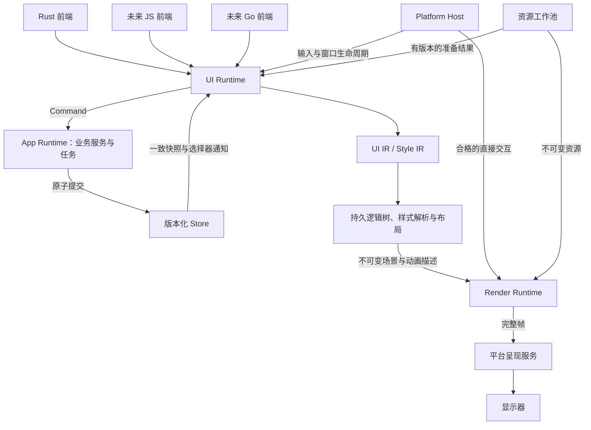
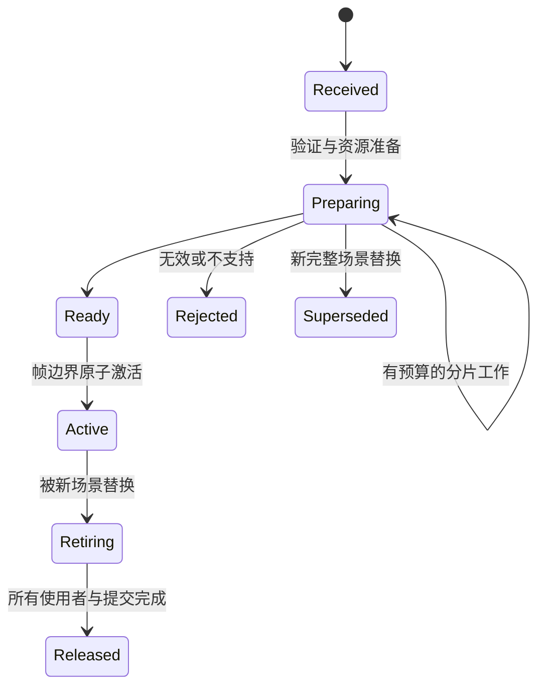

# UI IR、Store、Command 与独立渲染动画架构

状态：设计草案，已开始落地框架层；Rust 优先，预留 JS、Go。当前实现有与 Taffy 解耦的 `LayoutStyle` Flex/Grid/混合长度及测量协议，拥有式 primitive UI 输入快照／批次、纯布局资源、类型化样式组合、显式采用完整帧的主指针／焦点／激活／滚动路由，以及单次构建计划和作用域持久布局 producer。完整语义 UI IR、主题继承、序列化/跨语言 ABI、Store/Command、组件宏、通用反馈与细粒度调度、独立呈现仍未完成，总目标继续进行中。

更新日期：2026-11-18。实现对照取自 `codex/rendering-performance-research`。本文是架构映射与实现状态记录；实验能力与正式承诺仍分别列出。

## 1. 要解决的问题

框架以 GPUI 为基础，提供一套比底层绘制更完整的界面抽象：应用用 Rust 编写时自然、可检查；以后用 JS 或 Go 编写时，复用同一个 UI 语义与渲染内核。

优先解决四个会影响公共 API 的问题：

1. 界面逻辑和业务逻辑分开：UI 从 Store 读业务状态，通过 Command 请求业务操作。
2. 样式和动画是可分析的数据：样式 API 参考 StyleX，动画描述可以交给渲染运行时独立执行。
3. 已经启动的合格动画，不依赖 UI 构建线程每帧响应；新界面准备、图片解码、业务任务不得阻塞其推进。
4. 面向现代桌面 GPU 验证持续 120 Hz 和尾延迟；CPU 渲染首先保证输入、任务调度和完整画面的连续交付，允许明确选择较低画面更新频率。

120Hz帧间隔约8.333ms，60Hz约16.667ms，用于评估限定硬件和内容下的预算。当前优先框架能力、普通Flex和常见交互；“99%”只是常见场景流畅的表述，不是精确比例或p99门槛。CPU模式保持完整画面、文字和裁剪语义，并用合适档位保障响应。

本设计首先适用于桌面。现有 [Android 线程决策](ARCHITECTURE_DECISIONS.md) 不被本文自动替换；Android 必须另做平台可行性验证。本轮不引入 DLSS，不承诺完整 CSS、DOM、StyleX 源码兼容，也不要求立即拆出很多 crate。

## 2. 总体架构与线程所有权



“业务后端”是 App Runtime；“渲染后端”是 GPU/CPU 实现。公共文档和接口中不混用这两个词。

| 所有者 | 负责 | 不允许依赖 |
| --- | --- | --- |
| App Runtime / 执行器 | 领域状态、Store 写入、Command、IO 与业务任务 | UI 节点、Taffy、GPU 对象 |
| UI 构建线程 | 组件、LocalState、绑定、样式、持久 Logical Tree、布局、界面事件回调 | 同步等待 GPU 完成；在渲染线程执行任意前端回调 |
| Render Runtime | ActiveScene、动画时钟、呈现属性、GPU/CPU 资源、缓存、提交与退休 | UI 线程持有的锁、Rust/JS/Go 任意回调、逐帧 Store 往返 |
| Platform Host | 系统事件、窗口生命周期、平台要求在线程内完成的操作 | 长业务计算、完整 UI 构建、同步全帧 CPU 光栅化 |
| 资源工作池 | 图片解码、可并行的文字准备、缓存准备及大对象退休 | 未经许可调用有线程亲和性的系统 API |

UI 构建线程应在该线程内创建和持有现有 `Rc` 类型；不能给现有 `LogicalUi`、`Signal` 或 `gpui::Window` 强加跨线程传递。依赖平台字体服务的操作使用异步请求和有版本的结果，Render Runtime 不同步回调 UI 获取文字测量。

渲染线程独立与窗口呈现独立需要分别验收。若最终 `draw/present` 仍必须等阻塞中的 UI 回调，后台渲染完成也不能保证屏幕动画继续。平台能力显式区分：

- `IndependentPresentation`：UI 构建停顿时，平台事件与呈现服务仍可推进已接纳的动画。
- `HostDrivenPresentation`：只能在宿主调度绘制时更新，不能宣称上述保证。

第一阶段先验证最小窗口的独立呈现。一个窗口始终只有一个明确的 swapchain/呈现所有者，不让 GPUI 和新运行时竞争控制。若平台要求主线程呈现，主线程保留轻量呈现服务，将重 UI 工作移走。系统主线程本身被堵塞、GPU 饱和、驱动停顿不在 UI 隔离保证内。

## 3. UI IR：稳定的界面语义，不是 GPU 指令

### 3.1 两层表示

| 表示 | 用途 | 稳定性边界 |
| --- | --- | --- |
| UI IR + Style IR | Rust/JS/Go 前端共同表达结构、属性、样式、绑定、事件与语义 | 版本化的框架契约 |
| Render Scene / LocalFrame / FramePacket | 布局后的绘制内容、空间属性、资源引用、GPU 更新计划 | 内部实现，可以随后端演进 |

不把当前 `FramePacket` 或原样 Taffy `Style` 定为跨语言协议。Taffy 保留为内部布局引擎；公共维度、Flex、测量和响应式行为由框架定义。

当前已落地第一条框架边界：`gpui_box::retained::layout` 提供
`LayoutStyle`、`Dimension`、`Length`、`Edges`、Flex 方向/换行/对齐、
`AlignSelf`、布局影响型 `Overflow` 及
`LayoutDirection`。`UiTree::new_layout`、`append_layout`、
`LogicalUi::new_layout` 和 `append_render_layout` 在进入持久树前验证并
转换到 Taffy；调用方不需要把 Taffy `Style` 放入新 API。运行时更新通过
`Transaction::layout_style` 与 `Property<LayoutStyle>` 进入同一原子预检，
非法值返回 `InvalidStyle`，不会发布部分布局。`LayoutEnvironment` 也已改用
框架自己的方向类型。`main_cross_gap(main, cross)` 保存逻辑主/交叉轴间距，
在最终 lowering 时按最终 `flex_direction` 解析，避免 builder 调用顺序改变
布局语义；`gap(row, column)` 仍表示物理 CSS row/column gap。旧的 Taffy 入口暂时保留作迁移兼容层，因此这不是完整
CSS Flexbox 或最终跨语言 ABI；Grid、复杂 `calc()`、完整 intrinsic/baseline
契约、Style IR 序列化和组件宏仍未实现。

本轮又补齐了 Flex `order` 的框架适配层：`LayoutStyle::order` 默认值为 0，
相同 order 保持逻辑子节点顺序，Taffy 只接收降低后的 `Style`，稳定排序由
adapter 在 `set_children`、布局提取、绘制顺序和命中索引前统一应用。逻辑树仍保存
原始 sibling 顺序；order 更新会进入原子事务、触发布局并重建视觉顺序，旧的
Taffy `Style` 更新不会把公共 order 重置为 0。该实现已用两个节点覆盖反转位置、
命中顺序、同值稳定性和动态更新；order 本身不需要修改 `vendor/taffy` 本体。它仍不是完整
CSS order 兼容承诺：Grid order、匿名 flex item、复杂 stacking/context 和完整
baseline 语义仍未完成；首水平基线的正式发布现已另行接入，见下文。

响应式方向也已有第一条新 API：`LayoutBreakpointStyles` 和
`LayoutResponsiveBindings` 接收/绑定 `LayoutStyle`，按 `LayoutEnvironment`
的逻辑 viewport 和 `LayoutDirection` 做离散断点选择，再通过同一布局属性
事务提交。旧 `BreakpointStyles` / `ResponsiveBindings` 保留用于迁移和受限
容器查询；新的 viewport 路径不再要求业务代码构造 Taffy `Style`。断点选择
仍然是显式样式切换，不把结构自适应、完整 CSS 查询或自动迭代反馈循环伪装
成已实现能力。

容器查询也已迁移出 Taffy 风格入口：`LayoutResponsiveBindings::bind_container`
接受框架自己的 `LayoutQuery` 语义，要求 target 为 host 的严格 render 后代，
并验证 host 的 inline extent 独立于内容。`fixed_inline_size(width)` 设置相等的
width/min-width/max-width，height 可以为 Auto；BorderBox、水平 padding/border
和滚动条 gutter 必须固定且装入该宽度。仅固定 preferred width 不足以通过检查。
host 若受其他 responsive rule 控制，该 producer 的当前 source 与每一个断点分支
也必须满足证明，注册顺序不影响检查。每帧先复验拓扑/host，再更新 viewport 样式，
然后按依赖图分阶段读取实际 content width（减去 padding/border/滚动条）、批量提交
规则和布局。安全嵌套与自动高度现已支持，不采用迭代收敛。现改为同一个 source
draft 内的私有布局预演，所有阶段通过后才在原树的私有 candidate 上一次应用最终
sinks、布局并发布；中间 source、frame 和 effects 均不发布。后阶段返回错误时，
正式 source、frame/geometry、统计和 effects 保留原值。effects 只观察最终提交。
computed DAG 的所有布局 sinks 参与依赖图；每阶段复验实际草稿样式和原有证明，
依赖层变化则拒绝，不迭代收敛。新公共 `local_frame` / `local_frame_in_viewport`
返回 `LocalResponsiveFrame`，并将响应式环境、布局可用空间、绘制 viewport 分开。
所有私有预布局及最终布局计数累加；变化中的求值增加 O(tree) 副本和可能重复布局
成本，尚未优化为增量回滚。构图仍逐帧检查规则对、祖先和 computed sinks，尚未
索引化。这不是结构自适应事务；完整 CSS 条件和通用反馈仍未实现。详见
[响应式原子发布契约](RETAINED_ATOMIC_RESPONSIVE.md)。
旧 `ResponsiveBindings` 保持原固定宽高、最多两阶段、拒绝嵌套依赖的迁移契约。

公共 `LayoutContainerType::{Normal, InlineSize, Size}` 进一步提供显式尺寸隔离。
项目内 Taffy 在 Flex/Grid/Block/叶子测量阶段忽略被隔离轴的内容贡献，仍正常布局
和绘制后代。Size 支持外部 Flex 流式分配；InlineSize 在经过证明的无换行列链上
支持宽度流式、内容自动增高，Row/wrap/aspect 反馈仍拒绝。依赖图加入可能改变
兄弟分配的 producer，尺寸边界截断外部影响，不做迭代收敛。该 API 明确附带
layout containment（基线隔离与定位包含块），比当前浏览器单独 container-type
更强；clip/scroll 独立，完整 CSS stacking/OOF scroll attachment 尚未实现。
布局发布把 Taffy 的包含块坐标转换成 render-parent 局部坐标，保存旧发布位置，
并按 OOF 索引复验静态祖先移动后的补偿量。详见
[尺寸隔离与流式查询](RETAINED_SIZE_CONTAINMENT.md)。这轮没有宣称帧率提升。

公共 `Dimension` 现已提供 MinContent/MaxContent/FitContent/数值或百分比
FitContent/Stretch，以及仅供 flex-basis 的 Content；min/max 字段也已改用 Dimension，
内在约束参与实际 Flex 分配，交叉轴在最终主轴宽度后重新测量。原 Length builder
通过 Into 保留，直接字段赋值需要迁移。相等内在 min/max 不会使 auto 内容高度成为
后代百分比高度基准；固定高度与百分比后代组合仍有已记录的 Chromium 差异。
详见 [内在 min/max 契约](RETAINED_INTRINSIC_LIMITS.md)。物理 `gap(row,column)`
已修复为垂直 row gap、水平 column
gap，不随方向交换；只有 `main_cross_gap` 按最终方向 lower。此前补偿了错误轴向的
调用方需要相应调整。项目内 Taffy fork 补齐 in-flow 根节点尺寸关键词解析，修复
Flex ContentSize 过早施加自身 min/max 的测量，以及内容决定的最终尺寸不能约束
换行的问题；最终换行与后代百分比确定性分开，内容高度不会成为确定的百分比高度
基准。详见 [尺寸与查询契约](RETAINED_FLEX_SIZING_QUERIES.md)。这些改动没有宣称
性能提升；intrinsic 预查询有成本且可能改变内部缓存命中。

布局输入/输出也开始脱离 Taffy 类型：`LayoutAvailableSpace`、
`LayoutConstraints` 和 `LayoutResult` 是框架自己的约束与局部结果契约。
`UiTree::frame_with_constraints`、`ReactiveUi::frame_with_constraints` 与
`LogicalUi::frame_with_constraints` 接受该约束对象；原有 `frame([w, h])`
仍是确定窗口 viewport 的兼容入口。`frame_with_constraints` 继续从两个
`Definite` 轴取得裁剪 viewport；新增 `frame_in_viewport` 与
`local_frame_in_viewport` 可在独立有限绘制 viewport 下运行正常 Unbounded
布局或显式 MinContent/MaxContent 查询，并暴露在 UiTree/ReactiveUi/LogicalUi。
项目内 Taffy 与 GPUI 的 AvailableSpace 均新增 Unbounded；正常无上限主轴用
hypothetical outer size、margin/gap/inset 决定自然尺寸，不运行 MaxContent
的 intrinsic flex-fraction 算法。百分比基准来自布局，不借用呈现窗口；OOF
初始包含块在不确定轴回退根 padding box。仅 viewport 改变会更新完整裁剪
输出，但布局次数为零。显式 intrinsic 样式和尺寸隔离仍保留各自语义。
新增 `BoxConstraints` 和 `LayoutConstraints::with_bounds` 提供独立的父级硬
border-box min/max 区间，接入真实布局根和独立子树测量。父硬约束优先于样式
preferred/min/max、宽高比与 padding floor；tight 轴为确定分配，loose max 不
自动成为百分比高度基准。约束参与换行、grow/shrink 和最终宽度文字测量，不在
绘制包上事后 clamp。每个布局 invocation 的根读取该区间，子代仍由正常算法分配；
嵌套场景新增 `LayoutStyle::constraint_box(width_fit,height_fit)`，以单子节点协议
将实际 content 空间转为 tight/loose 硬分配，padding/border/gutter 向内收缩；
它可以放进 Flex 分配，再向内部 Flex 树传递约束。普通 CSS Flex 语义保持；
边界直接子节点的 margin/Flex 对齐/relative inset 不参与该父级摆放协议，
直接 OOF 子节点拒绝。新增 `LogicalUi::edit_frame` 和
`LogicalEdit::constraint_builder`，仅在 Size-contained 约束盒上读取父协议最终
分配给 child slot 的硬区间、软空间模式和独立百分比基准；在布局算法栈外构建
keyed 分支，并把生命周期、最终布局和完整 FramePacket 一起原子发布。嵌套
调用读取当前草稿；最终再验证已读输入，后续父/兄弟变动使输入改变则拒绝发布，
不反复迭代。临时 intrinsic probe 不调用用户 builder。私有完整树副本、每个
builder 的全量 preview 和最终几何校验增加成本。新增
`inline_constraint_builder` 与 `InlineConstraintBuilderInput` 只暴露横向
min/max/available/percentage basis；InlineSize 约束盒在共享依赖证明通过时
可让分支决定内容高度，更新祖先与后续兄弟。证明支持 Column/Tight-box 链及
精确固定宽且 numeric inset 的 CSS 边界；最终复验输入和证明，宽度数值相等
也不能掩盖依赖方向失效。preview 在 callback 前释放，嵌套不按深度保留整树。
详见 [inline 构建契约](RETAINED_INLINE_CONSTRAINT_BUILDERS.md)。通用 full-axis content-sized builder、
持久自动订阅和通用结构增量规划仍未实现，不能称为完整 Flutter RenderBox。
新增 `ParentLayoutSnapshot` 与纯 `ParentLayout` 父协议，通过 typed property 安装；
公共输入包含 content 分配、available 和独立 percentage basis，算法只能测量真实
直接子树并返回完整 child constraints/placement。子代可以继续使用真实 Flex、文字
或其他自定义父布局，content height、baseline、overflow 和后续兄弟进入同一发布
链路。已知维度、完整摆放、有限几何和非法直接 OOF/leaf 冲突均校验。项目内 Taffy
新增稀疏 delegate dispatch；自定义 invocation 使用完整 LayoutInput/LayoutOutput 的
有界测量缓存，避免普通 ComputeSize cache 丢失 baseline/vertical basis；每节点最多
九条，仅访问到的测量节点创建附表，Arc 写时复制使 preview 共享未修改记录。
普通树沿用紧凑尺寸缓存，完整布局缓存继续复用。dirty custom layout 用私有 Taffy clone 保证
失败不污染已发布布局；普通树仍原地布局。已有 CSS ContainerQuery/inline proof
不能证明任意策略的依赖；后续独立 inline allocation 协议允许证明穿过受内核
强制的宽度分配边，任意 allocator 仍拒绝。通用
结构构建、自动依赖、测量缓存全局字节预算/计时验收和增量回滚仍开放；这是父布局原语，不是完整
RenderBox。详见 [自定义父布局契约与 ADR](RETAINED_CUSTOM_PARENT_LAYOUT.md)。
精确测量缓存按两轴百分比基准、known/definiteness、available modes、requested
axis、sizing/margin mode 与硬 bounds 全部匹配，保留基线/overflow 等完整结果。
失效必须同时清理两类缓存：即使子节点仅有测量结果，也要使祖先重新计算；
移除最后一个 delegate 后保留尚未失效的记录以维持该证明链。附表/Arc/完整记录
及候选副本仍有内存与 lookup 成本，不能从 callback 次数下降推导尾延迟收益。
详见 [精确测量缓存契约与成本](RETAINED_EXACT_PARENT_MEASURE_CACHE.md)。
新增 `LogicalUi::edit_local_frame`，复用 `edit_frame` 的 source、keyed 生命周期、
最终布局和 builder 观察值复验边界，直接发布 LocalFrame；full/inline builder
和纯 ParentLayout 使用同一入口。稳定属性/材质变更保留稀疏前驱关系，不为验证
而构造完整 world items/property maps；`published_local_frame` 在三层 owner 上
读取最后的局部快照，不触发 resolve，交替消费者须检查其自身 revision。最终
几何按 preorder 检查，以 O(depth) 栈验证所有可见节点，包括被继承裁剪掩盖的
自身 clip 溢出；失败保留 source、effect、布局和旧快照。完整候选树 clone、
每个 builder 的 preview 以及 O(N) 最终检查仍存在，不能称为整个事务的次线性
更新。真实文字 CPU 像素和连续/跳帧后的 GPU 恢复与独立完整路径一致；这轮没有
时延或持续帧率结论。详见 [原子局部帧契约与成本](RETAINED_ATOMIC_LOCAL_EDITS.md)。
新增 `LogicalEdit::responsive(&rules, &environment)`，在 `edit_frame` /
`edit_local_frame` 内对当前 source/结构草稿执行既有 viewport 与多阶段容器规则，
后续 full/inline builder 可读取最终选中的样式与真实 slot。新建 computed 链、
binding 和 effect 参与同一次结算；sink/effect 只接收最终值。最终发布复验每次
调用观察的 content width、选中 source、精确 writer 和依赖证明，新加 layout
sink 也纳入检查；错误回滚，调用者捕获规则错误时仍恢复该次 source savepoint。
这使已注册规则与结构构建可以在同一原子编辑中显式编排。后续 build plan 支持事务内
祖先顺序与显式前置依赖，跨事件持久调度仍未实现。完整 preview、source map clone、computed 扫描
排序及证明/DAG 复验仍增加成本，不能据此宣称端到端性能提高。详见
[响应式结构构建契约与 ADR](RETAINED_STRUCTURAL_RESPONSIVE.md)。
新增 `(ScopeId, key)` 归属的 `responsive_rule` / `remove_responsive_rule` 与
`responsive_registered`，允许新 scope/source/node 和规则在同一草稿构建并原子发布。
同值声明保留 writer，更新断点/query 保留身份，source/target 改变需显式移除后重建。
scope 退休自动解绑所属规则；存活规则不能留下已退休的 source/query host，portal
移动也不能绕过此依赖检查。声明不自动求值，已观察规则不能通过移除抹去最终校验。
注册表在首个元数据修改时整体 clone；声明和最终 preflight 仍生成完整 preview，
没有自动 scheduler 或性能收益结论。详见
[作用域响应式规则生命周期](RETAINED_SCOPED_RESPONSIVE_RULES.md)。
详见 [嵌套协议](RETAINED_NESTED_CONSTRAINT_BOX.md) 与
[构建器契约和决策](RETAINED_CONSTRAINT_BUILDERS.md)。
缓存新增每节点四个 float 的约束
mode，变化时拒绝旧结果。详见 [父约束契约](RETAINED_PARENT_CONSTRAINTS.md)
与 [无上限布局契约](RETAINED_UNBOUNDED_LAYOUT.md)。
独立的 `measure_with_constraints` 查询仍不发布绘制 frame；
`measure_node_with_constraints(node, constraints)` 可以对任意活跃子树执行
同样的 measure-only 查询；结果局部于被查询节点，不发布 frame，也不把子树
临时几何误认为已提交的 `layout_result`。查询运行在持久布局树的 owned clone
上，不改写正式 Taffy 缓存、已发布几何或 frame revision。
`layout_result` 返回 parent-local 的 size/location、派生 content size、
border/padding、margin 和 scrollable overflow。`LayoutResult.baseline` 现在
来自项目内 Taffy fork 的最终 `Layout.baselines.first`，表示从本节点 border box
顶部计算的首水平基线。叶子测量与 Flex/Grid/Block 容器传播使用实际算法结果，
仅基线变化也会随正式 frame 发布；隐藏子树清空该结果。measure-only 查询从
clone 的最终布局读取同一字段，不改写已发布状态。Grid 在未运行预备基线对齐
阶段时错误回退到子节点底边、以及重复计入 margin 的问题也已修复。

这次把结果保存在布局输出中，而非事后读布局缓存或猜测容器基线，避免缓存驱逐、
同几何不同基线和 display:none 暴露陈旧值。它没有新增全树扫描；几何不变时仍可
保留原 PaintItems 与零 chunk 重录。详细契约、验证和成本见
[布局基线发布](RETAINED_LAYOUT_BASELINES.md)。可选公共设备像素策略现已通过
`PixelSnap::DevicePixels { scale }` 接入：在逻辑布局和 glyph chunk 选择之后，
发布绝对 border/content/clip 边缘的取整结果；LayoutResult、查询阈值、builder
输入、文字换行和基线仍保持逻辑精度。绘制与命中共享输出，CPU/WGPU 拒绝与
快照 scale 不匹配的消费。策略可加入同一个 keyed/source/frame 原子编辑；
同值不请求更新。默认 None 保留小数。当前 opt-in 每个脏帧完整提取并投影，
失去祖先位移/滚动共享，不能宣称性能收益；任意设备网格的 f32 精确表示、
自动 DPI 集成、增量投影和广泛取整一致性仍开放。详见
[像素输出契约与 ADR](RETAINED_PIXEL_SNAPPING.md)。完整 affine 变换、last-baseline
对齐、竖排文字、复杂 intrinsic、公共 Grid 和 `calc()` 仍未完成。

自定义父布局现另有可选 `ParentInlineLayout` 阶段，通过
`ParentLayoutSnapshot::with_inline_layout` 安装。它只能读取已知宽度、inline
available space、percentage basis 和子节点数量，返回每个子节点的有限 tight
border-box width 与独立 percentage basis；adapter 对实际测量和最终 placement
都强制应用这些值。这样 shared inline proof 可在证明父自身宽度后穿过自定义
边，组合 ContainerQuery 和 inline keyed builder。原子观察还保存算法身份及
layout-order 子列表，后续替换/增删重排即使等宽也拒绝；sibling order 参与查询
阶段依赖。任意父算法仍不能只靠声明绕过测量反馈。协议/成本与 ADR 见
[父布局独立 inline 分配](RETAINED_PARENT_INLINE_ALLOCATION.md)。这增加了 slot
分配、祖先扫描和结构快照成本，通用 interval/full-axis、自动调度、完整 RenderBox
及广泛 Flex 一致性仍开放；没有性能收益声明。

后续新增 `ParentAllocationLayout`，以测量前的 incoming border-box constraints
独立分配完整两轴 loose/tight intervals、soft space 和 percentage bases。内核在
所有测量和最终摆放时强制同一输入，不使用最终内容高度反推分配。
`LogicalEdit::allocation_builder` 读取 host 自己收到的 slot，可在全链路独立分配
的父链下按内容决定两轴尺寸，无需 Size containment；普通 Flex 混合边仍保守
拒绝。最终复验 style/algorithm/ancestry/order 与输入，完整最终 cache guard
防止已知尺寸遮蔽 soft space 变化。详见 [契约和 ADR](RETAINED_PARENT_ALLOCATION_BUILDERS.md)。
仍有完整 preview、slot 与稀疏记录成本，没有新增性能结论。

对齐 API 现在由框架自己的 `Alignment<T>` 与 `AlignmentOverflow` 表达，区分
logical Start/End、FlexStart/FlexEnd、SelfStart/SelfEnd，以及 Safe/Unsafe 溢出
回退；Normal/Stretch 按布局上下文解析。builder 接受原枚举或完整值，直接字段
赋值需 `.into()`；框架默认 justify Start 保持。非法组合在原子发布前拒绝，
modifier-only 修改经原样式/source 布局链路，同值不产新帧。项目内核修正了反向
主轴 justify Stretch 与 content Stretch 溢出回退；独立 Chromium145 几何
5,364 项匹配，另 12 项 reverse SpaceBetween 的规范/浏览器偏差单独保留断言。
真实文字、CPU/WGPU 与命中验证使用同一发布几何，未增加第二套布局真相。
详见 [Flex 对齐契约与 ADR](RETAINED_FLEX_ALIGNMENT.md)。这会增加样式值的策略
字段、校验和复制成本，没有性能提升声明；last-baseline、竖排与广泛对齐/布局
一致性仍开放。

后续 [末基线阶段](RETAINED_LAST_BASELINE.md) 增加 `LastBaseline` item/self 对齐，
以及贯穿 leaf、真实段落、custom parent、ConstraintBox/Block/Flex 和
`LayoutResult` 的独立首/末水平基线。原单基线测量入口保留，两组分享基线
分别决定行高和对齐；单项、wrap-reverse 与负 margin 均走通用规则。
新增字段会影响公共结果/父算法 struct literal，段落末基线按最终绘制宽度的真实
换行计算。浏览器 marker 与外层 Flex 探测分别检查子项几何和容器发布值，CPU/GPU
仍消费同一布局。竖排、baseline content distribution 和广泛一致性仍开放；
增加结果字段、临时 FlexItem float、组扫描和段落 memo lookup，没有性能收益声明。

后续 [自动响应式 session](RETAINED_AUTOMATIC_RESPONSIVE.md) 把 host environment、
实际布局约束、有限绘制 viewport 作为三个独立输入原子捕获。启用后普通 source
事务、后台 inbox、key 生命周期/重排/reparent 与取帧自动结算 scope-owned rules；
三种 builder 在读约束前结算，final draft 再结算并复验之前的观察，不重放用户回调。
普通事务发布完整 LocalFrame 后才交付 effects；失败保留旧环境/source/树/帧。
只承诺显式 host 输入捕获，没有自动 OS DPI/font 订阅或任意跨 builder 依赖调度。
现有整树候选、重复预览、source savepoint 和全量 proof 扫描成本继续；无性能收益声明。

后续 [混合 Flex 分配 builder](RETAINED_MIXED_ALLOCATION_BUILDERS.md) 用显式
Size+Layout containment 切断构建内容对外层尺寸/baseline/overflow 的反馈；普通
Flex 外壳可连接内部独立分配链、两轴内容尺寸 host 和真实文字。Size-contained
ConstraintBox 也可交付其实际 loose/tight outgoing slot。输入新增 known dimensions
及百分比 definiteness，保留与 hard bounds/soft space/bases 的区别。内核记录真实
final incoming input，complete-input cache guard 防止祖先缓存掩盖输入变化。无隔离
边界的普通反馈边、child-style 分配与完整 RenderBox 仍未完成，成本与限制见 ADR。

后续[普通 Flex 两轴分配](RETAINED_FULL_FLEX_ALLOCATION.md)进一步扩展既有
allocation_builder／Allocation producer：外部确定根宽高、每级主轴数值basis和显式
minimum排除内容贡献，NoWrap交叉轴可stretch，Wrap要求数值cross size且无baseline
共享组。四个Row/Column方向、RTL、百分比、padding/gutter复用真实内核分配，不自动
插入containment。旧独立parent／containment证明优先保留；新分支用既有opt-in最终输入
记录，完整known/definite/bounds/soft space/bases及ancestor/order/effective sibling styles
在原子采用前复验。通用intrinsic/ratio/自动cross-line反馈、Grid/Block两轴证明与完整
RenderBox仍开放；private preview/candidate与扫描成本仍在，无FPS收益声明。

后续[内容测量同级项](RETAINED_MEASURED_FLEX_SIBLINGS.md)允许真实文字标题／工具栏／
sidebar自动尺寸与remaining-space正文组合。普通两轴链只要求path child的尺寸贡献独立；
其余content-dependent sibling完整子树记录layout style／children／measure／parent
algorithm／metadata，在最终candidate与真实input一起复验。同数字的后写measurement也
拒绝；同paragraph换字色、同intrinsic size换image pixels仍走独立paint通道。Sibling
producer用既有after明确顺序，错误顺序拒绝而不回放。增加子树扫描和临时shared handle／
child-list记录，未自动推导writer依赖；path自身内容反馈与完整RenderBox仍开放。

后续[布局测量任务依赖](RETAINED_INFERRED_MEASUREMENT_TASKS.md)把上述sibling证明接到
既有BuildPlan／producer：full Allocation任务自动等待host位于所观察同级子树内的任务，
包括后来加入的descendant任务，不受registration／ID顺序影响。当前frame constraints与
draft topology决定证明；排序不调用layout或用户回调。Ancestry／after／measurement边
去重、共同计限额，cycle／retroactive predecessor拒绝，final executed-order复验同一
图，普通完整input校验保留。任意跨子树写仍须after，未实现通用writer推导；重复proof／
subtree扫描和private preview成本仍在，无时延／FPS收益声明。

后续 [ParentData](RETAINED_PARENT_DATA.md) 把 direct child 的不可变 typed metadata
独立于 CSS style 纳入父布局输入；独立分配器和测量阶段都可读取，普通 Flex 忽略。
typed sink、事务合并、缓存失效、reparent/keyed 生命周期沿正常链路；builder proof
记录所有 allocator child-data identity，响应式 computed metadata sink 参与依赖排序。
它支持父算法定义权重/角色等输入，不开放任意 child-style/intrinsic 反馈；泛型数据
尚无跨语言序列化 ABI/字节预算，clone/存储/保守 relayout 成本增加，无性能收益声明。

补充 [pure parent metrics](RETAINED_DRY_PARENT_MEASURE.md)：ParentLayoutSnapshot
可选 with_measure(ParentMeasure)，尺寸探测返回 content size/首末 baseline 而不构造
custom placement vector；最终 layout 对同一 final content input 校验一致性。显式
dry_measure_node 接收 child bounds/space/percentage bases，在私有内核副本上强制
ComputeSize；原 full-root measure API 保留。独立分配/metadata 在两阶段同样强制，
仍无完整 RenderBox/普通容器 intrinsic baseline 一致性承诺。private clone 与末次
metrics 校验成本保留，没有帧时/p99 收益结论。

补充 [显式完整基线查询](RETAINED_DRY_BASELINE_QUERY.md)：
dry_measure_node_baselines / children.measure_baselines 复用同输入最终布局算术，
在 scoped scratch 模式禁止 geometry/cache/builder observation/OOF 写入。
普通 size query 保持原快速行为；需要完整首末 baseline 的父算法显式选择。
查询可能执行后代完整 plan，跳过缓存，仍有 tree clone；无性能改善声明。
返回内核已支持的最终指标，不补齐 Grid last-baseline、竖排或完整 CSS conformance。

补充 [owned container overflow 修正](RETAINED_OWNED_CONTAINER_OVERFLOW.md)：
custom parent / ConstraintBox 的叶子 helper 只负责 host sizing；最终 overflow
丢弃该临时 desired-content extent，只累计真实子项及一次 scroll end padding。
沿用共享 RTL/Clip/Scroll/containment/unreachable 规则，避免虚假滚动范围。
父布局 baseline 为有限有符号 content offset，可随 overflow/负放置落在 host 高度外；
固定叶子 intrinsic metrics 仍按自己的范围验证。既有 scroll reclamp/后代 property
publication 消费修正结果，无新增 API/逐节点字段，也无本轮帧时改善声明。

补充 [owned content measurement](RETAINED_CONTENT_MEASURE.md)：
ContentMeasureSnapshot 通过既有 measure property 接入拥有式纯内容测量，回调只读取
deflated soft content space，区分 Definite/Unbounded/MinContent/MaxContent。
统一 leaf box model 选定 inline size 后重测 dependent height，实际内容 extent 与
used border box 分离，首末有符号 baseline/overflow 同源。完整输入 cache key 和
稀疏 capability index 防止查询模式合并；失败使用 private layout clone 保留旧几何。
这不是完整 RenderBox/任意 child-style 分配，重复测量、exact cache 和 clone 有成本，
没有本轮性能收益声明。

自定义 measured parent 另有 [ChildLayoutStyle](RETAINED_CHILD_STYLE.md) 只读
direct-child item inputs，包括未解析尺寸/边距、basis/grow/shrink、自对齐、containment
和 effective replaced flags。只在 pure metric/full measured 阶段可读；独立 allocator
仍只看 incoming constraints 与 metadata，未放宽 builder/query 证明。普通子布局仍由
统一内核执行；自定义 ParentPlacement 的 margin metadata 继续为0，不自动套用 CSS
margin/relative placement。无新增持久样式副本，无本轮性能改善声明。

后续 [independent allocation styles](RETAINED_ALLOCATION_STYLES.md) 使完整独立
allocator 可读同一 unresolved item inputs，但仍不能测量内容。builder 最终观察扩充为
每个 allocator ancestor 的所有 direct-child effective styles，包括图片派生的
replaced/aspect 和兄弟节点；即使数值 allocation 相等也重验输入。inline-only phase
和一般 feedback/query 证明不放宽；临时样式复制/扫描成本明确保留，无性能收益声明。

后续 [selected child assignments](RETAINED_CHILD_ASSIGNMENTS.md) 为 ChildLayoutInput
补齐 known_size / known_size_is_definite，避免把 content-derived 已选尺寸强行编码成
definite tight interval。与 hard bounds、soft space、incoming percentage basis 分开；
allocation readback、measured placement、nested parent/builders 和 dry queries 保真。
公开实验接口的 struct literals 已迁移，临时 input payload 增大，无性能收益声明。

后续 [explicit content sizing](RETAINED_CONTENT_SIZING.md) 为同一子布局输入补齐
LayoutSizingMode::Inherent/Content，并传到 measured/full/inline parent 与完整 builder
输入。Content 查询忽略被查询节点自身 preferred/min/max，保留后代样式、已选尺寸、
硬约束及 box insets；它与 MinContent/MaxContent 软空间是独立维度。共同 child entry
修复 Content 查询仍解析自身 preferred keyword 的错误，owned box 同步忽略自身
aspect suggestion。复用原内核及 cache 模式，没有第二套 intrinsic/Flex 算法。
正常 source、keyed builder、真实 glyph 与 CPU/GPU 完整参考均验证有限用例；
临时输入 payload 增大，没有帧时收益或完整 RenderBox/CSS contribution 一致性声明。

后续 [Flex automatic minimum](RETAINED_FLEX_AUTOMATIC_MINIMUM.md) 区分 authored
preferred size、content suggestion 和 ratio-transferred suggestion，修复普通内容与
replaced image 的自动最小尺寸，并按真实 BorderBox/ContentBox 转移比例。显式 cross
尺寸保留本轴限制，自动 cross 尺寸使用最终 main size 与内容最小值；复用现有 image
classification 和 source/layout/CPU/GPU 链路，不新增公共样式字段。浏览器参考保留
规范与 Chromium 的明确差异；临时 FlexItem 增大，无完整 CSS 一致性或帧时收益声明。

后续 [containment intrinsic fallback](RETAINED_CONTAINMENT_FALLBACK.md) 为公共
LayoutStyle 与只读 ChildLayoutStyle 增加每物理轴可选的 intrinsic inner length，
补齐隔离尺寸只能按空内容贡献的问题。共同 leaf/contained box model 与普通 Flex 分配复用，
ConstraintBox/custom parent 及 Content 查询保留语义；fallback 不替代 preferred size、
父约束或响应式依赖证明。每个 style 实测增加16字节，显式记忆尺寸/内容跳过、自动
scrollbar 预测仍未实现，没有新增持续帧率或尾延迟收益声明。

后续 [Flex percentage gaps](RETAINED_FLEX_PERCENTAGE_GAPS.md) 让共同内核使用已有
selected-size definiteness，避免把 content-derived height 当成百分比 gap 基准。
普通自动 inline width 选定后，若 percentage gap 改变则按同一已选宽度重新收集换行，
再进行正常 flex/cross/baseline/final placement，不反复调整容器尺寸求收敛。
公共 API 不新增字段，正常 source、owned parent、dry query 与 CPU/GPU 输出共用此路径。
额外标量判断与必要的一次 line collection 有成本，未测帧时或密集布局尾延迟；
浏览器几何匹配与单列 MinContent 的规范差异分别记录，完整 CSS 与总目标仍未完成。

后续 [owned parent definiteness](RETAINED_PARENT_DEFINITENESS.md) 把逐轴已选尺寸
来源传入 ParentMeasure/ParentLayout 与 inline phase，补齐只有 incoming child/full
allocator 能表达确定性的缺口。共同 custom-parent 与 ConstraintBox 最终阶段不再
无条件将已有 width 当成百分比基准，child padding/border 元数据也使用同一真实基准。
普通自动 inline width 选定与硬 tight 分配继续按原规则建立确定性；内容推导 height
虽在最终 callback 已知仍保持不确定。临时 input 新增 bool 字段，完整 literals 需迁移，
未新增持久树/GPU/packet字段或测量轮次；完整 RenderBox、CSS 与性能验收继续开放。

后续 [axis measurement](RETAINED_AXIS_MEASUREMENT.md) 暴露框架自有 LayoutAxis、
公共 scalar dry query 和纯父策略 measure_axis。ParentMeasure 读取 requested_axis，
普通 custom width query 可跳过依赖高度与最终plan；height仍先选择所需inline extent。
独立full/inline slots保持分配权威但不覆盖查询意图，baseline/final与兼容full-plan
fallback始终两轴，exact cache隔离partial结果。未扩大ChildLayoutInput/builder字段；
临时callback输入增大且public query仍clone树，尚无帧时或完整RenderBox验收结论。

后续 [content axis demand](RETAINED_CONTENT_AXIS_MEASUREMENT.md) 把请求轴继续传到
ContentMeasure，叶盒模型内部width/height intrinsic limit使用自己的probe axis。
普通最终布局与baseline取得完整natural metrics，scalar width可跳过无关height pass，
height仍先选定inline size。原leaf callback经包装复用同一算法，没有另一套盒模型。
临时content input增加optional enum，既有full/partial exact key与原子失败边界复用；
公共query clone/candidate成本仍在，不据callback减少推导帧时/尾延迟已改善。

后续 [ordinary inline allocation builder](RETAINED_INLINE_ALLOCATION_BUILDERS.md)
新增 `LogicalEdit::inline_allocation_builder`，普通未隔离 Flex/ConstraintBox host
按实际 incoming border-box 横向输入构建 keyed 后代，再由内容推导高度并更新父兄弟。
输入补齐 sizing mode、known width 与 definiteness，不暴露 block size。完整 Column／
Tight-box／独立宽度分配链及真实外部横向锚点证明依赖方向；无界空间下未解析的百分比
root 和 Row/wrap/aspect ancestry 保守拒绝，固定 used width 不能代替 incoming proof。
项目内 Taffy 的 opt-in 最终输入记录复用 exact cache，final draft 重测并复验后退役，
下一普通同值帧0 layout；重复 builder 本身仍有观察布局。源／绑定／keyed／effect／
frame 复用同一原子发布，真实文字和 CPU/GPU 完整参考验证有限场景。新增稀疏 map、
preview、扫描和 cache 成本，没有性能收益声明；任意 full-axis feedback 和自动调度仍开放。

后续 [显式 scrollbar allocation](RETAINED_SCROLLBAR_GUTTERS.md) 把既有内核占位接到
公共 `LayoutStyle.scrollbar_width`，`LayoutResult.scrollbar_size` 返回实际逐物理轴预留，
content_size 扣除 gutter。默认0保持overlay分配；Scroll预留、LTR右侧／RTL左侧、横向底部，
没有自动overflow检测或scrollbar绘制。Flex、ConstraintBox、custom parent、query和builder
复用同一box model，paragraph baseline重测、glyph wrap、image/glyph content bounds同步扣除
并采用RTL起点；占位／方向变化走正常几何更新，source/P0/rollback保持。独立浏览器288组与
真实glyph／CPU／GPU参考验证有限场景。公共payload和dirty检查有成本，没有帧时收益声明；
自动appearance、OS metrics/native chrome、完整CSS/RenderBox及持续呈现验收仍开放。

后续 [普通容器查询](RETAINED_ORDINARY_CONTAINER_QUERIES.md) 将既有 ContainerInline
扩展到未隔离内容尺寸host：完整Column／Tight-box／独立width phase链加真实外部inline
锚点证明查询宽度不受后代高度反馈。读取实际content width，保留与incoming slot／环境／
paint viewport的区别；嵌套规则按producer DAG结算，computed self-feedback拒绝。Scope-owned
session可与普通inline builder组合，后续source事务自动更新；standalone draft另在final
candidate复验width及custom algorithm/order，发布前失败保持旧sources/tree/frame/effects。
不新增公共签名或内核格式，proof扫描／style复制／observation vector有成本，无帧时收益声明。
通用Row/wrap/aspect/full-axis反馈、持久跨builder调度和完整RenderBox仍开放。

后续 [content-independent Row proof](RETAINED_ROW_INLINE_ALLOCATION.md) 让同一
inline builder／ContainerInline穿过Row／RowReverse及三种wrap，前提是父inline独立，
所有in-flow direct items有numeric basis（或Auto＋numeric width）、显式numeric min、
numeric/Auto max且无effective ratio。普通Flex仍决定分行／grow／shrink，内容只改变依赖
高度；未增加双栏特化算法。Final observations记录layout-order sibling列表和effective
styles，图片派生ratio也参与；query DAG计入兄弟style producer并拒绝computed分配反馈。
288组独立浏览器几何、真实glyph及CPU/GPU参考验证有限范围。公共API／内核格式不变，
祖先兄弟扫描与Style副本增加成本，无帧时收益结论。通用content／percentage／ratio／
intrinsic证明、full-axis反馈和持久自动调度仍未完成。

后续 [definite percentage Row proof](RETAINED_PERCENTAGE_INLINE_ALLOCATION.md)
扩展完整incoming链：普通Flex祖先加live外部root锚点证明百分比基准确定后，Row子项可用
Percent basis、Auto＋Percent width、显式Percent min和Auto/Px/Percent max。横向独立与
percentage definiteness分开证明；Row的definite main size使post-flexing width definite，
Column通过numeric/stretch分配传递。旧unconditional used-width证明不借用此条件，custom／
ConstraintBox ancestry在新增definiteness证明中保守停止。仍用普通Flex算法及既有兄弟DAG／
final observations／原子发布，432组独立浏览器对照和真实glyph／CPU／GPU参考覆盖有限范围。
新增证明按需运行，不增加公共字段或内核pass；扫描／preview成本继续，无帧时收益声明。
content/auto/intrinsic／ratio/general protocol证明、full-axis反馈和完整RenderBox仍开放。

后续 [公共Grid契约](RETAINED_PUBLIC_GRID.md) 新增框架自有GridStyle／轨道／重复／
placement类型，LayoutStyle::grid支持fr、minmax、percent、intrinsic／fit-content、
Count／AutoFit／AutoFill、implicit patterns与dense flow。公共justify_items／justify_self
复用alignment safety，Grid/Flex嵌套与typed source／keyed原子更新走同一持久布局与frame链。
轨道配置为可选Arc快照，Flex默认无轨道数组；lowering仍扫描／分配engine vectors，未测性能。
独立Chromium1,152组暴露并验证了Taffy Grid minimum outer contribution低于padding+border
的修复；真实Noto以手工公式定位参考验证换行／baseline／全部CPU glyph pixels。
已证明外部宽度的Grid host可建树，fixed/full-contained Grid query复用session；content-dependent
Grid item内部分配证明仍拒绝。Named lines/areas、subgrid、Grid last-baseline／竖排、calc、
广泛CSS及持续GPU/CPU/可见呈现验收继续开放，不能把这一阶段称为完整CSS Grid。

后续 [owned linear calc](RETAINED_OWNED_CALC.md) 将px＋percent两系数按值保存在公共
Length/Dimension、fit-content与Grid min/max/fit limits中，lower到项目内Taffy可选affine
tags，不借用外部pointer calc resolver或global expression registry。百分比基准缺失仍未解析，
margin/inset有符号，尺寸／padding／gap／track等非负域在解析后floor0；custom child-style
保持未解析值，普通Row builder/query复用definite链＋live anchor证明。336组浏览器几何
在0.1px内匹配（实际最大0.08，累积取整差异明记），typed/P0/rollback、ConstraintBox、
真实Noto及CPU/GPU数值参考覆盖有限链路。内存代价明确：64位Taffy length8→16bytes、
Style<String>576→776；Cargo feature统一使同workspace GPUI也受影响。无帧时／peak memory
收益声明，普通standalone不启用affine保持原尺寸。复杂calc函数／单位、广泛cyclic/intrinsic、
完整RenderBox、持久自动调度、incremental candidates与持续可见呈现验收仍开放。

后续 [Grid inline allocation](RETAINED_GRID_INLINE_ALLOCATION.md) 将既有inline builder／
ContainerInline从Grid host扩展到可证明的普通Grid item：所有explicit/implicit columns有
definite min与definite/fr max，parent完整链有live definite inline锚点，items采用numeric或
正常stretch宽且无effective ratio/intrinsic limits。固定row count允许Auto行高和column/dense
flow，column auto-fit/fill继续由普通内核求解；auto-repeat rows／implicit Auto／content反馈
仍拒绝。Definiteness与independence分开证明，可组合nested Grid及Grid→Row percentage basis。
Final observations记录full Grid Style、layout-order children和effective sibling styles；query DAG
计入Grid兄弟producer，computed反馈和读后等宽输入变化拒绝。新增1,152组浏览器、真实glyph
及CPU/GPU完整参考验证有限范围。无新公共API／kernel pass，额外Style/track-vector复制和
proof扫描成本继续，无帧时／内存收益声明。General intrinsic/ratio/implicit reachability／named
placement证明、full-axis反馈、完整RenderBox和持久自动调度仍开放。

后续 [不可变布局样式共享](RETAINED_SHARED_LAYOUT_STYLES.md) 让框架节点、Taffy节点、
private candidates与builder观察共享lowered Style；写入替换snapshot，image推导metadata
保留独立effective值。等值/P0与final dependency比较继续按值，原子回滚和普通Flex/Grid
算法不变。减少重复Style/track-vector复制，仍有heap/indirection/atomic handle成本；完整
tree/cache/topology复制和proof扫描继续。该阶段的CPU对照不替代native呈现／帧率验收，
Arc也不改变Taffy Style因裸指针表示而非Send/Sync的现状。

后续 [Grid item样式视图](RETAINED_GRID_ITEM_STYLE_VIEW.md) 为公共ChildLayoutStyle补上
grid_column／grid_row／justify_self，测量和独立分配读取同一未解析的公共numeric placement
及alignment safety。既有完整effective style观察覆盖读后变化；normal Grid算法继续，
custom parent仍选择自己的physical origins。Kernel view保留names，框架无对应类型时明确
拒绝转换，不把名字/无效line或span静默归一化；没有扩大builder反馈证明或新增solver。

后续 [事务内单次布局构建计划](RETAINED_LAYOUT_BUILD_PLAN.md) 提供
`LayoutBuildPlan`／`LayoutBuildQueue` 与 `LogicalEdit::build_layout_plan`，
覆盖 full/inline constraint、full/inline allocation 四类既有 builder。按当前 render
祖先关系推导父先子后边，兄弟/source 前置关系显式传入 `after`；ready task 按 ID
确定性选择。每次执行前结算捕获的 scope-owned responsive rules，预演当前草稿并验证
全部已排队图；父回调可创建 keyed 子 host，通过只追加 queue 注册后代任务。
回调可借用事务局部数据、仅执行一次，不在 Taffy intrinsic probe 内执行，也不重放到
数值收敛。既有布局依赖证明不放宽，最终同时复验输入／proof／已执行的祖先与前置顺序。
后续等宽 reparent 也不能反转顺序，循环／未知依赖／超限／回调失败使整个 edit 拒绝，
捕获错误返回 Ok 不能发布半个计划。Source、keyed 生命周期、effects 与完整帧沿原边界采用。

该计划仍是调用者请求的一次事务，不是跨事件持久组件 scheduler。一次任务一个 boxed
callback，每轮重建 DAG 和草稿 preview，builder 自身布局预演与最终完整校验也保留；
统计只计 planning preview，不代表总布局工作，结构上限不等于时间预算。未作时延／内存／
FPS 改善声明。任意闭包读写依赖发现、持久 producer 注册／失效、未变回调跳过、通用
intrinsic/full-axis feedback、完整 RenderBox 和 native 常见交互 p99 仍开放，详见
[验证范围与复现](performance/2026-11-18-layout-build-plan/README.md)。

后续 [局部帧复验复用](performance/2026-11-18-local-revalidation/README.md) 在实际布局和
最终校验照常运行后，仅当 source revision、pixel policy 和 selective publisher 的
paint/property storage 身份都未变，保留原 LocalFrame，避免重复局部 topology 构造和
同帧 GPU 提交。不能仅凭 revision 或相对旧 resolved baseline 的空 delta 判断相等；
最新 sparse-local 属性／材质变化必须先正常同步。该优化不跳过回调或布局，也不新增
布局语义／dirty hint／公开 API；持续可见 p99 与持久调度仍须另行完成。

后续 [作用域持久布局 producer](RETAINED_LAYOUT_PRODUCERS.md) 增加拥有式
`LayoutProducer`／`LayoutProducerId`／`LayoutProducerStats`。按 `(scope,key)`
注册可重复调用的 owner-local `Fn`，host 必须属于该 scope，保留四类既有 builder
输入／proof。普通 source transaction、background drain、结构 API 和 frame 请求
自动进入同一计划；父回调可注册新 keyed 后代，退休的 pending 子任务自动移除。
持久 callback 要求 owned/static captures，借用型单次计划仍保留；两者不在 intrinsic
probe 中执行。显式 after 处理兄弟 writer 顺序，后写已观察 source 在最终检查中拒绝。

Producer 动态记录 `edit.read` 与 keyed state/computed 访问的 Signal 值／generation，
比较 typed equality、builder 输入和 callback identity。只有 render revision 与逻辑
结构也未变时复用内容 callback；任意外部 render 改动保守失效，不以等宽猜输出仍有效。
换 producer／显式 invalidate 可刷新非 Signal 外部输入；任意 mutable capture／global
状态读写无法追踪。新 registry、observations、session、stats 与完整 frame 原子采用，
失败保留旧缓存／source／生命周期；最后一个 producer 移除会结束其隐式 frame session，
独立 responsive environment session 不受影响。

这使有限 builder 协议具备跨事件持久注册、自动调度和内容回调复用，仍非完整 RenderBox。
当前每次扫描所有注册、反复 map clone/DAG/preview/proof、最终 tracked layout 与完整
geometry 检查均保留；观察值持有旧 Rc，未作时延／内存／FPS 收益声明。细粒度输出域／
反向订阅索引、任意跨 producer writer 发现、通用 intrinsic/full-axis 反馈、UI IR 组件
宏与 native input/presentation p99 继续开放，详见
[验证与复现](performance/2026-11-18-layout-producers/README.md)。

后续 [producer 反向失效索引](RETAINED_PRODUCER_INVALIDATION.md) 将 accepted Signal
read generation 映射到注册身份，随 registry/observation 成功采用时重建。事务结算后的
变化 source／retirement 只挑选相关 observation 做 equality 复验。仅当 registry／rules／
logical structure／constraints／viewport 未变，内部 TreeEdit 无 staged render/pixel 写入、
无 pending layout/full extraction，且变化 source 无 property binding 同步时，可复用
整份 accepted plan，省去 DAG、builder preview/proof 和 final tracked input layout。
最后完整 frame geometry 与 source/lifecycle 采用仍保留，之后 responsive/source
retirement 再复验相关 sources。没有 caller dirty hint 或仅凭等宽判断；显式 equal patch
也保守走完整路径。相关 source 改变仍调度全部 producers，任意 callback 的跨 host 写入
尚无 output ownership proof，不能安全声称局部过滤。Index 重建／membership 内存、private
candidate 和最终检查仍有成本，持续 native p99 与通用反馈仍另行验收。

后续 [Grid／Flex 双轴分配](RETAINED_FULL_GRID_ALLOCATION.md) 让同一个
allocation_builder／Allocation task／持久 producer 穿过两轴独立的普通 Grid。
外部确定的根尺寸、数值 minimum 与数值／fr maximum、显式 implicit patterns 保证
轨道不反向读取构建内容，支持 Count／AutoFit／AutoFill 和嵌套 Grid／Flex。
路径 item 仍需独立数值尺寸或内核实际支持的 stretch；baseline groups、aspect／
intrinsic feedback、named placement 继续拒绝。读取真实 Grid area 的 percentage basis、
known border box、soft space 和独立 hard bounds，不按 viewport 自行分格。
Grid 同级内容变化不建立虚假测量边；cell 内 Flex 自动标题仍先于正文 full task 结算。
最终比较完整父样式、direct item styles／order 与 actual inputs，失败保持 source／
keyed／stats／旧帧。公共 API／schema6／Taffy／renderer 不增加另一套路径。
祖先／track／children 扫描、private preview／candidate 与完整 geometry 成本仍在，
没有 FPS／时延收益声明；通用内容反馈／完整 RenderBox、output ownership、组件统一、
资源预算与独立原生呈现保持未完成，见 [证据](performance/2026-11-18-full-grid-allocation/README.md)。

后续 [Content 构建任务](RETAINED_CONTENT_PRODUCERS.md) 在同一个 BuildPlan／持久
producer 协议增加无尺寸的 Content kind/input。按 source 决定的列表／分支／文字可先
构建，再由普通 Flex／Grid 自然测量；不要求与它无关的独立布局 slot 证明。
祖先／after／已证明的标题测量边、动态后代任务、动态 source 读取／反向索引、keyed
scope／effect 退休和完整原子发布继续共用。尺寸相关 builder 的证明不放宽，schema6、
Taffy 与 renderer 不变。规划 preview／DAG／candidate／完整geometry成本仍在，未宣称
FPS收益；这是组件前端可用的显式 runtime primitive，ReadProp／Branch／Match／KeepAlive／
宏、Store／Command与component/source统一仍未完成，见
[验证](performance/2026-11-18-content-producers/README.md)。

UI IR 的最小数据集合：

- `RuntimeId + Epoch + NodeId(generation)`，区分运行时、重建和节点复用；组件 `ScopeId` 与渲染父子关系分开。
- 同一组件作用域内稳定的 sibling key；重复 key 报错，不能静默错绑状态。
- Box、Text、Image 等基础节点；高层组件展开为基础节点，同时保留组件作用域和调试来源。
- 类型化属性值、StyleRef、资源句柄、BindingRef、HandlerId、可访问性语义、焦点与命中行为。
- create、set、reparent、remove 等变更；回调仅以 HandlerId 引用，闭包留在对应前端注册表内。

协议中不能出现 Rust 闭包、JS 对象指针、Go 指针、GPU 指针或要求布局线程同步执行的任意前端函数。当前 Rust host 也可预装纯拥有式测量／父布局资源：消息只引用资源 ID，算法只读取不可变捕获数据与明确的布局输入，可在布局阶段重复调用或被缓存。它与可变 UI／平台回调、未来跨语言回调协议分别处理。

### 3.2 快照、增量和事务

2026-11-18实现：[拥有式UI输入](RETAINED_OWNED_UI_INPUT.md) 提供实验Rust
`UiSnapshot`／`UiBatch`／`UiNode`／`UiDocument`，节点使用公共LayoutStyle和独立generation
身份，Box／Fixed／Image／prepared Text内容通过resource ID接入普通持久树。Exact base与
sequence校验、最后一批equal replay、generation tombstones、完整snapshot recovery及
source/frame revision分离已实现；失败保持已提交tree/source/frame。发布携带自身外部命中
映射，old frame不读新owner映射。Messages可跨线程，owner仍本地。

这是第一条primitive输入边界，并非完整语义IR或固定wire format：scope/binding、完整event/
完整semantics/IME/focus scopes、tokens/theme/inheritance、portable font/resource schema与JS/Go ABI仍无；
LogicalUi仍独立管理作用域，暂不允许两种writer混用。接受批次仍clone source图和candidate、
全图validation及完整geometry验证，resource table无byte-budget/eviction，不宣称吞吐改善。
下文完整目标保持，不能由初版消息结构存在认定M2完成。

后续[类型化样式阶段](RETAINED_TYPED_STYLE_COMPOSITION.md)将输入schema升为2：UiNode携带
ordered StyleRefs／StyleState，UiSnapshot携带独立style_environment；普通原子batch可一起更新。
UiDocument保留authored与effective两份记录，恢复时重新求值，再走既有P0–P5链路；不会把
上次effective值写回base。该初版每批全图resolution与双份validation，仍有clone和winner-map
成本。后续[纯样式增量规划](RETAINED_INCREMENTAL_STYLE_PLANNING.md)共享immutable节点并缓存
StylePlan，按touched identities和选中规则的环境依赖求值。属性批次复用已验树边，结构批次
完整校验source graph；目录复制、普通retained candidate与完整geometry validation仍在。
没有结构builder自动scheduler或全链路局部复杂度承诺。Schema1明确拒绝，外语wire ABI尚未冻结。

后续[拥有式布局资源](RETAINED_OWNED_LAYOUT_RESOURCES.md)将当前source schema升至6，
旧1–5拒绝。`UiContent::Measure`引用`ContentMeasureSnapshot`，`UiNode.parent_layout`／
`parent_data`引用既有纯父算法／直接父级元数据；同名operations支持替换／清除，
由`UiResources`安装并保持同表不可重绑身份。全部降低为普通TreeEdit属性，同批内容、
样式、Flex、拓扑与资源验证后一起采用。`UiDocument`暴露隔离dry size／axis／baseline
查询，不发布其临时几何。父资源保留既有独立inline/full allocation和可选ParentMeasure
能力；本轮验证了独立full allocation、普通wrap和真实文字。资源表、完整candidate、
resource扫描及dry-query私有副本成本仍在；没有新增paint primitive、foreign ABI、
通用feedback证明或独立呈现，也不宣称FPS提升。

`UiSnapshot` 用于首次装载与恢复；`UiBatch` 包含 schema version、runtime epoch、base revision、batch sequence 和操作。先在草稿上校验最终拓扑、资源、属性和生命周期，再原子发布。失败时保留原树，不泄漏已分配但未提交的句柄。

同一属性的重复写只提交最后的有效结果，同值不传播。结构变化只重建受影响组件作用域；属性绑定尽量直接更新现有节点。外部提交的 dirty 分类只是提示，不能绕过内部等价性与资源校验。

基线 revision 不匹配时返回明确的 `ResyncRequired`。可跨过中间版本的是完整、可恢复的视觉快照；依赖前一批的裸增量不能任意丢弃。batch sequence 支持识别重放，不能由“收到两次”产生重复创建。

节点退出时区分逻辑卸载和可选的视觉退出副本。视觉副本只保留动画所需内容与资源，不保留已失效的业务回调；退出完成后按 GPU/CPU 使用完成状态退休。

### 3.3 版本域

StoreRevision、UiRevision、SceneRevision、StyleEpoch、ResourceEpoch、DeviceEpoch、FrameId 分别编号，通过来源信息关联，不能共用一个“当前版本”。

例如 Command 成功并返回 StoreRevision，并不说明该版本已经被 UI 应用，更不说明已显示。每一阶段反馈名称必须体现证据层级：committed、applied、adopted、submitted、gpu_completed、present_attempted、displayed。

### 3.4 Rust 开发入口：use_*、#[component]、view!

公共开发入口采用组件函数、作用域 hooks 和声明式 view。底层显式 Context API 保留，供运行时、测试及其他前端适配使用。完整示例见 [Rust 界面示例](UI_RUNTIME_RUST_EXAMPLE.md)；所有宏和新增 API 都是拟议接口。

| 入口 | 责任 | 不承担的责任 |
| --- | --- | --- |
| `#[component]` | 生成组件类型/props 包装、调试来源、挂载入口 | 不重写函数中所有普通 Rust 控制流，不分析任意函数的业务语义 |
| `view!` | 将节点、动态属性、if、match、带 key 列表降为持久结构与订阅 | 不把 Rust 闭包或任意业务判断送到渲染线程 |
| `use_state` | 当前组件作用域中的局部状态 | 不提供全局变量或业务 Store 写权限 |
| `use_store::<StoreKey>()` | 查询最近 provider，取得对应 ReadStore | 不按状态结构类型猜测业务实例，不默认创建缺失 Store |
| `use_command::<C>()` | 取得单个类型化 Command 的发送句柄 | 不开放任意业务方法，不承载逐帧动画坐标 |
| `use_memo` | UI 侧的纯派生计算，动态追踪依赖并同值拦截 | 不做 IO、发命令或修改依赖来源 |
| `use_context / use_focus / use_window` | 按需取得受限能力 | 不暴露可任意跨线程访问的 gpui::Window |

StoreKey 关联一个 State 类型；同类型的多个业务 Store 可用不同 key 或显式 provider 实例区分。provider 随应用/组件作用域管理，不是进程全局单例。缺失必需 provider 在挂载时报告带组件路径的错误；可选依赖另用 `try_use_*`。v1 已解析的 provider 实例在该消费作用域存活期间不悄悄更换；需要替换 provider 身份时显式重新挂载，Store 内部值变化不需要重新挂载。

### 3.5 构建一次的准确含义

组件每次挂载执行一次初始化函数，建立 LocalState、订阅、事件句柄与控制流区域；以后依赖变化只重新求值对应 binding、memo 或控制条件。默认不因每次 Store 更新而重跑整个组件函数。卸载后重新挂载则重新初始化。

`view!` 内节点参数/动态属性编译为有依赖追踪的表达式；事件闭包是延后执行的 handler，不在构建时执行。`if` 条件、`match` 的 scrutinee/guard、列表源分别建立跟踪区域。一次求值只读取固定的输入快照；依赖集合按实际读取更新，移除不再使用的订阅。控制表达式必须纯且可终止，禁止写状态、IO、await 和发 Command。

宏外普通 Rust `let label = source.get();` 是初始化时快照，不会自动更新；需要持续变化时写 `use_memo(move || ...)` 或把读取放入 `view!` 动态表达式。直接传入类型化 Binding/ReadProp 时，属性接入该绑定，而不是把句柄显示为字符串。

hooks 只能在组件初始化或同步自定义 hook 的固定调用路径上调用，不能在事件、异步任务、普通条件/循环、memo 或属性表达式里调用。第一版要求分支/列表的有状态内容提取成子组件；不允许在 `view!` 的分支里临时声明 `use_state`。宏检查可见违规；跨函数行为仍需运行时作用域检查，不声称宏能静态发现所有违规。

内部状态槽只在挂载初始化期间分配，不要求对每次更新做 React 式整函数重执行。为将来显式重建或诊断保留槽位身份，但不承诺源码行号变化后的热重载状态保留。

当前组件作用域可以由安全封装的线程局部作用域栈提供，支持嵌套且在 panic/unwind 后恢复；不能用无保护的全局裸指针。作用域不跨 await。UI 本地句柄不允许 Send；延迟到达的事件按 generation 丢弃，后台结果通过有生命周期检查的通道投递。显式 `try_get/try_set` 在作用域销毁后返回 ScopeDisposed；同步便捷读写访问已销毁状态属于程序错误，不能访问复用槽位中的新状态。

组件参数显式区分 `ReadProp<T>` 与普通 `T`：前者是存活期内可更新的输入，后者是挂载参数。view 宏为 ReadProp 参数建立绑定；不能把动态值偷偷变成普通参数的首次快照。传入普通参数的动态来源需显式 snapshot 或改用 ReadProp，已挂载普通参数若必须改变，则显式更换组件 key 重新挂载。首版宁可要求类型标注，也不根据宏无法完整分析的函数实现猜测更新方式。

### 3.6 if：区域身份与分支挂载

```rust
view! {
    if expanded.get() {
        DetailPanel()
    } else {
        Text("详情已收起")
    }
}
```

概念上转换为条件求值器、then/else 工厂和稳定的 BranchSite。BranchSite 不额外产生可见布局盒。该区域身份由父作用域、宏生成的结构位置标识组成；活动分支身份还包含 arm 标识。不同位置的两个相同组件或不同分支内的相同组件不自动共享状态。

- false → false / true → true：不重建分支；分支内部依靠自己的绑定更新。
- false → true / true → false：准备新分支，校验成功后原子替换；旧分支卸载，释放局部状态和订阅，新分支首次挂载。
- 无 else 相当于空分支；没有活动内容时仍保留条件区域，以便未来激活。
- 同一事务中条件多次改变只依据最终提交值，不创建不可见的中间分支。
- 准备失败时丢弃新分支的临时资源，保留旧的已提交 UI 并报告错误；挂载副作用只能在成功提交后触发。

条件变化并不要求整个根组件重新运行。选择器和工厂在 UI Runtime 执行，不在 renderer 执行；UI 阻塞时不能保证尚未提交的分支切换立即出现。

### 3.7 match：保留 arm，更新 payload

```rust
view! {
    match phase.get() {
        Phase::Idle => Text("等待开始"),
        Phase::Running => BusyIndicator(),
        Phase::Ready { name } => Text(name),
        Phase::Failed { message } => ErrorBanner(message: message),
    }
}
```

宏生成普通 Rust 的模式检查来验证类型、穷尽性与 guard 顺序。每次求值先取得同一快照的 scrutinee，按源码顺序选择首个匹配且 guard 为真的 arm；guard 中响应式读取也被追踪，要求纯表达式。

每个源码 arm 有独立身份，不以整份 enum 值作 key。`Ready { name: A }` → `Ready { name: B }` 保留同一个 arm 的组件和 LocalState，只更新其 payload；`Ready` → `Failed` 则默认卸载旧 arm、挂载新 arm。两个模式属于同一个 arm 时共享该 arm 身份；相同组件出现在不同 arm 中仍是不同实例。

为避免捕获第一次匹配的旧字段，arm 工厂得到的绑定字段是可更新的只读 `ReadProp<T>`。例如上面的 `name` 可直接交给 Text；在计算表达式/事件中用 `name.get()` 读取当前值。guard 中的模式变量仍是此次选择用的普通快照值。分支使用的 payload 必须可拥有，不能把借用 scrutinee 的临时引用保存到组件中；v1 要求绑定字段可 Clone，较大数据用 Arc/资源句柄。

同一 arm 的多个字段更新与分支内属性变更在一个 UI 事务中提交，避免新 name 配旧 id。若 guard 使选中的 arm 改变，即使 enum variant 没变，也执行分支切换。内部异构分支由生成的枚举/组件包装统一，不要求应用手写 `Box<dyn View>`。

### 3.8 列表 key：身份与数据分开

```rust
view! {
    for row in rows.get() key row.id {
        ReportRow(report: row)
    }
}
```

这是 view DSL，不是原生 Rust for 语法。key 表达式在本次列表项目快照上求值；列表 body 中 `row` 为持续更新的 `ReadProp<Report>`。子组件显式接收该类型，从而同 key 的新数据能更新，不捕获初始项目副本。

动态列表强制提供稳定 key；不隐式使用 index。key 只在一个 ListSite 内唯一，身份为父组件作用域 + ListSite + key + 子组件类型。字符串或整数等 key 必须有稳定相等语义，不使用浮点数或对象地址。

| 列表变化 | 生命周期 |
| --- | --- |
| 同 key、同类型、数据变化 | 更新 ReadProp，保留状态和组件实例 |
| 同 key、同类型、顺序变化 | 移动对应输出；保留状态与合格的焦点/捕获身份 |
| 新 key | 挂载新作用域 |
| 删除 key / 被过滤掉 | 默认卸载，清理本地状态 |
| 删除后下一次事务重新插入相同 key | 新 generation、新实例；不恢复旧状态 |
| 改变 key 或同 key 更换组件类型 | 旧实例卸载，新实例挂载 |
| 从一个 ListSite 移到另一个 ListSite | 默认卸载再挂载；不是跨列表状态迁移 |
| 最终列表包含重复 key | 整批拒绝，保留旧列表并给出重复位置；不能部分应用 |

相同 key 在同一事务内先删除后恢复时，以最终集合判断，可保留原实例；不能把这个规则扩展到已经提交的两个事务之间。key 求值和最终重复检测必须发生在挂载/卸载副作用之前。

筛选恢复不等于排序：排序保留实例，筛掉后恢复默认重置局部状态。跨筛选/虚拟化仍需保留的草稿，应提升到父组件或按业务 id 管理的状态容器，不能靠一个 key 自动永久缓存。通用虚拟列表将来单独定义状态驻留预算。

### 3.9 分支状态、KeepAlive 与退出动画

默认采用卸载释放。逻辑卸载时清理 handler、订阅、组件任务和 effect，焦点/捕获按平台规则转移；业务 application scope 的 Command 不因此取消。渲染资源按现有多帧 lease 规则延后退休。

需要保留的分支显式写：

```rust
view! {
    KeepAlive(max_entries: 1, max_bytes: mib(2)) {
        if expanded.get() {
            AdvancedOptions()
        }
    }
}
```

第一版 KeepAlive 面向直接包裹的 if/match 分支，缓存键由 KeepAlive 所有者、BranchSite 与 arm 组成，不把任意全局组件按名字缓存。

| 状态 | LocalState | 订阅/任务 | 输入、布局、渲染 |
| --- | --- | --- | --- |
| Active | 保留 | 正常更新 | 正常参与 |
| Inactive（KeepAlive） | 保留 | 暂停 UI 订阅；激活型 effect 清理；组件任务请求取消 | 不布局、不绘制、不命中、不出现在活动可访问性树 |
| Reactivating | 保留 | 先刷新 props、provider 的当前值及 Store revision，再恢复 effect | 完整验证提交后才重新可见 |
| Disposed / Evicted | 释放 | 最终清理 | 后续重新进入是新实例 |
| 退出动画的视觉副本 | 不保留逻辑状态 | 没有业务 handler | 只用于动画，结束后退休资源 |

inactive 期间 Command 仍可更新应用 Store；恢复时读取最新完整 revision，不重放每次视觉通知。取消不是立即停止外部副作用；旧激活周期的异步 UI 回写通过 activation generation 拒绝。on_activate/on_deactivate 与最终 on_dispose 分开，清理必须幂等。

非活动分支默认停止动画；重新激活按新激活周期重新建立动画，默认从 base/enter 定义开始，不把隐藏的几十秒当作仍在执行的时间线。需要保留时间进度时另设显式动画策略。同一活动作用域中的相同 Motion 描述保持稳定身份，主题或无关 Store 更新不能让循环动画从头开始。

缓存限额是强制的，超限按明确淘汰顺序 dispose，无法计量/限制的用户状态不得承诺硬字节上限，需采用可计量容器或拒绝该驻留能力。父作用域被卸载或 provider 身份变化需要重新挂载时，缓存一并销毁。KeepAlive 不承诺无限保存，也不默认保留 GPU 光栅缓存。

退出动画只保留无交互的视觉快照，不能借此延长组件订阅或让删除按钮仍能触发命令。动画退出尚未结束又进入时，默认创建新逻辑实例；如需复用旧逻辑状态，应显式使用 KeepAlive。状态保留和像素缓存是两个独立决策。

### 3.10 宏、运行时与跨语言边界

推荐实现次序：显式 Context + Branch/Match/KeyedList 运行时原语 → use_* 作用域接口 → component/view 宏。宏展开可查看，报错指向用户源码，保留组件、分支和 key 路径供检查器使用。

宏生成的条件求值器、模式投影和事件闭包留在 Rust UI 前端；共同 UI IR 接收作用域身份、节点批次和 handler/binding 引用，不携带 Rust AST/闭包。JS/Go 将来在各自前端实现相同选择、key 和生命周期契约。宏不能替代运行时，也不能保证任意 Rust 条件在 UI 阻塞时继续求值。

实现映射：现有 LogicalUi 的 ScopeId/key/清理逻辑作为身份基础，ReactiveUi 的依赖与事务作为控制区域基础；ReadProp、分支激活、KeepAlive 和宏属于新增能力。先做无宏原语的生命周期验收，再做宏展开和编译诊断，避免宏语法完成就认为运行时已完成。

当前无宏 Content task／producer 已能按动态 source 构建自然尺寸的 keyed 内容，并复用
已有状态、effect和producer退休。它接通了不读取布局尺寸的构建方向；没有把组件初始化、
持续 ReadProp payload、typed Branch/Match site、KeepAlive 或本文宏契约标为已完成。

## 4. Store：业务状态的一致读取接口

拟议接口为 `StoreWriter<S>`、`ReadStore<S>`、`Selector<T>` 和 UI 内部的 `LocalState<T>`。现有 Signal 继续服务 UI 内依赖传播，不直接承担跨线程业务状态容器。

| 状态 | 默认所有者 | 示例 |
| --- | --- | --- |
| 业务状态 | App Store | 文档、账户、保存状态、任务进度 |
| 界面局部状态 | UI Runtime | 临时草稿、展开项、选中 tab；需要持久化时再提升 |
| 运行时状态 | 平台/渲染/UI 各自所有者 | 焦点、IME、捕获、动画当前采样值 |

一个 Store 是原子事务边界。提交发布不可变 revision；同一次 UI 更新的所有 selector 固定读取同一 revision，避免“新标题配旧内容”。跨 Store 一致性必须通过显式协调快照或合并业务 Store 实现，不假定自动存在。

可以把尚未处理的多个视觉通知合并为最新完整 revision，但不能逐字段合并出从未提交过的状态。审计、业务事件和 Command 结果不能走 latest-only 通道。现有 `UpdateSender` 的按 source 合并只适合作为 UI 视觉源桥接，不等同于 Store 事务。

复杂业务派生值由 App Runtime 计算；轻量展示派生值在 UI 侧计算并按依赖失效。集合提供按稳定 key 的 insert/update/remove/move，避免每次更新重建大列表。Store 发布不能同步执行所有订阅回调；视觉接纳与采样预算要尽可能置于昂贵的 UI fan-out 之前。

selector 的相等判断与订阅取消要有明确成本和生命周期。组件销毁取消订阅；业务 Store 不随组件销毁。线程间传递只读快照与消息，不共享可随意修改的状态。

## 5. Command：有结果、有生命周期的业务意图

`Command` 表达业务行为，例如 `SaveDocument { id, draft, expected_revision }`，而不是向所有语言暴露任意 `SetStoreField`。

拟议 Command 定义 Output、Error，发送返回 `CommandTicket`：request id、接纳状态、异步结果和取消请求入口。完整状态区分：

```text
Created -> Accepted -> Running -> Succeeded / Failed / Cancelled
       -> Rejected
```

发送前先明确有界队列容量。未接纳返回 Busy/Closed 等错误，不静默丢请求。对同一领域对象的冲突修改按明确顺序执行，不同对象可并行；慢 IO 在工作任务中执行，提交 Store 前重新验证 expected revision。

取消是请求，不等于回滚已发生的外部效果。重试依赖业务幂等键，不承诺神奇的 exactly-once。Command 结果可以附带 committed StoreRevision，调用方按需等 UI applied；普通保存操作不必等待显示器呈现。

任务作用域区分 application、window、component。组件卸载取消自身订阅和短期界面任务，不自动取消用户已经发出的保存、下载。错误保留上一份一致状态，失败呈现由显式错误状态驱动。

```rust
// 拟议用法，仅表达职责；不是当前可编译 API。
let document = stores.document.read().select(DocumentSelectors::title);
let saving = stores.document.read().select(DocumentSelectors::saving);

Text::new(document);
Button::new("保存")
    .disabled(saving)
    .on_press(move |ui| {
        commands.send(SaveDocument {
            id,
            draft: ui.read_local(draft),
            expected_revision: ui.observed_revision(document_store),
        })
    });
```

事件闭包留在 Rust 前端注册表内，UI IR 只记录 HandlerId。JS/Go 将来使用相同 Command schema 和句柄语义，不要求共享 Rust 泛型对象的内存布局。

## 6. 样式 API：参考 StyleX，输出原生 Style IR

### 当前落地范围

[retained::style契约与ADR](RETAINED_TYPED_STYLE_COMPOSITION.md)已实现实验Rust数据模型：
StyleRef／StyleDeclaration／StyleRule／StyleValue::Initial，以及纯StyleState／StyleCondition。
覆盖当前LayoutStyle与common UiProperties，简写展开、同定义重复拒绝、有序整条规则替换、
最后匹配case及winner诊断均有测试；不同实例的等值定义按值比较。
条件包括五个显式state bool、逻辑viewport宽度区间、direction、reduced-motion／touch／pointer。
Unknown capability不等于false；状态由frontend提供，disabled不等于禁用语义／事件。
UI schema2接入source/effective原子发布，Flex／Grid／Calc、P1／P2及真实Noto换行的CPU输出
与手工选值ordinary full tree对照；width／color和真实glyph的GPU完整像素亦通过对照。
没有新增kernel算法或wall-time/FPS结论。

以下含token/theme/parts、binding、inherit、宏及动画的写法和能力分层仍是设计；现StyleRef
不提供这些占位能力，Style IR也未承诺稳定wire ABI。后续纯样式增量规划已减少重复求值，
结构批次仍全图验证，所有发布仍做普通retained/layout/geometry校验；自动event state、
容器条件调度、render域独立条件采样和预算化准备尚待接入。完整M2与总目标保持未完成。

### 6.1 借鉴范围

StyleX 将样式定义为可静态分析的数据，并提供组合、变量和子树主题。我们借鉴其开发方式；后端输出是 Style IR，不是 CSS class。静态定义与类型化参数可以提前规范化，动态值保留为受检查的槽位。[样式定义](https://stylexjs.com/docs/learn/styling-ui/defining-styles/)、[变量定义](https://stylexjs.com/docs/learn/theming/defining-variables/)

第一步提供类型化 Rust builder 和稳定的 Style IR，随后增加 `styles!` / `tokens!` 等编译期前端。宏与 JS 构建插件是同一契约的不同入口，不让 Rust 使用者依赖 Node/Babel，也不在第一版声称已经实现完整 AOT。

| StyleX 的参考点 | 本框架拟议设计 |
| --- | --- |
| 命名样式与可分析定义 | StyleSheet / StyleRef；静态规则驻留，动态值独立存储 |
| 有序组合 | compose(base, variant, external)，由使用顺序确定覆盖 |
| 变量组与主题 | 类型化 TokenGroup、ThemeGroup，作用于逻辑子树 |
| 条件样式 | 类型化 State / Environment 条件，编译为可检查的属性规则 |
| 跨组件传入样式 | component style、公开 parts 和 slot；不依赖私有节点选择器 |

StyleX 对同名属性采用后应用者覆盖，但默认 shorthand/longhand 使用 property-specificity，长写可压过后来的简写。因此“所有声明都简单后写赢”不是其完整默认规则。[组合规则](https://stylexjs.com/docs/learn/styling-ui/using-styles/)

本框架建议采用更单一的原生规则：先把 padding 等简写展开为原子属性，再按组合顺序覆盖。这是有意与 StyleX 默认行为不同的地方，必须出现在文档、检查器和兼容测试中。

### 6.2 拟议 Rust 写法

```rust
// 设计示意：以下类型和函数名尚未实现。
let colors = TokenGroup::define("app.colors", ColorDefaults {
    surface: Color::rgb(248, 249, 251),
    text: Color::rgb(24, 28, 36),
    accent: Color::rgb(68, 100, 240),
});

let base = Style::new()
    .padding(Edges::all(dp(12.0)))
    .radius(dp(8.0))
    .background(colors.surface())
    .foreground(colors.text());

let primary = Style::new().background(
    cases(colors.accent())
        .when(State::Hovered, Color::rgb(58, 88, 220))
        .when(State::Pressed, Color::rgb(48, 72, 190))
);

Button::new("保存")
    .variant(ButtonVariant::Primary)
    .style(compose([base, primary, external_style]))
    .part(ButtonPart::Label, label_style)
    .motion(Motion::transition(
        Property::Opacity,
        Tween::new(ms(120), Ease::Out),
    ));
```

这些定义可以由 Rust 宏、JS 编译器或 Go builder 产生同一份 Style IR。跨语言一致性以 IR 测试向量为准，不以语法相似为准。

### 6.3 确定性的覆盖规则

按以下步骤得到每个原子属性的唯一 base value：

1. 展开简写；同一个样式定义内重复原子属性报诊断，避免哈希遍历决定结果。
2. 按 compose 的参数顺序选取该属性最后一个声明。后来的声明替换整个条件规则，不暗中合并 hover 分支。
3. 在选中的规则内从 default 开始，按声明顺序检查条件；最后一个匹配项获胜。交集条件显式写出，避免依赖隐藏 specificity。
4. 在该节点的主题作用域内解析 token，并解析 binding 的当前值；再执行类型、范围和后端能力验证。
5. 根据实际值差异生成布局、文字、绘制、合成或资源失效；动画采样叠加为 presentation value。

例如，base 中 padding=12，再组合 padding_left=20，左侧为 20；再组合 padding=6，则四侧都是 6。外部 background=红色会覆盖组件原有的 default/hover/pressed 整套 background 规则；需要保留交互差异时，调用者传入完整条件规则。

“没有声明”“恢复框架初始值”“继承允许继承的属性”必须是不同的类型化操作。组合列表中的 None 只代表不应用该样式。v1 不引入字符串形式的 CSS `!important`、全局选择器优先级或 `revert` 层叠。

binding 也是属性声明的值来源，受相同组合规则约束；不再由隐藏的 imperative setter 每帧覆盖。每个属性最多一个被选中的 base 来源和一个明确的动画控制者。调试器能解释最终赢家、被覆盖声明、主题来源与更新路径。

### 6.4 Token、主题、组件 parts

Token 按 Color、Length、Font、Duration、Curve 等类型分组，默认值完整，引用缺失或循环报错。派生 token 只使用可分析表达式；不得在 Render Runtime 执行任意用户函数。

默认主题按逻辑组件树继承，不按 portal 的渲染父节点继承；弹窗沿用创建它的逻辑主题，显式 `ThemeScope` 可切换到宿主主题。只有列明的文本属性允许继承，布局、边框、尺寸不隐式继承。

拟议 `ThemeGroup::create` 替换整个变量组，未填写项回到该组默认值，同一作用域中最后应用的同组主题获胜。这参考 StyleX 的 createTheme 行为，不是“未填写就沿用外层覆盖值”。以后若需要增量合并，另设 `ThemePatch` 并明确基准，不能复用同名 API 改语义。[主题规则](https://stylexjs.com/docs/learn/theming/creating-themes/)

组件必须公开足够的定制面：

- tokens 处理全局颜色、字号、间距、圆角、动效等设计变量。
- variants 表达 primary、danger、compact 等组件意图。
- parts 表达 root、label、icon、track、thumb 等稳定的可样式化部位，并限定允许的属性集合。
- slots 用于需要替换结构的内容；仅靠颜色 token 不能替代结构定制。

默认组合次序为组件基础样式、variant、调用者样式。必须保留的内部布局约束应通过 parts 类型限制或明确报错表达，不在调用者后面偷偷覆盖。disabled、可访问性角色和可操作性属于语义，不能通过改颜色或样式绕过。

### 6.5 状态、响应式与动画的边界

v1 条件包括 hover、pressed、focus-visible、disabled、selected，以及窗口逻辑宽度、主题偏好、对比度偏好和 reduced-motion。容器条件复用现有响应式布局约束；仅支持无自依赖或经过限制的查询，循环依赖报错，不反复重排到“碰巧稳定”。

规则按能力分层：

| 条件导致的变化 | 执行位置 | UI 构建停顿时 |
| --- | --- | --- |
| 已预编译、资源已备好的 translation / isolated opacity | Render Runtime | 可独立执行 |
| 颜色、描边等 paint 更新 | 合格渲染路径；否则 UI | 需满足重绘预算，不能视为零成本 |
| 字号、宽高、Flex、内容和结构 | UI 样式/布局阶段 | 不承诺继续重排 |
| 任意 Rust/JS/Go 条件回调 | 对应前端运行时 | 不得成为独立动画的逐帧依赖 |

快速交互规则必须随场景一起提交并通过验证；不能假定所有 hover 都天然能绕开 UI。字体 token 改变会触发测量和布局；颜色 token 可能使光栅缓存失效；opacity 也只有合格的隔离合成路径才便宜。

主题切换以 StyleEpoch 关联整份一致场景。大量 token 消费者变化仍可能是 O(N)，进入 PendingScene 的预算化准备，不在渲染线程同步重算全树。reduced-motion 是明确的运行时策略：缩短/移除非必要运动时仍保证终值与交互语义一致。

静态分析减少解析与重复工作，不消除光栅、混合、带宽和特效成本。样式 API 应提供成本诊断与不支持的能力错误，而不是让“像 CSS 一样能写”被误读为“一定可以 120 fps”。

## 7. 动画：目标值、时间线和呈现值分开

Render Runtime 持有三类状态：

| 状态 | 内容 |
| --- | --- |
| SceneSnapshot | 已提交的结构、内容、属性基础值与资源句柄 |
| AnimationState | 时间线、目标、曲线、开始时刻、必要的速度与控制序列 |
| PresentationState | 本次目标呈现时间采样出的实际属性覆盖值 |

Store 记录业务目标，例如面板应该展开；UI 选择动画并提交描述；Render Runtime 按时钟采样位置或透明度。不要把动画的每帧坐标写回 Store，再通知 UI 生成下一帧。

### 7.1 AnimationSpec

动画描述至少包含 target node generation、property、destination、curve、start policy、replace policy、animation id 和依赖的 scene revision。曲线先支持 Tween、Keyframes 和可有界求值的 Spring。

默认起点为场景激活时刻，支持显式单调时钟起点；默认重定向从 Render Runtime 当前呈现值开始，spring 可按明确规则保留速度。每个属性 v1 只允许一个动画控制者，不默认叠加多个来源；未来 additive 模式必须另定变换顺序。

新场景不会无条件把正在运动的属性重置为 UI 侧旧值。新 target 按序号接管，cancel/finish/remove 都有明确结果。若动画关联的待激活场景被替换，返回 Superseded/NotStarted，不能静默丢掉控制命令。

已接纳的独立动画不调用用户代码。动画完成通知异步送到 UI；UI 阻塞时通知可延迟，下一段动画若要继续独立运行，应预先放进时间线，而不是等待完成回调再发起。

### 7.2 120 Hz 调度

初期由一个 Render Runtime 线程同时负责采样与提交，避免先拆出动画线程再引入同步。以单调时钟和平台帧节奏为基础，采样目标呈现时间；恢复后跳到当前时刻，不补跑已经过期的每个 tick。没有动画、损伤和待处理控制时休眠。

限制 CPU 准备队列和 GPU in-flight 深度。吞吐更高但排队越来越长不算成功。新资源上传、缓存构建和场景激活也纳入预算；GPU 任务不能仅因“放在另一个队列”就被视为可抢占。

| 动画种类 | 第一阶段承诺 | 限制 |
| --- | --- | --- |
| translation、隔离层 opacity | 首批独立动画候选 | 命中、裁剪、资源和合成语义均需合格 |
| 有限内容内的 scroll / drag | 后续加入直接交互控制器 | 范围、捕获、内容必须事先提交 |
| scale、rotation | 后续扩展 | 文字采样、裁剪和命中需要单独验证 |
| 颜色、渐变参数 | 可表达，按绘制成本执行 | 可能重光栅化，不归为免费合成 |
| 阴影、blur 等效果参数 | 预算与能力约束下支持 | 最坏开销与临时纹理内存必须计入 |
| 宽高、Flex、文本内容 | UI/布局更新 | 不承诺 UI 构建停顿期间逐帧 reflow |

FLIP/布局快照插值是可选视觉策略，不能冒充每帧真实布局。缩放文字、兄弟重排和命中语义必须跟随所选模式定义。

## 8. 场景、缓存与多帧生命周期

### 8.1 ActiveScene 与 PendingScene



准备 PendingScene 时继续显示和动画化 ActiveScene。大场景验证、文字准备、解码和 GPU 上传不能挤占全部帧预算。只有场景、必需资源、命中数据和版本配套完整后才能激活；否则显示旧的完整画面或应用明确选择的占位内容。

场景替换后不能立即复用其 GPU 内存。FrameId、consumer epoch、提交完成值和资源 lease 联合决定退休；设备丢失不能被当成正常完成。大量对象的最后析构和内存回收要由退休任务承担，防止释放旧树在渲染线程制造尖峰。

窗口 resize、DPI、色彩模式和设备重建都推进相应 epoch。老资源可在旧帧仍使用时存活，但不得跨新 epoch 被错误解释。恢复通过完整快照重新同步。

### 8.2 三种复用身份

| 身份 | 必须纳入的内容 |
| --- | --- |
| ContentIdentity | 有序绘制命令、子内容、材质、局部裁剪、图片/字体等资源版本 |
| RasterEnvironment | 设备 epoch、DPI/栅格比例、色彩与 alpha 约定、目标范围、采样相位和质量策略 |
| Placement | 位置/变换，以及经过证明可在外部处理的裁剪和合成属性 |

内容与栅格环境相同，只改变合格 Placement 时复用缓存。祖先整体移动可能复用整层；层内某个子节点改变会使该层内容失效，除非它被单独提升。提升是受内存、层数、重叠和合成成本约束的优化，不能给每个节点无条件分配纹理。

调用者提供一个未变化的 version、hash 或 dirty=false 不足以证明像素等价。身份由受信的内部提交过程和资源版本推导；缓存缺失、冲突或能力不足时退回正确路径。

先保持整数物理位移的严格子集。小数平移/缩放缓存纹理与重新栅格化文字可能不同：需要显式区分 `ExactRaster` 和 `TransformCachedRaster` 视觉契约，不能默默降低保真。外部裁剪与 group opacity 也必须保持原有绘制顺序与隔离语义。

缓存命中率之外，还记录验证成本、准备成本、CPU/GPU 字节、临时分配、驱逐和 in-flight 租约。冷缓存可能比直接绘制更贵；预算包括当前帧、待激活场景和尚未退休的旧帧，不能只统计当前可见纹理。

### 8.3 通道策略

| 通道 | 顺序与合并 | 容量不足或失配 |
| --- | --- | --- |
| Store 视觉通知 | 可合并完整 revision | 保留最新一致状态；记录数据年龄 |
| UI IR 增量 | 按基线有序、原子应用 | 拒绝并要求重同步 |
| 完整 SceneSnapshot | 单个最新 pending，active 独立保留 | 新快照替换 pending；回收被替换准备任务 |
| AnimationControl | 按目标和序列保持因果 | 显式接纳/拒绝；cancel 不可无声丢失 |
| 指针 move | 在不跨越按钮/捕获边界时可合并 | 保留最新坐标和必要顺序 |
| wheel / scroll 增量 | 按语义累计 | 不能只保留最后一段 delta |
| Command、down/up、捕获、生命周期、资源控制 | 可靠有序，关闭语义明确 | 背压或显式失败；不走 latest-only |
| 诊断统计 | 可采样 | 记录采样策略；不拿它承载完成事件 |

通道均有容量、closed、epoch 和 wake 语义，不建立无限队列。平台事件线程不因普通队列满而长时间阻塞：为生命周期保留容量，达到业务容量上限时拒绝新工作，并明确处理溢出/关闭。所谓“可靠”表示已接纳消息不会悄悄丢失，不表示可以无限接纳。

## 9. 输入、CPU 与跨语言接入

### 9.1 命中跟随呈现几何

当前[UiInputScene／UiInputRouter](RETAINED_UI_INPUT_ROUTING.md)把policy／声明顺序Tab列表、
external identity map与exact LocalFrame放在同一publication。Host明确adopt已安装的完整输出，
Published／ImageInstalled／PresentAttempted是调用者证据标签，不等于displayed。Pointer命中
复用同帧clip／scroll／order；primary capture、hover／pressed／focus-visible反馈、Tab、
Enter／Space及disable/unmount取消已有有限实现。反馈生成普通UiBatch，handlers仍前端registry。
延迟dispatch复验runtime／epoch／tree／generation／完整path及handler ID，不重命中新树。
Schema3增加interaction并Box大Create／Layout载荷，后续schema4增加窄Scroll操作，旧schema明确拒绝。
OS capture/focus／scroll latching/inertia／gesture／IME／accessibility／事件确认和完整native输入tail仍开放；
当前linear hit walk和普通feedback候选仍有成本，后续按常见交互中的实际热点改善。

后续[滚轮与祖先滚动](RETAINED_WHEEL_SCROLLING.md)接收host-normalized logical-pixel
Wheel，按adopted scene命中路径记录target／ancestry，按当前document已提交clamped
offset与实际layout maximum消耗signed delta，各轴余量独立传祖先。多个事件按序累计，
host采用落后时也不会从旧offset反复覆盖；不预测新命中几何。UiScrollPlan将窄Scroll和
style feedback放入同一exact-base batch，stale path／disable／recovery拒绝，普通replay
不重复滚动。Scroll overflow接收wheel，Hidden只保留程序scroll；StyleRef声明Scroll时
input不争写，该节点的delta交给祖先。后续[overflow viewport](RETAINED_OVERFLOW_VIEWPORTS.md)
自动按非Visible轴裁剪自己的文字／图片与后代，保留host border／shadow；显式clip继续取交集，
命中与同一完整画面一致。共享GPU spatial node由96增至112bytes，scrollbar chrome仍开放。
每publication扫描并持有稀疏scroll metadata，linear hit与普通owner candidate成本仍在；
原生跟手p99、惯性／overscroll、renderer-domain direct scroll与owner-stall隔离尚未实现。

[Focus reveal](RETAINED_FOCUS_REVEAL.md)将Tab／显式Focus的adopted target/path转为
schema5 ScrollIntoView intent。普通setter／style／layout结算后按当前逻辑geometry、
实际clamped offsets和padding/gutter＋explicit clip，自内向外最小滚动Hidden／Scroll
祖先；Clip／Visible与style-owned Scroll不争写。Source offsets与完整帧原子采用，
不预测命中、不发布中间candidate；鼠标focus不跳动。事件确认／native p99仍开放。

命中使用与可见场景对应的 scene revision、变换与 clip，而不是最新构建但尚未显示的树。保存 PresentationRecord，包含 FrameId、采样时间、scene revision、属性覆盖和证据阶段。

如果平台只能提供最近提交/呈现尝试记录，就明确标注这一近似，不能宣称知道光子级的真实屏幕状态。事件携带 target generation 和所见 revision；处理延迟事件时重新检查节点/领域对象是否仍有效。

直接 scroll、drag、hover 动效使用预提交的简单控制器，可在 UI 构建停顿时响应；任意业务事件回调仍可能等待 UI。焦点、IME、可访问性语义不能只复制一份静态位图了事，必须和激活场景一起维护。

滚动位置具有独立交互序号，UI 对其确认不能把新位置回写成旧值。虚拟列表超出已准备范围时采用明确的限界或占位策略，不能在渲染线程同步调用前端补内容。

### 9.2 CPU 渲染

复用同一 UI/Style/Scene 契约，GPU 与软件消费者通过能力协商选择执行策略。真正 CPU 光栅化与“GPU 读回再上传”分别命名和验收。

当前 SoftwareJob 的分片模型可作为起点：工作线程分片 prepare/raster，完整输出后才发布，并安装与该图像对应的命中数据。配额表示工作量约束，不等于硬实时的毫秒上界；分配、析构、调度和系统 API 仍要测尾延迟。

持续 120 Hz 的新需求不能让软件任务不断取消而永不完成。允许保留有进展的任务、合并后继视觉请求、限制图像数据年龄；只有显著过时且新任务更有价值时才按明确策略取消。

默认先降低视觉更新频率、合并中间视觉状态、复用已经完成的内容。对装饰阴影等效果允许应用显式选择省略；文字、布局、裁剪、group opacity、交互几何不能隐式改语义。不支持的效果返回能力结果，由产品决定替代或拒绝，而不是悄悄走昂贵 GPU 读回。

### 9.3 Rust、JS、Go

Rust 首先走类型化内存接口，不要求序列化再反序列化。可导出的 UI IR、Style IR、Store 投影和 Command 具有显式 schema；运行时与协议版本握手，类型不兼容明确失败。

JS/Go 将来各自拥有线程/执行器、回调注册表和释放规则，通过批次传递数据，避免每个属性一次 FFI。大图片等通过资源通道和租约传递；跨语言 handle 带 generation/epoch，回调销毁后不能再调用。

JS GC 或 Go GC 停顿不阻塞已接纳的渲染时间线；它们仍可能延迟新 UI/Command。native island 只作为显式逃生口，标明平台、语言、线程与独立动画限制，不让不可移植能力污染通用协议。

## 10. 现有实现怎样迁移

已有实现提供重要底座，但“有持久树/局部上传”不等于完成本设计。下面的“复用”指能力和实现基础，不表示源码可不经审查直接迁移到另一个线程。

| 现有位置/能力 | 迁移方式 | 仍需新增或验收 |
| --- | --- | --- |
| [LogicalUi](../crates/gpui-box/src/retained/logical.rs)：组件 scope、key、逻辑与渲染父子分离 | 作为 UI Runtime 内核，保留作用域生命周期 | 公共 UI IR、组件适配、稳定协议与线程内创建 |
| [ReactiveUi](../crates/gpui-box/src/retained/reactive.rs)：Signal、计算、绑定 | 保留 UI 内增量依赖；Store snapshot 桥接到一次视觉事务 | App Store、revision pinning、集合 delta 和跨线程通知 |
| [delivery](../crates/gpui-box/src/retained/reactive/delivery.rs)：按 source 最新值合并 | 继续作为视觉输入工具 | 不承担业务事件/Command；补一致快照桥接 |
| [事务编辑](../crates/gpui-box/src/retained/edit.rs)及 reactive/logical 编辑器 | 复用草稿、最终校验、同值拦截与批量提交 | UI batch 的 schema、重放/恢复和错误映射 |
| [retained 公共入口](../crates/gpui-box/src/retained.rs)：暴露 Taffy Style | 用新的框架 LayoutStyle、LayoutConstraints、LayoutResult 适配到 Taffy | 公共 Flex、约束/局部结果、尺寸单位、测量及错误契约；旧 API 保留迁移期；intrinsic/baseline 尚不完整 |
| [Paint Store](RETAINED_PAINT_STORE.md)、属性树、实例与批量上传 | 继续作为内部场景与后端优化 | Style IR 到失效路由；数据动画更新 property slot |
| [LocalFrame](../crates/gpui-box/src/retained/local.rs)、[帧队列](../crates/gpui-box/src/retained/frame_queue.rs) | 作为不可变场景与 latest pending 的基础 | Active/Pending 原子激活、可靠控制通道、预算化准备 |
| [FrameClock](../crates/gpui-box/src/retained/pacing.rs) | 保留单调时钟计算 | 真正独立线程、平台节奏与呈现反馈；时钟类型本身不是调度器 |
| [WGPU 消费者](../crates/gpui-box/src/retained/wgpu.rs) | 抽离不需要 Window 的场景消费与资源管理 | device/surface 所有权、平台呈现协议与恢复 |
| [正常 demo](../examples/hello/src/retained_demo.rs)、[GPUI Window](../vendor/gpui/crates/gpui/src/window.rs) | 当前路径作为兼容/对照；逐步接入新宿主 | 当前窗口回调提交/绘制不能作为独立呈现的完成证据 |
| [原生 GPU surface 桥接](ADR_RETAINED_NATIVE_SURFACE.md) | 保留资源 lease、匹配设备与 fence 经验 | 当前是共享纹理 GPU copy 后由 GPUI 绘制；不是独立 swapchain 或零复制 |
| [空间/缓存设计](ADR_RETAINED_SPATIAL_GPU.md)、[整数位移原型](ADR_RETAINED_LAYER_TRANSLATION.md) | 从受限正确性证明逐步扩展 content/placement 分离 | 原型默认关闭；文字、图片、嵌套、小数、通用缓存与内存预算仍需验证 |
| [SoftwareJob](ADR_RETAINED_SOFTWARE_CONSUMER.md) | 复用真实 CPU 光栅消费者与分片机制 | 正常窗口安装、输入/命中、完整能力和持续响应验收 |

实现顺序优先加 facade 与适配层，不要求一次推翻现有 retained API。先在同一 crate 内形成 `app_state`、`commands`、`ui_ir`、`style`、`ui_runtime`、`render_runtime`、`platform_host` 的职责边界，性能和发布边界稳定后再决定 crate 划分。

每个新路径保留明确开关与旧路径对照，比较相同语义和画面。异常回退不得把 `IndependentPresentation` 悄悄降级后仍报告原能力；回退状态必须可观测。

### 当前性能证据的边界

[密集更新报告](performance/2026-11-13-dense-validation/README.md)显示特定优化相对前一实现降低了部分提交/完成中位数，但也存在退化，密集独立特效更新没有通过持续 60/120 Hz 验收。[整数层位移报告](performance/2026-11-13-layer-translation/README.md)在限定场景下把 120 Hz 完成 p99 从 15.07–16.48 ms 降至 8.39–8.70 ms，仍有截止时间失败。

上述是特定历史实现之间的比较，运行于 Ryzen 4800H / GTX 1650 Ti，测量截止到 GPU 完成；不是原版 GPUI 的完整公平对照，不是现代桌面 GPU 的可见 120 Hz 结论，也不能用来证明本设计已经实现。主线程后续提交及未提交实验需要各自的证据。

## 11. 分阶段迁移与验收

以下是拟议验收门槛，不是通过记录。M1 可与 M2 并行；CPU 路线可在公共协议稳定后提前开展。每阶段必须附实现 revision、配置、测试结果和未覆盖项，不能仅靠 API 存在或 demo 能运行结束。

| 阶段 | 交付物与依赖 | 通过条件 | 未通过时的边界 |
| --- | --- | --- | --- |
| M0：基线与测量 | 固定硬件/显示器/工作负载，旧 retained 与原版 GPUI 对照，贯通各阶段 FrameId | 相同语义、分辨率、构建配置；像素/输入对照；来源、丢弃与尾延迟可追踪 | 只能报告局部成本，不公布“比 GPUI 快 X 倍” |
| M1：平台隔离可行性 | 最小原生窗口，UI 构建线程与平台/呈现分离 | 已启动的简单动画在 UI 线程 sleep/busy 100、500、2000 ms 时仍持续呈现；关闭/resize/设备恢复不死锁 | 能力标为 HostDriven，不宣传 UI 卡顿隔离 |
| M2：公共协议与样式 | UI IR、LayoutStyle、Style IR、Store/Command schema；Rust builder 与显式 Branch/Match/KeyedList 原语 | 原子 batch、错误基线、生命周期、覆盖/主题/状态规则全部确定；同值不传播；通过 11.5 的运行时契约；公共接口不泄漏 Taffy/Window/GPU 指针 | 继续内部实验，不冻结跨语言 ABI |
| M3：Rust 业务闭环 | use_*、component/view 宏与报告示例：Store → UI，事件 → Command → Store | 成功/失败/冲突/取消/组件卸载可验证；一致 revision；队列满可恢复；宏与显式原语结果一致；通过 11.5 编译诊断；无 UI 同步 IO | 不把低层 Signal demo 或宏能展开当完整应用框架 |
| M4：独立动画 | 依赖 M1/M2；时间线、重定向、取消、场景因果和属性 overlay | translation/隔离 opacity 的正确性；UI 停顿仍采样；新场景不跳回旧值；连续 retarget 不泄漏 | 明确限制到已合格属性与已接纳时间线 |
| M5：复用与密集更新 | 依赖 M2/M4；content/placement 分离、预算化 PendingScene、缓存与退休 | 冷/热缓存正确；真实命中降成本；无效缓存保守回退；新大场景和大对象释放不阻塞旧动画；失败/退化数据保留 | 不把单层整数平移收益扩展为通用收益 |
| M6：正常 GPU 全链路 | 依赖 M3–M5；正常窗口、混合内容、交互、120 Hz | 通过下述 GPU 性能与功能矩阵；有可见呈现证据；原版 GPUI 与旧路径分别报告 | 任一必测项失败即保留未通过；不提前结束总目标 |
| M7：CPU 正常链路 | 依赖 M2/M3；SoftwareJob 接窗口与输入，明确质量策略 | 完整帧发布、图像与命中一致、任务不饥饿；达到 CPU 响应门槛；不支持效果可见且可控 | 标为 CPU 实验能力，不伪装完整 GPU 等价 |
| M8：JS 后 Go | 依赖 M2/M3/M4 稳定；schema/资源/回调 ABI 与生成绑定 | 同一 golden IR 得到相同逻辑结果；GC 停顿不阻塞已接纳动画；断开、重连、释放无泄漏 | 每种语言独立标明覆盖率；未实现语言只称预留 |

### 11.1 样式与状态的必测契约

- 外部样式可以覆盖基础和 variant；简写/长写、条件整组替换、多条件同时匹配都有固定测试向量。
- 主题缺省值、嵌套变量组、portal、主题销毁、light/dark/high-contrast/reduced-motion 都有确定结果。
- root/label/icon/track/thumb 等公开 parts 可独立定制；非法属性和私有节点穿透被明确拒绝。
- 字号变化确实触发必要测量；合格 opacity 不触发布局；颜色变化不错误复用旧像素。
- 同值 Store 提交、批量多个字段更新、列表 reorder、卸载后到达的消息、过期 Command 都保持一致性。
- 同时切换主题并重定向动画，验证 base target 与 presentation value 的交接，不能出现随机一帧旧样式。

### 11.2 GPU 性能调研与体验验证

用户于2026-11-18明确：“99%”是虚词，表示绝大多数常见场景流畅、交互自然，
不要求证明精确比例，也不作为p99验收门槛。性能分位数用于定位热点、比较方案和发现回退。
以下矩阵与采样建议用于调研；优先普通Flex、滚动、点击、文字图片和常用特效，
不为罕见极端组合增加过多API或特化，不把所有设备／分辨率组合跑完设为公共框架交付前提。

测试至少包含 1k/10k 节点，稀疏变化、共同祖先运动、独立密集变化；纯矩形及文字/图片/裁剪/嵌套 opacity/阴影的混合场景。分辨率覆盖 1080p、1440p、4K，DPI 覆盖 1、1.25、1.5、2，60/120 Hz 分开报告。

矩阵分成两类并在测试前固定：正式支持的承诺场景，以及用于寻找边界的压力场景。效果层数、模糊半径、资源尺寸和内存预算必须记录；不能看到失败后才把原来的承诺场景改名为压力场景。

针对有性能改动的场景选择足够的重复采样，必要时做独立进程／持续负载；冷启动、首次资源、resize/DPI和特效等常见阶段分别观察。新旧模式交错运行并保留源码／工具链信息。采样规模随问题决定，不强制每轮穷举矩阵。

现代桌面 GPU 的具体设备、驱动、电源状态、显示刷新率和操作系统由 M0 冻结；现有移动 GPU 继续作为回归机。至少分别选择一台现代桌面独显和一台现代集显建立各自能力档位，不用一台高端卡概括所有现代 GPU。

观察与实现原则：

1. 常见热态场景优先避免明显停顿与连续重复帧，记录掉帧与长停顿以定位问题；不要求证明零missed deadline或精确99%成功率。
2. UI 构建线程停顿 100/500/2000 ms 的 sleep 和 busy 两类注入分别测试；已经接纳的合格动画满足同一呈现门槛。业务事件回调延迟单独记录，不掩盖为“所有交互均不受影响”。
3. 直接输入应及时反馈，记录可获得的延迟来比较改动；不设统一p99／max数值门槛。只有实际显示反馈才能称为“可见”指标，普通业务Command另行观察。
4. 没有持续增长的 pending/in-flight/资源租约；多轮进入退出后内存回到规定的稳定区间；没有动画时不持续 120 Hz 空转。
5. 像素与交互契约通过后再认定性能收益。半透明叠加、文字采样、clip、z-order、缓存失效不能通过减少工作量而改变。

显示节奏与端到端延迟分开：稳定 120 Hz 不意味着每个业务状态都能在 8.333 ms 内显示；允许流水线，但队列深度与输入年龄必须满足单独指标。Store 中间 revision 的合并计入视觉数据新鲜度，不等价于动画漏帧；对于明确要求逐个 source tick 呈现的基准，被合并 tick 仍算未满足。

### 11.3 CPU 响应与保真门槛

CPU首先保证交互及时、完整画面持续产出，可选择30或60Hz等合适档位，不要求与GPU120Hz对等。轻量内置交互与业务回调分别观察，延迟数据用于定位问题；不设统一p99／max数值门槛。

持续源更新时应持续完成图像，避免反复重启而一直无输出；观察数据年龄和最长无更新区间，以修正常见负载中的饥饿和卡顿，不仅看平均FPS。

图像安装后绑定同一帧命中数据；不显示半完成图像；Exact 与允许省略装饰的模式分别做像素对照。字体、资源缺失和不支持效果的处理必须测试。软件工作配额与每个实际时间片的 p95/p99/max 同时记录。

### 11.4 计时与对照规则

同一个 FrameId 记录 source/input、Store commit、UI start/end、scene publish/adopt、animation sample、render start/end、submit、GPU completion、present attempt 和可获得的 display 时间。跨时钟域先校准，不直接相减未经对齐的 CPU/GPU 时间。

逐样本计算端到端分布；不能把各阶段 p99 相加。报告 p50/p95/p99/max、失败比例、最长连续失败、队列深度、数据年龄、合并/拒绝数量、内存与资源退休时间。GPU completion 不等于显示，Present 调用返回也不等于显示。

无法得到平台显示反馈时，结果只能标为 submitted/completed/present_attempted，并把可见 120 Hz 项保留未验收；必要时使用外部高速采集核验。未测量的阶段不能由前后两个阶段的差值直接命名为“纯 GPU 时间”。

三类基线独立报告：原版 GPUI、当前旧 retained 路径、新设计路径。原版不能表达的特效应另列共同子集，不删去其不利结果，也不把框架 A/B 与不同画质/不同负载的比较混在一起。

### 11.5 组件、hooks 与控制流的验收

先用无宏运行时原语验证生命周期，再把同一场景通过宏生成，对照最终 UI IR、作用域数量、订阅、mount/unmount 与效果日志。以下都是待实现的验收项，不是当前通过记录：

| 场景 | 必须满足 |
| --- | --- |
| 两个 Counter、两个应用或同类型不同 StoreKey | 状态与 provider 不串用；缺失 provider 给出组件路径 |
| 无关状态更新、条件同值、同一事务先真后假 | 不重跑根组件、不发生无意义 mount/unmount；以最终值提交 |
| if 真→假→真 | 默认重新初始化分支状态；旧 handler/异步回写不能操作新 generation |
| match 同 arm 换 payload | 字段与子组件 props 更新，本地状态不重置、无旧值捕获 |
| match guard 的依赖变化 | 按源码顺序重新选择；失效依赖解除订阅；跨 arm 不串状态 |
| 同一更新同时修改条件与 payload | 不出现新分支配旧字段；失败时旧 UI 与旧作用域保持一致 |
| 列表前插、删除、排序、同 key 数据替换 | 状态跟随 key；同 key 字段实时更新；订阅数量不随排序增长 |
| key 重复、key 变化、跨列表移动、同 key 换组件类型 | 分别整批拒绝或按规定重新挂载，不依赖偶然节点位置 |
| 列表筛选后恢复 | 被移除项状态重置；仍在列表中的项保持状态 |
| KeepAlive 隐藏期间 Store 更新 | 无活动 UI 订阅开销；恢复读取最新一致 revision，旧激活任务回写被拒绝 |
| KeepAlive 超限或父级卸载 | 按策略释放，退出视觉副本不携带 handler；GPU lease 不提前复用 |
| 活动动画同时切主题/更新无关字段 | 不重新启动同一时间线；停用/恢复遵守明确的动画策略 |
| 组件初始化 panic、准备失败、嵌套构建 | 当前作用域正确恢复，临时资源释放，失败草稿不执行挂载副作用 |
| hooks 位于事件/await/条件，列表缺 key，match 非穷尽、借用 payload 逃逸 | 可静态判断的情况给出源码位置诊断；其他由运行时/类型系统拒绝 |
| 宏外普通 get 与 view 内绑定 | 前者保持明确快照语义，后者追踪；不声称能发现任意函数隐藏依赖 |
| Rust 宏、显式原语以及后续 JS/Go 同一测试向量 | 分支身份、最终树、清理次序和错误语义一致 |

大列表还需记录“源更新 → UI 批次”的处理时间、重复 key 检测和内存成本。示例用 Vec 快照便于理解，不把 O(N) 克隆/扫描当成生产大列表的性能方案；keyed delta 路径须单独达到帧预算。

## 12. 决策、代价与后续边界

| 决策 | 原因 | 代价/替代方案 |
| --- | --- | --- |
| 公共 UI IR 与内部 Scene 分离 | 支持多语言并保持后端演进空间 | 多一层契约与诊断；直接暴露绘制包更简单但长期耦合重 |
| Store 读状态、Command 发意图 | 明确业务权限、事务与任务生命周期 | 需要 schema 和版本管理；不禁止应用内部使用普通 Rust 函数 |
| StyleX 式组合与类型化主题 | 让定制可组合、可静态检查、可追踪 | 不兼容完整 CSS；需要明确原子覆盖和主题替换差异 |
| 平台线程轻量、UI 构建可独立 | 避免 UI 构建卡住动画与呈现 | GPUI/平台接口迁移成本高，必须先做 M1 |
| 动画数据化并由 renderer 采样 | 去掉逐帧语言回调和 Store 往返 | 任意函数动画不能自动获得隔离保证 |
| Active/Pending 与资源 lease | 减少准备和退休尖峰，维护多帧正确性 | 额外内存与调度复杂度，需要总预算 |
| CPU 使用相同语义、独立档位 | 优先可交互与完整画面 | 特效覆盖和画面频率可能更低，必须显式暴露 |

需要在实现阶段冻结但不阻塞本文评审的事项：各桌面平台的独立呈现方案；公共 LayoutStyle 首版属性范围；动画/主题的插值色彩空间；各能力档位的效果与内存预算；跨语言 ABI 的编码与资源搬运方式。未决部分不能用一个“统一抽象”掩盖不同平台的能力差异。

讨论动画能力时，也应把“能表达哪些动画”“是否需要重建 view”“主线程阻塞时能否继续呈现”分开。MyGo 已有 spring、keyframe、timeline 以及避免 view 重建的 AnimatePose，不能笼统称为没有动画支持；这些能力本身也不是阻塞隔离的性能证明。[MyGo Motion](https://mygo.egoist.dev/docs/ui/motion)

同样，主题能力取决于 token、公开 parts、状态规则、结构 slots 和覆盖语义，不只是颜色数量。MyGo 已公开多种装饰与显式状态样式；本设计选择更明确的可扩展契约，不以未经测量的比较作为结论。[MyGo Styling](https://mygo.egoist.dev/docs/ui/styling)

本文完成的是设计整理。独立渲染、样式编译、Store/Command、JS/Go 与新的验收目标仍按上述阶段实施和验证；原有完整 RFC 目标保持未完成。
