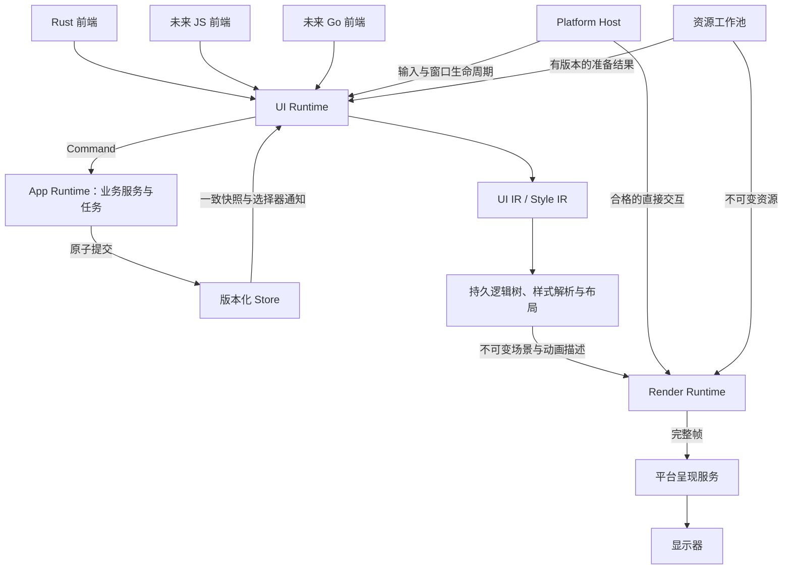
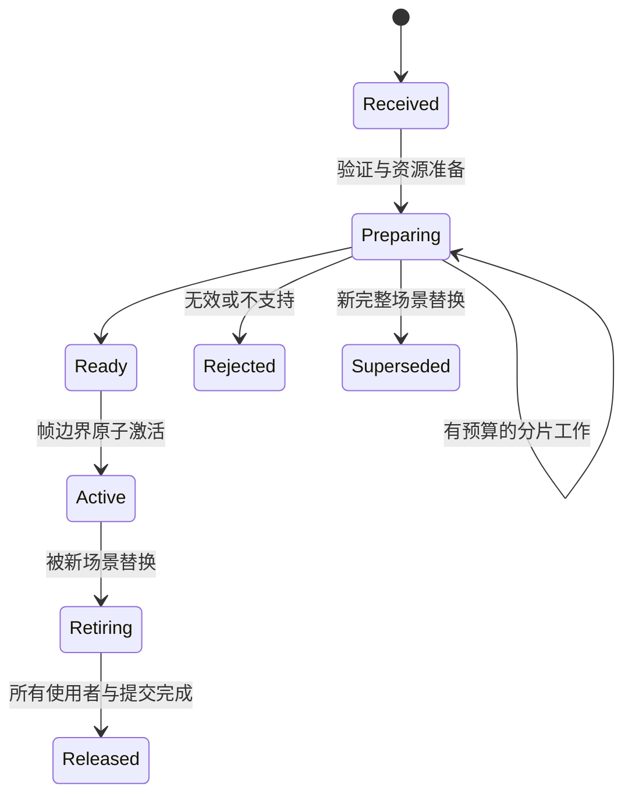

# UI IR、Store、Command 与独立渲染动画架构

状态：设计草案，已开始落地框架层；Rust 优先，预留 JS、Go。当前实现已新增与 Taffy 解耦的 `LayoutStyle` Flex 契约、建树入口、动态布局属性事务和布局方向类型；其余拟议 UI IR、Store/Command、组件宏、独立呈现仍未实现，也没有改变原有总目标的验收状态。

日期：2026-11-13。实现对照取自 `codex/rendering-performance-research`；本次更新包含未提交的框架层改动。本文是架构映射与实现状态记录；实验能力与正式承诺仍分别列出。

## 1. 要解决的问题

框架以 GPUI 为基础，提供一套比底层绘制更完整的界面抽象：应用用 Rust 编写时自然、可检查；以后用 JS 或 Go 编写时，复用同一个 UI 语义与渲染内核。

优先解决四个会影响公共 API 的问题：

1. 界面逻辑和业务逻辑分开：UI 从 Store 读业务状态，通过 Command 请求业务操作。
2. 样式和动画是可分析的数据：样式 API 参考 StyleX，动画描述可以交给渲染运行时独立执行。
3. 已经启动的合格动画，不依赖 UI 构建线程每帧响应；新界面准备、图片解码、业务任务不得阻塞其推进。
4. 面向现代桌面 GPU 验证持续 120 Hz 和尾延迟；CPU 渲染首先保证输入、任务调度和完整画面的连续交付，允许明确选择较低画面更新频率。

120 Hz 的帧间隔约为 8.333 ms，60 Hz 约为 16.667 ms。这是限定硬件、分辨率、内容与特效预算下的验收目标，不是任意场景的实时保证。CPU 模式也不能以偷偷丢文字、改变裁剪或显示半帧换取“流畅”。

本设计首先适用于桌面。现有 [Android 线程决策](ARCHITECTURE_DECISIONS.md) 不被本文自动替换；Android 必须另做平台可行性验证。本轮不引入 DLSS，不承诺完整 CSS、DOM、StyleX 源码兼容，也不要求立即拆出很多 crate。

## 2. 总体架构与线程所有权



“业务后端”是 App Runtime；“渲染后端”是 GPU/CPU 实现。公共文档和接口中不混用这两个词。

| 所有者 | 负责 | 不允许依赖 |
| --- | --- | --- |
| App Runtime / 执行器 | 领域状态、Store 写入、Command、IO 与业务任务 | UI 节点、Taffy、GPU 对象 |
| UI 构建线程 | 组件、LocalState、绑定、样式、持久 Logical Tree、布局、界面事件回调 | 同步等待 GPU 完成；在渲染线程执行任意前端回调 |
| Render Runtime | ActiveScene、动画时钟、呈现属性、GPU/CPU 资源、缓存、提交与退休 | UI 线程持有的锁、Rust/JS/Go 任意回调、逐帧 Store 往返 |
| Platform Host | 系统事件、窗口生命周期、平台要求在线程内完成的操作 | 长业务计算、完整 UI 构建、同步全帧 CPU 光栅化 |
| 资源工作池 | 图片解码、可并行的文字准备、缓存准备及大对象退休 | 未经许可调用有线程亲和性的系统 API |

UI 构建线程应在该线程内创建和持有现有 `Rc` 类型；不能给现有 `LogicalUi`、`Signal` 或 `gpui::Window` 强加跨线程传递。依赖平台字体服务的操作使用异步请求和有版本的结果，Render Runtime 不同步回调 UI 获取文字测量。

渲染线程独立与窗口呈现独立需要分别验收。若最终 `draw/present` 仍必须等阻塞中的 UI 回调，后台渲染完成也不能保证屏幕动画继续。平台能力显式区分：

- `IndependentPresentation`：UI 构建停顿时，平台事件与呈现服务仍可推进已接纳的动画。
- `HostDrivenPresentation`：只能在宿主调度绘制时更新，不能宣称上述保证。

第一阶段先验证最小窗口的独立呈现。一个窗口始终只有一个明确的 swapchain/呈现所有者，不让 GPUI 和新运行时竞争控制。若平台要求主线程呈现，主线程保留轻量呈现服务，将重 UI 工作移走。系统主线程本身被堵塞、GPU 饱和、驱动停顿不在 UI 隔离保证内。

## 3. UI IR：稳定的界面语义，不是 GPU 指令

### 3.1 两层表示

| 表示 | 用途 | 稳定性边界 |
| --- | --- | --- |
| UI IR + Style IR | Rust/JS/Go 前端共同表达结构、属性、样式、绑定、事件与语义 | 版本化的框架契约 |
| Render Scene / LocalFrame / FramePacket | 布局后的绘制内容、空间属性、资源引用、GPU 更新计划 | 内部实现，可以随后端演进 |

不把当前 `FramePacket` 或原样 Taffy `Style` 定为跨语言协议。Taffy 保留为内部布局引擎；公共维度、Flex、测量和响应式行为由框架定义。

当前已落地第一条框架边界：`gpui_box::retained::layout` 提供
`LayoutStyle`、`Dimension`、`Length`、`Edges`、Flex 方向/换行/对齐、
`AlignSelf`、布局影响型 `Overflow` 及
`LayoutDirection`。`UiTree::new_layout`、`append_layout`、
`LogicalUi::new_layout` 和 `append_render_layout` 在进入持久树前验证并
转换到 Taffy；调用方不需要把 Taffy `Style` 放入新 API。运行时更新通过
`Transaction::layout_style` 与 `Property<LayoutStyle>` 进入同一原子预检，
非法值返回 `InvalidStyle`，不会发布部分布局。`LayoutEnvironment` 也已改用
框架自己的方向类型。`main_cross_gap(main, cross)` 保存逻辑主/交叉轴间距，
在最终 lowering 时按最终 `flex_direction` 解析，避免 builder 调用顺序改变
布局语义；`gap(row, column)` 仍表示物理 CSS row/column gap。旧的 Taffy 入口暂时保留作迁移兼容层，因此这不是完整
CSS Flexbox 或最终跨语言 ABI；Grid、复杂 `calc()`、完整 intrinsic/baseline
契约、Style IR 序列化和组件宏仍未实现。

本轮又补齐了 Flex `order` 的框架适配层：`LayoutStyle::order` 默认值为 0，
相同 order 保持逻辑子节点顺序，Taffy 只接收降低后的 `Style`，稳定排序由
adapter 在 `set_children`、布局提取、绘制顺序和命中索引前统一应用。逻辑树仍保存
原始 sibling 顺序；order 更新会进入原子事务、触发布局并重建视觉顺序，旧的
Taffy `Style` 更新不会把公共 order 重置为 0。该实现已用两个节点覆盖反转位置、
命中顺序、同值稳定性和动态更新；没有修改 `vendor/taffy` 本体。它仍不是完整
CSS order 兼容承诺：Grid order、匿名 flex item、复杂 stacking/context 和完整
baseline 传播仍未实现。

响应式方向也已有第一条新 API：`LayoutBreakpointStyles` 和
`LayoutResponsiveBindings` 接收/绑定 `LayoutStyle`，按 `LayoutEnvironment`
的逻辑 viewport 和 `LayoutDirection` 做离散断点选择，再通过同一布局属性
事务提交。旧 `BreakpointStyles` / `ResponsiveBindings` 保留用于迁移和受限
容器查询；新的 viewport 路径不再要求业务代码构造 Taffy `Style`。断点选择
仍然是显式样式切换，不把结构自适应、完整 CSS 查询或自动迭代反馈循环伪装
成已实现能力。

容器查询也已迁移出 Taffy 风格入口：`LayoutResponsiveBindings::bind_container`
接受框架自己的 `LayoutQuery` 语义，在窗口样式应用和第一次布局后读取 query
container 的 resolved content width，再做一次后代样式事务和最终布局。最多两次
布局，不迭代到“碰巧稳定”；target 不能是 container 自身或 container 的祖先，
否则返回 `UnsafeContainerQuery`。这提供了可复用的公共容器查询边界，但仍不
支持 shrink-wrap 自依赖、复杂嵌套反馈、完整 CSS 条件规则或任意 `calc()`。

布局输入/输出也开始脱离 Taffy 类型：`LayoutAvailableSpace`、
`LayoutConstraints` 和 `LayoutResult` 是框架自己的约束与局部结果契约。
`UiTree::frame_with_constraints`、`ReactiveUi::frame_with_constraints` 与
`LogicalUi::frame_with_constraints` 接受该约束对象；原有 `frame([w, h])`
仍是确定窗口 viewport 的兼容入口。当前可绘制 frame 要求宽高为
`Definite`；`MinContent`、`MaxContent` 已可通过独立的
`measure_with_constraints` 查询进行 intrinsic 测量，且不会发布绘制 frame；
`Unbounded` 仍明确拒绝，因为当前 Taffy 版本没有等价的公开约束值。
`measure_node_with_constraints(node, constraints)` 可以对任意活跃子树执行
同样的 measure-only 查询；结果局部于被查询节点，不发布 frame，也不把子树
临时几何误认为已提交的 `layout_result`。查询运行在持久布局树的 owned clone
上，不改写正式 Taffy 缓存、已发布几何或 frame revision。
`layout_result`
返回 parent-local 的 size/location、派生 content size、border/padding、margin
和 scrollable overflow；世界
变换、设备像素取整和完整 baseline 语义仍在后续阶段，当前 Taffy 适配无法提供
叶子 measure snapshot 的 baseline 现在会随正式布局发布到 `LayoutResult`；容器
或没有稳定叶子 baseline 的节点仍返回 `None`。这一步建立了 API 边界，但不等于完整 intrinsic、
baseline、Grid 或 `calc()` 已完成。

UI IR 的最小数据集合：

- `RuntimeId + Epoch + NodeId(generation)`，区分运行时、重建和节点复用；组件 `ScopeId` 与渲染父子关系分开。
- 同一组件作用域内稳定的 sibling key；重复 key 报错，不能静默错绑状态。
- Box、Text、Image 等基础节点；高层组件展开为基础节点，同时保留组件作用域和调试来源。
- 类型化属性值、StyleRef、资源句柄、BindingRef、HandlerId、可访问性语义、焦点与命中行为。
- create、set、reparent、remove 等变更；回调仅以 HandlerId 引用，闭包留在对应前端注册表内。

协议中不能出现 Rust 闭包、JS 对象指针、Go 指针、GPU 指针或要求布局线程同步执行的任意函数。动态测量由内置布局/文字服务或预先提交的测量结果满足。

### 3.2 快照、增量和事务

`UiSnapshot` 用于首次装载与恢复；`UiBatch` 包含 schema version、runtime epoch、base revision、batch sequence 和操作。先在草稿上校验最终拓扑、资源、属性和生命周期，再原子发布。失败时保留原树，不泄漏已分配但未提交的句柄。

同一属性的重复写只提交最后的有效结果，同值不传播。结构变化只重建受影响组件作用域；属性绑定尽量直接更新现有节点。外部提交的 dirty 分类只是提示，不能绕过内部等价性与资源校验。

基线 revision 不匹配时返回明确的 `ResyncRequired`。可跨过中间版本的是完整、可恢复的视觉快照；依赖前一批的裸增量不能任意丢弃。batch sequence 支持识别重放，不能由“收到两次”产生重复创建。

节点退出时区分逻辑卸载和可选的视觉退出副本。视觉副本只保留动画所需内容与资源，不保留已失效的业务回调；退出完成后按 GPU/CPU 使用完成状态退休。

### 3.3 版本域

StoreRevision、UiRevision、SceneRevision、StyleEpoch、ResourceEpoch、DeviceEpoch、FrameId 分别编号，通过来源信息关联，不能共用一个“当前版本”。

例如 Command 成功并返回 StoreRevision，并不说明该版本已经被 UI 应用，更不说明已显示。每一阶段反馈名称必须体现证据层级：committed、applied、adopted、submitted、gpu_completed、present_attempted、displayed。

### 3.4 Rust 开发入口：use_*、#[component]、view!

公共开发入口采用组件函数、作用域 hooks 和声明式 view。底层显式 Context API 保留，供运行时、测试及其他前端适配使用。完整示例见 [Rust 界面示例](UI_RUNTIME_RUST_EXAMPLE.md)；所有宏和新增 API 都是拟议接口。

| 入口 | 责任 | 不承担的责任 |
| --- | --- | --- |
| `#[component]` | 生成组件类型/props 包装、调试来源、挂载入口 | 不重写函数中所有普通 Rust 控制流，不分析任意函数的业务语义 |
| `view!` | 将节点、动态属性、if、match、带 key 列表降为持久结构与订阅 | 不把 Rust 闭包或任意业务判断送到渲染线程 |
| `use_state` | 当前组件作用域中的局部状态 | 不提供全局变量或业务 Store 写权限 |
| `use_store::<StoreKey>()` | 查询最近 provider，取得对应 ReadStore | 不按状态结构类型猜测业务实例，不默认创建缺失 Store |
| `use_command::<C>()` | 取得单个类型化 Command 的发送句柄 | 不开放任意业务方法，不承载逐帧动画坐标 |
| `use_memo` | UI 侧的纯派生计算，动态追踪依赖并同值拦截 | 不做 IO、发命令或修改依赖来源 |
| `use_context / use_focus / use_window` | 按需取得受限能力 | 不暴露可任意跨线程访问的 gpui::Window |

StoreKey 关联一个 State 类型；同类型的多个业务 Store 可用不同 key 或显式 provider 实例区分。provider 随应用/组件作用域管理，不是进程全局单例。缺失必需 provider 在挂载时报告带组件路径的错误；可选依赖另用 `try_use_*`。v1 已解析的 provider 实例在该消费作用域存活期间不悄悄更换；需要替换 provider 身份时显式重新挂载，Store 内部值变化不需要重新挂载。

### 3.5 构建一次的准确含义

组件每次挂载执行一次初始化函数，建立 LocalState、订阅、事件句柄与控制流区域；以后依赖变化只重新求值对应 binding、memo 或控制条件。默认不因每次 Store 更新而重跑整个组件函数。卸载后重新挂载则重新初始化。

`view!` 内节点参数/动态属性编译为有依赖追踪的表达式；事件闭包是延后执行的 handler，不在构建时执行。`if` 条件、`match` 的 scrutinee/guard、列表源分别建立跟踪区域。一次求值只读取固定的输入快照；依赖集合按实际读取更新，移除不再使用的订阅。控制表达式必须纯且可终止，禁止写状态、IO、await 和发 Command。

宏外普通 Rust `let label = source.get();` 是初始化时快照，不会自动更新；需要持续变化时写 `use_memo(move || ...)` 或把读取放入 `view!` 动态表达式。直接传入类型化 Binding/ReadProp 时，属性接入该绑定，而不是把句柄显示为字符串。

hooks 只能在组件初始化或同步自定义 hook 的固定调用路径上调用，不能在事件、异步任务、普通条件/循环、memo 或属性表达式里调用。第一版要求分支/列表的有状态内容提取成子组件；不允许在 `view!` 的分支里临时声明 `use_state`。宏检查可见违规；跨函数行为仍需运行时作用域检查，不声称宏能静态发现所有违规。

内部状态槽只在挂载初始化期间分配，不要求对每次更新做 React 式整函数重执行。为将来显式重建或诊断保留槽位身份，但不承诺源码行号变化后的热重载状态保留。

当前组件作用域可以由安全封装的线程局部作用域栈提供，支持嵌套且在 panic/unwind 后恢复；不能用无保护的全局裸指针。作用域不跨 await。UI 本地句柄不允许 Send；延迟到达的事件按 generation 丢弃，后台结果通过有生命周期检查的通道投递。显式 `try_get/try_set` 在作用域销毁后返回 ScopeDisposed；同步便捷读写访问已销毁状态属于程序错误，不能访问复用槽位中的新状态。

组件参数显式区分 `ReadProp<T>` 与普通 `T`：前者是存活期内可更新的输入，后者是挂载参数。view 宏为 ReadProp 参数建立绑定；不能把动态值偷偷变成普通参数的首次快照。传入普通参数的动态来源需显式 snapshot 或改用 ReadProp，已挂载普通参数若必须改变，则显式更换组件 key 重新挂载。首版宁可要求类型标注，也不根据宏无法完整分析的函数实现猜测更新方式。

### 3.6 if：区域身份与分支挂载

```rust
view! {
    if expanded.get() {
        DetailPanel()
    } else {
        Text("详情已收起")
    }
}
```

概念上转换为条件求值器、then/else 工厂和稳定的 BranchSite。BranchSite 不额外产生可见布局盒。该区域身份由父作用域、宏生成的结构位置标识组成；活动分支身份还包含 arm 标识。不同位置的两个相同组件或不同分支内的相同组件不自动共享状态。

- false → false / true → true：不重建分支；分支内部依靠自己的绑定更新。
- false → true / true → false：准备新分支，校验成功后原子替换；旧分支卸载，释放局部状态和订阅，新分支首次挂载。
- 无 else 相当于空分支；没有活动内容时仍保留条件区域，以便未来激活。
- 同一事务中条件多次改变只依据最终提交值，不创建不可见的中间分支。
- 准备失败时丢弃新分支的临时资源，保留旧的已提交 UI 并报告错误；挂载副作用只能在成功提交后触发。

条件变化并不要求整个根组件重新运行。选择器和工厂在 UI Runtime 执行，不在 renderer 执行；UI 阻塞时不能保证尚未提交的分支切换立即出现。

### 3.7 match：保留 arm，更新 payload

```rust
view! {
    match phase.get() {
        Phase::Idle => Text("等待开始"),
        Phase::Running => BusyIndicator(),
        Phase::Ready { name } => Text(name),
        Phase::Failed { message } => ErrorBanner(message: message),
    }
}
```

宏生成普通 Rust 的模式检查来验证类型、穷尽性与 guard 顺序。每次求值先取得同一快照的 scrutinee，按源码顺序选择首个匹配且 guard 为真的 arm；guard 中响应式读取也被追踪，要求纯表达式。

每个源码 arm 有独立身份，不以整份 enum 值作 key。`Ready { name: A }` → `Ready { name: B }` 保留同一个 arm 的组件和 LocalState，只更新其 payload；`Ready` → `Failed` 则默认卸载旧 arm、挂载新 arm。两个模式属于同一个 arm 时共享该 arm 身份；相同组件出现在不同 arm 中仍是不同实例。

为避免捕获第一次匹配的旧字段，arm 工厂得到的绑定字段是可更新的只读 `ReadProp<T>`。例如上面的 `name` 可直接交给 Text；在计算表达式/事件中用 `name.get()` 读取当前值。guard 中的模式变量仍是此次选择用的普通快照值。分支使用的 payload 必须可拥有，不能把借用 scrutinee 的临时引用保存到组件中；v1 要求绑定字段可 Clone，较大数据用 Arc/资源句柄。

同一 arm 的多个字段更新与分支内属性变更在一个 UI 事务中提交，避免新 name 配旧 id。若 guard 使选中的 arm 改变，即使 enum variant 没变，也执行分支切换。内部异构分支由生成的枚举/组件包装统一，不要求应用手写 `Box<dyn View>`。

### 3.8 列表 key：身份与数据分开

```rust
view! {
    for row in rows.get() key row.id {
        ReportRow(report: row)
    }
}
```

这是 view DSL，不是原生 Rust for 语法。key 表达式在本次列表项目快照上求值；列表 body 中 `row` 为持续更新的 `ReadProp<Report>`。子组件显式接收该类型，从而同 key 的新数据能更新，不捕获初始项目副本。

动态列表强制提供稳定 key；不隐式使用 index。key 只在一个 ListSite 内唯一，身份为父组件作用域 + ListSite + key + 子组件类型。字符串或整数等 key 必须有稳定相等语义，不使用浮点数或对象地址。

| 列表变化 | 生命周期 |
| --- | --- |
| 同 key、同类型、数据变化 | 更新 ReadProp，保留状态和组件实例 |
| 同 key、同类型、顺序变化 | 移动对应输出；保留状态与合格的焦点/捕获身份 |
| 新 key | 挂载新作用域 |
| 删除 key / 被过滤掉 | 默认卸载，清理本地状态 |
| 删除后下一次事务重新插入相同 key | 新 generation、新实例；不恢复旧状态 |
| 改变 key 或同 key 更换组件类型 | 旧实例卸载，新实例挂载 |
| 从一个 ListSite 移到另一个 ListSite | 默认卸载再挂载；不是跨列表状态迁移 |
| 最终列表包含重复 key | 整批拒绝，保留旧列表并给出重复位置；不能部分应用 |

相同 key 在同一事务内先删除后恢复时，以最终集合判断，可保留原实例；不能把这个规则扩展到已经提交的两个事务之间。key 求值和最终重复检测必须发生在挂载/卸载副作用之前。

筛选恢复不等于排序：排序保留实例，筛掉后恢复默认重置局部状态。跨筛选/虚拟化仍需保留的草稿，应提升到父组件或按业务 id 管理的状态容器，不能靠一个 key 自动永久缓存。通用虚拟列表将来单独定义状态驻留预算。

### 3.9 分支状态、KeepAlive 与退出动画

默认采用卸载释放。逻辑卸载时清理 handler、订阅、组件任务和 effect，焦点/捕获按平台规则转移；业务 application scope 的 Command 不因此取消。渲染资源按现有多帧 lease 规则延后退休。

需要保留的分支显式写：

```rust
view! {
    KeepAlive(max_entries: 1, max_bytes: mib(2)) {
        if expanded.get() {
            AdvancedOptions()
        }
    }
}
```

第一版 KeepAlive 面向直接包裹的 if/match 分支，缓存键由 KeepAlive 所有者、BranchSite 与 arm 组成，不把任意全局组件按名字缓存。

| 状态 | LocalState | 订阅/任务 | 输入、布局、渲染 |
| --- | --- | --- | --- |
| Active | 保留 | 正常更新 | 正常参与 |
| Inactive（KeepAlive） | 保留 | 暂停 UI 订阅；激活型 effect 清理；组件任务请求取消 | 不布局、不绘制、不命中、不出现在活动可访问性树 |
| Reactivating | 保留 | 先刷新 props、provider 的当前值及 Store revision，再恢复 effect | 完整验证提交后才重新可见 |
| Disposed / Evicted | 释放 | 最终清理 | 后续重新进入是新实例 |
| 退出动画的视觉副本 | 不保留逻辑状态 | 没有业务 handler | 只用于动画，结束后退休资源 |

inactive 期间 Command 仍可更新应用 Store；恢复时读取最新完整 revision，不重放每次视觉通知。取消不是立即停止外部副作用；旧激活周期的异步 UI 回写通过 activation generation 拒绝。on_activate/on_deactivate 与最终 on_dispose 分开，清理必须幂等。

非活动分支默认停止动画；重新激活按新激活周期重新建立动画，默认从 base/enter 定义开始，不把隐藏的几十秒当作仍在执行的时间线。需要保留时间进度时另设显式动画策略。同一活动作用域中的相同 Motion 描述保持稳定身份，主题或无关 Store 更新不能让循环动画从头开始。

缓存限额是强制的，超限按明确淘汰顺序 dispose，无法计量/限制的用户状态不得承诺硬字节上限，需采用可计量容器或拒绝该驻留能力。父作用域被卸载或 provider 身份变化需要重新挂载时，缓存一并销毁。KeepAlive 不承诺无限保存，也不默认保留 GPU 光栅缓存。

退出动画只保留无交互的视觉快照，不能借此延长组件订阅或让删除按钮仍能触发命令。动画退出尚未结束又进入时，默认创建新逻辑实例；如需复用旧逻辑状态，应显式使用 KeepAlive。状态保留和像素缓存是两个独立决策。

### 3.10 宏、运行时与跨语言边界

推荐实现次序：显式 Context + Branch/Match/KeyedList 运行时原语 → use_* 作用域接口 → component/view 宏。宏展开可查看，报错指向用户源码，保留组件、分支和 key 路径供检查器使用。

宏生成的条件求值器、模式投影和事件闭包留在 Rust UI 前端；共同 UI IR 接收作用域身份、节点批次和 handler/binding 引用，不携带 Rust AST/闭包。JS/Go 将来在各自前端实现相同选择、key 和生命周期契约。宏不能替代运行时，也不能保证任意 Rust 条件在 UI 阻塞时继续求值。

实现映射：现有 LogicalUi 的 ScopeId/key/清理逻辑作为身份基础，ReactiveUi 的依赖与事务作为控制区域基础；ReadProp、分支激活、KeepAlive 和宏属于新增能力。先做无宏原语的生命周期验收，再做宏展开和编译诊断，避免宏语法完成就认为运行时已完成。

## 4. Store：业务状态的一致读取接口

拟议接口为 `StoreWriter<S>`、`ReadStore<S>`、`Selector<T>` 和 UI 内部的 `LocalState<T>`。现有 Signal 继续服务 UI 内依赖传播，不直接承担跨线程业务状态容器。

| 状态 | 默认所有者 | 示例 |
| --- | --- | --- |
| 业务状态 | App Store | 文档、账户、保存状态、任务进度 |
| 界面局部状态 | UI Runtime | 临时草稿、展开项、选中 tab；需要持久化时再提升 |
| 运行时状态 | 平台/渲染/UI 各自所有者 | 焦点、IME、捕获、动画当前采样值 |

一个 Store 是原子事务边界。提交发布不可变 revision；同一次 UI 更新的所有 selector 固定读取同一 revision，避免“新标题配旧内容”。跨 Store 一致性必须通过显式协调快照或合并业务 Store 实现，不假定自动存在。

可以把尚未处理的多个视觉通知合并为最新完整 revision，但不能逐字段合并出从未提交过的状态。审计、业务事件和 Command 结果不能走 latest-only 通道。现有 `UpdateSender` 的按 source 合并只适合作为 UI 视觉源桥接，不等同于 Store 事务。

复杂业务派生值由 App Runtime 计算；轻量展示派生值在 UI 侧计算并按依赖失效。集合提供按稳定 key 的 insert/update/remove/move，避免每次更新重建大列表。Store 发布不能同步执行所有订阅回调；视觉接纳与采样预算要尽可能置于昂贵的 UI fan-out 之前。

selector 的相等判断与订阅取消要有明确成本和生命周期。组件销毁取消订阅；业务 Store 不随组件销毁。线程间传递只读快照与消息，不共享可随意修改的状态。

## 5. Command：有结果、有生命周期的业务意图

`Command` 表达业务行为，例如 `SaveDocument { id, draft, expected_revision }`，而不是向所有语言暴露任意 `SetStoreField`。

拟议 Command 定义 Output、Error，发送返回 `CommandTicket`：request id、接纳状态、异步结果和取消请求入口。完整状态区分：

```text
Created -> Accepted -> Running -> Succeeded / Failed / Cancelled
       -> Rejected
```

发送前先明确有界队列容量。未接纳返回 Busy/Closed 等错误，不静默丢请求。对同一领域对象的冲突修改按明确顺序执行，不同对象可并行；慢 IO 在工作任务中执行，提交 Store 前重新验证 expected revision。

取消是请求，不等于回滚已发生的外部效果。重试依赖业务幂等键，不承诺神奇的 exactly-once。Command 结果可以附带 committed StoreRevision，调用方按需等 UI applied；普通保存操作不必等待显示器呈现。

任务作用域区分 application、window、component。组件卸载取消自身订阅和短期界面任务，不自动取消用户已经发出的保存、下载。错误保留上一份一致状态，失败呈现由显式错误状态驱动。

```rust
// 拟议用法，仅表达职责；不是当前可编译 API。
let document = stores.document.read().select(DocumentSelectors::title);
let saving = stores.document.read().select(DocumentSelectors::saving);

Text::new(document);
Button::new("保存")
    .disabled(saving)
    .on_press(move |ui| {
        commands.send(SaveDocument {
            id,
            draft: ui.read_local(draft),
            expected_revision: ui.observed_revision(document_store),
        })
    });
```

事件闭包留在 Rust 前端注册表内，UI IR 只记录 HandlerId。JS/Go 将来使用相同 Command schema 和句柄语义，不要求共享 Rust 泛型对象的内存布局。

## 6. 样式 API：参考 StyleX，输出原生 Style IR

### 6.1 借鉴范围

StyleX 将样式定义为可静态分析的数据，并提供组合、变量和子树主题。我们借鉴其开发方式；后端输出是 Style IR，不是 CSS class。静态定义与类型化参数可以提前规范化，动态值保留为受检查的槽位。[样式定义](https://stylexjs.com/docs/learn/styling-ui/defining-styles/)、[变量定义](https://stylexjs.com/docs/learn/theming/defining-variables/)

第一步提供类型化 Rust builder 和稳定的 Style IR，随后增加 `styles!` / `tokens!` 等编译期前端。宏与 JS 构建插件是同一契约的不同入口，不让 Rust 使用者依赖 Node/Babel，也不在第一版声称已经实现完整 AOT。

| StyleX 的参考点 | 本框架拟议设计 |
| --- | --- |
| 命名样式与可分析定义 | StyleSheet / StyleRef；静态规则驻留，动态值独立存储 |
| 有序组合 | compose(base, variant, external)，由使用顺序确定覆盖 |
| 变量组与主题 | 类型化 TokenGroup、ThemeGroup，作用于逻辑子树 |
| 条件样式 | 类型化 State / Environment 条件，编译为可检查的属性规则 |
| 跨组件传入样式 | component style、公开 parts 和 slot；不依赖私有节点选择器 |

StyleX 对同名属性采用后应用者覆盖，但默认 shorthand/longhand 使用 property-specificity，长写可压过后来的简写。因此“所有声明都简单后写赢”不是其完整默认规则。[组合规则](https://stylexjs.com/docs/learn/styling-ui/using-styles/)

本框架建议采用更单一的原生规则：先把 padding 等简写展开为原子属性，再按组合顺序覆盖。这是有意与 StyleX 默认行为不同的地方，必须出现在文档、检查器和兼容测试中。

### 6.2 拟议 Rust 写法

```rust
// 设计示意：以下类型和函数名尚未实现。
let colors = TokenGroup::define("app.colors", ColorDefaults {
    surface: Color::rgb(248, 249, 251),
    text: Color::rgb(24, 28, 36),
    accent: Color::rgb(68, 100, 240),
});

let base = Style::new()
    .padding(Edges::all(dp(12.0)))
    .radius(dp(8.0))
    .background(colors.surface())
    .foreground(colors.text());

let primary = Style::new().background(
    cases(colors.accent())
        .when(State::Hovered, Color::rgb(58, 88, 220))
        .when(State::Pressed, Color::rgb(48, 72, 190))
);

Button::new("保存")
    .variant(ButtonVariant::Primary)
    .style(compose([base, primary, external_style]))
    .part(ButtonPart::Label, label_style)
    .motion(Motion::transition(
        Property::Opacity,
        Tween::new(ms(120), Ease::Out),
    ));
```

这些定义可以由 Rust 宏、JS 编译器或 Go builder 产生同一份 Style IR。跨语言一致性以 IR 测试向量为准，不以语法相似为准。

### 6.3 确定性的覆盖规则

按以下步骤得到每个原子属性的唯一 base value：

1. 展开简写；同一个样式定义内重复原子属性报诊断，避免哈希遍历决定结果。
2. 按 compose 的参数顺序选取该属性最后一个声明。后来的声明替换整个条件规则，不暗中合并 hover 分支。
3. 在选中的规则内从 default 开始，按声明顺序检查条件；最后一个匹配项获胜。交集条件显式写出，避免依赖隐藏 specificity。
4. 在该节点的主题作用域内解析 token，并解析 binding 的当前值；再执行类型、范围和后端能力验证。
5. 根据实际值差异生成布局、文字、绘制、合成或资源失效；动画采样叠加为 presentation value。

例如，base 中 padding=12，再组合 padding_left=20，左侧为 20；再组合 padding=6，则四侧都是 6。外部 background=红色会覆盖组件原有的 default/hover/pressed 整套 background 规则；需要保留交互差异时，调用者传入完整条件规则。

“没有声明”“恢复框架初始值”“继承允许继承的属性”必须是不同的类型化操作。组合列表中的 None 只代表不应用该样式。v1 不引入字符串形式的 CSS `!important`、全局选择器优先级或 `revert` 层叠。

binding 也是属性声明的值来源，受相同组合规则约束；不再由隐藏的 imperative setter 每帧覆盖。每个属性最多一个被选中的 base 来源和一个明确的动画控制者。调试器能解释最终赢家、被覆盖声明、主题来源与更新路径。

### 6.4 Token、主题、组件 parts

Token 按 Color、Length、Font、Duration、Curve 等类型分组，默认值完整，引用缺失或循环报错。派生 token 只使用可分析表达式；不得在 Render Runtime 执行任意用户函数。

默认主题按逻辑组件树继承，不按 portal 的渲染父节点继承；弹窗沿用创建它的逻辑主题，显式 `ThemeScope` 可切换到宿主主题。只有列明的文本属性允许继承，布局、边框、尺寸不隐式继承。

拟议 `ThemeGroup::create` 替换整个变量组，未填写项回到该组默认值，同一作用域中最后应用的同组主题获胜。这参考 StyleX 的 createTheme 行为，不是“未填写就沿用外层覆盖值”。以后若需要增量合并，另设 `ThemePatch` 并明确基准，不能复用同名 API 改语义。[主题规则](https://stylexjs.com/docs/learn/theming/creating-themes/)

组件必须公开足够的定制面：

- tokens 处理全局颜色、字号、间距、圆角、动效等设计变量。
- variants 表达 primary、danger、compact 等组件意图。
- parts 表达 root、label、icon、track、thumb 等稳定的可样式化部位，并限定允许的属性集合。
- slots 用于需要替换结构的内容；仅靠颜色 token 不能替代结构定制。

默认组合次序为组件基础样式、variant、调用者样式。必须保留的内部布局约束应通过 parts 类型限制或明确报错表达，不在调用者后面偷偷覆盖。disabled、可访问性角色和可操作性属于语义，不能通过改颜色或样式绕过。

### 6.5 状态、响应式与动画的边界

v1 条件包括 hover、pressed、focus-visible、disabled、selected，以及窗口逻辑宽度、主题偏好、对比度偏好和 reduced-motion。容器条件复用现有响应式布局约束；仅支持无自依赖或经过限制的查询，循环依赖报错，不反复重排到“碰巧稳定”。

规则按能力分层：

| 条件导致的变化 | 执行位置 | UI 构建停顿时 |
| --- | --- | --- |
| 已预编译、资源已备好的 translation / isolated opacity | Render Runtime | 可独立执行 |
| 颜色、描边等 paint 更新 | 合格渲染路径；否则 UI | 需满足重绘预算，不能视为零成本 |
| 字号、宽高、Flex、内容和结构 | UI 样式/布局阶段 | 不承诺继续重排 |
| 任意 Rust/JS/Go 条件回调 | 对应前端运行时 | 不得成为独立动画的逐帧依赖 |

快速交互规则必须随场景一起提交并通过验证；不能假定所有 hover 都天然能绕开 UI。字体 token 改变会触发测量和布局；颜色 token 可能使光栅缓存失效；opacity 也只有合格的隔离合成路径才便宜。

主题切换以 StyleEpoch 关联整份一致场景。大量 token 消费者变化仍可能是 O(N)，进入 PendingScene 的预算化准备，不在渲染线程同步重算全树。reduced-motion 是明确的运行时策略：缩短/移除非必要运动时仍保证终值与交互语义一致。

静态分析减少解析与重复工作，不消除光栅、混合、带宽和特效成本。样式 API 应提供成本诊断与不支持的能力错误，而不是让“像 CSS 一样能写”被误读为“一定可以 120 fps”。

## 7. 动画：目标值、时间线和呈现值分开

Render Runtime 持有三类状态：

| 状态 | 内容 |
| --- | --- |
| SceneSnapshot | 已提交的结构、内容、属性基础值与资源句柄 |
| AnimationState | 时间线、目标、曲线、开始时刻、必要的速度与控制序列 |
| PresentationState | 本次目标呈现时间采样出的实际属性覆盖值 |

Store 记录业务目标，例如面板应该展开；UI 选择动画并提交描述；Render Runtime 按时钟采样位置或透明度。不要把动画的每帧坐标写回 Store，再通知 UI 生成下一帧。

### 7.1 AnimationSpec

动画描述至少包含 target node generation、property、destination、curve、start policy、replace policy、animation id 和依赖的 scene revision。曲线先支持 Tween、Keyframes 和可有界求值的 Spring。

默认起点为场景激活时刻，支持显式单调时钟起点；默认重定向从 Render Runtime 当前呈现值开始，spring 可按明确规则保留速度。每个属性 v1 只允许一个动画控制者，不默认叠加多个来源；未来 additive 模式必须另定变换顺序。

新场景不会无条件把正在运动的属性重置为 UI 侧旧值。新 target 按序号接管，cancel/finish/remove 都有明确结果。若动画关联的待激活场景被替换，返回 Superseded/NotStarted，不能静默丢掉控制命令。

已接纳的独立动画不调用用户代码。动画完成通知异步送到 UI；UI 阻塞时通知可延迟，下一段动画若要继续独立运行，应预先放进时间线，而不是等待完成回调再发起。

### 7.2 120 Hz 调度

初期由一个 Render Runtime 线程同时负责采样与提交，避免先拆出动画线程再引入同步。以单调时钟和平台帧节奏为基础，采样目标呈现时间；恢复后跳到当前时刻，不补跑已经过期的每个 tick。没有动画、损伤和待处理控制时休眠。

限制 CPU 准备队列和 GPU in-flight 深度。吞吐更高但排队越来越长不算成功。新资源上传、缓存构建和场景激活也纳入预算；GPU 任务不能仅因“放在另一个队列”就被视为可抢占。

| 动画种类 | 第一阶段承诺 | 限制 |
| --- | --- | --- |
| translation、隔离层 opacity | 首批独立动画候选 | 命中、裁剪、资源和合成语义均需合格 |
| 有限内容内的 scroll / drag | 后续加入直接交互控制器 | 范围、捕获、内容必须事先提交 |
| scale、rotation | 后续扩展 | 文字采样、裁剪和命中需要单独验证 |
| 颜色、渐变参数 | 可表达，按绘制成本执行 | 可能重光栅化，不归为免费合成 |
| 阴影、blur 等效果参数 | 预算与能力约束下支持 | 最坏开销与临时纹理内存必须计入 |
| 宽高、Flex、文本内容 | UI/布局更新 | 不承诺 UI 构建停顿期间逐帧 reflow |

FLIP/布局快照插值是可选视觉策略，不能冒充每帧真实布局。缩放文字、兄弟重排和命中语义必须跟随所选模式定义。

## 8. 场景、缓存与多帧生命周期

### 8.1 ActiveScene 与 PendingScene



准备 PendingScene 时继续显示和动画化 ActiveScene。大场景验证、文字准备、解码和 GPU 上传不能挤占全部帧预算。只有场景、必需资源、命中数据和版本配套完整后才能激活；否则显示旧的完整画面或应用明确选择的占位内容。

场景替换后不能立即复用其 GPU 内存。FrameId、consumer epoch、提交完成值和资源 lease 联合决定退休；设备丢失不能被当成正常完成。大量对象的最后析构和内存回收要由退休任务承担，防止释放旧树在渲染线程制造尖峰。

窗口 resize、DPI、色彩模式和设备重建都推进相应 epoch。老资源可在旧帧仍使用时存活，但不得跨新 epoch 被错误解释。恢复通过完整快照重新同步。

### 8.2 三种复用身份

| 身份 | 必须纳入的内容 |
| --- | --- |
| ContentIdentity | 有序绘制命令、子内容、材质、局部裁剪、图片/字体等资源版本 |
| RasterEnvironment | 设备 epoch、DPI/栅格比例、色彩与 alpha 约定、目标范围、采样相位和质量策略 |
| Placement | 位置/变换，以及经过证明可在外部处理的裁剪和合成属性 |

内容与栅格环境相同，只改变合格 Placement 时复用缓存。祖先整体移动可能复用整层；层内某个子节点改变会使该层内容失效，除非它被单独提升。提升是受内存、层数、重叠和合成成本约束的优化，不能给每个节点无条件分配纹理。

调用者提供一个未变化的 version、hash 或 dirty=false 不足以证明像素等价。身份由受信的内部提交过程和资源版本推导；缓存缺失、冲突或能力不足时退回正确路径。

先保持整数物理位移的严格子集。小数平移/缩放缓存纹理与重新栅格化文字可能不同：需要显式区分 `ExactRaster` 和 `TransformCachedRaster` 视觉契约，不能默默降低保真。外部裁剪与 group opacity 也必须保持原有绘制顺序与隔离语义。

缓存命中率之外，还记录验证成本、准备成本、CPU/GPU 字节、临时分配、驱逐和 in-flight 租约。冷缓存可能比直接绘制更贵；预算包括当前帧、待激活场景和尚未退休的旧帧，不能只统计当前可见纹理。

### 8.3 通道策略

| 通道 | 顺序与合并 | 容量不足或失配 |
| --- | --- | --- |
| Store 视觉通知 | 可合并完整 revision | 保留最新一致状态；记录数据年龄 |
| UI IR 增量 | 按基线有序、原子应用 | 拒绝并要求重同步 |
| 完整 SceneSnapshot | 单个最新 pending，active 独立保留 | 新快照替换 pending；回收被替换准备任务 |
| AnimationControl | 按目标和序列保持因果 | 显式接纳/拒绝；cancel 不可无声丢失 |
| 指针 move | 在不跨越按钮/捕获边界时可合并 | 保留最新坐标和必要顺序 |
| wheel / scroll 增量 | 按语义累计 | 不能只保留最后一段 delta |
| Command、down/up、捕获、生命周期、资源控制 | 可靠有序，关闭语义明确 | 背压或显式失败；不走 latest-only |
| 诊断统计 | 可采样 | 记录采样策略；不拿它承载完成事件 |

通道均有容量、closed、epoch 和 wake 语义，不建立无限队列。平台事件线程不因普通队列满而长时间阻塞：为生命周期保留容量，达到业务容量上限时拒绝新工作，并明确处理溢出/关闭。所谓“可靠”表示已接纳消息不会悄悄丢失，不表示可以无限接纳。

## 9. 输入、CPU 与跨语言接入

### 9.1 命中跟随呈现几何

命中使用与可见场景对应的 scene revision、变换与 clip，而不是最新构建但尚未显示的树。保存 PresentationRecord，包含 FrameId、采样时间、scene revision、属性覆盖和证据阶段。

如果平台只能提供最近提交/呈现尝试记录，就明确标注这一近似，不能宣称知道光子级的真实屏幕状态。事件携带 target generation 和所见 revision；处理延迟事件时重新检查节点/领域对象是否仍有效。

直接 scroll、drag、hover 动效使用预提交的简单控制器，可在 UI 构建停顿时响应；任意业务事件回调仍可能等待 UI。焦点、IME、可访问性语义不能只复制一份静态位图了事，必须和激活场景一起维护。

滚动位置具有独立交互序号，UI 对其确认不能把新位置回写成旧值。虚拟列表超出已准备范围时采用明确的限界或占位策略，不能在渲染线程同步调用前端补内容。

### 9.2 CPU 渲染

复用同一 UI/Style/Scene 契约，GPU 与软件消费者通过能力协商选择执行策略。真正 CPU 光栅化与“GPU 读回再上传”分别命名和验收。

当前 SoftwareJob 的分片模型可作为起点：工作线程分片 prepare/raster，完整输出后才发布，并安装与该图像对应的命中数据。配额表示工作量约束，不等于硬实时的毫秒上界；分配、析构、调度和系统 API 仍要测尾延迟。

持续 120 Hz 的新需求不能让软件任务不断取消而永不完成。允许保留有进展的任务、合并后继视觉请求、限制图像数据年龄；只有显著过时且新任务更有价值时才按明确策略取消。

默认先降低视觉更新频率、合并中间视觉状态、复用已经完成的内容。对装饰阴影等效果允许应用显式选择省略；文字、布局、裁剪、group opacity、交互几何不能隐式改语义。不支持的效果返回能力结果，由产品决定替代或拒绝，而不是悄悄走昂贵 GPU 读回。

### 9.3 Rust、JS、Go

Rust 首先走类型化内存接口，不要求序列化再反序列化。可导出的 UI IR、Style IR、Store 投影和 Command 具有显式 schema；运行时与协议版本握手，类型不兼容明确失败。

JS/Go 将来各自拥有线程/执行器、回调注册表和释放规则，通过批次传递数据，避免每个属性一次 FFI。大图片等通过资源通道和租约传递；跨语言 handle 带 generation/epoch，回调销毁后不能再调用。

JS GC 或 Go GC 停顿不阻塞已接纳的渲染时间线；它们仍可能延迟新 UI/Command。native island 只作为显式逃生口，标明平台、语言、线程与独立动画限制，不让不可移植能力污染通用协议。

## 10. 现有实现怎样迁移

已有实现提供重要底座，但“有持久树/局部上传”不等于完成本设计。下面的“复用”指能力和实现基础，不表示源码可不经审查直接迁移到另一个线程。

| 现有位置/能力 | 迁移方式 | 仍需新增或验收 |
| --- | --- | --- |
| [LogicalUi](../crates/gpui-box/src/retained/logical.rs)：组件 scope、key、逻辑与渲染父子分离 | 作为 UI Runtime 内核，保留作用域生命周期 | 公共 UI IR、组件适配、稳定协议与线程内创建 |
| [ReactiveUi](../crates/gpui-box/src/retained/reactive.rs)：Signal、计算、绑定 | 保留 UI 内增量依赖；Store snapshot 桥接到一次视觉事务 | App Store、revision pinning、集合 delta 和跨线程通知 |
| [delivery](../crates/gpui-box/src/retained/reactive/delivery.rs)：按 source 最新值合并 | 继续作为视觉输入工具 | 不承担业务事件/Command；补一致快照桥接 |
| [事务编辑](../crates/gpui-box/src/retained/edit.rs)及 reactive/logical 编辑器 | 复用草稿、最终校验、同值拦截与批量提交 | UI batch 的 schema、重放/恢复和错误映射 |
| [retained 公共入口](../crates/gpui-box/src/retained.rs)：暴露 Taffy Style | 用新的框架 LayoutStyle、LayoutConstraints、LayoutResult 适配到 Taffy | 公共 Flex、约束/局部结果、尺寸单位、测量及错误契约；旧 API 保留迁移期；intrinsic/baseline 尚不完整 |
| [Paint Store](RETAINED_PAINT_STORE.md)、属性树、实例与批量上传 | 继续作为内部场景与后端优化 | Style IR 到失效路由；数据动画更新 property slot |
| [LocalFrame](../crates/gpui-box/src/retained/local.rs)、[帧队列](../crates/gpui-box/src/retained/frame_queue.rs) | 作为不可变场景与 latest pending 的基础 | Active/Pending 原子激活、可靠控制通道、预算化准备 |
| [FrameClock](../crates/gpui-box/src/retained/pacing.rs) | 保留单调时钟计算 | 真正独立线程、平台节奏与呈现反馈；时钟类型本身不是调度器 |
| [WGPU 消费者](../crates/gpui-box/src/retained/wgpu.rs) | 抽离不需要 Window 的场景消费与资源管理 | device/surface 所有权、平台呈现协议与恢复 |
| [正常 demo](../examples/hello/src/retained_demo.rs)、[GPUI Window](../vendor/gpui/crates/gpui/src/window.rs) | 当前路径作为兼容/对照；逐步接入新宿主 | 当前窗口回调提交/绘制不能作为独立呈现的完成证据 |
| [原生 GPU surface 桥接](ADR_RETAINED_NATIVE_SURFACE.md) | 保留资源 lease、匹配设备与 fence 经验 | 当前是共享纹理 GPU copy 后由 GPUI 绘制；不是独立 swapchain 或零复制 |
| [空间/缓存设计](ADR_RETAINED_SPATIAL_GPU.md)、[整数位移原型](ADR_RETAINED_LAYER_TRANSLATION.md) | 从受限正确性证明逐步扩展 content/placement 分离 | 原型默认关闭；文字、图片、嵌套、小数、通用缓存与内存预算仍需验证 |
| [SoftwareJob](ADR_RETAINED_SOFTWARE_CONSUMER.md) | 复用真实 CPU 光栅消费者与分片机制 | 正常窗口安装、输入/命中、完整能力和持续响应验收 |

实现顺序优先加 facade 与适配层，不要求一次推翻现有 retained API。先在同一 crate 内形成 `app_state`、`commands`、`ui_ir`、`style`、`ui_runtime`、`render_runtime`、`platform_host` 的职责边界，性能和发布边界稳定后再决定 crate 划分。

每个新路径保留明确开关与旧路径对照，比较相同语义和画面。异常回退不得把 `IndependentPresentation` 悄悄降级后仍报告原能力；回退状态必须可观测。

### 当前性能证据的边界

[密集更新报告](performance/2026-11-13-dense-validation/README.md)显示特定优化相对前一实现降低了部分提交/完成中位数，但也存在退化，密集独立特效更新没有通过持续 60/120 Hz 验收。[整数层位移报告](performance/2026-11-13-layer-translation/README.md)在限定场景下把 120 Hz 完成 p99 从 15.07–16.48 ms 降至 8.39–8.70 ms，仍有截止时间失败。

上述是特定历史实现之间的比较，运行于 Ryzen 4800H / GTX 1650 Ti，测量截止到 GPU 完成；不是原版 GPUI 的完整公平对照，不是现代桌面 GPU 的可见 120 Hz 结论，也不能用来证明本设计已经实现。主线程后续提交及未提交实验需要各自的证据。

## 11. 分阶段迁移与验收

以下是拟议验收门槛，不是通过记录。M1 可与 M2 并行；CPU 路线可在公共协议稳定后提前开展。每阶段必须附实现 revision、配置、测试结果和未覆盖项，不能仅靠 API 存在或 demo 能运行结束。

| 阶段 | 交付物与依赖 | 通过条件 | 未通过时的边界 |
| --- | --- | --- | --- |
| M0：基线与测量 | 固定硬件/显示器/工作负载，旧 retained 与原版 GPUI 对照，贯通各阶段 FrameId | 相同语义、分辨率、构建配置；像素/输入对照；来源、丢弃与尾延迟可追踪 | 只能报告局部成本，不公布“比 GPUI 快 X 倍” |
| M1：平台隔离可行性 | 最小原生窗口，UI 构建线程与平台/呈现分离 | 已启动的简单动画在 UI 线程 sleep/busy 100、500、2000 ms 时仍持续呈现；关闭/resize/设备恢复不死锁 | 能力标为 HostDriven，不宣传 UI 卡顿隔离 |
| M2：公共协议与样式 | UI IR、LayoutStyle、Style IR、Store/Command schema；Rust builder 与显式 Branch/Match/KeyedList 原语 | 原子 batch、错误基线、生命周期、覆盖/主题/状态规则全部确定；同值不传播；通过 11.5 的运行时契约；公共接口不泄漏 Taffy/Window/GPU 指针 | 继续内部实验，不冻结跨语言 ABI |
| M3：Rust 业务闭环 | use_*、component/view 宏与报告示例：Store → UI，事件 → Command → Store | 成功/失败/冲突/取消/组件卸载可验证；一致 revision；队列满可恢复；宏与显式原语结果一致；通过 11.5 编译诊断；无 UI 同步 IO | 不把低层 Signal demo 或宏能展开当完整应用框架 |
| M4：独立动画 | 依赖 M1/M2；时间线、重定向、取消、场景因果和属性 overlay | translation/隔离 opacity 的正确性；UI 停顿仍采样；新场景不跳回旧值；连续 retarget 不泄漏 | 明确限制到已合格属性与已接纳时间线 |
| M5：复用与密集更新 | 依赖 M2/M4；content/placement 分离、预算化 PendingScene、缓存与退休 | 冷/热缓存正确；真实命中降成本；无效缓存保守回退；新大场景和大对象释放不阻塞旧动画；失败/退化数据保留 | 不把单层整数平移收益扩展为通用收益 |
| M6：正常 GPU 全链路 | 依赖 M3–M5；正常窗口、混合内容、交互、120 Hz | 通过下述 GPU 性能与功能矩阵；有可见呈现证据；原版 GPUI 与旧路径分别报告 | 任一必测项失败即保留未通过；不提前结束总目标 |
| M7：CPU 正常链路 | 依赖 M2/M3；SoftwareJob 接窗口与输入，明确质量策略 | 完整帧发布、图像与命中一致、任务不饥饿；达到 CPU 响应门槛；不支持效果可见且可控 | 标为 CPU 实验能力，不伪装完整 GPU 等价 |
| M8：JS 后 Go | 依赖 M2/M3/M4 稳定；schema/资源/回调 ABI 与生成绑定 | 同一 golden IR 得到相同逻辑结果；GC 停顿不阻塞已接纳动画；断开、重连、释放无泄漏 | 每种语言独立标明覆盖率；未实现语言只称预留 |

### 11.1 样式与状态的必测契约

- 外部样式可以覆盖基础和 variant；简写/长写、条件整组替换、多条件同时匹配都有固定测试向量。
- 主题缺省值、嵌套变量组、portal、主题销毁、light/dark/high-contrast/reduced-motion 都有确定结果。
- root/label/icon/track/thumb 等公开 parts 可独立定制；非法属性和私有节点穿透被明确拒绝。
- 字号变化确实触发必要测量；合格 opacity 不触发布局；颜色变化不错误复用旧像素。
- 同值 Store 提交、批量多个字段更新、列表 reorder、卸载后到达的消息、过期 Command 都保持一致性。
- 同时切换主题并重定向动画，验证 base target 与 presentation value 的交接，不能出现随机一帧旧样式。

### 11.2 GPU 性能矩阵与拟议门槛

测试至少包含 1k/10k 节点，稀疏变化、共同祖先运动、独立密集变化；纯矩形及文字/图片/裁剪/嵌套 opacity/阴影的混合场景。分辨率覆盖 1080p、1440p、4K，DPI 覆盖 1、1.25、1.5、2，60/120 Hz 分开报告。

矩阵分成两类并在测试前固定：正式支持的承诺场景，以及用于寻找边界的压力场景。效果层数、模糊半径、资源尺寸和内存预算必须记录；不能看到失败后才把原来的承诺场景改名为压力场景。

每个承诺场景至少三个独立进程、每次持续 60 秒；另做冷启动、首次字体/图片使用、首次特效、resize/DPI、主题切换、缓存驱逐和设备恢复测试。冷启动单列，不从报告中消失。新旧模式交错运行，保存同一二进制或源码/工具链哈希。

现代桌面 GPU 的具体设备、驱动、电源状态、显示刷新率和操作系统由 M0 冻结；现有移动 GPU 继续作为回归机。至少分别选择一台现代桌面独显和一台现代集显建立各自能力档位，不用一台高端卡概括所有现代 GPU。

拟议门槛：

1. 在承诺的热态场景中，连续动画每个目标显示周期都有新采样画面；框架导致的 missed deadline 为零。报告全部系统/驱动异常及最长重复帧串，归因不明不得直接算通过。
2. UI 构建线程停顿 100/500/2000 ms 的 sleep 和 busy 两类注入分别测试；已经接纳的合格动画满足同一呈现门槛。业务事件回调延迟单独记录，不掩盖为“所有交互均不受影响”。
3. 合格的直接输入路径从平台接收到可见反馈，拟议 p99 ≤ 2 个刷新周期、max ≤ 3 个周期；只在有实际显示反馈时使用“可见”指标。普通业务 Command 不套此上限。
4. 没有持续增长的 pending/in-flight/资源租约；多轮进入退出后内存回到规定的稳定区间；没有动画时不持续 120 Hz 空转。
5. 像素与交互契约通过后再认定性能收益。半透明叠加、文字采样、clip、z-order、缓存失效不能通过减少工作量而改变。

显示节奏与端到端延迟分开：稳定 120 Hz 不意味着每个业务状态都能在 8.333 ms 内显示；允许流水线，但队列深度与输入年龄必须满足单独指标。Store 中间 revision 的合并计入视觉数据新鲜度，不等价于动画漏帧；对于明确要求逐个 source tick 呈现的基准，被合并 tick 仍算未满足。

### 11.3 CPU 响应与保真门槛

CPU 首先选择 30 或 60 Hz 的明确画面档位，不要求与 GPU 120 Hz 对等。拟议在参考机和既定负载下：平台事件入队延迟 p99 ≤ 16 ms、max ≤ 50 ms；轻量内置交互从接收到反馈在所选视觉档位内单列测量。业务回调/任意用户代码阻塞不包含在调度器保证里。

持续源更新时必须持续完成图像，不能因重启任务一直无输出；测试前定义该负载可接受的数据年龄上限，例如 100 ms，并保存最老/最长无更新区间。未达到上限则该档位未通过，不能仅报告平均 FPS。

图像安装后绑定同一帧命中数据；不显示半完成图像；Exact 与允许省略装饰的模式分别做像素对照。字体、资源缺失和不支持效果的处理必须测试。软件工作配额与每个实际时间片的 p95/p99/max 同时记录。

### 11.4 计时与对照规则

同一个 FrameId 记录 source/input、Store commit、UI start/end、scene publish/adopt、animation sample、render start/end、submit、GPU completion、present attempt 和可获得的 display 时间。跨时钟域先校准，不直接相减未经对齐的 CPU/GPU 时间。

逐样本计算端到端分布；不能把各阶段 p99 相加。报告 p50/p95/p99/max、失败比例、最长连续失败、队列深度、数据年龄、合并/拒绝数量、内存与资源退休时间。GPU completion 不等于显示，Present 调用返回也不等于显示。

无法得到平台显示反馈时，结果只能标为 submitted/completed/present_attempted，并把可见 120 Hz 项保留未验收；必要时使用外部高速采集核验。未测量的阶段不能由前后两个阶段的差值直接命名为“纯 GPU 时间”。

三类基线独立报告：原版 GPUI、当前旧 retained 路径、新设计路径。原版不能表达的特效应另列共同子集，不删去其不利结果，也不把框架 A/B 与不同画质/不同负载的比较混在一起。

### 11.5 组件、hooks 与控制流的验收

先用无宏运行时原语验证生命周期，再把同一场景通过宏生成，对照最终 UI IR、作用域数量、订阅、mount/unmount 与效果日志。以下都是待实现的验收项，不是当前通过记录：

| 场景 | 必须满足 |
| --- | --- |
| 两个 Counter、两个应用或同类型不同 StoreKey | 状态与 provider 不串用；缺失 provider 给出组件路径 |
| 无关状态更新、条件同值、同一事务先真后假 | 不重跑根组件、不发生无意义 mount/unmount；以最终值提交 |
| if 真→假→真 | 默认重新初始化分支状态；旧 handler/异步回写不能操作新 generation |
| match 同 arm 换 payload | 字段与子组件 props 更新，本地状态不重置、无旧值捕获 |
| match guard 的依赖变化 | 按源码顺序重新选择；失效依赖解除订阅；跨 arm 不串状态 |
| 同一更新同时修改条件与 payload | 不出现新分支配旧字段；失败时旧 UI 与旧作用域保持一致 |
| 列表前插、删除、排序、同 key 数据替换 | 状态跟随 key；同 key 字段实时更新；订阅数量不随排序增长 |
| key 重复、key 变化、跨列表移动、同 key 换组件类型 | 分别整批拒绝或按规定重新挂载，不依赖偶然节点位置 |
| 列表筛选后恢复 | 被移除项状态重置；仍在列表中的项保持状态 |
| KeepAlive 隐藏期间 Store 更新 | 无活动 UI 订阅开销；恢复读取最新一致 revision，旧激活任务回写被拒绝 |
| KeepAlive 超限或父级卸载 | 按策略释放，退出视觉副本不携带 handler；GPU lease 不提前复用 |
| 活动动画同时切主题/更新无关字段 | 不重新启动同一时间线；停用/恢复遵守明确的动画策略 |
| 组件初始化 panic、准备失败、嵌套构建 | 当前作用域正确恢复，临时资源释放，失败草稿不执行挂载副作用 |
| hooks 位于事件/await/条件，列表缺 key，match 非穷尽、借用 payload 逃逸 | 可静态判断的情况给出源码位置诊断；其他由运行时/类型系统拒绝 |
| 宏外普通 get 与 view 内绑定 | 前者保持明确快照语义，后者追踪；不声称能发现任意函数隐藏依赖 |
| Rust 宏、显式原语以及后续 JS/Go 同一测试向量 | 分支身份、最终树、清理次序和错误语义一致 |

大列表还需记录“源更新 → UI 批次”的处理时间、重复 key 检测和内存成本。示例用 Vec 快照便于理解，不把 O(N) 克隆/扫描当成生产大列表的性能方案；keyed delta 路径须单独达到帧预算。

## 12. 决策、代价与后续边界

| 决策 | 原因 | 代价/替代方案 |
| --- | --- | --- |
| 公共 UI IR 与内部 Scene 分离 | 支持多语言并保持后端演进空间 | 多一层契约与诊断；直接暴露绘制包更简单但长期耦合重 |
| Store 读状态、Command 发意图 | 明确业务权限、事务与任务生命周期 | 需要 schema 和版本管理；不禁止应用内部使用普通 Rust 函数 |
| StyleX 式组合与类型化主题 | 让定制可组合、可静态检查、可追踪 | 不兼容完整 CSS；需要明确原子覆盖和主题替换差异 |
| 平台线程轻量、UI 构建可独立 | 避免 UI 构建卡住动画与呈现 | GPUI/平台接口迁移成本高，必须先做 M1 |
| 动画数据化并由 renderer 采样 | 去掉逐帧语言回调和 Store 往返 | 任意函数动画不能自动获得隔离保证 |
| Active/Pending 与资源 lease | 减少准备和退休尖峰，维护多帧正确性 | 额外内存与调度复杂度，需要总预算 |
| CPU 使用相同语义、独立档位 | 优先可交互与完整画面 | 特效覆盖和画面频率可能更低，必须显式暴露 |

需要在实现阶段冻结但不阻塞本文评审的事项：各桌面平台的独立呈现方案；公共 LayoutStyle 首版属性范围；动画/主题的插值色彩空间；各能力档位的效果与内存预算；跨语言 ABI 的编码与资源搬运方式。未决部分不能用一个“统一抽象”掩盖不同平台的能力差异。

讨论动画能力时，也应把“能表达哪些动画”“是否需要重建 view”“主线程阻塞时能否继续呈现”分开。MyGo 已有 spring、keyframe、timeline 以及避免 view 重建的 AnimatePose，不能笼统称为没有动画支持；这些能力本身也不是阻塞隔离的性能证明。[MyGo Motion](https://mygo.egoist.dev/docs/ui/motion)

同样，主题能力取决于 token、公开 parts、状态规则、结构 slots 和覆盖语义，不只是颜色数量。MyGo 已公开多种装饰与显式状态样式；本设计选择更明确的可扩展契约，不以未经测量的比较作为结论。[MyGo Styling](https://mygo.egoist.dev/docs/ui/styling)

本文完成的是设计整理。独立渲染、样式编译、Store/Command、JS/Go 与新的验收目标仍按上述阶段实施和验证；原有完整 RFC 目标保持未完成。
