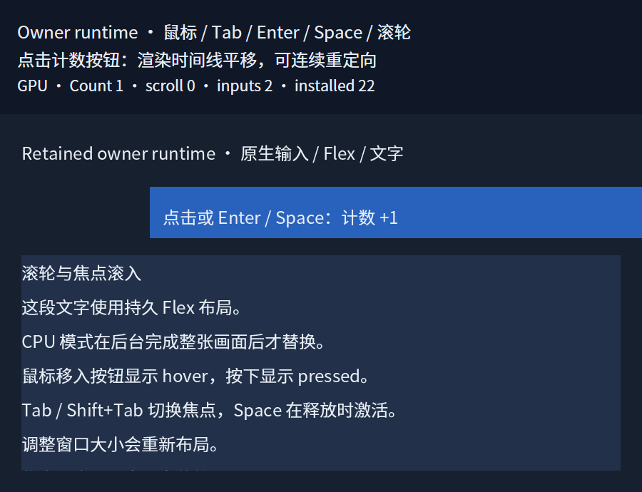
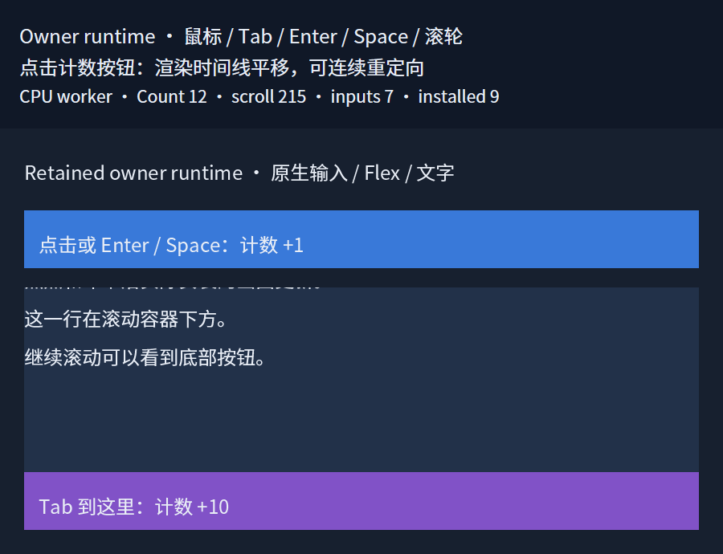

# Render-owned timeline correctness, 2026-11-19

Base: 612f11b2c3e97f9b5448c4123e00d74b895761e0.
Worktree: `D:\oss\ggpui-worktrees\rendering-performance-research`.
Branch: `codex/rendering-performance-research`.
[Public API](../../RETAINED_ANIMATION_RUNTIME.md) ·
[Decision](../../ADR_RETAINED_ANIMATION_RUNTIME.md).
Full RFC remains active; “99%” is figurative, not a numerical gate.

Core controls cover full-transaction CPU/geometry equality, unchanged-output
identity, old resources, current-value redirect, spring velocity, cancel/finish/
release, held values across source changes, exact generation removal, bounded
terminal reservations and atomic failed batches, stale scene/sequence/time,
finite curves/delayed/absolute sampling, exact-source input projection/ordered
adoption/current dispatch validation, and an independently parked UI owner.
The worker test uses explicit monotonic timestamps and a synchronization barrier;
it is not a sustained timer or visible window qualification.

Real Noto text/Flex/opacity images at 1.25scale compare all geometry,
full CPU pixels and full GPU images with fresh full Flex at five sample times.
The GPU variant additionally includes box shadow. CPU Exact does not support
box shadows and explicitly returns UnsupportedShadows; the CPU variant has no
shadow input and does not silently omit an effect.
A source width change during animation preserves trajectory and recomputes wraps
and following-sibling layout. Old output/resources and final-sample GPU reset
recovery are checked. A separate GPU translation-only test checks spatial instance
reuse, skipped-sample full recovery and ordinary material source rebase.

```powershell
cargo +1.98.1 test -p gpui-box --features retained --locked --offline
cargo +1.98.1 test -p gpui-box --features retained-text,retained-wgpu --locked --offline
cargo +1.98.1 test -p gpui-box-example-hello --features retained-wgpu --locked --offline
cargo +1.98.1 test -p gpui-box --features retained-text,retained-wgpu --locked --offline hardware_render_timeline -- --ignored --nocapture
cargo +1.98.1 test -p gpui-box-example-hello --features retained-wgpu --locked --offline hardware_render_animation_real_noto -- --ignored --nocapture
```

Final Windows MSVC / Rust-Cargo1.98.1 / locked-offline results:

| Check | Result |
| --- | --- |
| retained-only | 812 passed, 1 ignored; 17 compiler doctests |
| text + WGPU | 847 passed, 70 ignored; 17 compiler doctests |
| hello | 106 passed, 43 ignored |
| Explicit translation GPU | 1 passed; spatial reuse, skipped-base/material recovery, four full image controls |
| Explicit real Noto GPU | 1 passed; five complete images plus final-sample reset recovery at1.25scale |
| Native animated GPU / CPU | Both passed; six stages / 2,862,000 pixels each at1.5scale |
| Library Clippy `-D warnings` | Passed |
| CPU desktop without WGPU / retained-gpu harness | Passed |
| Scoped rustfmt / diff / inherited WIP | Passed; five baseline hashes unchanged |
| Focused Markdown/image links | 316 reachable documents, 1,233 local paths; none missing |

Logs are under
`target/animation-validation/`: `core-wgpu-final.log`, `hello-complete.log`,
`core-retained-final.log`, `hardware-spatial.log`, `hardware-noto.log`,
`clippy-complete.log`, `cpu-host.log`, `perf-harness.log`. Ignored tests do not
establish actual GPU execution. Both explicit GPU tests use GTX1650Ti/Vulkan/571.96.
No new release timing, FPS, memory benefit, numerical success rate or sustained
60/120Hz claim is made. Complete geometry validation remains O(scene); page
directories, controller sampling, candidate copies and normal effect/raster costs
remain. The owner example's final native presentation still waits for GPUI callbacks.
The changed Rust files are recorded in [source hashes](source-hashes.json).

The host CPU control compares the actually installed complete image, then routes
a point outside the previous button box but inside its visible translated area
through LogicalUi::handle_input. Count changes once and the held translation,
installed input identity and unchanged authored layout remain correct. An initial
test point lay outside the root viewport because Flex stretched the button; the
corrected point is clamped to visible extent. This was a test-fixture correction.

Native `--retained-owner-check --animate` passed on GPU and CPU, each six stages
and 477,000 checked pixels per stage at1.5scale. Counts0→1→2→12, Tab/Space focus
reveal214.66666, wheel154.66666 and outside release/capture cleanup pass. GPU uses
the actual DX12 GTX1650Ti adapter and native shared surface; CPU installs worker
rasterized complete images through the normal image path. All terminal sample
translations and matching installed input IDs are checked. Both runs use the
same binary hash in [manifest](native/manifest.json). [GPU result](native/gpu-result.txt)
and [CPU result](native/cpu-result.txt) preserve the evidence boundary. Initial GPU
diagnostic failed StaleScrollRoute at Tab: whole scene equality incorrectly
included presentation identity. Corrected authored-version checks retain all
path/eligibility validation; both final native runs passed.




