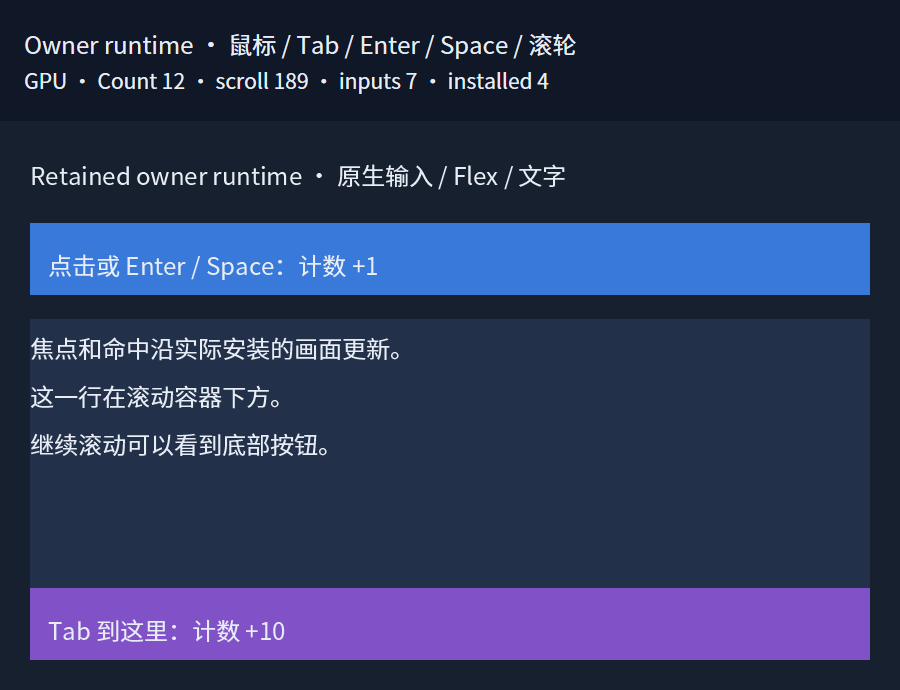
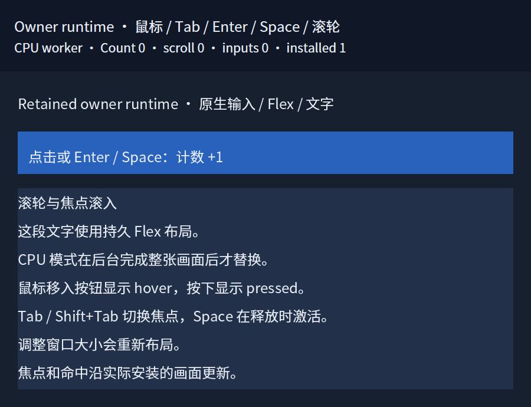

# Native owner host verification, 2026-11-19

Worktree: `D:\oss\ggpui-worktrees\rendering-performance-research`.
Branch: `codex/rendering-performance-research`.
Base: `f9a5ee6b640b47b08217eb1a2803963c8ff9cb41`.
See [host contract and reproduction](../../RETAINED_GPUI_OWNER_HOST.md).
Complete RFC remains active. No new performance gain/cadence claim.

## Native checks

Windows MSVC, Rust/Cargo 1.98.1, locked/offline **debug correctness**.
GPU: GTX1650Ti, DX12, driver32.0.15.7196. Actual window scale1.5.
Window600×460 logical pixels; retained canvas900×569 physical pixels.
Both backends compare all512,100 canvas pixels at each of six stages against
complete SoftwareJob reference output, channel tolerance1. The caption is excluded.

| Stage | Count | Scroll Y | Input leading to next stage |
| --- | --- | --- | --- |
| Initial | 0 | 0 | Primary down/up on first button |
| Click | 1 | 0 | Enter down/up |
| Keyboard activate | 2 | 0 | Tab; Space down/up |
| Focus reveal | 12 | 188.66666 | Wheel up60 logical pixels |
| Wheel | 12 | 128.66666 | Down; move outside; release outside |
| Outside release | 12 | 128.66666 | Capture verified released |

[GPU result](native-gpu.txt) uses immutable native texture import at every stage.
[CPU result](native-cpu.txt) uses background complete software images and the GPUI
image atlas. Each mode compares3,072,600 canvas pixels over six images. Counts
are image correctness coverage, not statistical interaction success rates.
Two representative native framebuffer captures were inspected:

The diagnostic dispatches GPUI events internally in a real Windows window and
explicitly calls draw/present/readback. This is not injected OS input or proof of
automatic displayed cadence. No display-completion or input-to-photon measurement.
Windows Computer Use could not initialize its Node kernel ("failed to write kernel
assets: path not found", including after reset), so no physical OS mouse/keyboard
automation claim. GPU/CPU native framebuffer correctness was verified separately.
An initial CPU attempt timed out after12×25ms; bounded diagnostic waiting was
increased to200×25ms to permit debug software work. Production code has no polling
timer. Wait bounds are not latency acceptance or benchmark results.

## Regression controls

The actual GPUI test uses real Noto/Cosmic shaping, native event types and complete
background images in a TestWindow. It covers click/Enter/Space, Tab reveal,
wheel, release outside, resize before CPU completion, final installed/router
identity, width420 responsive Flex and window deactivation cancelling a held key.
The keyboard helper sends only down, so tests explicitly send up; Space activates
on release. Initial maximized TestWindow did not require scrolling; the fixture
now uses600×460 to exercise a real overflow range.

The adapter test covers viewport origin, outside captured release, line delta sign
and scale, Shift+Tab, Ctrl+Enter exclusion and invalid viewport rejection.

Final full text/WGPU:748 passed,66 ignored;11 compiler doctests passed.
Final full hello:82 passed,32 ignored. Core and example library Clippy with
`-D warnings` pass. CPU desktop without retained-wgpu and the retained-gpu harness
check pass. No ignored hardware case is counted as executed.
Final retained-only:713 passed,1 ignored;11 compiler doctests passed. Scoped
rustfmt/diff,1080 local Markdown links and five inherited WIP hashes pass.
Final hello tests include the bounded pending resize burst; native controls ran
before final error-reporting and equivalent lint simplifications, which do not
change their exercised success paths. No device-loss acceptance inferred.

CPU rendering still has full-frame work, atlas upload and an uncancellable active
job. Input graph/callback/layout owner work remains. Device-replacement notification
rebind is compiled but not fault-injected by this check. Independent native
presentation, semantics/IME and the other open RFC work remain incomplete.
