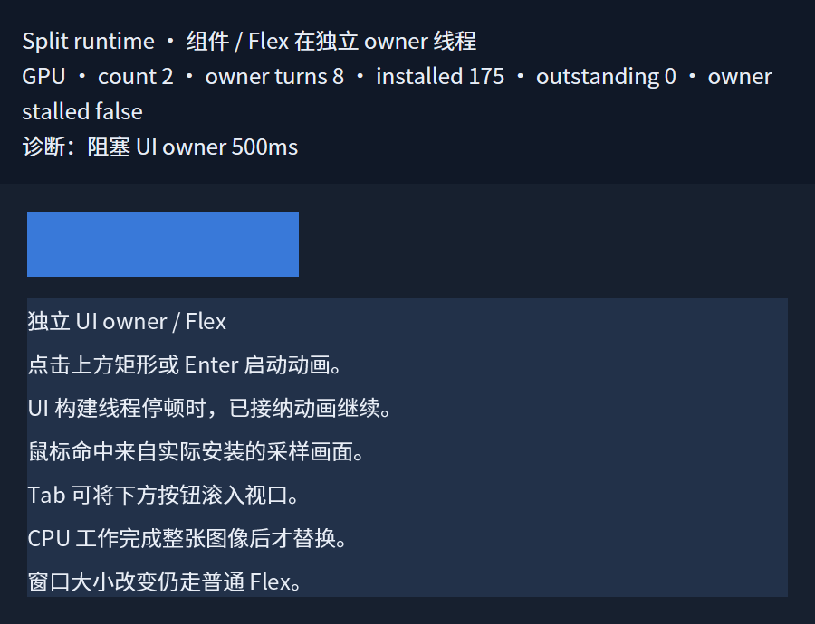
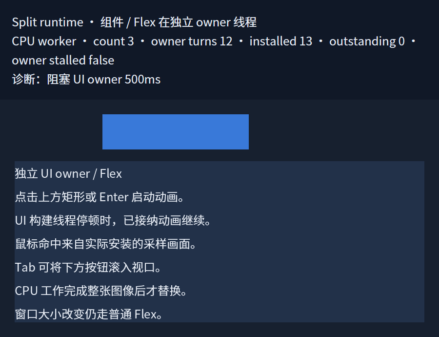

# Split UI owner / native presentation, 2026-11-19

Base: e842f0aeb160cf593a7e48af037117a9453396c1.
Worktree: `D:\oss\ggpui-worktrees\rendering-performance-research`.
Branch: `codex/rendering-performance-research`.
[Host contract](../../RETAINED_SPLIT_PRESENTATION.md) ·
[Decision](../../ADR_RETAINED_SPLIT_PRESENTATION.md).
Full RFC stays active; “99%” is figurative, not a numeric gate.

Owner controls use the real dedicated thread, existing Command queue and ordinary
LogicalUi input transaction. A100ms owner pause precedes queued down/up, producing
one activation in order. Wrong-scale text rejects and leaves source extent/resource
scale unchanged; a valid260x220 resize keeps node/count identity and the old frame
usable. Atomic timeline activate controls retain old source/IDs/sequence
on failed animation before adopting complete source+valid control together.

Native diagnostic creates the real GPUI window, prepares real Noto, dispatches
pointer/key events inside the app and observes normal scheduled callbacks while
the component/Flex owner sleeps. No window.draw/present_if_needed is invoked
inside those pause intervals. Distinct installed sample revisions/placements,
unchanged owner turn and native queued Present sequences are required for GPU;
CPU requires them in a separate2s interval, retaining the short observations. This is
not OS input injection or compositor/display completion. Full-frame readback
outside pauses compares all retained pixels with the ordinary software reference.

```powershell
cargo +1.98.1 build -p gpui-box-example-desktop --features native-check --locked --offline
target/debug/gpui-box-example-desktop.exe --retained-split-check target/split-gpu
target/debug/gpui-box-example-desktop.exe --retained-split-check target/split-cpu --cpu
```

Final Windows MSVC / Rust-Cargo1.98.1 / locked-offline debug results follow.
Logs are under `target/split-validation/`.
Initial hidden-process qualification had no normal frame progress; ordinary direct
window launch produced GPU progress. CPU then exposed a missing next-frame request
after installation; it now requests a platform animation frame rather than relying
on notify during painting. The final runs use ordinary direct visible windows.

| Mode / owner pause | Installed distinct samples / placements | New queued Present attempts |
| --- | --- | --- |
| GPU100ms | 6 / 6 | 5 |
| GPU500ms | 30 / 30 | 30 |
| CPU100ms | 0 / 0 | 0 |
| CPU500ms | 0 / 0 | 0 |
| CPU2000ms | 3 / 3 | 6 |

Owner turn remains fixed at3/7 in the short intervals and10 in the CPU2s
interval. GPU uses DX12 GTX1650Ti, driver32.0.15.7196 and the actual shared native
surface. CPU uses software retained raster and ordinary GPUI image upload; native
presentation still uses GPUI's renderer. The2s interval is an eventual-forward-
progress control, not a weakened claim of fluid short-interval animation.

Outside stalls, both GPU phases and all three CPU phases compare437,400 native
pixels each to the complete SoftwareJob reference, allowing at most1 per channel.
Matching installed input IDs, final Tab/Space activation (GPU count3/CPU count4)
and capture release pass. No explicit draw is used inside observed stalls.
Present receipts filter started_at against the sent stall request and record OS
submission acceptance only; duplicates can present the same image, so image
revision/placement progress is counted separately.

CPU construction plus full raster in the final debug run is488,771–538,699us per
900x486 image, approximately2.06million bounded work units and1.06million raster
samples. Image conversion/upload and final native presentation are outside that
timer. This explains the zero short-interval samples; moving the owner does not
improve the raster kernel. These debug measurements locate the limitation and
are not release throughput or a comparative performance result. CPU fluidity is
still open. No automatic resolution/quality reduction or special-case draw path
was added.

| Check | Result |
| --- | --- |
| Full text + WGPU | 848 passed, 70 ignored;17 compiler doctests |
| Full hello | 107 passed,43 ignored |
| Retained-only atomic activation control | 1 passed |
| Final dedicated owner / resize / resource-scale control | 1 passed |
| Native GPU | Passed2phases /874,800 checked pixels |
| Native CPU | Passed3phases /1,312,200 checked pixels; short interval progress not accepted |
| Library + hello native-check Clippy `-D warnings` | Passed |
| CPU desktop without WGPU | Passed, no local warnings |
| Scoped format / diff / inherited WIP | Passed;five baseline hashes unchanged |
| Focused Markdown/image links | 319 reachable documents /1,253 local paths; none missing |

The existing GPUI proc-macro link stdout warnings remain upstream. Full suites
cover the new atomic kernel and owner transport; the final focused owner run
also covers the added valid-resize control. Final diagnostic-only counters and
lint-equivalent changes are validated by native-check build, strict Clippy and
both final visible runs. Ignored tests do not count as hardware execution.

[GPU result](native/gpu-result.txt) · [CPU result](native/cpu-result.txt) ·
[CPU raster observations](native/cpu-raster.txt) · [binary/environment](native/manifest.json) ·
[changed source hashes](source-hashes.json).
Present receipts are retained in the same native directory.





No release timing or sustained60/120Hz claim, no numerical success-rate gate.
Platform font preparation, animation O(scene) validation, GPU submit/effects,
response leases and source/candidate/layout still have costs. This is an explicit
split host example, not complete five-platform runtime/presentation acceptance.
